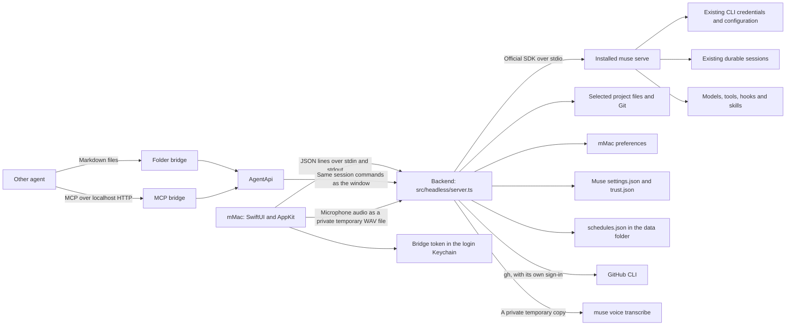

# Architecture

mMac is a native SwiftUI app over upstream's Node core. The core runs unchanged in one plain Node process, the backend, which mMac starts from the checkout it was built in. Electron's shell left the fork in M4a; `docs/decisions.md` names the last commit that has it.

## Stack choice

mMac is SwiftUI and AppKit on macOS 15 or newer, so it behaves like a Mac app and weighs far less than the Electron build (see "Size"). It does not rewrite the backend. The core in `src/main/` and `src/shared/` runs on the Node already installed on the Mac, and the official Node SDK does the protocol work. `src/headless/server.ts` is the backend's front door: one JSON object per line on stdin and stdout, as Requests, Replies, Events and Asks. The main spec, `docs/superpowers/specs/2026-10-21-mac-app-design.md`, has their shapes. This link needs no port and no token. The only local HTTP server is the MCP bridge, which is off by default and listens on `127.0.0.1`. Nothing is bundled: mMac needs the checkout, Node and `muse`.

## CLI lifecycle

`cli.ts` discovers an executable from the login-shell environment (on macOS and Linux) and standard installation locations across macOS, Linux, and Windows (including `.exe` and `.cmd` wrappers), verifies `--version`, and honors a custom path. Environment output is never logged. `muse-host.ts` owns one SDK stdio connection, initializes it with a compliant client identifier, checks the protocol fingerprint, and folds item revisions through the SDK's `ItemStore`.

The conversation list is paged automatically, and valid project directories are discovered from real session metadata without granting project trust. Saved conversations are read with `excludeItems: false`. When inline history is omitted, durable view pages are folded through `ItemStore`. A read does not claim the session; the first mutating operation resumes it. The CLI enforces session leases. CLI versions that reject unloaded live subscriptions show saved history until resumption; they do not acquire a lease just to display history. Completed item revisions replace accumulated streaming deltas. A view gap triggers unsubscribe, snapshot recovery, pending-request refresh, and subscription from the recovered cursor. Updates are coalesced over 32 ms to avoid rendering every token independently.

Commands use SDK-generated command IDs with one attempt. The app does not blindly retry a mutating command after a lost acknowledgement. Reconnect reads durable history instead. A closed host produces a visible connection error. Closing mMac's window keeps mMac and its backend running; quitting closes the owned CLI host. Active work prompts before quit or reconnect.

## Muse features exposed

mMac exposes Muse Code features instead of building its own where the CLI has one.

- `muse-host.ts` initializes with `experimentalApi: true`. Muse then grants the experimental surface, and `ConnectionStatus.experimental` reports the grant. Worktree features need it.
- Worktrees: `'session/start'` with `worktree: { mode: 'create' }` makes Muse create `<project>/.muse/worktrees/<name>` on a `muse/session-<id>` branch and exclude the folder in `.git/info/exclude`. `'worktree/list'` feeds the inspector. `worktrees.ts` adds only merge and remove, limited to paths under `<project>/.muse/worktrees/`. Muse requires the repository in its `~/.config/muse/trust.json`, so `MuseHost.create` records it there through `muse-config.ts` before every worktree session, from the window or a bridge. `src/shared/worktree.ts` maps a worktree path to its project, so trust, recent projects and sidebar grouping treat a worktree as part of its project.
- MCP servers: Muse 1.4.11 has no MSP method that writes MCP entries, and `'mcpServer/list'` returns no rows from `muse serve`. `mcp-config.ts` edits the `mcpServers` entries in Muse's `~/.config/muse/settings.json` one at a time and keeps every other key. OAuth sign-in runs `muse mcp login <name>` in Terminal. Changes apply when mMac reconnects to Muse.
- Diff review: Muse has no revert method, so `git.ts` reverts hunks and files with Git.
- Usage and limits: `muse-host.ts` reads `'usage/read'` at connect and folds `'usage/changed'` into one connection-wide `limits` value. It also keeps `cumulative.cost` from `'session/tokenUsage'` and `error.quota` from `'turn/completed'`. A CLI without `'usage/read'` keeps `limits` null, and the sidebar footer stays hidden.

## Scheduled tasks and the PR monitor

M5b added two backend modules. Neither touches `src/main/`.

`src/headless/schedule.ts` holds the `Scheduler`. It keeps the tasks and their history in `<data folder>/schedules.json`, written to a temporary file with mode 600 and renamed over the store. A timer checks every minute while mMac runs. A due task creates a conversation with its model and worktree flag, sets its permission mode and sends its prompt. One scheduled run goes at a time; a task due during a run records a skip. The history keeps 50 runs per task. A scheduled run needs a folder that mMac already trusts, because nobody is there to answer a trust Ask; an untrusted folder records a failed run. The quit path stops the timer and waits for the check in progress (`stopScheduler` in `src/headless/backend.ts`). `src/headless/schedule-rules.ts` holds the pure timing: preset to cron, the cron check, `dueTime` and `nextRun`. They compute on the Mac's wall clock, with `cron-parser` for the cron fields, so a daylight-saving change neither skips nor doubles a run. Catch-up after a sleep or a restart is the same rule as a normal tick: the latest due time after the last check, no older than seven days.

`src/headless/pull-request.ts` reads and merges pull requests through the GitHub CLI, `gh`. mMac never calls GitHub itself: `gh` holds the person's sign-in. `gh` runs with the backend's `PATH` plus `/opt/homebrew/bin` and `/usr/local/bin`. A merged PR is Live when its base is the repository's default branch, or when GitHub has a successful deployment of its merge commit; only the five newest merged PRs get the deployment lookup. Accept (`pr-merge`) and Merge when ready (`pr-merge-when-ready`) ask in the backend before they merge.

## Bridges

`event-bus.ts` copies every `AppEvent` to main-process listeners. `agent-api.ts` turns a prompt into a job: one turn in one session, followed through those events. A job is done only after its turn was seen running. Its transcript holds only the items its turn produced. A session has one active job at a time. Jobs use `'session/start'`, `'turn/start'`, `'approval/decide'`, `'userInput/answer'` and `'turn/cancel'` through `MuseHost`, so a bridge job is a normal conversation in the window.

`bridge-files.ts` watches `<bridge folder>/inbox/` and `<bridge folder>/decisions/` in the bridge folder with chokidar and writes `<bridge folder>/outbox/`. `bridge-mcp.ts` serves the same operations as MCP tools over streamable HTTP. Both accept only projects that mMac knows and trusts. `src/headless/bridges.ts` starts both bridges after `start`, follows preference and token changes, and stops them on quit. mMac keeps the token in the login Keychain and sends it in `start`, and the backend holds it in memory only. `bridge-token.ts`, the Electron app's encrypted token file, stays in the core, and mMac does not use it. See [bridges](bridge.md).

## State ownership

- CLI: authentication, tools, approval policies, model configuration, MCP server entries, workspace trust for worktrees, worktrees, durable conversations, and output blobs.
- The backend (`src/headless/` over the core): trusted projects, recent projects, appearance, pins, archives, bridge switches and port, bridge jobs in memory, the bridge token in memory, temporary attachment handles, session views, file and Git previews and edits, and the scheduled tasks with their history.
- GitHub CLI: the GitHub sign-in, and every pull request read and merge.
- mMac: windows, menus, native panels, alerts and notifications, the Settings window, the bridge token in the login Keychain, the microphone, and unsent drafts and attachment chips in memory.

No transcript mirror, credential database, or telemetry service is introduced. Pending approval cards carry the current requirement token, including staged requirements. Server labels and choices remain authoritative.

## Verification

Unit coverage checks file containment, symlink rejection, binary and size limits, Git filename parsing, preference persistence, approval freshness, streaming revisions, gap recovery, question answers, follow-up modes, cancellation dispatch, paged transcript recovery, and bounded voice encoding. It also covers hunk and file revert, worktree merge and remove, Muse trust and MCP settings edits, the job lifecycle, both bridges, and every backend method (`tests/unit/headless-*.test.ts`). The integration script exercises the real CLI with its echo provider across a process restart, Muse-created worktree sessions, the MCP entries `muse mcp` resolves, and bridge jobs. The headless script drives `src/headless/server.ts` as mMac does. `swift test` covers the Swift client (`MuseBackend`) and every rule and store in `MuseKit`. The UI tests in `mac/mMacUITests/` drive the app against the echo CLI and a fake backend.

These checks do not replace testing authenticated model tool execution.

M5a (2026-10-23): the backend speaks protocol 2 and has 47 methods (`set-approval-mode`, `side-chat` and `shell` joined in M5a); each has a Swift call. The unit tests pin them. M5a's UI test drives `!echo hi` through the composer's `!` escape, a real file:// preview, a pasteboard round trip, and a subagent session opened in a sheet, then restores the pasteboard. The inspector is six tabs: Changes, Files, Activity, Tasks, Agents and Preview. The Preview tab holds scripts and bot checks, local pages, and input forms in its `WKWebView`; the side chat and child sheets are read-only.

M5b (2026-10-24): the backend speaks protocol 3 and has 57 methods. `usage`, the five `schedule-*` methods and the four `pr-*` methods joined in M5b; each has a Swift call. Three events joined: `usage-changed`, `schedule-run-started` and `schedules-changed`. `tests/unit/headless-schedule-rules.test.ts` and `tests/unit/headless-schedule.test.ts` cover the scheduled tasks with a fake clock, daylight-saving changes in several zones included. `tests/unit/headless-pull-request.test.ts` covers the PR monitor with a fake `gh` (`tests/unit/fake-gh.ts`): no test runs the real `gh` or reaches GitHub. M5b's UI test, `testM5bAgainstTheFakeBackend`, builds; its runs wait for the end of the build.

## Size

Measured on 2026-10-23 on macOS 27.2 (26B5112a), Mac17,2 (arm64), with `mac/scripts/measure-size.sh` at `7095d4d`. Disk is `du -sk`. Memory is the physical footprint (`footprint`, the number Activity Monitor shows as Memory), summed over the app's processes. The RSS (`ps`) is also given, but it counts shared pages in every process that maps them, so it reads higher. The process totals do not include `muse serve`, which has its own row. 1 MiB is 1,048,576 bytes.

| What                 | mMac                                                                                                                    | Muse Desktop 0.2.0 (Electron)                   |
| -------------------- | ----------------------------------------------------------------------------------------------------------------------- | ----------------------------------------------- |
| The app bundle       | 16.8 MiB                                                                                                                | 344.0 MiB                                       |
| Outside the bundle   | Node 24.12.0: 226.6 MiB. The backend's part of `src/`: 0.2 MiB. The 110 packages it loads from `node_modules`: 41.6 MiB | Nothing                                         |
| Memory: the app      | 117.5 MiB footprint, 255.0 MiB RSS, 3 processes (mMac, its Node backend and esbuild)                                    | 346.7 MiB footprint, 535.0 MiB RSS, 4 processes |
| Memory: `muse serve` | 37.1 MiB footprint, 109.6 MiB RSS                                                                                       | 40.0 MiB footprint, 118.5 MiB RSS               |

The memory numbers are not like-for-like. mMac's comes from its measurement build (the Release build compiled with `MMAC_MEASURE`, which keeps the bridge token in memory), after 60 seconds idle on an empty first screen with a temporary home. Muse Desktop's was read from the copy Dom opened himself, after 69 seconds, with his real projects and conversations. The script launched nothing for it and only read its processes.

mMac's Node is the system copy that its backend runs on, and mMac does not ship it. The packages are the dependency closure of `@modelcontextprotocol/sdk`, `@muse-code/sdk`, `chokidar`, `zod` and `tsx`. The full report, with every process, is in the message of the commit that added this section.

## Module map

The Test column names the unit test that covers a file. A dash means no unit test does. `scripts/verify-muse.ts` (`npm run test:integration`) drives the real CLI, and `scripts/verify-headless.ts` (`npm run test:headless`) drives `src/headless/server.ts` the same way. In the `src/headless/` rows, an Ask is a native alert the backend asks mMac to show. mMac's Swift code is in `mac/`: `mac/Packages/MuseBackend/` (the client), `mac/Packages/MuseKit/` (logic, under `swift test`) and `mac/mMac/` (views). The spec has its units.

| File                          | Owns                                                                                                                                                                              | Test                                                                             |
| ----------------------------- | --------------------------------------------------------------------------------------------------------------------------------------------------------------------------------- | -------------------------------------------------------------------------------- |
| `src/main/cli.ts`             | Finding the `muse` executable, the login-shell environment, `--version`                                                                                                           | —                                                                                |
| `src/main/muse-host.ts`       | The one SDK stdio connection to `muse serve`, sessions, views, approvals, worktree sessions                                                                                       | `tests/unit/muse-host.test.ts`                                                   |
| `src/main/muse-config.ts`     | Muse's config folder, atomic JSON writes, the `~/.config/muse/trust.json` record                                                                                                  | `tests/unit/worktrees.test.ts`                                                   |
| `src/main/mcp-config.ts`      | The `mcpServers` entries in Muse's `~/.config/muse/settings.json`                                                                                                                 | `tests/unit/mcp-config.test.ts`                                                  |
| `src/main/worktrees.ts`       | Merge and remove for worktrees under `<project>/.muse/worktrees/`                                                                                                                 | `tests/unit/worktrees.test.ts`                                                   |
| `src/main/git.ts`             | Git status, diffs, hunk and file revert, staging                                                                                                                                  | `tests/unit/git-revert.test.ts`, `tests/unit/files.test.ts`                      |
| `src/main/files.ts`           | Project file listing and reads, contained to the project                                                                                                                          | `tests/unit/files.test.ts`                                                       |
| `src/main/preferences.ts`     | Reading and writing the preferences file                                                                                                                                          | `tests/unit/files.test.ts`                                                       |
| `src/main/voice.ts`           | Running `muse voice transcribe` on a temporary private file                                                                                                                       | `tests/unit/voice.test.ts`                                                       |
| `src/main/event-bus.ts`       | Copying `AppEvent`s to main-process listeners                                                                                                                                     | `tests/unit/agent-api.test.ts`                                                   |
| `src/main/agent-api.ts`       | Bridge jobs: one turn in one session, its status and transcript                                                                                                                   | `tests/unit/agent-api.test.ts`                                                   |
| `src/main/bridge-files.ts`    | The folder bridge: `<bridge folder>/inbox/`, `<bridge folder>/decisions/`, `<bridge folder>/outbox/`                                                                              | `tests/unit/bridge-files.test.ts`                                                |
| `src/main/bridge-mcp.ts`      | The MCP bridge on `127.0.0.1`                                                                                                                                                     | `tests/unit/bridge-mcp.test.ts`                                                  |
| `src/main/bridge-token.ts`    | The Electron app's encrypted bridge token file. mMac does not use it                                                                                                              | `tests/unit/bridge-token.test.ts`                                                |
| `src/headless/wire.ts`        | mMac's line protocol: Requests, Replies, Events and Asks                                                                                                                          | `tests/unit/headless-wire.test.ts`                                               |
| `src/headless/backend.ts`     | mMac's backend methods and the state they share                                                                                                                                   | `tests/unit/headless-backend.test.ts`, `tests/unit/headless-parity.test.ts`      |
| `src/headless/server.ts`      | The backend process: stdout, the line protocol and the quit path                                                                                                                  | —                                                                                |
| `src/headless/bridges.ts`     | mMac's two bridges: start, stop and status as the preferences say, and the token in memory                                                                                        | `tests/unit/headless-bridges.test.ts`, `tests/unit/headless-backend.test.ts`     |
| `src/headless/terminal.ts`    | Opening Terminal on one command line: `muse mcp login`, the project folder and the full CLI                                                                                       | `tests/unit/headless-terminal.test.ts`                                           |
| `src/headless/attachments.ts` | The files chosen for the next message: up to five, checked with Electron's limits and strings, and turned into Muse's parts and the display text. Copied from Electron's handlers | `tests/unit/headless-attachments.test.ts`, `tests/unit/headless-backend.test.ts` |
| `src/headless/export.ts`      | The Markdown export: the title chain and Electron's format                                                                                                                        | `tests/unit/headless-export.test.ts`, `tests/unit/headless-backend.test.ts`      |
| `src/headless/revert-hunk.ts` | Reverting the exact hunk mMac showed, or refusing when the file changed                                                                                                           | `tests/unit/headless-revert-hunk.test.ts`, `tests/unit/headless-backend.test.ts` |
| `src/headless/login-env.ts`   | The path of `src/headless/login-env.sh`, checked to exist and to be executable                                                                                                    | `tests/unit/headless-login-env.test.ts`                                          |
| `src/headless/login-env.sh`   | Answers `discoverCli`'s login-shell read from the environment mMac passed                                                                                                         | `tests/unit/headless-login-env.test.ts`                                          |

M5a added these files. The Test column names the unit test, or says that M4b adds the UI test for a view.

| File                           | Owns                                                                                                    | Test                                |
| ------------------------------ | ------------------------------------------------------------------------------------------------------- | ----------------------------------- |
| `mac/mMac/SideChatSheet.swift` | The side chat sheet (⌘;), its question field, and the read-only child session sheet                     | — (M4b adds its UI test)            |
| `mac/mMac/FilePathMenu.swift`  | The right-click menu on a project path: attach, Open in an editor, Show in Finder, Copy                 | — (M4b adds its UI test)            |
| `mac/mMac/PreviewView.swift`   | The Preview tab: an address field, Back and Reload, the page title, Open in Safari, and one `WKWebView` | — (M4b adds its UI test)            |
| `mac/Fixtures/preview.html`    | The page the M5a UI test loads in the Preview tab                                                       | `mac/mMacUITests/MMacUITests.swift` |
| `src/shared/protocol.ts`       | Event, session and preference schemas                                                                   | `tests/unit/files.test.ts`          |
| `src/shared/voice.ts`          | WAV encoding limits and the encoder                                                                     | `tests/unit/voice.test.ts`          |
| `src/shared/worktree.ts`       | Mapping a worktree path to its project                                                                  | `tests/unit/worktrees.test.ts`      |

### M5b's files

M5b added these files. The UI test for the views is `testM5bAgainstTheFakeBackend`, which builds but has not run yet.

| File                                                               | Owns                                                                                                                                                                                               | Test                                                                              |
| ------------------------------------------------------------------ | -------------------------------------------------------------------------------------------------------------------------------------------------------------------------------------------------- | --------------------------------------------------------------------------------- |
| `src/headless/schedule.ts`                                         | The `Scheduler`: `<data folder>/schedules.json`, the minute timer, one run at a time, skips, failures, the history and the quit path                                                               | `tests/unit/headless-schedule.test.ts`, `tests/unit/headless-backend.test.ts`     |
| `src/headless/schedule-rules.ts`                                   | The schedule's shape, preset to cron, the cron check (the minute is one number), `dueTime` and `nextRun` on the wall clock                                                                         | `tests/unit/headless-schedule-rules.test.ts`                                      |
| `src/headless/pull-request.ts`                                     | `gh` calls: the conversation's PR, the project's PRs, Live, merge and merge when ready. The `gh` error messages                                                                                    | `tests/unit/headless-pull-request.test.ts`, `tests/unit/headless-backend.test.ts` |
| `tests/unit/fake-gh.ts`                                            | The fake `gh` the tests put alone on `PATH`                                                                                                                                                        | —                                                                                 |
| `mac/Packages/MuseKit/Sources/MuseKit/UsageRules.swift`            | The usage footer's text and levels, its popover, the reset text, the context card's tokens and cost line, and the stop banner                                                                      | `mac/Packages/MuseKit/Tests/MuseKitTests/UsageRulesTests.swift`                   |
| `mac/Packages/MuseKit/Sources/MuseKit/ScheduleRules.swift`         | The Scheduled pane's words and checks, the next-run text and the finished notice. It formats `nextRunAt` and never computes a run time                                                             | `mac/Packages/MuseKit/Tests/MuseKitTests/ScheduleRulesTests.swift`                |
| `mac/Packages/MuseKit/Sources/MuseKit/ChangeCardRules.swift`       | `PullRequestRules` (the checks summary, the poll pace, the Auto-fix prompt) and `ChangeCardRules` (the headline, the track, the risk light, dependencies, pictures, the owner, the Ask why prompt) | `mac/Packages/MuseKit/Tests/MuseKitTests/ChangeCardRulesTests.swift`              |
| `mac/Packages/MuseKit/Sources/MuseKit/Workspace+Usage.swift`       | Reading the limits, without letting a late reply replace newer ones                                                                                                                                | `mac/Packages/MuseKit/Tests/MuseKitTests/WorkspaceUsageTests.swift`               |
| `mac/Packages/MuseKit/Sources/MuseKit/Workspace+Schedules.swift`   | The task list and its reload guard, save, remove, Run now, the Active switch, and the scheduled run's finished notice                                                                              | `mac/Packages/MuseKit/Tests/MuseKitTests/WorkspaceSchedulesTests.swift`           |
| `mac/Packages/MuseKit/Sources/MuseKit/Workspace+PullRequest.swift` | The open conversation's PR and its poll, the project's change cards, Accept, Merge when ready, Auto-fix and Ask why                                                                                | `mac/Packages/MuseKit/Tests/MuseKitTests/WorkspacePullRequestTests.swift`         |
| `mac/mMac/UsageViews.swift`                                        | The sidebar's limits line and its popover                                                                                                                                                          | `testM5bAgainstTheFakeBackend`                                                    |
| `mac/mMac/SchedulesPane.swift`                                     | Settings → Scheduled: the list, the form, Run now, the Active switch, the history and Delete                                                                                                       | `testM5bAgainstTheFakeBackend`                                                    |
| `mac/mMac/ChangeCardViews.swift`                                   | The change card, its delivery track, and the Proposed changes sheet                                                                                                                                | `testM5bAgainstTheFakeBackend`                                                    |

M5b also changed these app files: `mac/mMac/SidebarView.swift` (the Scheduled group, Proposed changes and the usage footer), `mac/mMac/ChangesView.swift` (the conversation's change card), `mac/mMac/SettingsView.swift` (the fifth pane), `mac/mMac/TranscriptViews.swift` (the stop banner), `mac/mMac/Notifications.swift` (the scheduled-task notice) and `mac/mMac/HelpSheet.swift` (the master-copy text).

### mMac's Settings files

M3 added these Swift files. The rest of `mac/` is in the spec's units.

| File                                                          | Owns                                                                                                                                 | Test                                                                  |
| ------------------------------------------------------------- | ------------------------------------------------------------------------------------------------------------------------------------ | --------------------------------------------------------------------- |
| `mac/Packages/MuseKit/Sources/MuseKit/SettingsRules.swift`    | The Add server form, env and header pairs, the bridge port, the two themes and their palettes, text sizes, and the completion notice | `mac/Packages/MuseKit/Tests/MuseKitTests/SettingsRulesTests.swift`    |
| `mac/Packages/MuseKit/Sources/MuseKit/SettingsModel.swift`    | The Settings store: MCP servers, bridge status, the token, and the errors Settings shows                                             | `mac/Packages/MuseKit/Tests/MuseKitTests/SettingsModelTests.swift`    |
| `mac/Packages/MuseKit/Sources/MuseKit/BridgeTokenStore.swift` | The bridge token in the login Keychain, or in memory in Debug test runs                                                              | `mac/Packages/MuseKit/Tests/MuseKitTests/BridgeTokenStoreTests.swift` |
| `mac/mMac/SettingsView.swift`                                 | The Settings window and its five panes                                                                                               | `testSettingsAgainstTheFakeBackend`                                   |
| `mac/mMac/AppearancePane.swift`                               | Settings → Appearance: theme, text size, Reduce motion, completion notifications                                                     | `testSettingsAgainstTheFakeBackend`                                   |
| `mac/mMac/MuseCodePane.swift`                                 | Settings → Muse Code: the connection, a custom path, Reconnect                                                                       | `testSettingsAgainstTheFakeBackend`                                   |
| `mac/mMac/McpPane.swift`                                      | Settings → MCP servers and the Add server form                                                                                       | `testSettingsAgainstTheFakeBackend`                                   |
| `mac/mMac/BridgesPane.swift`                                  | Settings → Bridges: both switches, the port, the token, the status poll                                                              | `testSettingsAgainstTheFakeBackend`                                   |
| `mac/mMac/PlainTextEditor.swift`                              | Text fields that keep text exactly as typed                                                                                          | `testSettingsAgainstTheFakeBackend`                                   |
| `mac/mMac/Theme.swift`                                        | The theme's colors, the window background, text size and Reduce motion at the root, the filled button style                          | —                                                                     |
| `mac/mMac/Notifications.swift`                                | Completion notifications: permission, posting, and the click that opens a conversation                                               | —                                                                     |
| `mac/mMac/WindowStateGuard.swift`                             | No frame autosave in UI-test runs                                                                                                    | `mac/scripts/ui-tests.sh` (the defaults check)                        |
| `mac/mMac/AskQueue.swift`                                     | Asks shown one at a time, in order. Renamed from AskSheet.swift                                                                      | `testAnAskShowsOverTheRenameSheet`                                    |
| `mac/mMac/Assets.xcassets/MuseMark.imageset/`                 | Electron's MuseMark artwork for the Muse avatar                                                                                      | —                                                                     |

### mMac's M4a files

M4a added these files. The Test column names the unit test, or says that M4b adds the UI test for a view.

| File                                                                 | Owns                                                                                                                                                                              | Test                                                                                                                                                  |
| -------------------------------------------------------------------- | --------------------------------------------------------------------------------------------------------------------------------------------------------------------------------- | ----------------------------------------------------------------------------------------------------------------------------------------------------- |
| `src/headless/attachments.ts`                                        | The files chosen for the next message: up to five, checked with Electron's limits and strings, and turned into Muse's parts and the display text. Copied from Electron's handlers | `tests/unit/headless-attachments.test.ts`, `tests/unit/headless-backend.test.ts`                                                                      |
| `src/headless/export.ts`                                             | The Markdown export: the title chain and Electron's format                                                                                                                        | `tests/unit/headless-export.test.ts`, `tests/unit/headless-backend.test.ts`                                                                           |
| `mac/Packages/MuseKit/Sources/MuseKit/CommandMenu.swift`             | The ⌘K entries, groups, filter and caps, and the arrow keys' clamp                                                                                                                | `mac/Packages/MuseKit/Tests/MuseKitTests/CommandMenuTests.swift`                                                                                      |
| `mac/Packages/MuseKit/Sources/MuseKit/ComposerRules.swift`           | The ten slash commands with their menu, parse and key rules, the `@` rule, and the drop plan                                                                                      | `mac/Packages/MuseKit/Tests/MuseKitTests/ComposerRulesTests.swift`                                                                                    |
| `mac/Packages/MuseKit/Sources/MuseKit/Voice.swift`                   | `VoiceWAV`, the mono 16 kHz 16-bit PCM WAV encoder, and `VoiceSession`: the states, the timer, the stop at 119 seconds and the append rule                                        | `mac/Packages/MuseKit/Tests/MuseKitTests/VoiceTests.swift`                                                                                            |
| `mac/Packages/MuseKit/Sources/MuseKit/VoiceMeter.swift`              | The voice pill's five bar heights, from the microphone's samples                                                                                                                  | `mac/Packages/MuseKit/Tests/MuseKitTests/VoiceMeterTests.swift`                                                                                       |
| `mac/Packages/MuseKit/Sources/MuseKit/Workspace+Attachments.swift`   | The chips: attach, remove, paste and drop, with the limits Electron checks before the backend. The private temporary files for pasted images and voice clips                      | `mac/Packages/MuseKit/Tests/MuseKitTests/WorkspaceAttachmentsTests.swift`                                                                             |
| `mac/Packages/MuseKit/Sources/MuseKit/Workspace+Commands.swift`      | What each composer command does, the `CommandEffect` it returns to the app, and the `@` menu's folder listing                                                                     | `mac/Packages/MuseKit/Tests/MuseKitTests/WorkspaceCommandsTests.swift`                                                                                |
| `mac/Packages/MuseKit/Sources/MuseKit/Workspace+Conversations.swift` | Pin and archive toggles, one at a time, from the latest preferences. The export call and the save panel's default name. A row's actions open their conversation first             | `mac/Packages/MuseKit/Tests/MuseKitTests/WorkspaceConversationsTests.swift`, `mac/Packages/MuseKit/Tests/MuseKitTests/WorkspaceRowActionsTests.swift` |
| `mac/mMac/ToastView.swift`                                           | The success toast over the main window, for 4 seconds                                                                                                                             | — (M4b adds its UI test)                                                                                                                              |
| `mac/mMac/ExportPanel.swift`                                         | The save panel sheet for Export as Markdown                                                                                                                                       | — (M4b adds its UI test)                                                                                                                              |
| `mac/mMac/CommandMenuView.swift`                                     | The ⌘K sheet and its search field                                                                                                                                                 | — (M4b adds its UI test)                                                                                                                              |
| `mac/mMac/WindowSheets.swift`                                        | The Rename, ⌘K and Help sheets, which the menus, the toolbar and the composer open                                                                                                | — (M4b adds its UI test)                                                                                                                              |
| `mac/mMac/ComposerMenus.swift`                                       | The slash and `@` popups above the composer, and the pickers that `/model` and `/effort` open                                                                                     | — (M4b adds its UI test)                                                                                                                              |
| `mac/mMac/HelpSheet.swift`                                           | The `/help` sheet                                                                                                                                                                 | — (M4b adds its UI test)                                                                                                                              |
| `mac/mMac/AttachmentChips.swift`                                     | The paperclip and the chips                                                                                                                                                       | — (M4b adds its UI test)                                                                                                                              |
| `mac/mMac/VoiceRecorder.swift`                                       | `AVAudioEngine` capture, the level meter's samples and the microphone permission                                                                                                  | — (M4b adds its UI test)                                                                                                                              |
| `mac/mMac/VoiceControls.swift`                                       | The mic button, the status pill and its five bars, and the cancel on Escape or a hidden window                                                                                    | — (M4b adds its UI test)                                                                                                                              |

The UI tests are in `mac/mMacUITests/MMacUITests.swift`.
