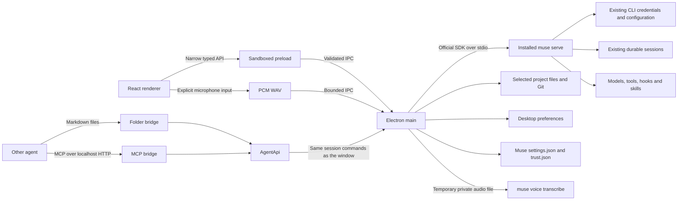

# Architecture

## Stack choice

Electron runs the official Node SDK directly, supports macOS, Windows, and Linux desktop integration with a unified Mac-style frameless window chrome, and gives contributors a TypeScript stack across the protocol boundary and UI. React is responsible only for presentation and interaction. Vite handles the three build targets: main, sandboxed preload, and renderer. This trades a larger application bundle for a direct, maintainable SDK integration. There is no application backend service. The only local HTTP server is the MCP bridge, which is off by default and listens on `127.0.0.1`.

## CLI lifecycle

`cli.ts` discovers an executable from the login-shell environment (on macOS and Linux) and standard installation locations across macOS, Linux, and Windows (including `.exe` and `.cmd` wrappers), verifies `--version`, and honors a custom path. Environment output is never logged. `muse-host.ts` owns one SDK stdio connection, initializes it with a compliant client identifier, checks the protocol fingerprint, and folds item revisions through the SDK's `ItemStore`.

The conversation list is paged automatically, and valid project directories are discovered from real session metadata without granting project trust. Saved conversations are read with `excludeItems: false`. When inline history is omitted, durable view pages are folded through `ItemStore`. A read does not claim the session; the first mutating operation resumes it. The CLI enforces session leases. CLI versions that reject unloaded live subscriptions show saved history until resumption; they do not acquire a lease just to display history. Completed item revisions replace accumulated streaming deltas. A view gap triggers unsubscribe, snapshot recovery, pending-request refresh, and subscription from the recovered cursor. Updates are coalesced over 32 ms to avoid rendering every token independently.

Commands use SDK-generated command IDs with one attempt. The app does not blindly retry a mutating command after a lost acknowledgement. Reconnect reads durable history instead. A closed host produces a visible connection error. Closing the Mac window hides it; quitting closes the owned CLI host. Active work prompts before quit or reconnect.

## Muse features exposed

Desktop exposes Muse Code features instead of building its own where the CLI has one.

- `muse-host.ts` initializes with `experimentalApi: true`. Muse then grants the experimental surface, and `ConnectionStatus.experimental` reports the grant. Worktree features need it.
- Worktrees: `'session/start'` with `worktree: { mode: 'create' }` makes Muse create `<project>/.muse/worktrees/<name>` on a `muse/session-<id>` branch and exclude the folder in `.git/info/exclude`. `'worktree/list'` feeds the inspector. `worktrees.ts` adds only merge and remove, limited to paths under `<project>/.muse/worktrees/`. Muse requires the repository in its `~/.config/muse/trust.json`, so `MuseHost.create` records it there through `muse-config.ts` before every worktree session, from the window or a bridge. `src/shared/worktree.ts` maps a worktree path to its project, so trust, recent projects and sidebar grouping treat a worktree as part of its project.
- MCP servers: Muse 1.4.11 has no MSP method that writes MCP entries, and `'mcpServer/list'` returns no rows from `muse serve`. `mcp-config.ts` edits the `mcpServers` entries in Muse's `~/.config/muse/settings.json` one at a time and keeps every other key. OAuth sign-in runs `muse mcp login <name>` in Terminal. Changes apply when Desktop reconnects to Muse.
- Diff review: Muse has no revert method, so `git.ts` reverts hunks and files with Git.

## Bridges

`event-bus.ts` copies every `AppEvent` to main-process listeners. `agent-api.ts` turns a prompt into a job: one turn in one session, followed through those events. A job is done only after its turn was seen running. Its transcript holds only the items its turn produced. A session has one active job at a time. Jobs use `'session/start'`, `'turn/start'`, `'approval/decide'`, `'userInput/answer'` and `'turn/cancel'` through `MuseHost`, so a bridge job is a normal conversation in the window.

`bridge-files.ts` watches `<bridge folder>/inbox/` and `<bridge folder>/decisions/` in the bridge folder with chokidar and writes `<bridge folder>/outbox/`. `bridge-mcp.ts` serves the same operations as MCP tools over streamable HTTP. Both accept only projects that Desktop knows and trusts. `bridge-token.ts` keeps the MCP bearer token outside the preferences, encrypted with `safeStorage` when available. `index.ts` starts the bridges after Muse connects, follows preference and token changes, and stops them on quit. See [bridges](bridge.md).

## State ownership

- CLI: authentication, tools, approval policies, model configuration, MCP server entries, workspace trust for worktrees, worktrees, durable conversations, and output blobs.
- Electron main: trusted projects, recent projects, appearance, pins, archives, bridge switches and port, the bridge token, bridge jobs in memory, temporary attachment handles, session views, native dialogs, and file/Git previews and edits.
- React: selected page and conversation, dialogs, scroll-follow state, and unsent drafts in memory.

No transcript mirror, credential database, or telemetry service is introduced. Pending approval cards carry the current requirement token, including staged requirements. Server labels and choices remain authoritative.

## Verification

Unit coverage checks file containment, symlink rejection, binary and size limits, Git filename parsing, preference persistence, approval freshness, streaming revisions, gap recovery, question answers, follow-up modes, cancellation dispatch, paged transcript recovery, and bounded voice encoding. It also covers hunk and file revert, worktree merge and remove, Muse trust and MCP settings edits, the job lifecycle, both bridges, and the bridge token. The integration script exercises the real CLI with its echo provider across a process restart. It also checks Muse-created worktree sessions, that `muse mcp` resolves the MCP entries Desktop writes, and bridge jobs. Playwright drives the real Electron application and real echo CLI, including themes, native bridge rejection cases, project browsing, search, sending, renaming, fresh-install history discovery, themed menu keyboard behavior, and simulated microphone capture/cancellation/draft insertion. `tests/e2e/extensions.spec.ts` covers diff review, a worktree conversation and its merge, the MCP servers tab, the folder bridge, and the MCP bridge with a real MCP client.

These checks do not replace testing authenticated model tool execution or Developer ID signing on a release candidate.

## Updates

A small Objective-C++ Node-API bridge loads Sparkle 2 from the packaged app's Frameworks directory on the Cocoa main thread. The renderer receives only update status, manual checking, and the automatic-check preference through validated IPC. Development builds do not load the updater. Sparkle owns update preferences in NSUserDefaults; appearance preferences remain independent.

The packaging hook downloads a pinned, SHA-256-verified upstream archive, compiles the bridge for the selected architecture, embeds the framework before Developer ID signing, and sets the public Ed25519 key and architecture-specific feed URL in Info.plist. Feeds and downloaded archives must both be signed. Update installation is user initiated, and the updater refuses a relaunch during an active CLI turn. Normal quit handling shuts down the CLI and cancels transcription. Save drafts and finish voice input before choosing to install.

Daily checks are opt-in, automatic installation and system profiling are disabled. GitHub hosts the feeds and release downloads. Apple notarization remains a separate release requirement. See [releasing](releasing.md).

## Module map

The Test column names the unit test that covers a file. A dash means no unit test does. `tests/e2e/desktop.spec.ts`, `tests/e2e/extensions.spec.ts` and `tests/e2e/setup.spec.ts` drive the whole app on top of these, and `scripts/verify-muse.ts` (`npm run test:integration`) drives the real CLI. `scripts/verify-headless.ts` (`npm run test:headless`) drives `src/headless/server.ts` the same way.

| File                                             | Owns                                                                                                 | Test                                                        |
| ------------------------------------------------ | ---------------------------------------------------------------------------------------------------- | ----------------------------------------------------------- |
| `src/main/index.ts`                              | App lifecycle, windows, menus, every IPC handler, bridge start and stop, quit handling               | —                                                           |
| `src/main/cli.ts`                                | Finding the `muse` executable, the login-shell environment, `--version`                              | —                                                           |
| `src/main/muse-host.ts`                          | The one SDK stdio connection to `muse serve`, sessions, views, approvals, worktree sessions          | `tests/unit/muse-host.test.ts`                              |
| `src/main/muse-config.ts`                        | Muse's config folder, atomic JSON writes, the `~/.config/muse/trust.json` record                     | `tests/unit/worktrees.test.ts`                              |
| `src/main/mcp-config.ts`                         | The `mcpServers` entries in Muse's `~/.config/muse/settings.json`                                    | `tests/unit/mcp-config.test.ts`                             |
| `src/main/worktrees.ts`                          | Merge and remove for worktrees under `<project>/.muse/worktrees/`                                    | `tests/unit/worktrees.test.ts`                              |
| `src/main/git.ts`                                | Git status, diffs, hunk and file revert, staging                                                     | `tests/unit/git-revert.test.ts`, `tests/unit/files.test.ts` |
| `src/main/files.ts`                              | Project file listing and reads, contained to the project                                             | `tests/unit/files.test.ts`                                  |
| `src/main/preferences.ts`                        | Reading and writing Desktop's preferences file                                                       | `tests/unit/files.test.ts`                                  |
| `src/main/voice.ts`                              | Running `muse voice transcribe` on a temporary private file                                          | `tests/unit/voice.test.ts`                                  |
| `src/main/updates.ts`                            | Sparkle updates in packaged macOS builds                                                             | —                                                           |
| `src/main/event-bus.ts`                          | Copying `AppEvent`s to main-process listeners                                                        | `tests/unit/agent-api.test.ts`                              |
| `src/main/agent-api.ts`                          | Bridge jobs: one turn in one session, its status and transcript                                      | `tests/unit/agent-api.test.ts`                              |
| `src/main/bridge-files.ts`                       | The folder bridge: `<bridge folder>/inbox/`, `<bridge folder>/decisions/`, `<bridge folder>/outbox/` | `tests/unit/bridge-files.test.ts`                           |
| `src/main/bridge-mcp.ts`                         | The MCP bridge on `127.0.0.1`                                                                        | `tests/unit/bridge-mcp.test.ts`                             |
| `src/main/bridge-token.ts`                       | The MCP bridge's bearer token                                                                        | `tests/unit/bridge-token.test.ts`                           |
| `src/headless/wire.ts`                           | mMac's line protocol: Requests, Replies, Events and Asks                                             | `tests/unit/headless-wire.test.ts`                          |
| `src/headless/server.ts`                         | mMac's backend: the core over stdin and stdout, and its quit path                                    | `tests/unit/headless-parity.test.ts`                        |
| `src/preload/index.ts`                           | The renderer's narrow typed API                                                                      | —                                                           |
| `src/shared/protocol.ts`                         | IPC and preference schemas                                                                           | `tests/unit/files.test.ts`                                  |
| `src/shared/voice.ts`                            | WAV encoding limits and the encoder                                                                  | `tests/unit/voice.test.ts`                                  |
| `src/shared/worktree.ts`                         | Mapping a worktree path to its project                                                               | `tests/unit/worktrees.test.ts`                              |
| `src/renderer/src/App.tsx`                       | Renderer state, pages and the reconnect flow                                                         | —                                                           |
| `src/renderer/src/activity.ts`                   | Which transcript items count as background activity                                                  | `tests/unit/activity.test.ts`                               |
| `src/renderer/src/commands.ts`                   | Composer slash commands                                                                              | —                                                           |
| `src/renderer/src/components/Inspector.tsx`      | The project inspector, diff review and the worktree panel                                            | `tests/unit/git-revert.test.ts` (`parseDiffLines`)          |
| `src/renderer/src/components/McpSettings.tsx`    | Settings → MCP servers                                                                               | `tests/unit/mcp-config.test.ts` (`parsePairs`)              |
| `src/renderer/src/components/BridgeSettings.tsx` | Settings → Bridges                                                                                   | —                                                           |
| `src/renderer/src/components/Primitives.tsx`     | Shared buttons, dialogs and text helpers                                                             | `tests/unit/activity.test.ts`, `tests/unit/files.test.ts`   |
| `src/renderer/src/components/` (the rest)        | Composer, transcript, settings, menus, voice input, workspace pages                                  | —                                                           |
