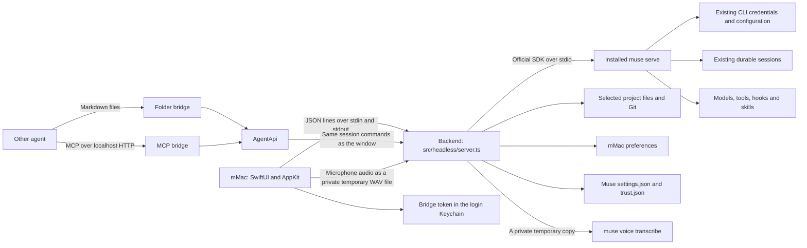

# mMac M4a (the last features) Implementation Plan

> **For agentic workers:** REQUIRED SUB-SKILL: Use superpowers-extended-cc:subagent-driven-development (recommended) or superpowers-extended-cc:executing-plans to implement this plan task-by-task. Steps use checkbox (`- [ ]`) syntax for tracking.

**Goal:** mMac gets the last seven parity features (⌘K search, pins and archives, Markdown export, composer slash commands, `@file` mentions with attachments, drag-and-drop and paste, voice input, and Open in Finder, Terminal or Muse Code). M4a then measures mMac's size against the Electron app, checks parity, and removes Electron's shell.

**Architecture:** The Node backend gains nine methods (`compact`, `export`, `terminal`, `cli-terminal`, `attachments`, `remove-attachment`, `voice`, `cancel-voice`, and attachments in `send`). They call the fork's `src/main/` modules unchanged, plus two new backend files: `src/headless/attachments.ts` (copied from Electron's `index.ts`) and `src/headless/export.ts`. `MuseBackend` gets the typed Swift calls. `MuseKit` gets every rule as pure, tested Swift: the ⌘K entries, slash-command parsing, the `@` rule, pins and archives in the sidebar, the attachment chips, the WAV encoder and the voice states. The app adds thin SwiftUI and AppKit views on top. When every parity item has passing tests, Electron's shell goes.

**Tech Stack:** TypeScript, zod, Vitest, `tsx`; Swift 6, SwiftUI (macOS 15), AppKit (`NSSavePanel`, `NSOpenPanel`, `NSWorkspace`, `NSPasteboard`, `NSTextView`), AVFoundation (`AVAudioEngine`, `AVCaptureDevice`), Swift Testing, XcodeGen.

**Inputs:**

- The M4a spec, `docs/superpowers/specs/2026-10-22-mmac-m4a-design.md`. It is the source for every decision below.
- The Electron survey, `docs/superpowers/plans/2026-10-22-mmac-m4a-survey.md`. When a task quotes a user-facing string, a limit or a key rule, it comes from there, unless the spec changes it.
- The main spec, `docs/superpowers/specs/2026-10-21-mac-app-design.md`: the architecture, the messages, the parity checklist.
- `docs/decisions.md`, for the decisions M1 to M3 made.

**Dom's decisions for M4a (2026-10-22):**

- M4a holds the seven features, the parity check and the size measurement. M4b holds the proof work: the UI tests (written and run three times) and the live isolated run of M2, M3 and M4a.
- Electron's shell is removed at the end of M4a, shell only, if every parity item has passing automated tests. Appearance and Completion notifications count on their unit tests.
- Electron's bugs are fixed, and its choices are improved where the spec lists an improvement ("Fix bugs and improve choices").
- Unit and backend tests stay in M4a. Every task writes its tests first.

---

## Before you start

- Work in the worktree `.cache/worktrees/mac-m4a`, on the branch `mac-m4a`, cut from `origin/extensions` at `2d837b1` (which holds M3). Run every command from the worktree. Never switch branches, stash or reset in the main checkout: other sessions share it.
- Every run that starts `muse` or an app points `HOME`, `MUSE_HOME`, `XDG_CONFIG_HOME`, `XDG_DATA_HOME`, `XDG_STATE_HOME` and `ZDOTDIR` at a temporary folder, and sets `MUSE_DESKTOP_TEST_PROVIDER=echo` and `MUSE_NO_AUTO_UPDATE=1`. `scripts/verify-headless.ts` shows how. Never run anything against the real `~/.config/muse/`, and never list or read it.
- Never read or write the Keychain item `com.domalhambra.mmac.bridge-token`. Never run `security find-generic-password -w`.
- `export MUSE_BIN="$(command -v muse)"` before the integration and headless checks.
- Swift build output goes to `.cache/` in the worktree: `--scratch-path .cache/swift` (MuseBackend) and `.cache/swift-kit` (MuseKit) for `swift test`, and `-derivedDataPath .cache/mmac` for `xcodebuild`.
- Never edit files under `src/main/`, `src/renderer/` or `src/preload/`. Only Task 17 changes them, and only by deleting `src/renderer/`, `src/preload/`, `src/main/index.ts` and `src/main/updates.ts`.
- No app launches and no UI-test runs in M4a, except the size measurement in Task 15. `xcodebuild build-for-testing` is the app's check. UI-test screen capture stays off.
- Commits use the repo's `area: summary` style (`headless:`, `mac:`, `docs:`, `tests:`, `build:`). Commit only the files you changed, with `git add <paths>`, never `git add -A`. End every message with a blank line and `Co-Authored-By: Claude Opus 5.5 <noreply@anthropic.com>`.
- Run `npx prettier --write` on every TypeScript, JSON and Markdown file you change. When you touch TypeScript, also run `npm run typecheck`, because Vitest does not typecheck.
- Swift 6 language mode reports data races as errors. Fix them. Never add `@unchecked Sendable` or `nonisolated(unsafe)` beyond what this plan shows.
- Where this plan differs from Electron on purpose, the task says so, and Task 19 records it in `docs/decisions.md` under "2026-10-22: mMac M4a".

## The interface contract

Every task uses these names and shapes. A task that needs a change here changes this table first, in the same commit.

### Backend methods (`src/headless/backend.ts`)

| Method              | Arguments                                        | Reply                | Notes                                                                                                                                                                                      |
| ------------------- | ------------------------------------------------ | -------------------- | ------------------------------------------------------------------------------------------------------------------------------------------------------------------------------------------ |
| `compact`           | `sessionId`                                      | `{ status: string }` | `sessionProject` first, then `muse.compact`, as Electron                                                                                                                                   |
| `export`            | `sessionId`, `path`, `fallbackTitle?`            | the path written     | `muse.getView`; the format in `src/headless/export.ts`; mode 0600. The title is `name`, then `title`, then `fallbackTitle`, then `Muse conversation`                                       |
| `terminal`          | `project`                                        | nothing              | `knownProject`, then Terminal on `folderCommand(project)`: `cd '<project>'`                                                                                                                |
| `cli-terminal`      | `project`                                        | nothing              | `knownProject`, then Terminal on `terminalCommand(project, muse.status.path \|\| 'muse', [])`                                                                                              |
| `attachments`       | `paths: string[]`                                | `Attachment[]`       | At most 5 paths. Electron's per-file checks and strings. `{ id, name, kind: 'image' \| 'text', size }`                                                                                     |
| `remove-attachment` | `id`                                             | nothing              | Forgets the id                                                                                                                                                                             |
| `send`              | `{ sessionId, text, attachments, effort, mode }` | nothing              | `attachments` up to 5 ids. Electron's parts, display text, limits and strings. The ids are forgotten after a successful send only                                                          |
| `voice`             | `path`                                           | the transcribed text | Reads a `.wav` file of at most `MAX_VOICE_BYTES`, deletes it, then `VoiceTranscriber.transcribe(data, cliPath)`. A failure whose text starts with `Command failed` gets the general string |
| `cancel-voice`      | none                                             | nothing              | `VoiceTranscriber.cancel()`. The quit path calls it too                                                                                                                                    |

`Muse` (the `Pick<MuseHost, …>` in `backend.ts`) gains `'compact'` and `'getView'`. `BackendDeps` gains `voice?: { transcribe(data: Buffer, cliPath: string): Promise<string>; cancel(): Promise<void> }`; the default is a `new VoiceTranscriber()`. `createBackend` returns `stopVoice: () => Promise<void>` beside `stopBridges`, and `src/headless/server.ts` calls it in `quit`.

### Swift client calls (`mac/Packages/MuseBackend/Sources/MuseBackend/Methods.swift`)

| Call                                                                                                     | Method              |
| -------------------------------------------------------------------------------------------------------- | ------------------- |
| `compact(_ sessionId: String) async throws -> CompactResult`                                             | `compact`           |
| `export(sessionId: String, to url: URL, fallbackTitle: String?) async throws -> String`                  | `export`            |
| `openTerminal(project: String) async throws`                                                             | `terminal`          |
| `openCLITerminal(project: String) async throws`                                                          | `cli-terminal`      |
| `attachments(_ urls: [URL]) async throws -> [Attachment]`                                                | `attachments`       |
| `removeAttachment(_ id: String) async throws`                                                            | `remove-attachment` |
| `send(sessionId:text:effort:mode:attachments:)`, with `attachments: [String] = []` as the last parameter | `send`              |
| `voice(_ url: URL) async throws -> String`                                                               | `voice`             |
| `cancelVoice() async throws`                                                                             | `cancel-voice`      |

New models in `Models.swift`: `CompactResult { status: String }`, and `Attachment { id, name, kind, size }` (`Identifiable`, `Equatable`, `Sendable`, `Codable`; `kind` is `"image"` or `"text"`, `size` an `Int`). `Preferences` and `PreferencesPatch` gain `pinnedSessionIds: [String]` and `archivedSessionIds: [String]` (defaults `[]` in `Preferences`, `nil` in the patch).

### MuseKit names

| Name                                                                                                                                                 | File                                  | Owns                                                                                                                                     |
| ---------------------------------------------------------------------------------------------------------------------------------------------------- | ------------------------------------- | ---------------------------------------------------------------------------------------------------------------------------------------- |
| `SidebarSections.build(_:project:pinned:archived:showArchived:now:calendar:)`                                                                        | `SidebarSections.swift`               | Pinned first, the Pinned group, the archived view                                                                                        |
| `Workspace.showArchived`, `togglePin(_:)`, `toggleArchive(_:)`, `isPinned(_:)`, `isArchived(_:)`                                                     | `Workspace+Conversations.swift` (new) | Pin and archive toggles, one at a time, from the latest preferences                                                                      |
| `Workspace.exportConversation(to:) async -> Bool`, `ExportName.defaultFileName(for:)`                                                                | `Workspace+Conversations.swift`       | The export call and the save panel's default name                                                                                        |
| `Workspace.notice: String?`, `Workspace.showNotice(_:)`                                                                                              | `Workspace.swift`                     | The success toast's text. The app clears it after 4 seconds. Errors keep `errorMessage` and mMac's alert                                 |
| `CommandMenu.entries(sessions:archived:query:) -> [CommandMenuEntry]`, `CommandMenuEntry`, `CommandMenuAction`                                       | `CommandMenu.swift` (new)             | ⌘K entries, groups, filter and caps                                                                                                      |
| `Workspace.attachments: [Attachment]`, `attach(_ urls: [URL]) async`, `removeAttachment(_:) async`, `attachPasted(_ data: Data, type: String) async` | `Workspace+Attachments.swift` (new)   | The chips, the limits Electron checks before the backend, the pasted-image temp files                                                    |
| `DropPlan.classify(_ urls: [URL], project: String) -> DropPlan`                                                                                      | `ComposerRules.swift` (new)           | Files to attach, folder mentions to insert, and the folder error                                                                         |
| `ComposerCommand`, `ComposerCommand.menu(for:)`, `parse(_:)`, `SlashKey`, `slashKeyAction(_:draft:index:)`                                           | `ComposerRules.swift`                 | The ten commands, the menu rule, the parse rule, the Tab, Enter and Escape rules                                                         |
| `MentionRule.match(_ draft: String) -> Mention?`, `MentionRule.insert(_:into:)`                                                                      | `ComposerRules.swift`                 | The `@` rule, the folder and filter split, the 12-row cap, the insertion                                                                 |
| `Workspace.run(_ command: ParsedCommand) async -> CommandEffect?`, `CommandEffect`                                                                   | `Workspace+Commands.swift` (new)      | What each command does. Backend calls happen here; UI effects (rename sheet, Settings, Help, voice, pickers) return as a `CommandEffect` |
| `VoiceWAV.encode(samples:sampleRate:) throws -> Data`                                                                                                | `Voice.swift` (new)                   | Mono 16 kHz 16-bit PCM WAV, as `src/shared/voice.ts`                                                                                     |
| `VoiceSession` (`@MainActor @Observable`)                                                                                                            | `Voice.swift`                         | The states, the timer, the stop at 119 seconds, the append rule                                                                          |

### App names (`mac/mMac/`)

| File                          | Owns                                                                          |
| ----------------------------- | ----------------------------------------------------------------------------- |
| `ToastView.swift` (new)       | The success toast over the main window                                        |
| `SidebarView.swift`           | The pin button, the Archive toggle, the ARCHIVED header, the row context menu |
| `ConversationView.swift`      | The toolbar's Conversation actions menu, the rename sheet raised by `/rename` |
| `ExportPanel.swift` (new)     | The `NSSavePanel` sheet, through a new `SheetAlert.run(_ panel: NSSavePanel)` |
| `CommandMenuView.swift` (new) | The ⌘K sheet, and View › Command Menu in `MMacApp.swift`                      |
| `ComposerMenus.swift` (new)   | The slash and mention popups above the composer                               |
| `ComposerTextView.swift`      | Up, Down, Tab, Enter and Escape for the popups; paste of images and files     |
| `HelpSheet.swift` (new)       | The `/help` sheet                                                             |
| `AttachmentChips.swift` (new) | The paperclip, the chips and the composer's drop target                       |
| `VoiceRecorder.swift` (new)   | `AVAudioEngine` capture, the level meter, the microphone permission           |
| `VoiceControls.swift` (new)   | The mic button, the status pill, Edit › Voice Input (⌥V)                      |
| `InspectorView.swift`         | The footer's Finder, Terminal and Muse Code buttons                           |

## File structure

| File                                                                         | Responsibility                                                                                    |
| ---------------------------------------------------------------------------- | ------------------------------------------------------------------------------------------------- |
| `src/headless/backend.ts`                                                    | The nine methods; `Muse` gains `compact` and `getView`; `voice` in `BackendDeps`; `stopVoice`     |
| `src/headless/export.ts`                                                     | `exportTitle`, `exportMarkdown`: Electron's format (new)                                          |
| `src/headless/attachments.ts`                                                | `Attachments`: register, remove, build the parts, forget, copied from Electron's `index.ts` (new) |
| `src/headless/terminal.ts`                                                   | `folderCommand(folder)` beside `terminalCommand`                                                  |
| `src/headless/server.ts`                                                     | `stopVoice()` in the quit path                                                                    |
| `tests/unit/headless-*.test.ts`                                              | The new methods, the export format, the attachment limits, the parity lists                       |
| `mac/Packages/MuseBackend/Sources/MuseBackend/Methods.swift`, `Models.swift` | The nine calls; `CompactResult`, `Attachment`; the two preference arrays                          |
| `mac/Packages/MuseKit/Sources/MuseKit/SidebarSections.swift`                 | Pins and archives in the list                                                                     |
| `mac/Packages/MuseKit/Sources/MuseKit/Workspace.swift`                       | `notice`, `showArchived`; `startNew()` resets the archived view                                   |
| `mac/Packages/MuseKit/Sources/MuseKit/Workspace+Conversations.swift`         | Pin, archive, export (new)                                                                        |
| `mac/Packages/MuseKit/Sources/MuseKit/CommandMenu.swift`                     | ⌘K (new)                                                                                          |
| `mac/Packages/MuseKit/Sources/MuseKit/Workspace+Attachments.swift`           | Chips, attach, remove, paste, send with ids (new)                                                 |
| `mac/Packages/MuseKit/Sources/MuseKit/ComposerRules.swift`                   | Slash commands, the `@` rule, the drop plan (new)                                                 |
| `mac/Packages/MuseKit/Sources/MuseKit/Workspace+Commands.swift`              | Running a parsed command (new)                                                                    |
| `mac/Packages/MuseKit/Sources/MuseKit/Voice.swift`                           | `VoiceWAV`, `VoiceSession` (new)                                                                  |
| `mac/mMac/*.swift`                                                           | The views in "App names"                                                                          |
| `mac/project.yml`                                                            | `NSMicrophoneUsageDescription`                                                                    |
| `mac/scripts/measure-size.sh`                                                | Disk and memory, mMac and Electron (new)                                                          |
| `package.json`, `tests/unit/headless-parity.test.ts`, docs                   | Task 17's removal of Electron's shell                                                             |

## Tasks

| Task | What                                                                            | Area    |
| ---- | ------------------------------------------------------------------------------- | ------- |
| 0    | The worktree: dependencies, a clean baseline gate                               | setup   |
| 1    | Backend: `compact`, `export`, `terminal`, `cli-terminal`, and their Swift calls | backend |
| 2    | Backend: attachments and `send` with attachments, and their Swift calls         | backend |
| 3    | Backend: `voice` and `cancel-voice`, and their Swift calls                      | backend |
| 4    | MuseKit: pins, archives, export and the notice                                  | MuseKit |
| 5    | MuseKit: the ⌘K entries                                                         | MuseKit |
| 6    | MuseKit: attachment chips, paste and the drop plan                              | MuseKit |
| 7    | MuseKit: slash commands and the `@` rule                                        | MuseKit |
| 8    | MuseKit: the WAV encoder and the voice states                                   | MuseKit |
| 9    | App: the toast, pins and archives, the Conversation actions menu, export        | app     |
| 10   | App: the ⌘K sheet                                                               | app     |
| 11   | App: the composer popups, the command effects and the Help sheet                | app     |
| 12   | App: the paperclip, the chips, drag-and-drop and paste                          | app     |
| 13   | App: voice input                                                                | app     |
| 14   | App: Finder, Terminal and Muse Code in the inspector                            | app     |
| 15   | The size measurement                                                            | measure |
| 16   | The parity report                                                               | parity  |
| 17   | Remove Electron's shell                                                         | removal |
| 18   | Review the whole branch                                                         | review  |
| 19   | Docs to the repo standard                                                       | docs    |
| 20   | The gate and the PR                                                             | gate    |

Tasks run in order. Tasks 1 to 3 come before the MuseKit tasks that call them, and the MuseKit tasks come before the app tasks that draw them.

---

## Additions to the contract made while drafting

The tasks below add these names. They keep every name in the tables above.

- **Tasks 1 to 3 (backend):** `new Attachments(newId?)` takes an optional id generator, for the test that shows a failed `register` keeps nothing. `voice` checks the WAV header with `validateVoiceAudio` before it calls the transcriber. Every Swift call passes its method name as a string literal, which Task 17's parity test checks. An export sets mode 0600 also on a file it replaces (Electron keeps the old mode).
- **Tasks 4 to 8 (MuseKit):**
  - `Workspace.attachments` and the pasted-file store are stored properties, so they live in `Workspace.swift`; the methods stay in `Workspace+Attachments.swift`.
  - `Workspace.noticeCount` is bumped by every `showNotice(_:)`, so the same text twice restarts the toast's timer.
  - `Workspace.drop(_:)` applies a `DropPlan`. `ExportName.fallbackTitle(for:)` and `title(for:)` hold the title chain. `CommandMenuGroup` and `CommandMenu.moved(_:by:count:)` serve the ⌘K sheet. `ParsedCommand { name, argument }`, `SlashKeyAction` (`.pass`, `.select(Int)`, `.setDraft(String)`, `.submit`), `Mention`, `MentionKeyAction` and `MentionMenu` (the `@` folder loader, in `Workspace+Commands.swift`) serve the composer. `CommandEffect` is `.renameSheet(title:)`, `.settings`, `.help`, `.toggleVoice`, `.cancelVoice`, `.modelPicker`, `.effortPicker`.
  - `PrivateTemp` and `PastedFiles` (internal) make 0700 temp folders and 0600 files; voice reuses `PrivateTemp`.
  - `VoiceCapture` is `@MainActor`: `requestPermission()`, `start(levels:failed:)`, `stop() async throws -> VoiceRecording`, `cancel()`.
- **Tasks 9 to 14 (app):** `SheetAlert.run` takes any `NSSavePanel` (open panels included), and `SheetAlert.runMultiple(_:)` returns several URLs. `WindowSheets.swift` holds the Rename sheet, the ⌘K sheet and the Help sheet, reachable from menus through `AppController.sheets`. `AppController.voice` holds the `VoiceSession`. MuseKit gains `Workspace.ensureOpen(_:)` (a row's menu opens its conversation first), `VoiceMeter` (the five bars, `[Double]` from 0.22 to 1), `openProjectInTerminal()`, `openProjectInMuseCode()` and `revealProject(using:)`. Debug builds read `MMAC_TEST_EXPORT` and `MMAC_TEST_ATTACHMENTS` in place of the save and open panels, for M4b's UI tests.
- **Tasks 15 to 20:** a Release build compiled with `MMAC_MEASURE` keeps the bridge token in memory and its window defaults in their own suite, because a plain Release mMac reads the real Keychain item and writes the real defaults. The launches set `CFFIXED_USER_HOME`, because `HOME` alone does not move `~/Library`. Task 17 also deletes `resources/`, `docs/screenshots/`, the two release docs, the artwork prompt files, `tests/unit/activity.test.ts` and `release.yml`, moves `tsx` to `dependencies`, and keeps `npm run build` as the typecheck, outside the gate.

---

### Task 0: The worktree: dependencies, a clean baseline gate

**Goal:** The worktree has its dependencies, every baseline check passes, and the counts later tasks compare against are written down.

**Files:**

- Modify: `tests/unit/docs.test.ts`, `docs/README.md`
- Commit (if still untracked): `docs/superpowers/plans/2026-10-22-mmac-m4a.md`

**Acceptance Criteria:**

- [ ] `node_modules/` exists in the worktree, installed by `npm ci` from `package-lock.json`.
- [ ] `npm run typecheck`, `npm run build`, `npm run format:check` and `npm test` pass.
- [ ] Both `swift test` runs pass, and `xcodebuild build-for-testing` prints `** TEST BUILD SUCCEEDED **`.
- [ ] `tests/unit/docs.test.ts` passes in this linked worktree. In the main checkout, where `.git` is a folder, it still checks `.git/info/exclude`.
- [ ] `docs/README.md` indexes the M4a plan.
- [ ] The baseline counts are noted in the task log: vitest files and tests, and the test count of each `swift test` run.
- [ ] No other file changes.

**Verify:** `npm test` → `Test Files  19 passed (19)`; `git status --short` → empty.

**Steps:**

- [ ] **Step 1: Install the dependencies**

Run from the worktree root:

```bash
pwd   # ends in .cache/worktrees/mac-m4a
git branch --show-current   # mac-m4a
npm ci
```

Expected: `npm ci` ends with `added N packages`. Electron's postinstall downloads the Electron binary; it needs the network.

- [ ] **Step 2: Run the baseline and see the docs test fail**

```bash
npm run typecheck
npm run build
npm run format:check
npm test
swift test --package-path mac/Packages/MuseBackend --scratch-path .cache/swift
swift test --package-path mac/Packages/MuseKit --scratch-path .cache/swift-kit
cd mac && xcodegen generate && xcodebuild build-for-testing -project mMac.xcodeproj -scheme mMac -destination 'platform=macOS' -derivedDataPath ../.cache/mmac; cd ..
```

Expected:

- `typecheck` and `build` exit 0. `build` writes `out/`, which is gitignored.
- `format:check` prints `All matched files use Prettier code style!`. If it lists only `docs/superpowers/plans/2026-10-22-mmac-m4a.md`, Step 4 formats that file. Any other file is a real failure: stop and report it.
- `npm test`: 19 test files, 18 pass. `tests/unit/docs.test.ts` fails with:

  ```
  unindexed      docs/README.md: superpowers/plans/2026-10-22-mmac-m4a.md
  dead-path      docs/architecture.md: .git/info/exclude
  ```

  The first finding goes once the plan is indexed. The second comes from the worktree: here `.git` is a file (`gitdir: …/.git/worktrees/mac-m4a`), so `.git/info/exclude` does not exist under the worktree root.

- `swift test` for MuseBackend passes. The suite has 54 `@Test` declarations; note the count the run reports.
- `swift test` for MuseKit passes. The suite has 245 `@Test` declarations; note the count the run reports.
- `xcodebuild` prints `** TEST BUILD SUCCEEDED **`.

Note the vitest totals from the `npm test` summary (`Test Files` and `Tests`). Later tasks add to them.

- [ ] **Step 3: Excuse `.git/` paths in a linked worktree only**

`scripts/docs_check.py` reads each `--known-absent` entry that ends in `/` as a folder prefix (`dead_paths`, the `any(k.endswith("/") …)` line), so `--known-absent .git/` excuses `.git/info/exclude`. Passing it only when `.git` is a file keeps the check honest in the main checkout. `docs_check.py` is vendored byte for byte, so the change goes in the test, not the script.

Replace the whole of `tests/unit/docs.test.ts`:

```ts
import { describe, expect, it } from 'vitest'
import { spawnSync } from 'node:child_process'
import { lstatSync } from 'node:fs'
import { join } from 'node:path'
import { fileURLToPath } from 'node:url'

// The documentation standard's check, run with the suite. `docs/README.md`
// must index every document under `docs/`, every path the guide and the docs
// quote must exist, and `CLAUDE.md` must stay under its token budget.
// `scripts/docs_check.py` is vendored byte for byte from Dom's workspace;
// this test only runs it. Two gitignored folders may be absent: `release/`,
// the build output `README.md` names, and `.cache/`, where
// `docs/releasing.md` says the Sparkle tools land. In a linked worktree,
// `.git` is a file that names the main checkout's Git folder, so the `.git/`
// paths the docs quote exist only in the main checkout. That exception
// applies in a linked worktree only.
const root = fileURLToPath(new URL('../..', import.meta.url))

/** True when `.git` is a file: a linked worktree, not the main checkout. */
function linkedWorktree() {
  try {
    return lstatSync(join(root, '.git')).isFile()
  } catch {
    return false
  }
}

const args = [
  'scripts/docs_check.py',
  root,
  '--require',
  'docs/architecture.md',
  '--require',
  'docs/changing-things.md',
  '--require',
  'docs/decisions.md',
  '--known-absent',
  'release/',
  '--known-absent',
  '.cache/',
  ...(linkedWorktree() ? ['--known-absent', '.git/'] : []),
]

describe('documentation', () => {
  it('is indexed, quotes only paths that exist, and keeps the guide under budget', () => {
    const run = spawnSync('python3', args, { cwd: root, encoding: 'utf8' })
    expect(run.error, 'python3 must be on PATH').toBeUndefined()
    expect(run.status, `docs_check exited ${run.status}\n${run.stdout}${run.stderr}`).toBe(0)
  })
})
```

Run: `npx vitest run tests/unit/docs.test.ts`
Expected: FAIL, with only `unindexed      docs/README.md: superpowers/plans/2026-10-22-mmac-m4a.md` left. If the plan was indexed before Task 0 started, it passes now.

- [ ] **Step 4: Index the plan, and commit it if it is still untracked**

In `docs/README.md`, add this row directly after the row for `superpowers/plans/2026-10-22-mmac-m4a-survey.md`:

```markdown
| `superpowers/plans/2026-10-22-mmac-m4a.md` | You build or check M4a. It holds the interface contract, the tasks, and the parity report. |
```

Then:

```bash
npx prettier --write docs/README.md docs/superpowers/plans/2026-10-22-mmac-m4a.md tests/unit/docs.test.ts
npx vitest run tests/unit/docs.test.ts
```

Expected: PASS.

- [ ] **Step 5: Run the whole suite and the format check**

Run: `npm test && npm run format:check && npm run typecheck`
Expected: `Test Files  19 passed (19)`, `All matched files use Prettier code style!`, and a clean typecheck.

- [ ] **Step 6: Commit**

```bash
git add tests/unit/docs.test.ts
git commit -F - <<'EOF'
tests: the docs check excuses .git/ paths in a linked worktree only

In a linked worktree .git is a file, so .git/info/exclude, which
docs/architecture.md quotes, exists only in the main checkout.

Co-Authored-By: Claude Opus 5.5 <noreply@anthropic.com>
EOF
git status --short docs/superpowers/plans/2026-10-22-mmac-m4a.md
```

If that last command prints `??` or ` M`, commit the plan with its row:

```bash
git add docs/README.md docs/superpowers/plans/2026-10-22-mmac-m4a.md
git commit -F - <<'EOF'
docs: the M4a plan, indexed

Co-Authored-By: Claude Opus 5.5 <noreply@anthropic.com>
EOF
```

If it prints nothing (the plan is already committed), commit the row alone:

```bash
git add docs/README.md
git commit -F - <<'EOF'
docs: index the M4a plan

Co-Authored-By: Claude Opus 5.5 <noreply@anthropic.com>
EOF
```

Run: `git status --short`
Expected: empty.

---

### Task 1: Backend: `compact`, `export`, `terminal`, `cli-terminal`, and their Swift calls

**Goal:** The backend compacts a conversation, exports it in Electron's Markdown format, and opens Terminal in a known project, with or without the CLI. `MuseBackend` has the four typed calls.

**Files:**

- Create: `src/headless/export.ts`
- Modify: `src/headless/backend.ts`, `src/headless/terminal.ts`, `mac/Packages/MuseBackend/Sources/MuseBackend/Methods.swift`, `mac/Packages/MuseBackend/Sources/MuseBackend/Models.swift`
- Test: `tests/unit/headless-export.test.ts` (new), `tests/unit/headless-backend.test.ts`, `tests/unit/headless-terminal.test.ts`, `tests/unit/headless-parity.test.ts`, `mac/Packages/MuseBackend/Tests/MuseBackendTests/BackendClientTests.swift`, `mac/Packages/MuseBackend/Tests/MuseBackendTests/ModelsTests.swift`

**Acceptance Criteria:**

- [ ] `compact(sessionId)` runs the trust check (`sessionProject`), then `muse.compact`, and returns `{ status }`. A cancelled trust check stops it before Muse is called.
- [ ] `exportMarkdown` writes Electron's format byte for byte: the survey's worked example gives exactly the 170 bytes in the test.
- [ ] `exportTitle` takes `name`, then `title`, then the sidebar title mMac sends, then `Muse conversation`.
- [ ] `export(sessionId, path, fallbackTitle?)` reads `muse.getView`, refuses a relative path, writes the file with mode 0600 and returns the path. A conversation that is not open fails with `Open this conversation before performing an action.` and writes nothing.
- [ ] `folderCommand(folder)` gives `cd '<folder>'` with single quotes escaped, and `/bin/sh` runs it into that folder.
- [ ] `terminal` and `cli-terminal` refuse an unknown project with `Choose this project using Open project first.`, then open Terminal on `cd '<project>'` and `cd '<project>' && '<cli>'`, where `<cli>` is `muse.status.path`, else `muse`.
- [ ] The parity test has `compact`, `export`, `terminal` and `cli-terminal` out of `notYet`, and counts 40 headless methods.
- [ ] `compact(_:)`, `export(sessionId:to:fallbackTitle:)`, `openTerminal(project:)` and `openCLITerminal(project:)` send the method names and arguments above. `CompactResult` decodes `{ "status": … }`.

**Verify:** `npx vitest run tests/unit/headless-export.test.ts tests/unit/headless-backend.test.ts tests/unit/headless-terminal.test.ts tests/unit/headless-parity.test.ts && npm run typecheck && swift test --package-path mac/Packages/MuseBackend --scratch-path .cache/swift` → all pass.

**Steps:**

- [ ] **Step 1: Write the failing TypeScript tests**

Create `tests/unit/headless-export.test.ts`:

````ts
import { describe, expect, it } from 'vitest'
import type { MuseSession, SessionView, TranscriptItem } from '../../src/shared/protocol'
import { exportMarkdown, exportTitle } from '../../src/headless/export'

// Electron's Markdown export (src/main/index.ts, the `export` handler), pinned byte for byte.
// The worked example is the survey's (docs/superpowers/plans/2026-10-22-mmac-m4a-survey.md,
// Part 1, section 3).

function session(overrides: Partial<MuseSession> = {}): MuseSession {
  return {
    sessionId: 's1',
    workspaceRoot: null,
    createdAt: '2026-10-21T00:00:00Z',
    updatedAt: '2026-10-21T00:00:00Z',
    status: 'idle',
    activeTurnId: null,
    modelId: null,
    turnCount: 0,
    ...overrides,
  }
}

function item(overrides: Partial<TranscriptItem> & Pick<TranscriptItem, 'kind'>): TranscriptItem {
  return { itemId: 'i', revision: 1, status: 'completed', ...overrides }
}

function view(value: MuseSession, items: TranscriptItem[]): SessionView {
  return { session: value, items, approvals: [], questions: [] }
}

describe('exportMarkdown', () => {
  it('writes the survey’s worked example byte for byte', () => {
    const conversation = view(session({ name: 'Fix: the "bug" / ok 🎉' }), [
      item({ kind: 'userMessage', text: 'Hello' }),
      item({ kind: 'reasoning', summary: ['think a', 'think b'] }),
      item({ kind: 'toolCall', tool: 'shell', visibleOutput: 'a\nb' }),
      item({ kind: 'toolCall', tool: 'edit' }),
      item({ kind: 'agentMessage', text: 'Done.\n```ts\nconst x = 1\n```' }),
      item({ kind: 'hookRun', fallbackText: 'hook' }),
    ])
    const expected =
      '# Fix: the "bug" / ok 🎉\n\n' +
      'Project: None\n\n' +
      '## You\n\nHello\n\n' +
      '## reasoning\n\nthink a\nthink b\n\n' +
      '## shell\n\na\nb\n\n' +
      '## edit\n\n\n\n' +
      '## Muse\n\nDone.\n```ts\nconst x = 1\n```\n\n' +
      '## hookRun\n\nhook\n'
    const text = exportMarkdown(conversation, exportTitle(conversation.session))
    expect(Buffer.from(text, 'utf8').equals(Buffer.from(expected, 'utf8'))).toBe(true)
    expect(Buffer.byteLength(text)).toBe(170)
  })

  it('takes the first body field that has text, and the tool, else the kind, as the heading', () => {
    const conversation = view(session({ workspaceRoot: '/p' }), [
      item({ kind: 'userMessage', displayText: 'Shown', text: 'raw' }),
      item({
        kind: 'toolCall',
        tool: '',
        text: '',
        visibleOutput: '',
        fallbackText: '',
        summary: [],
        objective: 'Goal',
      }),
      item({ kind: 'subagent' }),
    ])
    expect(exportMarkdown(conversation, 'T')).toBe(
      '# T\n\nProject: /p\n\n## You\n\nShown\n\n## toolCall\n\nGoal\n\n## subagent\n\n\n',
    )
  })

  it('writes the title and project alone for a conversation with no items', () => {
    expect(exportMarkdown(view(session(), []), 'Muse conversation')).toBe(
      '# Muse conversation\n\nProject: None\n',
    )
  })
})

describe('exportTitle', () => {
  it('takes the name, then the title, then the sidebar title, then Muse conversation', () => {
    expect(exportTitle(session({ name: 'Name', title: 'Title' }), 'Sidebar')).toBe('Name')
    expect(exportTitle(session({ title: 'Title' }), 'Sidebar')).toBe('Title')
    expect(exportTitle(session({ name: '', title: '' }), 'Sidebar')).toBe('Sidebar')
    expect(exportTitle(session(), '')).toBe('Muse conversation')
    expect(exportTitle(session())).toBe('Muse conversation')
  })
})
````

In `tests/unit/headless-terminal.test.ts`, change the import:

```ts
import { folderCommand, openInTerminal, terminalCommand } from '../../src/headless/terminal'
```

and add after the `terminalCommand` describe:

```ts
describe('folderCommand', () => {
  it('escapes a single quote in the folder', () => {
    expect(folderCommand("/tmp/O'Brien dir")).toBe(`cd '/tmp/O'\\''Brien dir'`)
  })

  it('gives a line the shell parses and runs into the folder, every character literal', async () => {
    const folder = join(dir, "O'Brien $HOME `id`")
    await mkdir(folder)
    const line = folderCommand(folder)
    expect(() => execFileSync('/bin/sh', ['-n', '-c', line])).not.toThrow()
    expect(execFileSync('/bin/sh', ['-c', `${line} && pwd`], { encoding: 'utf8' })).toBe(
      `${folder}\n`,
    )
  })
})
```

In `tests/unit/headless-backend.test.ts`:

Add `stat` to the `node:fs/promises` import:

```ts
import { mkdir, mkdtemp, readFile, realpath, rm, stat, writeFile } from 'node:fs/promises'
```

In `fakeMuse`, add `compact` after `cancel` and `getView` after `getSession`:

```ts
    cancel: vi.fn(async () => {}),
    compact: vi.fn(async () => ({ status: 'started' })),
    getSession: vi.fn(() => session()),
    getView: vi.fn((sessionId: string) => view(session({ sessionId }))),
```

In the `'%s stops at a cancelled trust check'` table, add one row after `['cancel-question', 'cancelQuestion', ['s1', 'u1']],`:

```ts
    ['compact', 'compact', ['s1']],
```

Then add this describe after `'headless backend, M3 bridges'`:

```ts
describe('headless backend, M4a conversation actions', () => {
  it('compacts after the trust check and returns Muse’s status', async () => {
    const project = await folder('project')
    const muse = fakeMuse({
      getSession: vi.fn(() => session({ workspaceRoot: project })),
      compact: vi.fn(async () => ({ status: 'noop' })),
    })
    const { call, start, asks } = harness(muse, [0])
    await start()
    expect(await call('compact', 's1')).toEqual({ status: 'noop' })
    expect(muse.compact).toHaveBeenCalledWith('s1')
    expect(asks).toHaveLength(1)
  })

  it('exports the open view to the chosen path, mode 0600, without a trust check', async () => {
    const exported = view(session({ name: 'Plan', workspaceRoot: '/p' }))
    exported.items = [
      { itemId: 'i1', kind: 'userMessage', revision: 1, status: 'completed', text: 'Hello' },
    ]
    const muse = fakeMuse({ getView: vi.fn(() => exported) })
    const { call, start, asks } = harness(muse)
    await start()
    const path = join(dir, 'Plan.md')
    // A file the person chose to replace: its old mode must not stay.
    await writeFile(path, 'old', { mode: 0o644 })
    expect(await call('export', 's1', path)).toBe(path)
    expect(muse.getView).toHaveBeenCalledWith('s1')
    expect(await readFile(path, 'utf8')).toBe('# Plan\n\nProject: /p\n\n## You\n\nHello\n')
    expect((await stat(path)).mode & 0o777).toBe(0o600)
    expect(asks).toHaveLength(0)
  })

  it('titles an unnamed conversation with the sidebar title mMac sends', async () => {
    const { call, start } = harness()
    await start()
    const path = join(dir, 'out.md')
    await call('export', 's1', path, 'Fix the login bug')
    expect(await readFile(path, 'utf8')).toBe('# Fix the login bug\n\nProject: None\n')
    await call('export', 's1', path)
    expect(await readFile(path, 'utf8')).toBe('# Muse conversation\n\nProject: None\n')
  })

  it('writes nothing for a conversation that is not open, or for a relative path', async () => {
    const muse = fakeMuse({
      getView: vi.fn((sessionId: string): SessionView => {
        if (sessionId === 'gone')
          throw new Error('Open this conversation before performing an action.')
        return view(session({ sessionId }))
      }),
    })
    const { call, start } = harness(muse)
    await start()
    const path = join(dir, 'never.md')
    await expect(call('export', 'gone', path)).rejects.toThrow(
      'Open this conversation before performing an action.',
    )
    await expect(call('export', 's1', 'never.md')).rejects.toThrow()
    await expect(readFile(path)).rejects.toThrow('ENOENT')
  })

  it('opens Terminal in a known project, then with the CLI', async () => {
    const project = await folder("O'Brien project")
    const { call, start, terminal } = harness(fakeMuse({ status: { ...ready, path: '/opt/muse' } }))
    await start()
    await expect(call('terminal', project)).rejects.toThrow(
      'Choose this project using Open project first.',
    )
    await expect(call('cli-terminal', project)).rejects.toThrow(
      'Choose this project using Open project first.',
    )
    expect(terminal).toEqual([])
    await call('add-project', project)
    await call('terminal', project)
    await call('cli-terminal', project)
    expect(terminal).toEqual([
      `cd '${dir}/O'\\''Brien project'`,
      `cd '${dir}/O'\\''Brien project' && '/opt/muse'`,
    ])
  })

  it('runs muse when the CLI path is not known', async () => {
    const project = await folder('project')
    const { call, start, terminal } = harness()
    await start()
    await call('add-project', project)
    await call('cli-terminal', project)
    expect(terminal).toEqual([`cd '${project}' && 'muse'`])
  })
})
```

In `tests/unit/headless-parity.test.ts`, replace `notYet` and the count:

```ts
const notYet = ['voice', 'cancel-voice', 'attachments', 'remove-attachment']
```

```ts
expect(headless).toHaveLength(40)
```

- [ ] **Step 2: Run the tests and see them fail**

Run: `npx vitest run tests/unit/headless-export.test.ts tests/unit/headless-backend.test.ts tests/unit/headless-terminal.test.ts tests/unit/headless-parity.test.ts`
Expected: FAIL. `headless-export.test.ts` cannot resolve `../../src/headless/export`; `folderCommand is not a function`; `No method compact`, `No method export`, `No method terminal`; the parity test expects length 40 but gets 36.

- [ ] **Step 3: Implement**

Create `src/headless/export.ts`:

```ts
import type { MuseSession, SessionView, TranscriptItem } from '../shared/protocol'

// Markdown export, as src/main/index.ts's `export` handler writes it: one section per item, in
// order, with no dates and no tool arguments. One change on purpose: an unnamed conversation
// takes the sidebar title mMac sends before `Muse conversation`, so the heading matches the list.

/** The heading: the session's name, then its title, then mMac's sidebar title. */
export function exportTitle(session: MuseSession, fallbackTitle?: string) {
  return session.name || session.title || fallbackTitle || 'Muse conversation'
}

function heading(item: TranscriptItem) {
  if (item.kind === 'userMessage') return 'You'
  if (item.kind === 'agentMessage') return 'Muse'
  return item.tool || item.kind
}

/** The first field with text. Output only: tool arguments and command text are never written. */
function body(item: TranscriptItem) {
  return (
    item.displayText ||
    item.text ||
    item.visibleOutput ||
    item.fallbackText ||
    item.summary?.join('\n') ||
    item.objective ||
    ''
  )
}

/** The file's text: parts joined by a blank line, and one final newline. */
export function exportMarkdown(view: SessionView, title: string) {
  const content = [
    `# ${title}`,
    `Project: ${view.session.workspaceRoot || 'None'}`,
    ...view.items.map((item) => `## ${heading(item)}\n\n${body(item)}`),
  ].join('\n\n')
  return `${content}\n`
}
```

In `src/headless/terminal.ts`, replace `terminalCommand` with these two functions:

```ts
/** The line Terminal runs to open a shell in `folder`, as Electron's Terminal button does. */
export function folderCommand(folder: string) {
  return `cd ${quote(folder)}`
}

/** The line Terminal runs: change to `folder`, then run the CLI with `cliArgs`. */
export function terminalCommand(folder: string, cli: string, cliArgs: string[]) {
  return `${folderCommand(folder)} && ${[cli, ...cliArgs].map(quote).join(' ')}`
}
```

In `src/headless/backend.ts`:

Imports. Replace:

```ts
import { mkdir, realpath, stat } from 'node:fs/promises'
import { homedir } from 'node:os'
import { basename, join } from 'node:path'
```

with:

```ts
import { chmod, mkdir, realpath, stat, writeFile } from 'node:fs/promises'
import { homedir } from 'node:os'
import { basename, isAbsolute, join } from 'node:path'
```

Replace:

```ts
import { revertExpectedHunk, STALE_HUNK } from './revert-hunk'
import { openInTerminal, terminalCommand } from './terminal'
```

with:

```ts
import { exportMarkdown, exportTitle } from './export'
import { revertExpectedHunk, STALE_HUNK } from './revert-hunk'
import { folderCommand, openInTerminal, terminalCommand } from './terminal'
```

The `Muse` Pick. Replace:

```ts
  | 'send'
  | 'cancel'
  | 'getSession'
```

with:

```ts
  | 'send'
  | 'cancel'
  | 'compact'
  | 'getSession'
  | 'getView'
```

The path schemas. Replace:

```ts
const pathSchema = z.string().min(1).max(4096)
```

with:

```ts
const pathSchema = z.string().min(1).max(4096)
// A file mMac chose in its own panel or wrote itself: always a full path, never one the
// backend would resolve against its own working folder.
const absolutePath = pathSchema.refine((value) => isAbsolute(value))
```

After `method('cancel', (value) => muse.cancel(id.parse(value)))`, add:

```ts
method('compact', async (value) => {
  const sessionId = id.parse(value)
  await sessionProject(sessionId)
  return muse.compact(sessionId)
})
```

After `method('output', (session, item) => muse.readOutput(id.parse(session), id.parse(item)))`, add:

```ts
// Markdown export, as src/main/index.ts's `export` handler writes it. mMac shows the save
// panel and sends the path; like Electron, this needs the conversation open, not trusted.
method('export', async (session, path, fallback) => {
  const view = muse.getView(id.parse(session))
  const file = absolutePath.parse(path)
  const title = exportTitle(
    view.session,
    z.string().max(1000).nullish().parse(fallback) ?? undefined,
  )
  await writeFile(file, exportMarkdown(view, title), { mode: 0o600 })
  // writeFile sets the mode only on a new file. A file the person replaced would keep its old
  // mode, as in Electron; mMac sets it every time.
  await chmod(file, 0o600)
  return file
})
```

After the `method('worktree-remove', …)` block, add:

```ts
// The inspector's footer, as src/main/index.ts's `terminal` and `cli-terminal` open it. mMac
// reveals the folder in Finder itself.
method('terminal', async (project) => openTerminal(folderCommand(await knownProject(project))))

method('cli-terminal', async (project) =>
  openTerminal(terminalCommand(await knownProject(project), muse.status.path || 'muse', [])),
)
```

- [ ] **Step 4: Run the tests and see them pass**

Run:

```bash
npx prettier --write src/headless tests/unit
npx vitest run tests/unit/headless-export.test.ts tests/unit/headless-backend.test.ts tests/unit/headless-terminal.test.ts tests/unit/headless-parity.test.ts
npm run typecheck
```

Expected: PASS, and a clean typecheck.

- [ ] **Step 5: Commit the backend**

```bash
git add src/headless/export.ts src/headless/backend.ts src/headless/terminal.ts tests/unit/headless-export.test.ts tests/unit/headless-backend.test.ts tests/unit/headless-terminal.test.ts tests/unit/headless-parity.test.ts
git commit -F - <<'EOF'
headless: compact, Markdown export, and Terminal in the project

export writes Electron's format. One change on purpose: an unnamed
conversation takes the sidebar title before "Muse conversation".

Co-Authored-By: Claude Opus 5.5 <noreply@anthropic.com>
EOF
```

- [ ] **Step 6: Write the failing Swift tests**

In `mac/Packages/MuseBackend/Tests/MuseBackendTests/ModelsTests.swift`, add at the end:

```swift
@Test func compactResultDecodes() throws {
  let result = try JSONDecoder().decode(CompactResult.self, from: Data(#"{"status":"noop"}"#.utf8))
  #expect(result == CompactResult(status: "noop"))
}
```

In `mac/Packages/MuseBackend/Tests/MuseBackendTests/BackendClientTests.swift`, add after `settingsCallsSendTheBackendsMethodsAndArguments`:

```swift
@Test(.timeLimit(.minutes(1))) func conversationCallsSendTheBackendsMethodsAndArguments() async throws {
  let backend = ScriptedBackend { message in
    guard case .number(let number)? = message["id"] else { return [] }
    let id = Int(number)
    switch message["method"] {
    case "compact": return [#"{"id":\#(id),"ok":true,"value":{"status":"noop"}}"#]
    case "export": return [#"{"id":\#(id),"ok":true,"value":"/t/Chat.md"}"#]
    default: return [#"{"id":\#(id),"ok":true,"value":null}"#]
    }
  }
  let client = BackendClient(transport: backend, answerAsk: { _ in -1 })
  await client.run()
  #expect(try await client.compact("s1") == CompactResult(status: "noop"))
  let file = URL(fileURLWithPath: "/t/Chat.md")
  #expect(try await client.export(sessionId: "s1", to: file, fallbackTitle: "First prompt") == "/t/Chat.md")
  _ = try await client.export(sessionId: "s1", to: file, fallbackTitle: nil)
  try await client.openTerminal(project: "/p")
  try await client.openCLITerminal(project: "/p")
  let sent: [[JSONValue]] = backend.messages.map { [$0["method"] ?? .null, $0["args"] ?? .null] }
  #expect(sent == [
    ["compact", ["s1"]],
    ["export", ["s1", "/t/Chat.md", "First prompt"]],
    ["export", ["s1", "/t/Chat.md"]],
    ["terminal", ["/p"]],
    ["cli-terminal", ["/p"]],
  ])
}
```

- [ ] **Step 7: Run them and see them fail**

Run: `swift test --package-path mac/Packages/MuseBackend --scratch-path .cache/swift --filter 'compactResultDecodes|conversationCallsSend'`
Expected: FAIL to compile: `cannot find 'CompactResult' in scope` and `value of type 'BackendClient' has no member 'compact'`.

- [ ] **Step 8: Implement the Swift calls and model**

In `Models.swift`, add after the `Usage` struct, before `// Settings: MCP servers and the bridges, from src/shared/protocol.ts.`:

```swift
// M4a's replies, from src/shared/protocol.ts.

/// `compact`'s reply. `noop` means the conversation had no history to compact.
public struct CompactResult: Codable, Equatable, Sendable {
  public let status: String

  public init(status: String) {
    self.status = status
  }
}
```

In `Methods.swift`, add after `cancel(_:)`:

```swift
  /// Asks Muse to compact the conversation's history. The backend checks trust first.
  public func compact(_ sessionId: String) async throws -> CompactResult {
    try await call("compact", [.string(sessionId)])
  }
```

Add after `readOutput(sessionId:itemId:)`:

```swift
  /// Writes the open conversation as Markdown to `url`, mode 0600, and returns the path written.
  /// `fallbackTitle` is the sidebar title, used when the conversation has no name or title.
  public func export(sessionId: String, to url: URL, fallbackTitle: String?) async throws -> String {
    var args: [JSONValue] = [.string(sessionId), .string(url.path)]
    if let fallbackTitle { args.append(.string(fallbackTitle)) }
    return try await call("export", args)
  }
```

Add after `removeWorktree(project:path:)`:

```swift
  /// Opens Terminal in the project folder.
  public func openTerminal(project: String) async throws {
    _ = try await request("terminal", [.string(project)])
  }

  /// Opens Terminal in the project folder and starts the Muse Code CLI there.
  public func openCLITerminal(project: String) async throws {
    _ = try await request("cli-terminal", [.string(project)])
  }
```

- [ ] **Step 9: Run the Swift tests and see them pass**

Run:

```bash
swift test --package-path mac/Packages/MuseBackend --scratch-path .cache/swift
swift build --package-path mac/Packages/MuseKit --scratch-path .cache/swift-kit
```

Expected: PASS (two more tests than Task 0's MuseBackend count), and MuseKit builds.

- [ ] **Step 10: Commit the Swift calls**

```bash
git add mac/Packages/MuseBackend/Sources/MuseBackend/Methods.swift mac/Packages/MuseBackend/Sources/MuseBackend/Models.swift mac/Packages/MuseBackend/Tests/MuseBackendTests/BackendClientTests.swift mac/Packages/MuseBackend/Tests/MuseBackendTests/ModelsTests.swift
git commit -F - <<'EOF'
mac: compact, export and the Terminal calls in MuseBackend

Co-Authored-By: Claude Opus 5.5 <noreply@anthropic.com>
EOF
```

---

### Task 2: Backend: attachments and `send` with attachments, and their Swift calls

**Goal:** The backend registers up to five files, forgets one on request, and sends text with attachments exactly as Electron's `attachments`, `remove-attachment` and `send` handlers do. `MuseBackend` has the typed calls.

**Files:**

- Create: `src/headless/attachments.ts`
- Modify: `src/headless/backend.ts`, `mac/Packages/MuseBackend/Sources/MuseBackend/Methods.swift`, `mac/Packages/MuseBackend/Sources/MuseBackend/Models.swift`
- Test: `tests/unit/headless-attachments.test.ts` (new), `tests/unit/headless-backend.test.ts`, `tests/unit/headless-parity.test.ts`, `mac/Packages/MuseBackend/Tests/MuseBackendTests/BackendClientTests.swift`, `mac/Packages/MuseBackend/Tests/MuseBackendTests/ModelsTests.swift`

**Acceptance Criteria:**

- [ ] `attachments(paths)` refuses more than five paths with `Select up to five files at a time.`, and a folder or a file over 2 MB with `<name> must be a file smaller than 2 MB.` A file of exactly 2 MB passes.
- [ ] `kind` is `image` for `.png`, `.jpg`, `.jpeg`, `.webp` and `.gif` in any case, and `text` for anything else.
- [ ] When one file in a call fails, none of the call's files is registered (Electron registered the earlier ones and never returned them).
- [ ] `send` refuses an empty message with no attachments with `Write a message or attach a file first.`, before the trust check, and refuses more than five ids.
- [ ] `send` builds Electron's parts (a text part, then an image part with the media type and base64 data, or a text part `Attached file: <name>\n\n<content>`) and the display text (`text`, then one `[Attached: <name>]` line per file).
- [ ] `send` fails with each of Electron's strings: `An attachment expired. Select it again.`, `Attachments must be 2 MB or smaller.`, `This message exceeds the 4 MB attachment limit.`, `<name> is a binary file. Attach an image or a text file.`, `Text attachments must be 200 KB or smaller.`
- [ ] The ids are forgotten after a successful send only. After any failure, Muse's included, the same ids send.
- [ ] `remove-attachment(id)` forgets the id.
- [ ] The parity test has `attachments` and `remove-attachment` out of `notYet`, and counts 42 headless methods.
- [ ] `attachments(_:)`, `removeAttachment(_:)` and `send(sessionId:text:effort:mode:attachments:)` send the method names and arguments above. `Attachment` decodes and encodes `{ id, name, kind, size }`.

**Verify:** `npx vitest run tests/unit/headless-attachments.test.ts tests/unit/headless-backend.test.ts tests/unit/headless-parity.test.ts && npm run typecheck && swift test --package-path mac/Packages/MuseBackend --scratch-path .cache/swift && swift test --package-path mac/Packages/MuseKit --scratch-path .cache/swift-kit` → all pass.

**Steps:**

- [ ] **Step 1: Write the failing TypeScript tests**

Create `tests/unit/headless-attachments.test.ts`:

```ts
import { mkdir, mkdtemp, realpath, rm, writeFile } from 'node:fs/promises'
import { tmpdir } from 'node:os'
import { join } from 'node:path'
import { afterEach, beforeEach, describe, expect, it } from 'vitest'
import { Attachments } from '../../src/headless/attachments'

// The class behind the backend's attachment methods. The backend tests cover every error
// string through the methods; this file covers what they cannot see: the ids.

let dir = ''
beforeEach(async () => {
  dir = await realpath(await mkdtemp(join(tmpdir(), 'mmac-attachments-')))
})
afterEach(async () => {
  await rm(dir, { recursive: true, force: true })
})

/** Ids in order, so a test can name the id a failed call used. */
function counter() {
  let next = 0
  return () => `id-${++next}`
}

describe('Attachments', () => {
  it('registers none of a call’s files when one fails', async () => {
    const attachments = new Attachments(counter())
    const good = join(dir, 'good.txt')
    await writeFile(good, 'ok')
    const folder = join(dir, 'notes')
    await mkdir(folder)
    await expect(attachments.register([good, folder])).rejects.toThrow(
      'notes must be a file smaller than 2 MB.',
    )
    // good.txt took id-1 in the failed call. It must not be held.
    await expect(attachments.build('', ['id-1'])).rejects.toThrow(
      'An attachment expired. Select it again.',
    )
    const [again] = await attachments.register([good])
    expect(again).toEqual({ id: 'id-2', name: 'good.txt', kind: 'text', size: 2 })
    expect(await attachments.build('', ['id-2'])).toEqual({
      parts: [
        { type: 'text', text: '' },
        { type: 'text', text: 'Attached file: good.txt\n\nok' },
      ],
      display: '\n[Attached: good.txt]',
    })
  })

  it('forgets removed and sent ids, and keeps the others', async () => {
    const attachments = new Attachments(counter())
    const path = join(dir, 'a.txt')
    await writeFile(path, 'a')
    await attachments.register([path, path, path])
    attachments.remove('id-1')
    attachments.forget(['id-2'])
    await expect(attachments.build('x', ['id-1'])).rejects.toThrow('An attachment expired.')
    await expect(attachments.build('x', ['id-2'])).rejects.toThrow('An attachment expired.')
    expect((await attachments.build('x', ['id-3'])).display).toBe('x\n[Attached: a.txt]')
  })

  it('reads each file at build time, not at register time', async () => {
    const attachments = new Attachments(counter())
    const path = join(dir, 'late.txt')
    await writeFile(path, 'before')
    await attachments.register([path])
    await writeFile(path, 'after')
    expect((await attachments.build('', ['id-1'])).parts[1]).toEqual({
      type: 'text',
      text: 'Attached file: late.txt\n\nafter',
    })
  })
})
```

In `tests/unit/headless-backend.test.ts`:

Add `Attachment` to the protocol type import:

```ts
import type {
  AppEvent,
  Attachment,
  ConnectionStatus,
  MuseSession,
  SessionView,
} from '../../src/shared/protocol'
```

Replace the test `'sends text only, after the trust check'` with:

```ts
it('sends a text message after the trust check, and refuses an empty one first', async () => {
  const project = await folder('project')
  const muse = fakeMuse({ getSession: vi.fn(() => session({ workspaceRoot: project })) })
  const { call, start, asks } = harness(muse, [0])
  await start()
  const message = { sessionId: 's1', text: 'hi', attachments: [], effort: 'high', mode: 'steer' }
  await expect(call('send', { ...message, text: '   ' })).rejects.toThrow(
    'Write a message or attach a file first.',
  )
  expect(asks).toHaveLength(0)
  expect(muse.send).not.toHaveBeenCalled()
  await call('send', message)
  expect(muse.send).toHaveBeenCalledWith(
    's1',
    [{ type: 'text', text: 'hi' }],
    'high',
    'steer',
    'hi',
  )
  expect(asks).toHaveLength(1)
})
```

Add this describe after `'headless backend, M4a conversation actions'`:

```ts
describe('headless backend, M4a attachments', () => {
  const MB = 1024 * 1024
  const message = {
    sessionId: 's1',
    text: 'Look',
    attachments: [] as string[],
    effort: 'high',
    mode: 'queue',
  }

  async function trusted() {
    const project = await folder('project')
    const muse = fakeMuse({ getSession: vi.fn(() => session({ workspaceRoot: project })) })
    const h = harness(muse, [0])
    await h.start()
    return { ...h, muse }
  }

  async function writeTemp(name: string, content: string | Buffer) {
    const path = join(dir, name)
    await writeFile(path, content)
    return path
  }

  it('registers up to five regular files, with Electron’s kind rule', async () => {
    const { call } = await trusted()
    const paths = [
      await writeTemp('shot.PNG', 'png'),
      await writeTemp('photo.jpeg', 'jpg'),
      await writeTemp('notes.md', '# Notes\n'),
      await writeTemp('doc.pdf', '%PDF'),
      await writeTemp('pic.heic', 'heic'),
    ]
    const chosen = (await call('attachments', paths)) as Attachment[]
    expect(chosen.map(({ name, kind, size }) => ({ name, kind, size }))).toEqual([
      { name: 'shot.PNG', kind: 'image', size: 3 },
      { name: 'photo.jpeg', kind: 'image', size: 3 },
      { name: 'notes.md', kind: 'text', size: 8 },
      { name: 'doc.pdf', kind: 'text', size: 4 },
      { name: 'pic.heic', kind: 'text', size: 4 },
    ])
    expect(new Set(chosen.map((attachment) => attachment.id)).size).toBe(5)
  })

  it('refuses six paths, a folder, a file over 2 MB and a relative path', async () => {
    const { call } = await trusted()
    const small = await writeTemp('a.txt', 'a')
    await expect(call('attachments', Array(6).fill(small))).rejects.toThrow(
      'Select up to five files at a time.',
    )
    await expect(call('attachments', [await folder('notes')])).rejects.toThrow(
      'notes must be a file smaller than 2 MB.',
    )
    await expect(
      call('attachments', [await writeTemp('big.txt', Buffer.alloc(2 * MB + 1, 'a'))]),
    ).rejects.toThrow('big.txt must be a file smaller than 2 MB.')
    await expect(call('attachments', ['a.txt'])).rejects.toThrow()
    // Exactly 2 MB passes, as in Electron.
    expect(
      await call('attachments', [await writeTemp('edge.txt', Buffer.alloc(2 * MB, 'a'))]),
    ).toHaveLength(1)
  })

  it('sends Electron’s parts and display text, then forgets the ids', async () => {
    const { call, muse } = await trusted()
    const png = Buffer.from([0x89, 0x50, 0x4e, 0x47])
    const [image, text] = (await call('attachments', [
      await writeTemp('shot.png', png),
      await writeTemp('notes.md', 'Line one\n'),
    ])) as Attachment[]
    await call('send', { ...message, attachments: [image.id, text.id] })
    expect(muse.send).toHaveBeenCalledWith(
      's1',
      [
        { type: 'text', text: 'Look' },
        { type: 'image', mediaType: 'image/png', base64Data: png.toString('base64') },
        { type: 'text', text: 'Attached file: notes.md\n\nLine one\n' },
      ],
      'high',
      'queue',
      'Look\n[Attached: shot.png]\n[Attached: notes.md]',
    )
    await expect(call('send', { ...message, attachments: [image.id] })).rejects.toThrow(
      'An attachment expired. Select it again.',
    )
  })

  it('sends files with no text, with each image extension’s media type', async () => {
    const { call, muse } = await trusted()
    const chosen = (await call('attachments', [
      await writeTemp('a.JPG', 'a'),
      await writeTemp('b.jpeg', 'b'),
      await writeTemp('c.webp', 'c'),
      await writeTemp('d.gif', 'd'),
    ])) as Attachment[]
    await call('send', { ...message, text: '', attachments: chosen.map((entry) => entry.id) })
    expect(muse.send).toHaveBeenCalledWith(
      's1',
      [
        { type: 'text', text: '' },
        { type: 'image', mediaType: 'image/jpeg', base64Data: Buffer.from('a').toString('base64') },
        { type: 'image', mediaType: 'image/jpeg', base64Data: Buffer.from('b').toString('base64') },
        { type: 'image', mediaType: 'image/webp', base64Data: Buffer.from('c').toString('base64') },
        { type: 'image', mediaType: 'image/gif', base64Data: Buffer.from('d').toString('base64') },
      ],
      'high',
      'queue',
      '\n[Attached: a.JPG]\n[Attached: b.jpeg]\n[Attached: c.webp]\n[Attached: d.gif]',
    )
  })

  it('refuses more than five ids', async () => {
    const { call, muse } = await trusted()
    await expect(
      call('send', { ...message, attachments: ['1', '2', '3', '4', '5', '6'] }),
    ).rejects.toThrow()
    expect(muse.send).not.toHaveBeenCalled()
  })

  it('keeps every limit and string, and keeps the ids after each failure', async () => {
    const { call, muse } = await trusted()
    const one = async (name: string, content: string | Buffer) =>
      ((await call('attachments', [await writeTemp(name, content)])) as Attachment[])[0]
    await expect(call('send', { ...message, attachments: ['gone'] })).rejects.toThrow(
      'An attachment expired. Select it again.',
    )
    // A file that grew past 2 MB after it was chosen.
    const grown = await one('grown.txt', 'small')
    await writeFile(join(dir, 'grown.txt'), Buffer.alloc(2 * MB + 1, 'a'))
    await expect(call('send', { ...message, attachments: [grown.id] })).rejects.toThrow(
      'Attachments must be 2 MB or smaller.',
    )
    // Two 1.5 MB images: 1.4 times their bytes passes 4 MB.
    const a = await one('a.png', Buffer.alloc(1.5 * MB))
    const b = await one('b.png', Buffer.alloc(1.5 * MB))
    await expect(call('send', { ...message, attachments: [a.id, b.id] })).rejects.toThrow(
      'This message exceeds the 4 MB attachment limit.',
    )
    const binary = await one('data.bin', Buffer.from([0x61, 0x00, 0x62]))
    await expect(call('send', { ...message, attachments: [binary.id] })).rejects.toThrow(
      'data.bin is a binary file. Attach an image or a text file.',
    )
    const long = await one('long.txt', 'a'.repeat(200 * 1024 + 1))
    await expect(call('send', { ...message, attachments: [long.id] })).rejects.toThrow(
      'Text attachments must be 200 KB or smaller.',
    )
    expect(muse.send).not.toHaveBeenCalled()
    // Nothing was forgotten: the first image still sends.
    await call('send', { ...message, attachments: [a.id] })
    expect(muse.send).toHaveBeenCalledTimes(1)
  })

  it('keeps the ids when Muse refuses the message', async () => {
    const { call, muse } = await trusted()
    const [chosen] = (await call('attachments', [await writeTemp('a.txt', 'a')])) as Attachment[]
    vi.mocked(muse.send).mockRejectedValueOnce(new Error('Muse is not connected.'))
    await expect(call('send', { ...message, attachments: [chosen.id] })).rejects.toThrow(
      'Muse is not connected.',
    )
    await call('send', { ...message, attachments: [chosen.id] })
    expect(muse.send).toHaveBeenCalledTimes(2)
  })

  it('forgets a removed attachment', async () => {
    const { call } = await trusted()
    const [chosen] = (await call('attachments', [await writeTemp('a.txt', 'a')])) as Attachment[]
    await call('remove-attachment', chosen.id)
    await expect(call('send', { ...message, attachments: [chosen.id] })).rejects.toThrow(
      'An attachment expired. Select it again.',
    )
    await expect(call('remove-attachment', '')).rejects.toThrow()
  })
})
```

In `tests/unit/headless-parity.test.ts`:

```ts
const notYet = ['voice', 'cancel-voice']
```

```ts
expect(headless).toHaveLength(42)
```

- [ ] **Step 2: Run the tests and see them fail**

Run: `npx vitest run tests/unit/headless-attachments.test.ts tests/unit/headless-backend.test.ts tests/unit/headless-parity.test.ts`
Expected: FAIL. `headless-attachments.test.ts` cannot resolve `../../src/headless/attachments`; `No method attachments`; the empty-message test sees `Write a message first.`; the parity test expects 42 but gets 40.

- [ ] **Step 3: Implement**

Create `src/headless/attachments.ts`:

```ts
import { randomUUID } from 'node:crypto'
import { readFile, stat } from 'node:fs/promises'
import { basename, extname } from 'node:path'
import type { Attachment } from '../shared/protocol'

// Files chosen for the next message, as src/main/index.ts's `attachments`, `remove-attachment`
// and `send` handlers keep them. Copied, not shared: index.ts is deleted at the end of M4a.
// The paths stay here; mMac holds only the ids, names, kinds and sizes. One fix on purpose:
// when one file in a call fails, none of the call's files is kept. Electron kept the earlier
// ones and never returned their ids.

const MB = 1024 * 1024
const MAX_FILE = 2 * MB
const MAX_MESSAGE = 4 * MB
const MAX_TEXT = 200 * 1024
// Base64 makes data about 4/3 larger; Electron counts every file, text too, at 1.4.
const ENCODED = 1.4

const mediaTypes: Record<string, string> = {
  '.png': 'image/png',
  '.jpg': 'image/jpeg',
  '.jpeg': 'image/jpeg',
  '.webp': 'image/webp',
  '.gif': 'image/gif',
}

type Chosen = { attachment: Attachment; path: string }

export class Attachments {
  private selected = new Map<string, Chosen>()

  /** `newId` names each file. Tests pass a counter; the default is a random UUID. */
  constructor(private readonly newId: () => string = randomUUID) {}

  /** Checks every path, then keeps them all, or none when one fails. */
  async register(paths: string[]): Promise<Attachment[]> {
    if (paths.length > 5) throw new Error('Select up to five files at a time.')
    const chosen: Chosen[] = []
    for (const path of paths) {
      const info = await stat(path)
      if (!info.isFile() || info.size > MAX_FILE)
        throw new Error(`${basename(path)} must be a file smaller than 2 MB.`)
      chosen.push({
        path,
        attachment: {
          id: this.newId(),
          name: basename(path),
          kind: /\.(png|jpe?g|webp|gif)$/i.test(path) ? 'image' : 'text',
          size: info.size,
        },
      })
    }
    for (const entry of chosen) this.selected.set(entry.attachment.id, entry)
    return chosen.map((entry) => entry.attachment)
  }

  /** Forgets a file mMac no longer shows. */
  remove(id: string) {
    this.selected.delete(id)
  }

  /**
   * The message's parts and display text. Each file is read now, not when it was chosen, so a
   * file that changed or grew since fails here, with the draft and the ids kept.
   */
  async build(text: string, ids: string[]) {
    const parts: Record<string, unknown>[] = [{ type: 'text', text }]
    const names: string[] = []
    let bytes = Buffer.byteLength(text)
    for (const id of ids) {
      const chosen = this.selected.get(id)
      if (!chosen) throw new Error('An attachment expired. Select it again.')
      const info = await stat(chosen.path)
      if (info.size > MAX_FILE) throw new Error('Attachments must be 2 MB or smaller.')
      const data = await readFile(chosen.path)
      bytes += data.length * ENCODED
      if (bytes > MAX_MESSAGE) throw new Error('This message exceeds the 4 MB attachment limit.')
      if (chosen.attachment.kind === 'image') {
        parts.push({
          type: 'image',
          mediaType: mediaTypes[extname(chosen.path).toLowerCase()],
          base64Data: data.toString('base64'),
        })
      } else {
        if (data.includes(0))
          throw new Error(
            `${chosen.attachment.name} is a binary file. Attach an image or a text file.`,
          )
        if (data.length > MAX_TEXT) throw new Error('Text attachments must be 200 KB or smaller.')
        parts.push({
          type: 'text',
          text: `Attached file: ${chosen.attachment.name}\n\n${data.toString('utf8')}`,
        })
      }
      names.push(chosen.attachment.name)
    }
    return { parts, display: [text, ...names.map((name) => `[Attached: ${name}]`)].join('\n') }
  }

  /** Forgets the files of a message Muse accepted. */
  forget(ids: string[]) {
    for (const id of ids) this.selected.delete(id)
  }
}
```

In `src/headless/backend.ts`:

The import. Replace:

```ts
import { Bridges, type BridgeFactories } from './bridges'
```

with:

```ts
import { Attachments } from './attachments'
import { Bridges, type BridgeFactories } from './bridges'
```

Replace:

```ts
let bridges: Bridges | undefined
```

with:

```ts
let bridges: Bridges | undefined
// Files chosen for the next message. Memory only, as in Electron.
const attachments = new Attachments()
```

Replace the whole `send` method:

```ts
method('send', async (value) => {
  // Text only. Attachments come with the attachment methods in M4.
  const input = z
    .object({
      sessionId: id,
      text: z.string().max(200000),
      attachments: z.array(id).max(0),
      effort: effortSchema,
      mode: z.enum(['queue', 'steer']),
    })
    .parse(value)
  if (!input.text.trim()) throw new Error('Write a message first.')
  await sessionProject(input.sessionId)
  await muse.send(
    input.sessionId,
    [{ type: 'text', text: input.text }],
    input.effort,
    input.mode,
    input.text,
  )
})
```

with:

```ts
method('send', async (value) => {
  const input = z
    .object({
      sessionId: id,
      text: z.string().max(200000),
      attachments: z.array(id).max(5),
      effort: effortSchema,
      mode: z.enum(['queue', 'steer']),
    })
    .parse(value)
  if (!input.text.trim() && !input.attachments.length)
    throw new Error('Write a message or attach a file first.')
  await sessionProject(input.sessionId)
  const { parts, display } = await attachments.build(input.text, input.attachments)
  await muse.send(input.sessionId, parts, input.effort, input.mode, display)
  // Only now: after any failure the ids stay valid, so mMac can send them again.
  attachments.forget(input.attachments)
})

// Attachments, as src/main/index.ts registers them. mMac shows the panel and sends the paths.
method('attachments', (value) => attachments.register(z.array(absolutePath).parse(value)))

method('remove-attachment', (value) => {
  attachments.remove(id.parse(value))
})
```

- [ ] **Step 4: Run the tests and see them pass**

Run:

```bash
npx prettier --write src/headless tests/unit
npx vitest run tests/unit/headless-attachments.test.ts tests/unit/headless-backend.test.ts tests/unit/headless-parity.test.ts
npm run typecheck
```

Expected: PASS, and a clean typecheck.

- [ ] **Step 5: Commit the backend**

```bash
git add src/headless/attachments.ts src/headless/backend.ts tests/unit/headless-attachments.test.ts tests/unit/headless-backend.test.ts tests/unit/headless-parity.test.ts
git commit -F - <<'EOF'
headless: attachments, and send with attachments

Copied from Electron's handlers, with every limit and string. One fix on
purpose: a register call that fails on one file keeps none of them.

Co-Authored-By: Claude Opus 5.5 <noreply@anthropic.com>
EOF
```

- [ ] **Step 6: Write the failing Swift tests**

In `ModelsTests.swift`, add at the end:

```swift
@Test func attachmentRoundTrips() throws {
  let json = #"{"id":"a1","name":"shot.png","kind":"image","size":2048}"#
  let attachment = try JSONDecoder().decode(Attachment.self, from: Data(json.utf8))
  #expect(attachment == Attachment(id: "a1", name: "shot.png", kind: "image", size: 2048))
  #expect(try JSONDecoder().decode(Attachment.self, from: JSONEncoder().encode(attachment)) == attachment)
}
```

In `BackendClientTests.swift`, add after `conversationCallsSendTheBackendsMethodsAndArguments`:

```swift
@Test(.timeLimit(.minutes(1))) func attachmentCallsSendTheBackendsMethodsAndArguments() async throws {
  let backend = ScriptedBackend { message in
    guard case .number(let number)? = message["id"] else { return [] }
    let id = Int(number)
    switch message["method"] {
    case "attachments":
      return [#"{"id":\#(id),"ok":true,"value":[{"id":"a1","name":"shot.png","kind":"image","size":2048}]}"#]
    default:
      return [#"{"id":\#(id),"ok":true,"value":null}"#]
    }
  }
  let client = BackendClient(transport: backend, answerAsk: { _ in -1 })
  await client.run()
  let chosen = try await client.attachments([
    URL(fileURLWithPath: "/p/shot.png"), URL(fileURLWithPath: "/p/notes.md"),
  ])
  #expect(chosen == [Attachment(id: "a1", name: "shot.png", kind: "image", size: 2048)])
  try await client.removeAttachment("a1")
  try await client.send(sessionId: "s1", text: "", effort: "low", mode: .steer, attachments: ["a1", "a2"])
  try await client.send(sessionId: "s1", text: "hi")
  let sent: [[JSONValue]] = backend.messages.map { [$0["method"] ?? .null, $0["args"] ?? .null] }
  #expect(sent == [
    ["attachments", [["/p/shot.png", "/p/notes.md"]]],
    ["remove-attachment", ["a1"]],
    ["send", [["sessionId": "s1", "text": "", "attachments": ["a1", "a2"], "effort": "low", "mode": "steer"]]],
    ["send", [["sessionId": "s1", "text": "hi", "attachments": [], "effort": "high", "mode": "queue"]]],
  ])
}
```

- [ ] **Step 7: Run them and see them fail**

Run: `swift test --package-path mac/Packages/MuseBackend --scratch-path .cache/swift --filter 'attachmentRoundTrips|attachmentCallsSend'`
Expected: FAIL to compile: `cannot find 'Attachment' in scope`, `value of type 'BackendClient' has no member 'attachments'`, and `extra argument 'attachments' in call`.

- [ ] **Step 8: Implement the Swift calls and model**

In `Models.swift`, add after `CompactResult`:

```swift
/// A file chosen for the next message. The backend keeps its path; mMac sends the id with `send`.
public struct Attachment: Codable, Equatable, Sendable, Identifiable {
  public let id: String
  public let name: String
  /// `image` or `text`, from the file's extension.
  public let kind: String
  /// In bytes.
  public let size: Int

  public init(id: String, name: String, kind: String, size: Int) {
    self.id = id
    self.name = name
    self.kind = kind
    self.size = size
  }
}
```

In `Methods.swift`, replace the whole `send` call:

```swift
  public func send(
    sessionId: String, text: String, effort: String = "high", mode: SendMode = .queue
  ) async throws {
    _ = try await request("send", [
      [
        "sessionId": .string(sessionId), "text": .string(text), "attachments": [],
        "effort": .string(effort), "mode": .string(mode.rawValue),
      ]
    ])
  }
```

with:

```swift
  /// Sends a message. `attachments` holds up to five ids from `attachments(_:)`; the backend
  /// forgets them only when Muse accepts the message, so a failed send can be tried again.
  public func send(
    sessionId: String, text: String, effort: String = "high", mode: SendMode = .queue,
    attachments: [String] = []
  ) async throws {
    _ = try await request("send", [
      [
        "sessionId": .string(sessionId), "text": .string(text),
        "attachments": .array(attachments.map { .string($0) }),
        "effort": .string(effort), "mode": .string(mode.rawValue),
      ]
    ])
  }
```

Add after `send`:

```swift
  /// Registers files chosen in mMac's panel, at most five. The backend checks each one and
  /// keeps its path.
  public func attachments(_ urls: [URL]) async throws -> [Attachment] {
    try await call("attachments", [.array(urls.map { .string($0.path) })])
  }

  /// Forgets an attachment mMac no longer shows.
  public func removeAttachment(_ id: String) async throws {
    _ = try await request("remove-attachment", [.string(id)])
  }
```

- [ ] **Step 9: Run the Swift tests and see them pass**

Run:

```bash
swift test --package-path mac/Packages/MuseBackend --scratch-path .cache/swift
swift test --package-path mac/Packages/MuseKit --scratch-path .cache/swift-kit
```

Expected: PASS. MuseKit's `Workspace.send` still calls `send(sessionId:text:effort:mode:)`; the new parameter has a default, so its tests pass unchanged.

- [ ] **Step 10: Commit the Swift calls**

```bash
git add mac/Packages/MuseBackend/Sources/MuseBackend/Methods.swift mac/Packages/MuseBackend/Sources/MuseBackend/Models.swift mac/Packages/MuseBackend/Tests/MuseBackendTests/BackendClientTests.swift mac/Packages/MuseBackend/Tests/MuseBackendTests/ModelsTests.swift
git commit -F - <<'EOF'
mac: attachment calls, and send with attachment ids, in MuseBackend

Co-Authored-By: Claude Opus 5.5 <noreply@anthropic.com>
EOF
```

---

### Task 3: Backend: `voice` and `cancel-voice`, and their Swift calls

**Goal:** The backend transcribes mMac's recording with the fork's unchanged `VoiceTranscriber`, deletes the file whatever the outcome, cancels on request and on quit, and never shows raw `Command failed` text. `MuseBackend` has the typed calls.

**Files:**

- Modify: `src/headless/backend.ts`, `src/headless/server.ts`, `mac/Packages/MuseBackend/Sources/MuseBackend/Methods.swift`
- Test: `tests/unit/headless-backend.test.ts`, `tests/unit/headless-parity.test.ts`, `mac/Packages/MuseBackend/Tests/MuseBackendTests/BackendClientTests.swift`

**Acceptance Criteria:**

- [ ] `voice(path)` takes a full path to a regular `.wav` file (not a symlink, not a folder). Anything else fails with `The recording is not a supported PCM audio clip. Please record it again.` and nothing is deleted.
- [ ] A `.wav` over `MAX_VOICE_BYTES` fails with `Record between a moment and two minutes of speech.`, and a WAV with a bad header fails with the PCM string. Both files are deleted, and the transcriber is never called.
- [ ] A valid recording is read, deleted, and passed as a `Buffer` with `preferences.cliPath` to `voice.transcribe`; its text is the reply.
- [ ] An error whose message starts with `Command failed` becomes `Muse Code could not transcribe this recording. Check your connection and CLI voice setup, then try again.` Other errors pass through unchanged. This holds for the real `VoiceTranscriber` with a CLI that exits non-zero and writes nothing to stderr.
- [ ] `cancel-voice` and `backend.stopVoice()` call `voice.cancel()`. `server.ts` calls `backend.stopVoice()` in `quit`, beside `stopBridges()`.
- [ ] `src/main/voice.ts` is unchanged (`git diff --quiet origin/extensions -- src/main` exits 0).
- [ ] The parity test's `notYet` is empty and still checked, and the test counts 44 headless methods.
- [ ] `voice(_:)` and `cancelVoice()` send `voice` with the file's path and `cancel-voice` with no arguments.

**Verify:** `npx vitest run tests/unit/headless-backend.test.ts tests/unit/headless-parity.test.ts && npm run typecheck && git diff --quiet origin/extensions -- src/main && swift test --package-path mac/Packages/MuseBackend --scratch-path .cache/swift` → all pass, and the diff check exits 0.

**Steps:**

- [ ] **Step 1: Write the failing TypeScript tests**

In `tests/unit/headless-backend.test.ts`:

Replace the imports from `node:fs/promises` and `../../src/headless/backend`, and add two imports:

```ts
import {
  chmod,
  mkdir,
  mkdtemp,
  readFile,
  realpath,
  rm,
  stat,
  symlink,
  writeFile,
} from 'node:fs/promises'
```

```ts
import { createBackend, type BackendDeps, type Muse } from '../../src/headless/backend'
```

```ts
import { VoiceTranscriber } from '../../src/main/voice'
import { encodeVoiceWav, MAX_VOICE_BYTES } from '../../src/shared/voice'
```

Put the two new imports directly after `import { splitHunks } from '../../src/main/git'`.

Add after `fakeMuse`:

```ts
/** A VoiceTranscriber stand-in that records its calls. */
function fakeVoice() {
  return {
    transcribe: vi.fn(async () => 'A voice draft to review.'),
    cancel: vi.fn(async () => {}),
  }
}
```

In `harness`, replace:

```ts
  options: { askStartsQuit?: boolean; dataFolder?: string } = {},
) {
  const asks: Ask[] = []
```

with:

```ts
  options: {
    askStartsQuit?: boolean
    dataFolder?: string
    voice?: NonNullable<BackendDeps['voice']>
  } = {},
) {
  const asks: Ask[] = []
  const voice = options.voice ?? fakeVoice()
```

In the `createBackend({ … })` call inside `harness`, replace:

```ts
    bridgeFactories,
    ask: async (value) => {
```

with:

```ts
    bridgeFactories,
    voice,
    ask: async (value) => {
```

In the object `harness` returns, replace:

```ts
    lastPreferences,
    backend,
```

with:

```ts
    lastPreferences,
    backend,
    /** The transcriber the backend was given. */
    voice,
```

Add this describe after `'headless backend, M4a attachments'`:

```ts
describe('headless backend, M4a voice', () => {
  const PCM = 'The recording is not a supported PCM audio clip. Please record it again.'
  const GENERAL =
    'Muse Code could not transcribe this recording. Check your connection and CLI voice setup, then try again.'

  afterEach(() => {
    vi.unstubAllEnvs()
  })

  /** One second of silence as mMac records it: 16 kHz mono 16-bit PCM WAV. */
  async function recording(name = 'clip.wav') {
    const path = join(dir, name)
    await writeFile(path, encodeVoiceWav([new Float32Array(16000)], 16000))
    return path
  }

  /** The error a call rejects with, so a test can compare the whole message. */
  async function failure(result: unknown) {
    return Promise.resolve(result).then(
      () => new Error('It did not fail.'),
      (error: unknown) => error as Error,
    )
  }

  it('reads the recording, deletes it, and returns the transcribed text', async () => {
    const h = harness()
    await h.start()
    await h.call('preferences', { cliPath: '/opt/muse' })
    const path = await recording()
    const bytes = await readFile(path)
    expect(await h.call('voice', path)).toBe('A voice draft to review.')
    expect(h.voice.transcribe).toHaveBeenCalledWith(bytes, '/opt/muse')
    await expect(stat(path)).rejects.toThrow('ENOENT')
  })

  it('refuses anything but a regular .wav file, and deletes nothing it refuses', async () => {
    const h = harness()
    await h.start()
    const text = join(dir, 'notes.txt')
    await writeFile(text, 'x')
    await expect(h.call('voice', text)).rejects.toThrow(PCM)
    expect((await stat(text)).isFile()).toBe(true)
    const wavFolder = await folder('folder.wav')
    await expect(h.call('voice', wavFolder)).rejects.toThrow(PCM)
    expect((await stat(wavFolder)).isDirectory()).toBe(true)
    const target = await recording('target.wav')
    const link = join(dir, 'link.wav')
    await symlink(target, link)
    await expect(h.call('voice', link)).rejects.toThrow(PCM)
    expect((await stat(target)).isFile()).toBe(true)
    await expect(h.call('voice', join(dir, 'missing.wav'))).rejects.toThrow(PCM)
    await expect(h.call('voice', 'clip.wav')).rejects.toThrow()
    expect(h.voice.transcribe).not.toHaveBeenCalled()
  })

  it('deletes a recording that fails the size or header check, and never transcribes it', async () => {
    const h = harness()
    await h.start()
    const big = join(dir, 'big.wav')
    await writeFile(big, Buffer.alloc(MAX_VOICE_BYTES + 1))
    await expect(h.call('voice', big)).rejects.toThrow(
      'Record between a moment and two minutes of speech.',
    )
    await expect(stat(big)).rejects.toThrow('ENOENT')
    const bad = await recording('bad.wav')
    const bytes = await readFile(bad)
    bytes[20] = 3 // Floats cannot be passed off as PCM16.
    await writeFile(bad, bytes)
    await expect(h.call('voice', bad)).rejects.toThrow(PCM)
    await expect(stat(bad)).rejects.toThrow('ENOENT')
    expect(h.voice.transcribe).not.toHaveBeenCalled()
  })

  it('maps Command failed to the general string and passes other errors through', async () => {
    const voice = fakeVoice()
    const h = harness(fakeMuse(), [], { voice })
    await h.start()
    voice.transcribe.mockRejectedValueOnce(
      new Error(`Command failed: /opt/muse voice transcribe ${dir}/v/recording.wav\n`),
    )
    expect((await failure(h.call('voice', await recording()))).message).toBe(GENERAL)
    voice.transcribe.mockRejectedValueOnce(
      new Error('Muse voice needs authentication. Run muse login in Terminal, then try again.'),
    )
    expect((await failure(h.call('voice', await recording()))).message).toBe(
      'Muse voice needs authentication. Run muse login in Terminal, then try again.',
    )
  })

  it('maps the real transcriber’s failure when the CLI exits with no stderr', async () => {
    // discoverCli runs $SHELL -ilc and reads HOME. Keep both away from Dom's own setup.
    vi.stubEnv('SHELL', '/bin/sh')
    vi.stubEnv('HOME', dir)
    const cli = join(dir, 'muse')
    await writeFile(
      cli,
      '#!/bin/sh\nif [ "$1" = "--version" ]; then echo "Muse Code 9.9.9"; exit 0; fi\nexit 3\n',
    )
    await chmod(cli, 0o755)
    const h = harness(fakeMuse(), [], { voice: new VoiceTranscriber() })
    await h.start()
    await h.call('preferences', { cliPath: cli })
    const path = await recording()
    const error = await failure(h.call('voice', path))
    expect(error.message).toBe(GENERAL)
    await expect(stat(path)).rejects.toThrow('ENOENT')
  }, 20_000)

  it('cancels a transcription on cancel-voice and on the quit path', async () => {
    const h = harness()
    await h.start()
    await h.call('cancel-voice')
    await h.backend.stopVoice()
    expect(h.voice.cancel).toHaveBeenCalledTimes(2)
  })
})
```

In `tests/unit/headless-parity.test.ts`, replace `notYet` and the count. The list and its checks stay, so a future Electron channel still has a place to wait:

```ts
const notYet: string[] = []
```

```ts
expect(headless).toHaveLength(44)
```

- [ ] **Step 2: Run the tests and see them fail**

Run: `npx vitest run tests/unit/headless-backend.test.ts tests/unit/headless-parity.test.ts`
Expected: FAIL. `No method voice`, `No method cancel-voice`, `h.backend.stopVoice is not a function`; the parity test expects 44 but gets 42. `npm run typecheck` also fails: `voice` is not in `BackendDeps`.

- [ ] **Step 3: Implement**

In `src/headless/backend.ts`:

Imports. Replace:

```ts
import { chmod, mkdir, realpath, stat, writeFile } from 'node:fs/promises'
```

with:

```ts
import { chmod, lstat, mkdir, readFile, realpath, rm, stat, writeFile } from 'node:fs/promises'
```

Replace:

```ts
import { readPreferences, writePreferences } from '../main/preferences'
import { mergeWorktree, removeWorktree } from '../main/worktrees'
import { projectRoot, worktreeParent } from '../shared/worktree'
```

with:

```ts
import { readPreferences, writePreferences } from '../main/preferences'
import { validateVoiceAudio, VoiceTranscriber } from '../main/voice'
import { mergeWorktree, removeWorktree } from '../main/worktrees'
import { MAX_VOICE_BYTES } from '../shared/voice'
import { projectRoot, worktreeParent } from '../shared/worktree'
```

`BackendDeps`. Replace:

```ts
  /** The bridges to run. Tests pass fakes; the default is the real FileBridge and McpBridge. */
  bridgeFactories?: BridgeFactories
}
```

with:

```ts
  /** The bridges to run. Tests pass fakes; the default is the real FileBridge and McpBridge. */
  bridgeFactories?: BridgeFactories
  /** Runs `muse voice transcribe`. Tests pass a fake; the default is src/main/voice.ts's. */
  voice?: { transcribe(data: Buffer, cliPath: string): Promise<string>; cancel(): Promise<void> }
}
```

`createBackend`'s parameters. Replace:

```ts
  agent,
  bridgeFactories,
}: BackendDeps) {
```

with:

```ts
  agent,
  bridgeFactories,
  voice = new VoiceTranscriber(),
}: BackendDeps) {
```

Before `method('shutdown', …)`, add:

```ts
// Voice, as src/main/index.ts registers it, with the audio as a file instead of bytes: the
// longest clip is about 3.8 MB, too much for one JSON line. mMac writes the WAV to its own temp
// folder; the backend checks it, reads it and deletes it before transcribing.
const NOT_A_CLIP = 'The recording is not a supported PCM audio clip. Please record it again.'

/** Reads mMac's recording and deletes it, also when a check fails. Refuses anything else. */
async function takeRecording(value: unknown) {
  const path = absolutePath.parse(value)
  // lstat, so a symlink is refused rather than followed. Nothing refused here is deleted.
  const info = /\.wav$/i.test(path) ? await lstat(path).catch(() => undefined) : undefined
  if (!info?.isFile()) throw new Error(NOT_A_CLIP)
  try {
    if (info.size > MAX_VOICE_BYTES)
      throw new Error('Record between a moment and two minutes of speech.')
    return validateVoiceAudio(await readFile(path))
  } finally {
    await rm(path, { force: true })
  }
}

method('voice', async (value) => {
  const data = await takeRecording(value)
  try {
    return await voice.transcribe(data, current().cliPath)
  } catch (error) {
    // A CLI that fails with no stderr gives execFile's own text, which names the temp file.
    if (error instanceof Error && error.message.startsWith('Command failed'))
      throw new Error(
        'Muse Code could not transcribe this recording. Check your connection and CLI voice setup, then try again.',
      )
    throw error
  }
})

method('cancel-voice', () => voice.cancel())
```

The return value. Replace:

```ts
    /** Stops both bridges for good: the quit path. */
    stopBridges: () => bridges?.stop() ?? Promise.resolve(),
  }
```

with:

```ts
    /** Stops both bridges for good: the quit path. */
    stopBridges: () => bridges?.stop() ?? Promise.resolve(),
    /** Cancels a transcription in progress: the quit path. */
    stopVoice: () => voice.cancel(),
  }
```

In `src/headless/server.ts`, replace:

```ts
  // Closing Muse makes waiting requests fail, so drain() cannot wait forever.
  const results = await Promise.allSettled([
    backend.stopBridges(),
    muse.close(),
```

with:

```ts
  // Closing Muse makes waiting requests fail, and cancelling ends a voice request, so drain()
  // cannot wait forever, or 90 seconds for a transcription.
  const results = await Promise.allSettled([
    backend.stopBridges(),
    backend.stopVoice(),
    muse.close(),
```

- [ ] **Step 4: Run the tests and see them pass**

Run:

```bash
npx prettier --write src/headless tests/unit
npx vitest run tests/unit/headless-backend.test.ts tests/unit/headless-parity.test.ts
npm run typecheck
git diff --quiet origin/extensions -- src/main && echo "src/main unchanged"
```

Expected: PASS, a clean typecheck, and `src/main unchanged`.

Then check that the real backend still starts and quits with the new quit path:

```bash
export MUSE_BIN="$(command -v muse)"
npm run test:headless
```

Expected: the script's success line. `scripts/verify-headless.ts` uses its own temporary HOME, MUSE_HOME, XDG folders and ZDOTDIR.

- [ ] **Step 5: Commit the backend**

```bash
git add src/headless/backend.ts src/headless/server.ts tests/unit/headless-backend.test.ts tests/unit/headless-parity.test.ts
git commit -F - <<'EOF'
headless: voice and cancel-voice; the quit path cancels a transcription

The recording comes as a path to mMac's temp WAV, checked, read and
deleted. A failure with no stderr no longer shows "Command failed: ..."
with the temp path.

Co-Authored-By: Claude Opus 5.5 <noreply@anthropic.com>
EOF
```

- [ ] **Step 6: Write the failing Swift test**

In `BackendClientTests.swift`, add after `attachmentCallsSendTheBackendsMethodsAndArguments`:

```swift
@Test(.timeLimit(.minutes(1))) func voiceCallsSendTheBackendsMethodsAndArguments() async throws {
  let backend = ScriptedBackend { message in
    guard case .number(let number)? = message["id"] else { return [] }
    let id = Int(number)
    return message["method"] == "voice"
      ? [#"{"id":\#(id),"ok":true,"value":"A voice draft to review."}"#]
      : [#"{"id":\#(id),"ok":true,"value":null}"#]
  }
  let client = BackendClient(transport: backend, answerAsk: { _ in -1 })
  await client.run()
  #expect(try await client.voice(URL(fileURLWithPath: "/t/mmac-voice/clip.wav")) == "A voice draft to review.")
  try await client.cancelVoice()
  let sent: [[JSONValue]] = backend.messages.map { [$0["method"] ?? .null, $0["args"] ?? .null] }
  #expect(sent == [["voice", ["/t/mmac-voice/clip.wav"]], ["cancel-voice", []]])
}
```

- [ ] **Step 7: Run it and see it fail**

Run: `swift test --package-path mac/Packages/MuseBackend --scratch-path .cache/swift --filter voiceCallsSend`
Expected: FAIL to compile: `value of type 'BackendClient' has no member 'voice'`.

- [ ] **Step 8: Implement the Swift calls**

In `Methods.swift`, add after `bridgeNewToken()`:

```swift
  // Voice input. mMac records and writes the WAV; the backend runs the CLI.

  /// Transcribes mMac's recording, a 16 kHz mono WAV in its temp folder, with
  /// `muse voice transcribe`. The backend deletes the file, whatever the outcome.
  public func voice(_ url: URL) async throws -> String {
    try await call("voice", [.string(url.path)])
  }

  /// Stops a transcription in progress.
  public func cancelVoice() async throws {
    _ = try await request("cancel-voice")
  }
```

- [ ] **Step 9: Run the Swift tests and see them pass**

Run: `swift test --package-path mac/Packages/MuseBackend --scratch-path .cache/swift`
Expected: PASS.

- [ ] **Step 10: Commit the Swift calls**

```bash
git add mac/Packages/MuseBackend/Sources/MuseBackend/Methods.swift mac/Packages/MuseBackend/Tests/MuseBackendTests/BackendClientTests.swift
git commit -F - <<'EOF'
mac: voice and cancelVoice in MuseBackend

Co-Authored-By: Claude Opus 5.5 <noreply@anthropic.com>
EOF
```

---

### Task 4: MuseKit: pins, archives, export and the notice

**Goal:** The preferences carry pinned and archived ids, the sidebar sorts and groups by them, and the Workspace toggles them one at a time, exports the open conversation, and shows a success notice.

**Files:**

- Modify: `mac/Packages/MuseBackend/Sources/MuseBackend/Models.swift` (`Preferences`, `PreferencesPatch`)
- Modify: `mac/Packages/MuseKit/Sources/MuseKit/SidebarSections.swift`
- Modify: `mac/Packages/MuseKit/Sources/MuseKit/Workspace.swift`
- Create: `mac/Packages/MuseKit/Sources/MuseKit/Workspace+Conversations.swift`
- Test: `mac/Packages/MuseBackend/Tests/MuseBackendTests/ModelsTests.swift`
- Test: `mac/Packages/MuseKit/Tests/MuseKitTests/SidebarSectionsTests.swift`
- Test: `mac/Packages/MuseKit/Tests/MuseKitTests/WorkspaceConversationsTests.swift` (new)

**Acceptance Criteria:**

- [ ] `Preferences` decodes `pinnedSessionIds` and `archivedSessionIds`, with `[]` when the file lacks them. `PreferencesPatch` sends each only when set. `touchesBridges` ignores both.
- [ ] `SidebarSections.build(_:project:pinned:archived:showArchived:now:calendar:)` keeps a session only when its archived state matches `showArchived`, leaves out subagent and reminder sessions, sorts pinned first and then by last activity, and puts pinned sessions in a `Pinned` group, in both views.
- [ ] `Workspace.sections` passes the two arrays and `showArchived`.
- [ ] `togglePin(_:)` and `toggleArchive(_:)` add the id at the end or remove it. Each waits for the toggle before it and reads `preferences` only then: two quick toggles both land.
- [ ] Archiving or restoring the open conversation calls `startNew()`. `startNew()` sets `showArchived` to false.
- [ ] `exportConversation(to:)` sends `export` with the sidebar's first-prompt title as `fallbackTitle`, or none for "Untitled conversation". Success shows the notice "Conversation exported to Markdown." and returns true. A failure sets `errorMessage` and returns false.
- [ ] `ExportName.defaultFileName(for:)` gives Electron's file name (for example `Fix the bug  ok .md`), with the title chain name, title, fallback, `Muse conversation`, cut at 80 UTF-16 units without splitting a surrogate pair.
- [ ] `showNotice(_:)` sets `notice` and bumps `noticeCount`.

**Verify:** `swift test --package-path mac/Packages/MuseKit --scratch-path .cache/swift-kit` → every test passes, and `swift test --package-path mac/Packages/MuseBackend --scratch-path .cache/swift` → every test passes.

**Steps:**

- [ ] **Step 1: Write the failing tests**

Add to `mac/Packages/MuseBackend/Tests/MuseBackendTests/ModelsTests.swift`, after `aPatchSendsOnlyItsFields`:

```swift
@Test func pinsAndArchivesDecodeWithEmptyDefaultsAndTravelInAPatch() throws {
  let empty = try JSONDecoder().decode(Preferences.self, from: Data("{}".utf8))
  #expect(empty.pinnedSessionIds.isEmpty)
  #expect(empty.archivedSessionIds.isEmpty)
  let saved = try JSONDecoder().decode(
    Preferences.self, from: Data(#"{"pinnedSessionIds":["a","b"],"archivedSessionIds":["c"]}"#.utf8))
  #expect(saved.pinnedSessionIds == ["a", "b"])
  #expect(saved.archivedSessionIds == ["c"])
  #expect(saved == Preferences(pinnedSessionIds: ["a", "b"], archivedSessionIds: ["c"]))
  let pin = try JSONSerialization.jsonObject(with: JSONEncoder().encode(PreferencesPatch(pinnedSessionIds: ["a"])))
    as? [String: Any]
  #expect(pin?.keys.sorted() == ["pinnedSessionIds"])
  #expect(pin?["pinnedSessionIds"] as? [String] == ["a"])
  // An empty list is sent: restoring the last archived conversation saves [].
  let archive = try JSONSerialization.jsonObject(
    with: JSONEncoder().encode(PreferencesPatch(archivedSessionIds: []))) as? [String: Any]
  #expect(archive?.keys.sorted() == ["archivedSessionIds"])
  #expect(!PreferencesPatch(pinnedSessionIds: ["a"], archivedSessionIds: ["b"]).touchesBridges)
}
```

Add to `mac/Packages/MuseKit/Tests/MuseKitTests/SidebarSectionsTests.swift`, after `aProjectFilterKeepsItsWorktreeSessions`:

```swift
@Test func pinnedConversationsComeFirstInTheirOwnGroup() {
  let sessions = [
    session("today", hoursAgo: 1),
    session("old-pin", hoursAgo: 24 * 30),
    session("new-pin", hoursAgo: 2),
    session("week", hoursAgo: 24 * 4),
  ]
  let sections = SidebarSections.build(
    sessions, project: "", pinned: ["old-pin", "new-pin"], now: now, calendar: calendar)
  #expect(sections.map(\.title) == ["Pinned", "Today", "Previous 7 days"])
  #expect(sections.flatMap { $0.sessions.map(\.sessionId) } == ["new-pin", "old-pin", "today", "week"])
}

@Test func archivedConversationsShowOnlyInTheArchivedViewAndPinnedStillWins() {
  let sessions = [
    session("open", hoursAgo: 1),
    session("archived", hoursAgo: 2),
    session("archived-pin", hoursAgo: 24 * 30),
  ]
  let archived = ["archived", "archived-pin"]
  let normal = SidebarSections.build(
    sessions, project: "", pinned: ["archived-pin"], archived: archived, now: now, calendar: calendar)
  #expect(normal.flatMap { $0.sessions.map(\.sessionId) } == ["open"])
  let archive = SidebarSections.build(
    sessions, project: "", pinned: ["archived-pin"], archived: archived, showArchived: true, now: now,
    calendar: calendar)
  #expect(archive.map(\.title) == ["Pinned", "Today"])
  #expect(archive.flatMap { $0.sessions.map(\.sessionId) } == ["archived-pin", "archived"])
}

@Test func subagentAndReminderSessionsStayOutWhenPinnedOrArchived() {
  let sessions = [session("sub", hoursAgo: 1, kind: "subagent"), session("rem", hoursAgo: 1, kind: "reminder")]
  #expect(SidebarSections.build(sessions, project: "", pinned: ["sub", "rem"], now: now, calendar: calendar).isEmpty)
  #expect(
    SidebarSections.build(
      sessions, project: "", archived: ["sub", "rem"], showArchived: true, now: now, calendar: calendar
    ).isEmpty)
}

@Test func anEmptyArchiveHasNoSections() {
  let sessions = [session("open", hoursAgo: 1)]
  #expect(SidebarSections.build(sessions, project: "", showArchived: true, now: now, calendar: calendar).isEmpty)
}
```

Create `mac/Packages/MuseKit/Tests/MuseKitTests/WorkspaceConversationsTests.swift`:

```swift
import Foundation
import MuseBackend
import MuseBackendTesting
import Synchronization
import Testing
@testable import MuseKit

/// The backend's preferences file: each patch merges into it, and the reply is the whole set.
private final class SavedPreferences: Sendable {
  private let state = Mutex<[String: JSONValue]>(["recentProjects": ["/p"]])

  func save(_ args: [JSONValue]) -> String {
    guard case .object(let patch)? = args.first else { return "null" }
    return state.withLock { saved in
      saved.merge(patch) { _, new in new }
      return String(decoding: try! JSONEncoder().encode(JSONValue.object(saved)), as: UTF8.self)
    }
  }
}

/// Answers `preferences` from `saved`, `open` with s1 (first prompt "Fix the   bug"), `export`
/// with a path, and the rest with null.
private func conversationScript(_ saved: SavedPreferences) -> @Sendable (String, [JSONValue], Int) -> [String] {
  { method, args, id in
    switch method {
    case "preferences": [reply(id, saved.save(args))]
    case "open": [reply(id, viewJSON(sessionJSON("s1", firstUserPrompt: "Fix the   bug")))]
    case "export": [reply(id, #""/x/out.md""#)]
    default: [reply(id, "null")]
    }
  }
}

/// The ids of every `preferences` request, in order.
private func preferenceIds(_ backend: ScriptedBackend) -> [Int] {
  backend.messages.compactMap { message in
    guard message["method"] == "preferences", case .number(let id)? = message["id"] else { return nil }
    return Int(id)
  }
}

/// The arguments of the last `export` request.
private func exportArgs(_ backend: ScriptedBackend) -> [JSONValue]? {
  guard case .array(let args)? = backend.messages.last(where: { $0["method"] == "export" })?["args"] else {
    return nil
  }
  return args
}

@MainActor @Test func pinningAddsAtTheEndAndUnpinningRemoves() async throws {
  let (workspace, backend) = await makeWorkspace(script: conversationScript(SavedPreferences()))
  #expect(await workspace.togglePin("a"))
  #expect(await workspace.togglePin("b"))
  #expect(workspace.preferences.pinnedSessionIds == ["a", "b"])
  #expect(workspace.isPinned("a"))
  #expect(await workspace.togglePin("a"))
  #expect(workspace.preferences.pinnedSessionIds == ["b"])
  #expect(!workspace.isPinned("a"))
  #expect(requests(backend).map { $0[1] } == [
    [["pinnedSessionIds": ["a"]]], [["pinnedSessionIds": ["a", "b"]]], [["pinnedSessionIds": ["b"]]],
  ])
}

@MainActor @Test func twoQuickTogglesBothLand() async throws {
  // `preferences` gets no answer until the test pushes one.
  let (workspace, backend) = await makeWorkspace { _, _, _ in [] }
  let first = Task { await workspace.togglePin("a") }
  try await eventually { preferenceIds(backend).count == 1 }
  let second = Task { await workspace.togglePin("b") }
  // The second toggle waits for the first reply, so it reads the list that reply brings.
  try await Task.sleep(for: .milliseconds(50))
  #expect(preferenceIds(backend).count == 1)
  backend.push(reply(preferenceIds(backend)[0], #"{"recentProjects":["/p"],"pinnedSessionIds":["a"]}"#))
  try await eventually { preferenceIds(backend).count == 2 }
  #expect(requests(backend).last == ["preferences", [["pinnedSessionIds": ["a", "b"]]]])
  backend.push(reply(preferenceIds(backend)[1], #"{"recentProjects":["/p"],"pinnedSessionIds":["a","b"]}"#))
  #expect(await first.value)
  #expect(await second.value)
  #expect(workspace.preferences.pinnedSessionIds == ["a", "b"])
}

@MainActor @Test func archivingOrRestoringTheOpenConversationStartsANewOne() async throws {
  let (workspace, _) = await makeWorkspace(script: conversationScript(SavedPreferences()))
  await workspace.open("s1")
  #expect(await workspace.toggleArchive("other"))
  #expect(workspace.view?.session.sessionId == "s1")
  #expect(await workspace.toggleArchive("s1"))
  #expect(workspace.view == nil)
  #expect(workspace.isArchived("s1"))
  // Restoring it from the archived view also returns to a new conversation, in the normal list.
  await workspace.open("s1")
  workspace.showArchived = true
  #expect(await workspace.toggleArchive("s1"))
  #expect(workspace.view == nil)
  #expect(!workspace.showArchived)
  #expect(workspace.preferences.archivedSessionIds == ["other"])
}

@MainActor @Test func aFailedToggleShowsTheErrorAndKeepsTheConversation() async throws {
  let (workspace, _) = await makeWorkspace { method, _, id in
    switch method {
    case "open": [reply(id, viewJSON(sessionJSON("s1")))]
    case "preferences": [failure(id, "EACCES: permission denied")]
    default: [reply(id, "null")]
    }
  }
  await workspace.open("s1")
  #expect(await workspace.toggleArchive("s1") == false)
  #expect(workspace.view?.session.sessionId == "s1")
  #expect(workspace.errorMessage == "EACCES: permission denied")
}

@MainActor @Test func startingANewConversationLeavesTheArchivedView() async {
  let (workspace, _) = await makeWorkspace()
  workspace.showArchived = true
  workspace.startNew()
  #expect(!workspace.showArchived)
  // Choosing a project starts a new conversation too, as Electron's switcher does.
  workspace.showArchived = true
  workspace.selectProject("/q")
  #expect(!workspace.showArchived)
}

@MainActor @Test func theSidebarFollowsThePinsAndTheArchivedView() async throws {
  let list = #"{"sessions":[\#(sessionJSON("a", updatedAt: "2026-10-21T10:00:00Z")),\#(sessionJSON("b", updatedAt: "2026-10-21T09:00:00Z")),\#(sessionJSON("c", updatedAt: "2026-10-21T08:00:00Z"))],"nextCursor":null}"#
  let (workspace, _) = await makeWorkspace(
    preferences: Preferences(recentProjects: ["/p"], pinnedSessionIds: ["c"], archivedSessionIds: ["b"])
  ) { method, _, id in method == "sessions" ? [reply(id, list)] : [] }
  await workspace.refreshSessions()
  #expect(workspace.sections.first?.title == "Pinned")
  #expect(workspace.sections.flatMap { $0.sessions.map(\.sessionId) } == ["c", "a"])
  workspace.showArchived = true
  #expect(workspace.sections.flatMap { $0.sessions.map(\.sessionId) } == ["b"])
}

@MainActor @Test func exportSendsTheSidebarTitleAsTheFallbackAndShowsTheNotice() async throws {
  let (workspace, backend) = await makeWorkspace(script: conversationScript(SavedPreferences()))
  await workspace.open("s1")
  #expect(await workspace.exportConversation(to: URL(fileURLWithPath: "/x/out.md")))
  #expect(exportArgs(backend) == ["s1", "/x/out.md", "Fix the bug"])
  #expect(workspace.notice == "Conversation exported to Markdown.")
  #expect(workspace.noticeCount == 1)
  #expect(workspace.errorMessage == nil)
}

@MainActor @Test func anUntitledConversationSendsNoFallback() async throws {
  let (workspace, backend) = await makeWorkspace { method, _, id in
    switch method {
    case "open": [reply(id, viewJSON(sessionJSON("s1")))]
    case "export": [reply(id, #""/x/out.md""#)]
    default: [reply(id, "null")]
    }
  }
  await workspace.open("s1")
  #expect(await workspace.exportConversation(to: URL(fileURLWithPath: "/x/out.md")))
  #expect(exportArgs(backend) == ["s1", "/x/out.md"])
}

@MainActor @Test func aFailedExportShowsTheErrorAndNoNotice() async throws {
  let (workspace, _) = await makeWorkspace { method, _, id in
    switch method {
    case "open": [reply(id, viewJSON(sessionJSON("s1")))]
    case "export": [failure(id, "Open this conversation before performing an action.")]
    default: [reply(id, "null")]
    }
  }
  await workspace.open("s1")
  #expect(await workspace.exportConversation(to: URL(fileURLWithPath: "/x/out.md")) == false)
  #expect(workspace.errorMessage == "Open this conversation before performing an action.")
  #expect(workspace.notice == nil)
}

@MainActor @Test func exportWithNoConversationSendsNothing() async {
  let (workspace, backend) = await makeWorkspace()
  #expect(await workspace.exportConversation(to: URL(fileURLWithPath: "/x/out.md")) == false)
  #expect(backend.messages.isEmpty)
}

@MainActor @Test func everyNoticeCounts() async {
  let (workspace, _) = await makeWorkspace()
  workspace.showNotice("Done.")
  workspace.showNotice("Done.")
  #expect(workspace.notice == "Done.")
  #expect(workspace.noticeCount == 2)
}

@Test func theDefaultFileNameKeepsLettersDigitsSpacesUnderscoresAndHyphens() {
  // The survey's worked example.
  let example = Session(sessionId: "s", updatedAt: "x", name: #"Fix: the "bug" / ok 🎉"#)
  #expect(ExportName.defaultFileName(for: example) == "Fix the bug  ok .md")
  #expect(ExportName.defaultFileName(for: Session(sessionId: "s", updatedAt: "x", title: "A.b/c_d-e")) == "Abc_d-e.md")
  // Name wins over title.
  #expect(ExportName.defaultFileName(for: Session(sessionId: "s", updatedAt: "x", name: "N", title: "T")) == "N.md")
  // Unicode letters and digits stay: \p{L} and \p{N}.
  #expect(ExportName.defaultFileName(for: Session(sessionId: "s", updatedAt: "x", name: "Ünïcödé 名前 ٣")) == "Ünïcödé 名前 ٣.md")
  // An all-symbol title gives ".md", as in Electron.
  #expect(ExportName.defaultFileName(for: Session(sessionId: "s", updatedAt: "x", name: "🎉!!")) == ".md")
}

@Test func theTitleFallsBackToTheFirstPromptThenMuseConversation() {
  let prompt = Session(sessionId: "s", updatedAt: "x", firstUserPrompt: "  Plan the   trip  ")
  #expect(ExportName.fallbackTitle(for: prompt) == "Plan the trip")
  #expect(ExportName.title(for: prompt) == "Plan the trip")
  #expect(ExportName.defaultFileName(for: prompt) == "Plan the trip.md")
  let empty = Session(sessionId: "s", updatedAt: "x")
  #expect(ExportName.fallbackTitle(for: empty) == nil)
  #expect(ExportName.title(for: empty) == "Muse conversation")
  #expect(ExportName.defaultFileName(for: empty) == "Muse conversation.md")
  // An empty name is skipped, as JavaScript's `||` skips it.
  #expect(ExportName.title(for: Session(sessionId: "s", updatedAt: "x", name: "", title: "T")) == "T")
}

@Test func theFileNameIsCutAt80UTF16UnitsWithoutSplittingAPair() {
  let long = Session(sessionId: "s", updatedAt: "x", name: String(repeating: "é", count: 100))
  #expect(ExportName.defaultFileName(for: long) == String(repeating: "é", count: 80) + ".md")
  // 𝐀 (U+1D400) is a letter of two UTF-16 units. At 79 units it does not fit, so it is left out.
  let pair = Session(sessionId: "s", updatedAt: "x", name: String(repeating: "a", count: 79) + "𝐀")
  #expect(ExportName.defaultFileName(for: pair) == String(repeating: "a", count: 79) + ".md")
  let fits = Session(sessionId: "s", updatedAt: "x", name: String(repeating: "a", count: 78) + "𝐀")
  #expect(ExportName.defaultFileName(for: fits) == String(repeating: "a", count: 78) + "𝐀.md")
}
```

- [ ] **Step 2: Run them and see them fail**

Run: `swift test --package-path mac/Packages/MuseBackend --scratch-path .cache/swift --filter ModelsTests`
Expected: FAIL to compile: `value of type 'Preferences' has no member 'pinnedSessionIds'` and `extra argument 'pinnedSessionIds' in call`.

Run: `swift test --package-path mac/Packages/MuseKit --scratch-path .cache/swift-kit --filter "SidebarSectionsTests|WorkspaceConversationsTests"`
Expected: FAIL to compile: `extra argument 'pinned' in call`, `value of type 'Workspace' has no member 'togglePin'`, `cannot find 'ExportName' in scope`.

- [ ] **Step 3: Implement**

In `mac/Packages/MuseBackend/Sources/MuseBackend/Models.swift`, replace the whole `Preferences` struct and the whole `PreferencesPatch` struct with:

```swift
/// The preferences mMac reads. The backend sends them whole on `start` and after every save.
/// A field the file lacks takes Electron's default (`src/shared/protocol.ts`).
public struct Preferences: Codable, Equatable, Sendable {
  public var cliPath = ""
  public var recentProjects: [String] = []
  public var trustedProjects: [String] = []
  public var reasoningEffort = "high"
  public var theme = "muse"
  public var fontSize = "comfortable"
  public var reduceMotion = false
  public var notifyOnCompletion = false
  public var bridgeFilesEnabled = false
  public var bridgeMcpEnabled = false
  public var bridgeMcpPort = 7735
  /// Pinned conversations, in the order they were pinned.
  public var pinnedSessionIds: [String] = []
  /// Conversations archived in mMac only. The CLI session is never told.
  public var archivedSessionIds: [String] = []

  public init(
    cliPath: String = "", recentProjects: [String] = [], trustedProjects: [String] = [],
    reasoningEffort: String = "high", theme: String = "muse", fontSize: String = "comfortable",
    reduceMotion: Bool = false, notifyOnCompletion: Bool = false, bridgeFilesEnabled: Bool = false,
    bridgeMcpEnabled: Bool = false, bridgeMcpPort: Int = 7735, pinnedSessionIds: [String] = [],
    archivedSessionIds: [String] = []
  ) {
    self.cliPath = cliPath
    self.recentProjects = recentProjects
    self.trustedProjects = trustedProjects
    self.reasoningEffort = reasoningEffort
    self.theme = theme
    self.fontSize = fontSize
    self.reduceMotion = reduceMotion
    self.notifyOnCompletion = notifyOnCompletion
    self.bridgeFilesEnabled = bridgeFilesEnabled
    self.bridgeMcpEnabled = bridgeMcpEnabled
    self.bridgeMcpPort = bridgeMcpPort
    self.pinnedSessionIds = pinnedSessionIds
    self.archivedSessionIds = archivedSessionIds
  }

  public init(from decoder: any Decoder) throws {
    let c = try decoder.container(keyedBy: CodingKeys.self)
    let d = Preferences()
    cliPath = try c.decodeIfPresent(String.self, forKey: .cliPath) ?? d.cliPath
    recentProjects = try c.decodeIfPresent([String].self, forKey: .recentProjects) ?? d.recentProjects
    trustedProjects = try c.decodeIfPresent([String].self, forKey: .trustedProjects) ?? d.trustedProjects
    reasoningEffort = try c.decodeIfPresent(String.self, forKey: .reasoningEffort) ?? d.reasoningEffort
    theme = try c.decodeIfPresent(String.self, forKey: .theme) ?? d.theme
    fontSize = try c.decodeIfPresent(String.self, forKey: .fontSize) ?? d.fontSize
    reduceMotion = try c.decodeIfPresent(Bool.self, forKey: .reduceMotion) ?? d.reduceMotion
    notifyOnCompletion = try c.decodeIfPresent(Bool.self, forKey: .notifyOnCompletion) ?? d.notifyOnCompletion
    bridgeFilesEnabled = try c.decodeIfPresent(Bool.self, forKey: .bridgeFilesEnabled) ?? d.bridgeFilesEnabled
    bridgeMcpEnabled = try c.decodeIfPresent(Bool.self, forKey: .bridgeMcpEnabled) ?? d.bridgeMcpEnabled
    bridgeMcpPort = try c.decodeIfPresent(Int.self, forKey: .bridgeMcpPort) ?? d.bridgeMcpPort
    pinnedSessionIds = try c.decodeIfPresent([String].self, forKey: .pinnedSessionIds) ?? d.pinnedSessionIds
    archivedSessionIds = try c.decodeIfPresent([String].self, forKey: .archivedSessionIds) ?? d.archivedSessionIds
  }
}

/// The preference fields mMac may change. Fields left nil are not sent.
public struct PreferencesPatch: Encodable, Equatable, Sendable {
  public var cliPath: String?
  public var reasoningEffort: String?
  public var theme: String?
  public var fontSize: String?
  public var reduceMotion: Bool?
  public var notifyOnCompletion: Bool?
  public var bridgeFilesEnabled: Bool?
  public var bridgeMcpEnabled: Bool?
  public var bridgeMcpPort: Int?
  /// The whole list. Electron's patch replaces the array too.
  public var pinnedSessionIds: [String]?
  /// The whole list.
  public var archivedSessionIds: [String]?

  public init(
    cliPath: String? = nil, reasoningEffort: String? = nil, theme: String? = nil, fontSize: String? = nil,
    reduceMotion: Bool? = nil, notifyOnCompletion: Bool? = nil, bridgeFilesEnabled: Bool? = nil,
    bridgeMcpEnabled: Bool? = nil, bridgeMcpPort: Int? = nil, pinnedSessionIds: [String]? = nil,
    archivedSessionIds: [String]? = nil
  ) {
    self.cliPath = cliPath
    self.reasoningEffort = reasoningEffort
    self.theme = theme
    self.fontSize = fontSize
    self.reduceMotion = reduceMotion
    self.notifyOnCompletion = notifyOnCompletion
    self.bridgeFilesEnabled = bridgeFilesEnabled
    self.bridgeMcpEnabled = bridgeMcpEnabled
    self.bridgeMcpPort = bridgeMcpPort
    self.pinnedSessionIds = pinnedSessionIds
    self.archivedSessionIds = archivedSessionIds
  }

  /// True when the patch changes a bridge, so the bridge status needs a new read.
  public var touchesBridges: Bool { bridgeFilesEnabled != nil || bridgeMcpEnabled != nil || bridgeMcpPort != nil }
}
```

In `mac/Packages/MuseKit/Sources/MuseKit/SidebarSections.swift`, replace the whole `SidebarSections` enum with:

```swift
/// The conversation list, as Electron's `App.tsx` builds it (`visibleSessions`, `groupedSessions`).
public enum SidebarSections {
  /// The group pinned conversations form, in the normal view and in the archived view.
  public static let pinnedTitle = "Pinned"

  /// Keeps a conversation when it matches the project filter, is not a subagent or reminder, and
  /// is archived exactly when `showArchived` is on. Pinned conversations come first, then the rest
  /// by last activity, newest first.
  public static func build(
    _ sessions: [Session], project: String, pinned: [String] = [], archived: [String] = [],
    showArchived: Bool = false, now: Date, calendar: Calendar = .current
  ) -> [SidebarSection] {
    let root = project.isEmpty ? nil : ProjectPath.root(of: project)
    let pinned = Set(pinned)
    let archived = Set(archived)
    let shown = sessions
      .filter { $0.kind != "subagent" && $0.kind != "reminder" }
      .filter { archived.contains($0.sessionId) == showArchived }
      .filter { session in
        guard let root else { return true }
        return session.workspaceRoot.map(ProjectPath.root(of:)) == root
      }
      .sorted { first, second in
        let (firstPinned, secondPinned) = (pinned.contains(first.sessionId), pinned.contains(second.sessionId))
        if firstPinned != secondPinned { return firstPinned }
        return activity(first) > activity(second)
      }
    var sections: [SidebarSection] = []
    for session in shown {
      // Pinned wins over the date, in the archived view too.
      let title = pinned.contains(session.sessionId) ? pinnedTitle : group(session, now: now, calendar: calendar)
      if sections.last?.title == title {
        sections[sections.count - 1] = SidebarSection(title: title, sessions: sections[sections.count - 1].sessions + [session])
      } else {
        sections.append(SidebarSection(title: title, sessions: [session]))
      }
    }
    return sections
  }

  /// `lastActivityAt || updatedAt`: the time a row sorts, groups and shows by.
  public static func activity(_ session: Session) -> String {
    ToolPresentation.first(session.lastActivityAt) ?? session.updatedAt
  }

  static func group(_ session: Session, now: Date, calendar: Calendar) -> String {
    guard let date = RelativeTime.date(activity(session)) else { return "Earlier" }
    let today = calendar.startOfDay(for: now)
    if date >= today { return "Today" }
    if let yesterday = calendar.date(byAdding: .day, value: -1, to: today), date >= yesterday { return "Yesterday" }
    if let week = calendar.date(byAdding: .day, value: -7, to: today), date >= week { return "Previous 7 days" }
    return "Earlier"
  }
}
```

In `mac/Packages/MuseKit/Sources/MuseKit/Workspace.swift`, make these edits.

Replace:

```swift
  /// Start the next new conversation in its own Muse-created Git worktree.
  public var startInWorktree = false
```

with:

```swift
  /// Start the next new conversation in its own Muse-created Git worktree.
  public var startInWorktree = false
  /// The sidebar lists archived conversations instead of the others. Not saved, as in Electron;
  /// `startNew()` turns it off.
  public var showArchived = false
```

Replace:

```swift
  public var errorMessage: String?
```

with:

```swift
  public var errorMessage: String?
  /// The success toast's text. The app shows it for 4 seconds, then sets it to nil. Errors stay in
  /// `errorMessage`.
  public var notice: String?
  /// Bumped by every `showNotice(_:)`, so the same text twice restarts the app's timer.
  public private(set) var noticeCount = 0
```

Replace:

```swift
  /// The pause before a `sessions-changed` event refreshes history. Electron waits 250 ms.
  private let refreshDebounce: Duration
```

with:

```swift
  /// The pause before a `sessions-changed` event refreshes history. Electron waits 250 ms.
  private let refreshDebounce: Duration
  /// The last pin or archive toggle. The next one waits for it, then reads `preferences`.
  @ObservationIgnored var preferenceToggles: Task<Bool, Never>?
```

Replace:

```swift
  public var sections: [SidebarSection] {
    SidebarSections.build(sessions, project: project, now: .now)
  }
```

with:

```swift
  public var sections: [SidebarSection] {
    SidebarSections.build(
      sessions, project: project, pinned: preferences.pinnedSessionIds,
      archived: preferences.archivedSessionIds, showArchived: showArchived, now: .now)
  }
```

Replace:

```swift
  public func startNew() {
    openSequence += 1
    openingSessionId = nil
    view = nil
    mode = .queue
    clearStoredOutput()
  }
```

with:

```swift
  public func startNew() {
    openSequence += 1
    openingSessionId = nil
    view = nil
    mode = .queue
    // As Electron's startNew: back to the normal list.
    showArchived = false
    clearStoredOutput()
  }
```

Replace:

```swift
  /// Runs one backend call and shows its error, if any.
  func run(_ work: () async throws -> Void) async {
    do { try await work() } catch { errorMessage = error.localizedDescription }
  }
}
```

with:

```swift
  /// Runs one backend call and shows its error, if any.
  func run(_ work: () async throws -> Void) async {
    do { try await work() } catch { errorMessage = error.localizedDescription }
  }

  /// Shows a success toast, as Electron's `showSuccess`.
  public func showNotice(_ text: String) {
    notice = text
    noticeCount += 1
  }
}
```

Create `mac/Packages/MuseKit/Sources/MuseKit/Workspace+Conversations.swift`:

```swift
import Foundation
import MuseBackend

// Pins, archives and the Markdown export. Electron's versions are `togglePin`, `toggleArchive` and
// the Export as Markdown button in src/renderer/src/App.tsx, and the `export` handler in
// src/main/index.ts.
extension Workspace {
  public func isPinned(_ sessionId: String) -> Bool { preferences.pinnedSessionIds.contains(sessionId) }

  /// Decides the Archive or Restore label: the conversation's own state, not the sidebar's view.
  public func isArchived(_ sessionId: String) -> Bool { preferences.archivedSessionIds.contains(sessionId) }

  /// Pins or unpins a conversation. Returns false when the save failed.
  @discardableResult
  public func togglePin(_ sessionId: String) async -> Bool {
    await toggle(sessionId, in: .pinned)
  }

  /// Archives or restores a conversation in mMac only; the CLI session is untouched. Archiving or
  /// restoring the open conversation returns to New conversation, as Electron does. Returns false
  /// when the save failed.
  @discardableResult
  public func toggleArchive(_ sessionId: String) async -> Bool {
    guard await toggle(sessionId, in: .archived) else { return false }
    if view?.session.sessionId == sessionId { startNew() }
    return true
  }

  enum SavedList { case pinned, archived }

  /// Saves the list with `sessionId` added at the end, or removed. Each toggle waits for the one
  /// before it and reads `preferences` only then, so two quick toggles both land. Electron
  /// computes both from the state before the first reply, and the first is lost.
  private func toggle(_ sessionId: String, in list: SavedList) async -> Bool {
    let previous = preferenceToggles
    let next = Task { [weak self] () -> Bool in
      _ = await previous?.value
      guard let self else { return false }
      let ids = list == .pinned ? preferences.pinnedSessionIds : preferences.archivedSessionIds
      let changed = ids.contains(sessionId) ? ids.filter { $0 != sessionId } : ids + [sessionId]
      let patch =
        list == .pinned ? PreferencesPatch(pinnedSessionIds: changed) : PreferencesPatch(archivedSessionIds: changed)
      return await save(patch)
    }
    preferenceToggles = next
    return await next.value
  }

  /// Exports the open conversation to `url`, chosen in the save panel. The backend writes
  /// Electron's format, mode 0600. Success shows the notice and returns true.
  @discardableResult
  public func exportConversation(to url: URL) async -> Bool {
    guard let session = view?.session else { return false }
    do {
      _ = try await client.export(
        sessionId: session.sessionId, to: url, fallbackTitle: ExportName.fallbackTitle(for: session))
      showNotice("Conversation exported to Markdown.")
      return true
    } catch {
      errorMessage = error.localizedDescription
      return false
    }
  }
}

/// The export's title and the save panel's default file name, as Electron's `export` handler
/// makes them, with the sidebar title as a fallback.
public enum ExportName {
  /// The sidebar's first-prompt title, for a conversation with neither name nor title. Electron
  /// writes "Muse conversation" there; mMac uses what the sidebar shows. Nil for "Untitled
  /// conversation", so the backend falls through to "Muse conversation".
  public static func fallbackTitle(for session: Session) -> String? {
    let title = SessionTitle.text(name: nil, title: nil, firstUserPrompt: session.firstUserPrompt)
    return title == "Untitled conversation" ? nil : title
  }

  /// `name`, then `title`, then the fallback, then "Muse conversation". An empty value is skipped,
  /// as JavaScript's `||` skips it; name and title are used raw, as Electron uses them.
  public static func title(for session: Session) -> String {
    [session.name, session.title, fallbackTitle(for: session)].compactMap { $0 }.first { !$0.isEmpty }
      ?? "Muse conversation"
  }

  /// Electron's `title.replace(/[^\p{L}\p{N} _-]/gu, '').slice(0, 80) + '.md'`, except that the cut
  /// never splits a surrogate pair.
  public static func defaultFileName(for session: Session) -> String {
    var kept = String.UnicodeScalarView()
    var units = 0
    for scalar in title(for: session).unicodeScalars where keeps(scalar) {
      let width = UTF16.width(scalar)
      if units + width > 80 { break }
      kept.append(scalar)
      units += width
    }
    return String(kept) + ".md"
  }

  /// Letters (`\p{L}`), numbers (`\p{N}`), space, `_` and `-`.
  static func keeps(_ scalar: Unicode.Scalar) -> Bool {
    switch scalar.properties.generalCategory {
    case .uppercaseLetter, .lowercaseLetter, .titlecaseLetter, .modifierLetter, .otherLetter,
      .decimalNumber, .letterNumber, .otherNumber:
      true
    default:
      scalar == " " || scalar == "_" || scalar == "-"
    }
  }
}
```

- [ ] **Step 4: Run them and see them pass**

Run: `swift test --package-path mac/Packages/MuseBackend --scratch-path .cache/swift`
Expected: PASS, the new `pinsAndArchivesDecodeWithEmptyDefaultsAndTravelInAPatch` included.

Run: `swift test --package-path mac/Packages/MuseKit --scratch-path .cache/swift-kit`
Expected: PASS. The run includes the 4 new sidebar tests and the 14 tests in `WorkspaceConversationsTests.swift`.

- [ ] **Step 5: Commit**

```bash
git add mac/Packages/MuseBackend/Sources/MuseBackend/Models.swift \
  mac/Packages/MuseBackend/Tests/MuseBackendTests/ModelsTests.swift \
  mac/Packages/MuseKit/Sources/MuseKit/SidebarSections.swift \
  mac/Packages/MuseKit/Sources/MuseKit/Workspace.swift \
  mac/Packages/MuseKit/Sources/MuseKit/Workspace+Conversations.swift \
  mac/Packages/MuseKit/Tests/MuseKitTests/SidebarSectionsTests.swift \
  mac/Packages/MuseKit/Tests/MuseKitTests/WorkspaceConversationsTests.swift
git commit -F - <<'EOF'
mac: pins, archives, Markdown export and the success notice in MuseKit

Co-Authored-By: Claude Opus 5.5 <noreply@anthropic.com>
EOF
```

---

### Task 5: MuseKit: the ⌘K entries

**Goal:** A pure `CommandMenu` builds Electron's ⌘K list (three actions, recent conversations, the two themes), filters it, and caps the conversations at 25.

**Files:**

- Create: `mac/Packages/MuseKit/Sources/MuseKit/CommandMenu.swift`
- Test: `mac/Packages/MuseKit/Tests/MuseKitTests/CommandMenuTests.swift` (new)

**Acceptance Criteria:**

- [ ] With an empty query, `CommandMenu.entries(sessions:archived:query:)` returns the actions `New conversation`, `Open project`, `Open settings`, then the conversations, then `Switch to Muse` and `Switch to Moonlight`, with Electron's subtitles and shortcuts (`⌘ N`, `⌘ O`, `⌘ ,`).
- [ ] Conversations leave out subagent, reminder and archived sessions, sort by `SidebarSections.activity` newest first, and stop at 25. Actions and Themes always show.
- [ ] A conversation's title is `SessionTitle.of`. Its subtitle is the project folder's name, or `Conversation` when it has no folder.
- [ ] The filter is `"\(title) \(subtitle)".lowercased().contains(query.lowercased())`, with the query untrimmed, and it runs before the cap.
- [ ] `CommandMenu.moved(_:by:count:)` clamps at both ends.

**Verify:** `swift test --package-path mac/Packages/MuseKit --scratch-path .cache/swift-kit --filter CommandMenuTests` → 9 tests pass.

**Steps:**

- [ ] **Step 1: Write the failing test**

Create `mac/Packages/MuseKit/Tests/MuseKitTests/CommandMenuTests.swift`:

```swift
import Foundation
import MuseBackend
import Testing
@testable import MuseKit

// 2026-10-21 12:00 UTC.
private let base = Date(timeIntervalSince1970: 1_792_584_000)

private func iso(minutesAgo: Int) -> String {
  ISO8601DateFormatter().string(from: base.addingTimeInterval(Double(-minutesAgo * 60)))
}

private func session(
  _ id: String, root: String? = "/Users/dom/app", minutesAgo: Int, activityMinutesAgo: Int? = nil,
  name: String? = nil, kind: String? = nil
) -> Session {
  Session(
    sessionId: id, workspaceRoot: root, updatedAt: iso(minutesAgo: minutesAgo),
    lastActivityAt: activityMinutesAgo.map { iso(minutesAgo: $0) }, name: name ?? id, kind: kind)
}

@Test func anEmptyQueryListsActionsConversationsThenThemes() {
  let entries = CommandMenu.entries(sessions: [session("chat", minutesAgo: 5)], archived: [], query: "")
  #expect(entries.map(\.title) == [
    "New conversation", "Open project", "Open settings", "chat", "Switch to Muse", "Switch to Moonlight",
  ])
  #expect(entries.map(\.subtitle) == [
    "Start a conversation", "Choose a folder on your Mac", "Appearance and Muse Code connection", "app",
    "Electric blue", "Soft and dark",
  ])
  #expect(entries.map(\.shortcut) == ["⌘ N", "⌘ O", "⌘ ,", nil, nil, nil])
  #expect(entries.map(\.group) == [.actions, .actions, .actions, .conversations, .themes, .themes])
  #expect(entries.map(\.action) == [
    .newConversation, .openProject, .openSettings, .open("chat"), .theme("muse"), .theme("moonlight"),
  ])
  #expect(CommandMenuGroup.allCases.map(\.rawValue) == ["Actions", "Recent conversations", "Themes"])
}

@Test func subagentReminderAndArchivedSessionsStayOut() {
  let sessions = [
    session("kept", minutesAgo: 1),
    session("sub", minutesAgo: 2, kind: "subagent"),
    session("rem", minutesAgo: 3, kind: "reminder"),
    session("archived", minutesAgo: 4),
  ]
  let entries = CommandMenu.entries(sessions: sessions, archived: ["archived"], query: "")
  #expect(entries.filter { $0.group == .conversations }.map(\.title) == ["kept"])
}

@Test func conversationsSortByLastActivityNewestFirst() {
  let sessions = [
    session("old", minutesAgo: 300),
    // Updated long ago, but active a minute ago: lastActivityAt wins, as in the sidebar.
    session("active", minutesAgo: 600, activityMinutesAgo: 1),
    session("new", minutesAgo: 10),
  ]
  let entries = CommandMenu.entries(sessions: sessions, archived: [], query: "")
  #expect(entries.filter { $0.group == .conversations }.map(\.title) == ["active", "new", "old"])
}

@Test func conversationsStopAt25AndThemesStillShow() {
  let sessions = (1...30).map { session("chat \($0)", minutesAgo: $0) }
  let entries = CommandMenu.entries(sessions: sessions, archived: [], query: "")
  let conversations = entries.filter { $0.group == .conversations }
  #expect(conversations.count == 25)
  #expect(conversations.first?.title == "chat 1")
  #expect(conversations.last?.title == "chat 25")
  #expect(entries.filter { $0.group == .themes }.count == 2)
  #expect(entries.filter { $0.group == .actions }.count == 3)
}

@Test func theFilterRunsBeforeTheCapSoOlderConversationsCanBeFound() {
  let sessions = (1...30).map { session("chat \($0)", minutesAgo: $0) }
  let entries = CommandMenu.entries(sessions: sessions, archived: [], query: "chat 30")
  #expect(entries.map(\.title) == ["chat 30"])
}

@Test func theFilterSpansTitleAndSubtitleIgnoresCaseAndKeepsSpaces() {
  // One space joins title and subtitle, so a query can span them.
  #expect(CommandMenu.entries(sessions: [], archived: [], query: "conversation start").map(\.title) == [
    "New conversation"
  ])
  #expect(CommandMenu.entries(sessions: [], archived: [], query: "DARK").map(\.title) == ["Switch to Moonlight"])
  #expect(CommandMenu.entries(sessions: [], archived: [], query: "blue").map(\.title) == ["Switch to Muse"])
  // The query is not trimmed: "dark " needs a space after "dark", and Moonlight's subtitle ends there.
  #expect(CommandMenu.entries(sessions: [], archived: [], query: "dark ").isEmpty)
  // Typing a project name finds its conversations.
  let sessions = [session("one", root: "/code/website", minutesAgo: 1), session("two", minutesAgo: 2)]
  #expect(CommandMenu.entries(sessions: sessions, archived: [], query: "website").map(\.title) == ["one"])
}

@Test func aConversationShowsItsProjectOrConversation() {
  let sessions = [
    session("rooted", root: "/Users/dom/Code/app/", minutesAgo: 1),
    session("none", root: nil, minutesAgo: 2),
    session("empty", root: "", minutesAgo: 3),
  ]
  let entries = CommandMenu.entries(sessions: sessions, archived: [], query: "").filter { $0.group == .conversations }
  #expect(entries.map(\.subtitle) == ["app", "Conversation", "Conversation"])
  // The title is the sidebar's.
  let untitled = Session(sessionId: "u", updatedAt: iso(minutesAgo: 1), firstUserPrompt: "  Fix   it ")
  #expect(CommandMenu.entries(sessions: [untitled], archived: [], query: "")[3].title == "Fix it")
}

@Test func nothingMatchingGivesAnEmptyList() {
  #expect(CommandMenu.entries(sessions: [session("chat", minutesAgo: 1)], archived: [], query: "zzz").isEmpty)
  #expect(CommandMenu.emptyState == "No matches. Try a project or conversation name.")
  #expect(CommandMenu.placeholder == "Search commands and conversations…")
  #expect(CommandMenu.fieldLabel == "Search commands and conversations")
}

@Test func theArrowsClampAtBothEnds() {
  #expect(CommandMenu.moved(0, by: -1, count: 4) == 0)
  #expect(CommandMenu.moved(0, by: 1, count: 4) == 1)
  #expect(CommandMenu.moved(3, by: 1, count: 4) == 3)
  #expect(CommandMenu.moved(2, by: -1, count: 4) == 1)
  #expect(CommandMenu.moved(5, by: 1, count: 0) == 0)
}
```

- [ ] **Step 2: Run it and see it fail**

Run: `swift test --package-path mac/Packages/MuseKit --scratch-path .cache/swift-kit --filter CommandMenuTests`
Expected: FAIL to compile: `cannot find 'CommandMenu' in scope`.

- [ ] **Step 3: Implement**

Create `mac/Packages/MuseKit/Sources/MuseKit/CommandMenu.swift`:

```swift
import Foundation
import MuseBackend

/// What choosing a ⌘K entry does. The app closes the sheet first, then runs it, as Electron's
/// `invoke` does.
public enum CommandMenuAction: Equatable, Sendable {
  case newConversation
  case openProject
  case openSettings
  /// Opens the conversation with this id.
  case open(String)
  /// Saves this theme preference.
  case theme(String)
}

/// The three groups, in Electron's order. The sheet draws the titles in capitals, as Electron's CSS.
public enum CommandMenuGroup: String, CaseIterable, Sendable {
  case actions = "Actions"
  case conversations = "Recent conversations"
  case themes = "Themes"
}

public struct CommandMenuEntry: Identifiable, Equatable, Sendable {
  public let id: String
  public let group: CommandMenuGroup
  public let title: String
  public let subtitle: String
  /// The key hint, with a space as in Electron: `⌘ N`. Nil shows the arrow icon.
  public let shortcut: String?
  public let action: CommandMenuAction
}

/// The ⌘K list, as Electron's `CommandMenu.tsx` builds it, with the spec's fixes: conversations
/// leave out subagent, reminder and archived sessions, sort by last activity, and stop at 25, so
/// Actions and Themes always show. Electron cut the whole list at 30. Themes lists the two themes
/// mMac keeps.
public enum CommandMenu {
  public static let conversationLimit = 25
  public static let placeholder = "Search commands and conversations…"
  /// The field's accessibility label.
  public static let fieldLabel = "Search commands and conversations"
  public static let emptyState = "No matches. Try a project or conversation name."

  /// The entries for `query`: a case-insensitive substring match on the title, one space, and the
  /// subtitle. The query is not trimmed. Not `localizedStandardContains`, which ignores diacritics.
  public static func entries(sessions: [Session], archived: [String], query: String) -> [CommandMenuEntry] {
    let needle = query.lowercased()
    func matches(_ entry: CommandMenuEntry) -> Bool {
      // JavaScript's `includes('')` is true; Foundation's `contains("")` is not.
      needle.isEmpty || "\(entry.title) \(entry.subtitle)".lowercased().contains(needle)
    }
    let hidden = Set(archived)
    let actions = [
      CommandMenuEntry(
        id: "new", group: .actions, title: "New conversation", subtitle: "Start a conversation",
        shortcut: "⌘ N", action: .newConversation),
      CommandMenuEntry(
        id: "open", group: .actions, title: "Open project", subtitle: "Choose a folder on your Mac",
        shortcut: "⌘ O", action: .openProject),
      CommandMenuEntry(
        id: "settings", group: .actions, title: "Open settings", subtitle: "Appearance and Muse Code connection",
        shortcut: "⌘ ,", action: .openSettings),
    ]
    let conversations = sessions
      .filter { $0.kind != "subagent" && $0.kind != "reminder" && !hidden.contains($0.sessionId) }
      .sorted { SidebarSections.activity($0) > SidebarSections.activity($1) }
      .map { session in
        CommandMenuEntry(
          id: "conversation:\(session.sessionId)", group: .conversations, title: SessionTitle.of(session),
          subtitle: session.workspaceRoot.flatMap { $0.isEmpty ? nil : ProjectPath.name(of: $0) } ?? "Conversation",
          shortcut: nil, action: .open(session.sessionId))
      }
      .filter(matches)
      .prefix(conversationLimit)
    let themes = ThemeName.allCases.map { theme in
      CommandMenuEntry(
        id: theme.rawValue, group: .themes, title: "Switch to \(theme.label)", subtitle: theme.hint,
        shortcut: nil, action: .theme(theme.rawValue))
    }
    return actions.filter(matches) + conversations + themes.filter(matches)
  }

  /// The highlight after Up or Down: it stops at both ends and does not wrap, as in Electron.
  public static func moved(_ index: Int, by step: Int, count: Int) -> Int {
    guard count > 0 else { return 0 }
    return min(max(index + step, 0), count - 1)
  }
}
```

- [ ] **Step 4: Run it and see it pass**

Run: `swift test --package-path mac/Packages/MuseKit --scratch-path .cache/swift-kit --filter CommandMenuTests`
Expected: PASS, 9 tests.

- [ ] **Step 5: Commit**

```bash
git add mac/Packages/MuseKit/Sources/MuseKit/CommandMenu.swift \
  mac/Packages/MuseKit/Tests/MuseKitTests/CommandMenuTests.swift
git commit -F - <<'EOF'
mac: the Command-K entries, groups, filter and caps in MuseKit

Co-Authored-By: Claude Opus 5.5 <noreply@anthropic.com>
EOF
```

---

### Task 6: MuseKit: attachment chips, paste and the drop plan

**Goal:** The Workspace holds the composer's attachment chips, attaches files and pasted images with Electron's limits, sends the chip ids with the message, and classifies a drop into files, folder mentions and the folder error.

**Files:**

- Create: `mac/Packages/MuseKit/Sources/MuseKit/Workspace+Attachments.swift`
- Create: `mac/Packages/MuseKit/Sources/MuseKit/ComposerRules.swift`
- Modify: `mac/Packages/MuseKit/Sources/MuseKit/Workspace.swift` (the chips and the pasted-file store)
- Modify: `mac/Packages/MuseKit/Sources/MuseKit/Workspace+Actions.swift` (`send(text:from:)`)
- Test: `mac/Packages/MuseKit/Tests/MuseKitTests/WorkspaceAttachmentsTests.swift` (new)
- Test: `mac/Packages/MuseKit/Tests/MuseKitTests/ComposerRulesTests.swift` (new)

Where the chips live: on the `Workspace`, one list for the window, beside `drafts` and not keyed by conversation, as Electron's Composer state. A conversation switch keeps them. A backend restart makes a new `Workspace`, and `AppController` does not carry them over: the ids belong to the old backend's memory, which is gone. The pasted-file store goes with the old `Workspace`, and its folder is deleted then.

**Acceptance Criteria:**

- [ ] `attach(_:)` calls `attachments` and adds the chips. When the chips would pass five, it removes every new id with `remove-attachment`, keeps the old chips, and shows "You can attach up to five files per message."
- [ ] `removeAttachment(_:)` drops the chip at once and calls `remove-attachment`. A failure shows in `errorMessage`.
- [ ] `send()` sends the chip ids, sends with an empty draft when there are chips, shows the optimistic message with Electron's display text, and clears the sent chips only on success.
- [ ] `attachPasted(_:type:)` writes PNG, JPEG, GIF or WebP data to `Pasted image.<ext>` in its own folder (mode 0700) in a private temp folder, with mode 0600, and attaches it. The file is deleted after a successful send, after the chip's removal, and when the attach is refused. Any other type shows "Paste a PNG, JPEG, WebP or GIF image." and sends nothing.
- [ ] `DropPlan.classify(_:project:)` puts files in `files`, gives `@<project-relative path>/` for a folder inside the project, and sets "Drop files, or a folder inside this project." for a folder outside it, for the project folder itself, and for any folder when no project is chosen. Symbolic links in either path are resolved first.
- [ ] `Workspace.drop(_:)` attaches the files, appends the mentions to the draft, and shows the folder error.

**Verify:** `swift test --package-path mac/Packages/MuseKit --scratch-path .cache/swift-kit` → every test passes, `WorkspaceActionsTests.swift` included.

**Steps:**

- [ ] **Step 1: Write the failing tests**

Create `mac/Packages/MuseKit/Tests/MuseKitTests/ComposerRulesTests.swift`:

```swift
import Foundation
import MuseBackend
import Testing
@testable import MuseKit

/// A project folder with `src/lib` and `notes.txt`, and a folder beside it, under a new temp folder.
/// The caller deletes `base`.
private func dropFolders() throws -> (base: URL, project: URL, outside: URL) {
  let base = FileManager.default.temporaryDirectory
    .appending(path: "mmac-drop-\(UUID().uuidString)", directoryHint: .isDirectory)
  let project = base.appending(path: "project", directoryHint: .isDirectory)
  let outside = base.appending(path: "outside", directoryHint: .isDirectory)
  try FileManager.default.createDirectory(
    at: project.appending(path: "src/lib", directoryHint: .isDirectory), withIntermediateDirectories: true)
  try FileManager.default.createDirectory(at: outside, withIntermediateDirectories: true)
  try Data("hi".utf8).write(to: project.appending(path: "notes.txt"))
  return (base, project, outside)
}

@Test func aDropAttachesFilesAndMentionsFoldersInsideTheProject() throws {
  let (base, project, outside) = try dropFolders()
  defer { try? FileManager.default.removeItem(at: base) }
  let file = project.appending(path: "notes.txt")
  // A folder URL without the trailing slash is still a folder: the check reads the disk.
  let lib = URL(filePath: project.appending(path: "src/lib").path, directoryHint: .notDirectory)
  let plan = DropPlan.classify(
    [file, project.appending(path: "src", directoryHint: .isDirectory), lib, outside], project: project.path)
  #expect(plan.files == [file])
  #expect(plan.mentions == ["@src/", "@src/lib/"])
  #expect(plan.error == "Drop files, or a folder inside this project.")
}

@Test func onlyFoldersStrictlyInsideTheProjectBecomeMentions() throws {
  let (base, project, _) = try dropFolders()
  defer { try? FileManager.default.removeItem(at: base) }
  let src = project.appending(path: "src", directoryHint: .isDirectory)
  // The project itself is not inside it.
  #expect(DropPlan.classify([project], project: project.path) == DropPlan(error: DropPlan.folderError))
  // With all projects shown, no folder is inside a project.
  #expect(DropPlan.classify([src], project: "") == DropPlan(error: DropPlan.folderError))
  // The temp folder is under a symbolic link (/var → /private/var); both sides are resolved.
  let resolved = project.resolvingSymlinksInPath().path
  #expect(DropPlan.classify([src], project: resolved).mentions == ["@src/"])
  // A folder whose name only starts with the project's name is outside it.
  let sibling = URL(filePath: project.path + "-copy", directoryHint: .isDirectory)
  try FileManager.default.createDirectory(at: sibling, withIntermediateDirectories: true)
  #expect(DropPlan.classify([sibling], project: project.path).error == DropPlan.folderError)
}

@Test func mentionsGoAtTheEndOfTheDraftAfterOneSpace() {
  let plan = DropPlan(mentions: ["@src/", "@docs/"])
  #expect(plan.appendingMentions(to: "") == "@src/ @docs/")
  #expect(plan.appendingMentions(to: "Look at") == "Look at @src/ @docs/")
  #expect(plan.appendingMentions(to: "Look at ") == "Look at @src/ @docs/")
  #expect(plan.appendingMentions(to: "Look at\n") == "Look at\n@src/ @docs/")
  #expect(DropPlan().appendingMentions(to: "Same") == "Same")
}

@Test func javaScriptWhitespaceIsTheSetTheRegularExpressionsUse() {
  #expect(JSWhitespace.trim(" \t\u{00A0}\u{FEFF}\u{2028}/x\u{3000}\n") == "/x")
  // U+0085 is whitespace to Swift, but not to JavaScript's \s.
  #expect(JSWhitespace.trim("\u{0085}x") == "\u{0085}x")
  #expect(JSWhitespace.endsWithWhitespace("a\u{00A0}"))
  #expect(!JSWhitespace.endsWithWhitespace("a"))
  #expect(!JSWhitespace.endsWithWhitespace(""))
}
```

Create `mac/Packages/MuseKit/Tests/MuseKitTests/WorkspaceAttachmentsTests.swift`:

```swift
import Foundation
import MuseBackend
import MuseBackendTesting
import Synchronization
import Testing
@testable import MuseKit

/// What the backend saw of a file when the request came: its path, size and modes.
private final class FileProbe: Sendable {
  struct Seen: Sendable {
    let path: String
    let size: Int
    let fileMode: Int
    let folderMode: Int
  }

  private let value = Mutex<Seen?>(nil)

  func record(_ path: String) {
    let manager = FileManager.default
    let file = try? manager.attributesOfItem(atPath: path)
    let folder = try? manager.attributesOfItem(atPath: (path as NSString).deletingLastPathComponent)
    let seen = Seen(
      path: path, size: (file?[.size] as? Int) ?? -1, fileMode: (file?[.posixPermissions] as? Int) ?? -1,
      folderMode: (folder?[.posixPermissions] as? Int) ?? -1)
    value.withLock { $0 = seen }
  }

  var seen: Seen? { value.withLock { $0 } }
}

/// The paths in an `attachments` request: one array argument.
private func paths(in args: [JSONValue]) -> [String] {
  guard case .array(let values)? = args.first else { return [] }
  return values.compactMap { value -> String? in
    if case .string(let path) = value { return path }
    return nil
  }
}

/// Answers `attachments` with one chip per path, numbered a1, a2… across calls, `open` with s1,
/// and the rest with null, unless `extra` answers. `probe` sees each attached file.
private func attachmentScript(
  probe: FileProbe? = nil,
  _ extra: @escaping @Sendable (String, [JSONValue], Int) -> [String]? = { _, _, _ in nil }
) -> @Sendable (String, [JSONValue], Int) -> [String] {
  let count = Counter()
  return { method, args, id in
    if let answer = extra(method, args, id) { return answer }
    switch method {
    case "attachments":
      let chips = paths(in: args).map { path in
        probe?.record(path)
        let name = URL(fileURLWithPath: path).lastPathComponent
        return #"{"id":"a\#(count.next())","name":"\#(name)","kind":"text","size":3}"#
      }
      return [reply(id, "[\(chips.joined(separator: ","))]")]
    case "open":
      return [reply(id, viewJSON(sessionJSON("s1")))]
    default:
      return [reply(id, "null")]
    }
  }
}

private func files(_ names: String...) -> [URL] { names.map { URL(fileURLWithPath: "/d/\($0)") } }

@MainActor @Test func attachingAddsChipsInOrder() async throws {
  let (workspace, backend) = await makeWorkspace(script: attachmentScript())
  await workspace.attach(files("a.txt", "shot.png"))
  #expect(workspace.attachments.map(\.id) == ["a1", "a2"])
  #expect(workspace.attachments.map(\.name) == ["a.txt", "shot.png"])
  #expect(requests(backend) == [["attachments", [["/d/a.txt", "/d/shot.png"]]]])
}

@MainActor @Test func moreThanFiveChipsAreRefusedAndTheNewIdsForgotten() async throws {
  let (workspace, backend) = await makeWorkspace(script: attachmentScript())
  await workspace.attach(files("1", "2", "3"))
  await workspace.attach(files("4", "5", "6"))
  #expect(workspace.attachments.map(\.id) == ["a1", "a2", "a3"])
  #expect(workspace.errorMessage == "You can attach up to five files per message.")
  #expect(Array(requests(backend).suffix(3)) == [
    ["remove-attachment", ["a4"]], ["remove-attachment", ["a5"]], ["remove-attachment", ["a6"]],
  ])
}

@MainActor @Test func aBackendRefusalShowsItsMessage() async throws {
  let (workspace, _) = await makeWorkspace(script: attachmentScript { method, _, id in
    method == "attachments" ? [failure(id, "big.bin must be a file smaller than 2 MB.")] : nil
  })
  await workspace.attach(files("big.bin"))
  #expect(workspace.attachments.isEmpty)
  #expect(workspace.errorMessage == "big.bin must be a file smaller than 2 MB.")
}

@MainActor @Test func removingAChipDropsItAtOnceAndTellsTheBackend() async throws {
  let (workspace, backend) = await makeWorkspace(script: attachmentScript())
  await workspace.attach(files("a.txt", "b.txt"))
  await workspace.removeAttachment("a1")
  #expect(workspace.attachments.map(\.id) == ["a2"])
  #expect(requests(backend).last == ["remove-attachment", ["a1"]])
}

@MainActor @Test func chipsAloneCanBeSentAndAreClearedOnSuccess() async throws {
  let (workspace, backend) = await makeWorkspace(script: attachmentScript())
  await workspace.open("s1")
  await workspace.attach(files("a.txt", "b.txt"))
  #expect(await workspace.send() == .sent)
  #expect(requests(backend).last == [
    "send", [["sessionId": "s1", "text": "", "attachments": ["a1", "a2"], "effort": "high", "mode": "queue"]],
  ])
  #expect(workspace.attachments.isEmpty)
  // Electron's display text: the message, then one line per chip.
  #expect(workspace.view?.items.last?.displayText == "\n[Attached: a.txt]\n[Attached: b.txt]")
  #expect(workspace.view?.items.last?.text == "")
}

@MainActor @Test func aFailedSendKeepsTheChips() async throws {
  let (workspace, _) = await makeWorkspace(script: attachmentScript { method, _, id in
    method == "send" ? [failure(id, "An attachment expired. Select it again.")] : nil
  })
  await workspace.open("s1")
  await workspace.attach(files("a.txt"))
  workspace.draft = "Look"
  #expect(await workspace.send() == .notSent)
  #expect(workspace.attachments.map(\.id) == ["a1"])
  #expect(workspace.draft == "Look")
  #expect(workspace.errorMessage == "An attachment expired. Select it again.")
}

@MainActor @Test func neitherTextNorChipsSendsNothing() async throws {
  let (workspace, backend) = await makeWorkspace(script: attachmentScript())
  await workspace.open("s1")
  workspace.draft = "  \n"
  #expect(await workspace.send() == .notSent)
  #expect(!backend.messages.contains { $0["method"] == "send" })
}

@MainActor @Test func aPastedImageIsAPrivateFileUntilItsMessageIsSent() async throws {
  let probe = FileProbe()
  let (workspace, _) = await makeWorkspace(script: attachmentScript(probe: probe))
  await workspace.open("s1")
  await workspace.attachPasted(Data([0x89, 0x50, 0x4E, 0x47]), type: "public.png")
  let seen = try #require(probe.seen)
  #expect(seen.path.hasSuffix("/Pasted image.png"))
  #expect(seen.size == 4)
  #expect(seen.fileMode == 0o600)
  #expect(seen.folderMode == 0o700)
  #expect(workspace.attachments.map(\.name) == ["Pasted image.png"])
  #expect(FileManager.default.fileExists(atPath: seen.path))
  #expect(await workspace.send() == .sent)
  #expect(!FileManager.default.fileExists(atPath: seen.path))
  #expect(!FileManager.default.fileExists(atPath: (seen.path as NSString).deletingLastPathComponent))
}

@MainActor @Test func aRemovedPastedImageIsDeleted() async throws {
  let probe = FileProbe()
  let (workspace, _) = await makeWorkspace(script: attachmentScript(probe: probe))
  await workspace.attachPasted(Data([1, 2, 3]), type: "public.jpeg")
  let seen = try #require(probe.seen)
  #expect(seen.path.hasSuffix("/Pasted image.jpg"))
  await workspace.removeAttachment("a1")
  #expect(!FileManager.default.fileExists(atPath: seen.path))
}

@MainActor @Test func aPastedImagePastTheLimitIsDeleted() async throws {
  let probe = FileProbe()
  let (workspace, _) = await makeWorkspace(script: attachmentScript(probe: probe))
  await workspace.attach(files("1", "2", "3", "4", "5"))
  await workspace.attachPasted(Data([1]), type: "public.png")
  let seen = try #require(probe.seen)
  #expect(seen.path.hasSuffix("/Pasted image.png"))
  #expect(workspace.attachments.count == 5)
  #expect(workspace.errorMessage == "You can attach up to five files per message.")
  #expect(!FileManager.default.fileExists(atPath: seen.path))
}

@MainActor @Test func anImageTypeTheBackendCannotSendIsRefused() async throws {
  let (workspace, backend) = await makeWorkspace(script: attachmentScript())
  await workspace.attachPasted(Data([1]), type: "public.tiff")
  #expect(workspace.errorMessage == "Paste a PNG, JPEG, WebP or GIF image.")
  #expect(backend.messages.isEmpty)
}

@MainActor @Test func pastedTypesMapToTheExtensionsTheBackendReads() {
  #expect(Workspace.pastedImageExtension("public.png") == "png")
  #expect(Workspace.pastedImageExtension("public.jpeg") == "jpg")
  #expect(Workspace.pastedImageExtension("com.compuserve.gif") == "gif")
  #expect(Workspace.pastedImageExtension("org.webmproject.webp") == "webp")
  #expect(Workspace.pastedImageExtension("public.tiff") == nil)
  #expect(Workspace.pastedImageExtension("not a type") == nil)
}

@MainActor @Test func aDropAttachesFilesInsertsMentionsAndShowsTheFolderError() async throws {
  let base = FileManager.default.temporaryDirectory
    .appending(path: "mmac-drop-\(UUID().uuidString)", directoryHint: .isDirectory)
  defer { try? FileManager.default.removeItem(at: base) }
  let project = base.appending(path: "project", directoryHint: .isDirectory)
  let src = project.appending(path: "src", directoryHint: .isDirectory)
  let outside = base.appending(path: "outside", directoryHint: .isDirectory)
  try FileManager.default.createDirectory(at: src, withIntermediateDirectories: true)
  try FileManager.default.createDirectory(at: outside, withIntermediateDirectories: true)
  let file = project.appending(path: "notes.txt")
  try Data("hi".utf8).write(to: file)
  let (workspace, backend) = await makeWorkspace(
    preferences: Preferences(recentProjects: [project.path]), script: attachmentScript())
  workspace.draft = "Look at"
  let focus = workspace.composerFocusRequest
  await workspace.drop([file, src])
  #expect(workspace.draft == "Look at @src/")
  #expect(workspace.composerFocusRequest == focus + 1)
  #expect(workspace.attachments.map(\.name) == ["notes.txt"])
  #expect(requests(backend).last == ["attachments", [[.string(file.path)]]])
  #expect(workspace.errorMessage == nil)
  await workspace.drop([outside])
  #expect(workspace.errorMessage == "Drop files, or a folder inside this project.")
  #expect(workspace.draft == "Look at @src/")
}
```

- [ ] **Step 2: Run them and see them fail**

Run: `swift test --package-path mac/Packages/MuseKit --scratch-path .cache/swift-kit --filter "ComposerRulesTests|WorkspaceAttachmentsTests"`
Expected: FAIL to compile: `cannot find 'DropPlan' in scope`, `cannot find 'JSWhitespace' in scope`, `value of type 'Workspace' has no member 'attach'`.

- [ ] **Step 3: Implement**

Create `mac/Packages/MuseKit/Sources/MuseKit/ComposerRules.swift`:

```swift
import Foundation
import MuseBackend

// The composer's rules: the drop plan, the slash commands and the `@` mentions. Electron keeps
// them in src/renderer/src/commands.ts and components/Composer.tsx.

/// JavaScript's whitespace: what `\s` matches and `String.prototype.trim` removes. The rules
/// ported from Electron's regular expressions use it, so they match the same drafts. Swift's
/// `.whitespacesAndNewlines` differs (it has U+0085, and lacks U+FEFF).
enum JSWhitespace {
  static func contains(_ scalar: Unicode.Scalar) -> Bool {
    switch scalar.value {
    case 0x09...0x0D, 0x20, 0xA0, 0x1680, 0x2000...0x200A, 0x2028, 0x2029, 0x202F, 0x205F, 0x3000, 0xFEFF:
      true
    default:
      false
    }
  }

  /// `text.trim()`.
  static func trim(_ text: String) -> String {
    let scalars = text.unicodeScalars
    guard let first = scalars.firstIndex(where: { !contains($0) }),
      let last = scalars.lastIndex(where: { !contains($0) })
    else { return "" }
    return String(scalars[first...last])
  }

  /// `/\s$/.test(text)`.
  static func endsWithWhitespace(_ text: String) -> Bool {
    text.unicodeScalars.last.map(contains) ?? false
  }
}

/// What a drop on the composer does. Electron pastes a dropped file's text, or `@<file name>`,
/// into the draft. mMac attaches files as chips, with the paperclip's limits, and turns a folder
/// inside the project into a mention of its project-relative path.
public struct DropPlan: Equatable, Sendable {
  public static let folderError = "Drop files, or a folder inside this project."

  /// Files to attach as chips.
  public var files: [URL]
  /// `@<project-relative path>/` for each folder inside the project.
  public var mentions: [String]
  /// Set when a folder is outside the project, is the project itself, or no project is chosen.
  public var error: String?

  public init(files: [URL] = [], mentions: [String] = [], error: String? = nil) {
    self.files = files
    self.mentions = mentions
    self.error = error
  }

  /// Sorts dropped URLs. A folder is told from a file on disk, so a folder URL without its
  /// trailing slash still counts. Both paths have their symbolic links resolved before the
  /// comparison.
  public static func classify(_ urls: [URL], project: String) -> DropPlan {
    var plan = DropPlan()
    let root = project.isEmpty
      ? nil : URL(filePath: project, directoryHint: .isDirectory).resolvingSymlinksInPath().path
    for url in urls where url.isFileURL {
      let isFolder = (try? url.resourceValues(forKeys: [.isDirectoryKey]))?.isDirectory ?? url.hasDirectoryPath
      guard isFolder else {
        plan.files.append(url)
        continue
      }
      let path = url.resolvingSymlinksInPath().path
      if let root, path.hasPrefix(root + "/") {
        plan.mentions.append("@\(path.dropFirst(root.count + 1))/")
      } else {
        plan.error = folderError
      }
    }
    return plan
  }

  /// The draft with the mentions at its end, after one space when the draft does not end in
  /// whitespace. The last mention ends in `/`, so the mention menu opens on that folder.
  public func appendingMentions(to draft: String) -> String {
    guard !mentions.isEmpty else { return draft }
    let gap = draft.isEmpty || JSWhitespace.endsWithWhitespace(draft) ? "" : " "
    return draft + gap + mentions.joined(separator: " ")
  }
}
```

Create `mac/Packages/MuseKit/Sources/MuseKit/Workspace+Attachments.swift`:

```swift
import Foundation
import MuseBackend
import UniformTypeIdentifiers

// The composer's attachment chips, as Electron's Composer.tsx keeps them: one list for the
// window, beside the draft and not per conversation. The chip ids belong to one backend, so the
// Workspace for a restarted backend starts with none.
extension Workspace {
  public static let maxAttachments = 5
  public static let tooManyAttachments = "You can attach up to five files per message."
  public static let unsupportedPaste = "Paste a PNG, JPEG, WebP or GIF image."

  /// Attaches files chosen in the panel or dropped on the composer. The backend checks each file.
  public func attach(_ urls: [URL]) async {
    _ = await attachReturningNew(urls)
  }

  /// Removes a chip at once, then tells the backend, as Electron does. A pasted image's file goes too.
  public func removeAttachment(_ id: String) async {
    attachments.removeAll { $0.id == id }
    pastedFiles.forget([id])
    await run { try await self.client.removeAttachment(id) }
  }

  /// Attaches a pasted image. `type` is the pasteboard's type identifier, such as `public.png`.
  /// The data goes to a private temp file, so it crosses to the backend as a path.
  public func attachPasted(_ data: Data, type: String) async {
    guard let ext = Self.pastedImageExtension(type) else {
      errorMessage = Self.unsupportedPaste
      return
    }
    let file: URL
    do {
      file = try pastedFiles.write(data, named: "Pasted image.\(ext)")
    } catch {
      errorMessage = error.localizedDescription
      return
    }
    guard let added = await attachReturningNew([file]), let chip = added.first else {
      pastedFiles.discard(file)
      return
    }
    pastedFiles.remember(chip.id, file: file)
  }

  /// A drop on the composer: files become chips, a folder inside the project becomes a mention at
  /// the end of the draft, and a folder outside it shows the folder error.
  public func drop(_ urls: [URL]) async {
    let plan = DropPlan.classify(urls, project: project)
    if !plan.mentions.isEmpty {
      draft = plan.appendingMentions(to: draft)
      composerFocusRequest += 1
    }
    if let error = plan.error { errorMessage = error }
    if !plan.files.isEmpty { await attach(plan.files) }
  }

  /// The extension the backend reads as an image (`png`, `jpg`, `gif`, `webp`), or nil.
  static func pastedImageExtension(_ type: String) -> String? {
    guard let type = UTType(type) else { return nil }
    if type.conforms(to: .png) { return "png" }
    if type.conforms(to: .jpeg) { return "jpg" }
    if type.conforms(to: .gif) { return "gif" }
    if type.conforms(to: .webP) { return "webp" }
    return nil
  }

  /// Electron's `attach`: register first, then refuse the whole batch, and forget its ids, when
  /// the chips would pass five. Returns the new chips, or nil after an error.
  private func attachReturningNew(_ urls: [URL]) async -> [Attachment]? {
    guard !urls.isEmpty else { return [] }
    do {
      let added = try await client.attachments(urls)
      if attachments.count + added.count > Self.maxAttachments {
        for chip in added { try? await client.removeAttachment(chip.id) }
        throw WorkspaceError(Self.tooManyAttachments)
      }
      attachments += added
      return added
    } catch {
      errorMessage = error.localizedDescription
      return nil
    }
  }
}

/// Pasted images on disk. Each paste gets its own folder in one private temp folder, so its chip
/// reads "Pasted image.png". A file goes once its chip is sent or removed, and the whole folder
/// goes with the Workspace that owns this store.
final class PastedFiles {
  private var root: URL?
  /// Chip id → the folder that holds its file.
  private var folders: [String: URL] = [:]

  deinit {
    if let root { try? FileManager.default.removeItem(at: root) }
  }

  /// Writes one pasted image, mode 0600, in a new folder, mode 0700.
  func write(_ data: Data, named name: String) throws -> URL {
    let root = try self.root ?? PrivateTemp.makeFolder("pasted")
    self.root = root
    let folder = root.appending(path: UUID().uuidString, directoryHint: .isDirectory)
    try FileManager.default.createDirectory(
      at: folder, withIntermediateDirectories: false, attributes: [.posixPermissions: 0o700])
    return try PrivateTemp.write(data, named: name, in: folder)
  }

  func remember(_ id: String, file: URL) {
    folders[id] = file.deletingLastPathComponent()
  }

  /// Deletes the files of these chips, for those that were pasted.
  func forget(_ ids: some Sequence<String>) {
    for id in ids {
      if let folder = folders.removeValue(forKey: id) { try? FileManager.default.removeItem(at: folder) }
    }
  }

  /// Deletes a pasted file that never became a chip.
  func discard(_ file: URL) {
    try? FileManager.default.removeItem(at: file.deletingLastPathComponent())
  }
}

/// Private temp folders (0700) and files (0600) in the user's temp folder, named for mMac, for
/// data that crosses to the backend as a path: pasted images and voice clips. The spec keeps large
/// data off the JSON wire.
enum PrivateTemp {
  static func makeFolder(_ purpose: String) throws -> URL {
    let folder = FileManager.default.temporaryDirectory
      .appending(path: "mMac-\(purpose)-\(UUID().uuidString)", directoryHint: .isDirectory)
    try FileManager.default.createDirectory(
      at: folder, withIntermediateDirectories: false, attributes: [.posixPermissions: 0o700])
    return folder
  }

  static func write(_ data: Data, named name: String, in folder: URL) throws -> URL {
    let file = folder.appending(path: name, directoryHint: .notDirectory)
    guard FileManager.default.createFile(atPath: file.path, contents: data, attributes: [.posixPermissions: 0o600])
    else { throw WorkspaceError("mMac could not write a temporary file.") }
    return file
  }
}
```

In `mac/Packages/MuseKit/Sources/MuseKit/Workspace.swift`, replace:

```swift
  /// Unsent text by `draftKey`. AppController passes them to the next backend's Workspace.
  public internal(set) var drafts: [String: String] = [:]
```

with:

```swift
  /// Unsent text by `draftKey`. AppController passes them to the next backend's Workspace.
  public internal(set) var drafts: [String: String] = [:]
  /// The composer's attachment chips: one list beside the draft, not per conversation, as in
  /// Electron. Their ids belong to this backend, so AppController does not pass them on.
  public internal(set) var attachments: [Attachment] = []
  /// Pasted images on disk until their chip is sent or removed. The folder goes with the Workspace.
  let pastedFiles = PastedFiles()
```

In `mac/Packages/MuseKit/Sources/MuseKit/Workspace+Actions.swift`, replace the whole `send(text:from:)` function with:

```swift
  /// Sends `text` and the attachment chips, written under the draft key `startKey`. A cancelled
  /// caller still waits for the backend's answer, and `submitting` stays true until it comes.
  func send(text: String, from startKey: String) async -> SendOutcome {
    // As Electron's submit: a message can be attachments alone.
    let chips = attachments
    guard !text.trimmingCharacters(in: .whitespacesAndNewlines).isEmpty || !chips.isEmpty, !submitting else {
      return .notSent
    }
    if view == nil, project.isEmpty { return .needsProject }
    submitting = true
    defer { submitting = false }
    // Taken now, as Electron's submit takes them when called: startNew resets the mode.
    let (mode, effort) = (self.mode, self.effort)
    let worktree = startInWorktree && canStartInWorktree
    // As Electron's submit: the view changes only while the person stays on this conversation.
    let sequence = openSequence
    var sentId: String?
    var shownId: String?
    var previousStatus: String?
    do {
      let current: SessionView
      if let view {
        current = view
      } else {
        // Its own task, like the send below: a cancelled caller still gets the conversation that
        // was created, so none is left behind and the next send does not create a second one.
        let client = self.client
        let (folder, model) = (project, modelId.isEmpty ? nil : modelId)
        let creating = Task.detached {
          try await client.create(project: folder, modelId: model, worktree: worktree)
        }
        current = try await creating.value
        // Show the new conversation, unless the person opened another one meanwhile.
        if sequence == openSequence, view == nil { view = current }
        if worktree {
          startInWorktree = false
          // As Electron: Muse runs this conversation in its new worktree, so follow it there.
          if sequence == openSequence, view?.session.sessionId == current.session.sessionId,
            let root = current.session.workspaceRoot
          {
            project = root
          }
        }
      }
      let sessionId = current.session.sessionId
      sentId = sessionId
      if sequence == openSequence, view?.session.sessionId == sessionId {
        // Show the message at once. The next session event replaces the whole list. Muse cannot
        // have echoed it yet, so there is no copy to look for; a check would only hide a repeated
        // reply such as "yes". With chips it shows the backend's display text, so a message of
        // chips alone is not an empty bubble.
        let id = "optimistic-\(UUID().uuidString)"
        shownId = id
        let display = chips.isEmpty ? text : ([text] + chips.map { "[Attached: \($0.name)]" }).joined(separator: "\n")
        view?.items.append(
          TranscriptItem(
            itemId: id, kind: "userMessage", status: "completed", text: text, displayText: display,
            recordedAt: Date.now.ISO8601Format()))
        previousStatus = view?.session.status
        view?.session.status = "running"
      }
      // Clear the draft only where it still holds what was sent.
      for key in [startKey, sessionId] where drafts[key] == text { drafts[key] = nil }
      // Its own detached task: cancelling the caller must not stop the wait, or a rejection that
      // comes later would leave the conversation shown as running. Detached, so the task inherits
      // neither the caller's cancellation nor the main actor: a caller cancelled before this call,
      // or during it, still sends the message and gets the conversation. The error path below is
      // then one main-actor hop away. `AppController.dropWorkspace()` assumes that order: a send
      // the stop cut off has put its text back before the event stream ends the backend. Nothing
      // enforces it.
      let client = self.client
      let ids = chips.map(\.id)
      let request = Task.detached {
        try await client.send(sessionId: sessionId, text: text, effort: effort, mode: mode, attachments: ids)
      }
      try await request.value
      // The backend forgot these ids. Chips added during the send stay.
      let sent = Set(ids)
      attachments.removeAll { sent.contains($0.id) }
      pastedFiles.forget(ids)
      return .sent
    } catch {
      let stillShown = sequence == openSequence && sentId != nil && view?.session.sessionId == sentId
      if stillShown {
        if let shownId { view?.items.removeAll { $0.itemId == shownId } }
        // Only while the status is still the one set above; a session event may have replaced it.
        if let previousStatus, view?.session.status == "running" { view?.session.status = previousStatus }
      }
      // The draft goes back where it was written: the conversation's own, or the new one's. The
      // chips stay, so the person can try again.
      let restoreKey = stillShown ? (sentId ?? startKey) : startKey
      if (drafts[restoreKey] ?? "").isEmpty { drafts[restoreKey] = text }
      errorMessage = error.localizedDescription
      return .notSent
    }
  }
```

- [ ] **Step 4: Run them and see them pass**

Run: `swift test --package-path mac/Packages/MuseKit --scratch-path .cache/swift-kit`
Expected: PASS. The run includes the 4 tests in `ComposerRulesTests.swift`, the 13 in `WorkspaceAttachmentsTests.swift`, and the unchanged send tests in `WorkspaceActionsTests.swift`, whose requests still carry `"attachments": []`.

- [ ] **Step 5: Commit**

```bash
git add mac/Packages/MuseKit/Sources/MuseKit/ComposerRules.swift \
  mac/Packages/MuseKit/Sources/MuseKit/Workspace+Attachments.swift \
  mac/Packages/MuseKit/Sources/MuseKit/Workspace.swift \
  mac/Packages/MuseKit/Sources/MuseKit/Workspace+Actions.swift \
  mac/Packages/MuseKit/Tests/MuseKitTests/ComposerRulesTests.swift \
  mac/Packages/MuseKit/Tests/MuseKitTests/WorkspaceAttachmentsTests.swift
git commit -F - <<'EOF'
mac: attachment chips, pasted images and the drop plan in MuseKit

Co-Authored-By: Claude Opus 5.5 <noreply@anthropic.com>
EOF
```

---

### Task 7: MuseKit: slash commands and the `@` rule

**Goal:** MuseKit holds Electron's ten composer commands with their menu, parse and key rules, runs a parsed command against the backend, and holds the `@` mention rule and the mention menu's folder listing.

**Files:**

- Modify: `mac/Packages/MuseKit/Sources/MuseKit/ComposerRules.swift`
- Create: `mac/Packages/MuseKit/Sources/MuseKit/Workspace+Commands.swift`
- Test: `mac/Packages/MuseKit/Tests/MuseKitTests/ComposerRulesTests.swift`
- Test: `mac/Packages/MuseKit/Tests/MuseKitTests/WorkspaceCommandsTests.swift` (new)

**Acceptance Criteria:**

- [ ] `ComposerCommand.allCases` is the ten commands in Electron's order, with the survey's descriptions verbatim (the apostrophe in `/stop` is U+2019).
- [ ] `ComposerCommand.menu(for:)` opens only when the whole draft is `/` plus ASCII letters or hyphens, any case, and returns the commands whose name starts with the lowercased text after the slash.
- [ ] `ComposerCommand.parse(_:)` follows `^\/([a-z-]+)(?:\s+([\s\S]*))?$`, case-insensitive, on the JavaScript-trimmed draft: a lowercased name, and the trimmed argument or empty.
- [ ] `slashKeyAction(_:draft:index:)`: Down and Up wrap; Tab gives `/<name> `; Enter gives `/<name> ` unless the lowercased draft already equals `/<name>` for some command, when it submits; Escape adds a space.
- [ ] `Workspace.run(_:)` refuses an unknown name with "/<name> is not handled by Desktop. Use /help, or open Muse Code in the project inspector for CLI commands.", then any chips with "Send attachments with a message, or remove them before using a command.", then runs the command with Electron's behavior and strings. It clears the draft on success only, and returns the `CommandEffect` the app must perform.
- [ ] `/compact` shows "There is no conversation history to compact yet." for `noop`, else "Muse is compacting this conversation.". `/voice status` shows "Use ⌥V to start or stop recording. Muse Code transcribes speech into your draft.".
- [ ] `MentionRule.match(_:)` follows `(?:^|\s)@([^\s@]*)$` on the whole draft and splits the folder from the filter. `rows(_:filter:)` keeps at most 12 names that contain the filter, any case. `insert(_:into:)` inserts the project-relative path and a space, or `/` for a folder.
- [ ] `MentionMenu` lists one folder through `files`, does not list it again while the filter changes, keeps Escape's dismissal until the folder changes, and shows nothing without a project.

**Verify:** `swift test --package-path mac/Packages/MuseKit --scratch-path .cache/swift-kit --filter "ComposerRulesTests|WorkspaceCommandsTests"` → every test passes.

**Steps:**

- [ ] **Step 1: Write the failing tests**

Append to `mac/Packages/MuseKit/Tests/MuseKitTests/ComposerRulesTests.swift`:

```swift
// Composer commands (src/renderer/src/commands.ts and Composer.tsx).

@Test func theTenCommandsKeepElectronsOrderAndDescriptions() {
  #expect(ComposerCommand.allCases.map(\.name) == [
    "clear", "new", "voice", "model", "effort", "compact", "rename", "stop", "settings", "help",
  ])
  #expect(ComposerCommand.allCases.map(\.description) == [
    "Start a new conversation; keep saved history",
    "Start a new conversation",
    "Start voice input",
    "Choose a model, or /model <model-id>",
    "Choose reasoning effort, or /effort <level>",
    "Compact this conversation with Muse Code",
    "/rename <conversation name>",
    "Stop Muse\u{2019}s active turn",
    "Open desktop settings",
    "Open the guide and CLI compatibility information",
  ])
}

@Test func theMenuOpensOnlyForASlashAndLettersOnTheWholeDraft() {
  #expect(ComposerCommand.menu(for: "/").count == 10)
  #expect(ComposerCommand.menu(for: "/mo") == [.model])
  #expect(ComposerCommand.menu(for: "/Model") == [.model])
  #expect(ComposerCommand.menu(for: "/MO") == [.model])
  #expect(ComposerCommand.menu(for: "/c") == [.clear, .compact])
  #expect(ComposerCommand.menu(for: "/n") == [.new])
  #expect(ComposerCommand.menu(for: "/vo") == [.voice])
  #expect(ComposerCommand.menu(for: "/x").isEmpty)
  #expect(ComposerCommand.menu(for: "/model ").isEmpty)
  #expect(ComposerCommand.menu(for: "/model x").isEmpty)
  #expect(ComposerCommand.menu(for: " /mo").isEmpty)
  #expect(ComposerCommand.menu(for: "hi /mo").isEmpty)
  // Shift-Return adds a newline, and the menu closes: JavaScript's `$` does not match before it.
  #expect(ComposerCommand.menu(for: "/mo\n").isEmpty)
  #expect(ComposerCommand.menu(for: "/m\u{00E9}").isEmpty)
  #expect(ComposerCommand.menu(for: "").isEmpty)
}

@Test func parsingTrimsTheDraftLowercasesTheNameAndTrimsTheArgument() {
  #expect(ComposerCommand.parse("/effort medium") == ParsedCommand(name: "effort", argument: "medium"))
  #expect(ComposerCommand.parse("  /Rename   a\nb  ") == ParsedCommand(name: "rename", argument: "a\nb"))
  #expect(ComposerCommand.parse("/model\tm1") == ParsedCommand(name: "model", argument: "m1"))
  #expect(ComposerCommand.parse("/clear") == ParsedCommand(name: "clear", argument: ""))
  #expect(ComposerCommand.parse("/a-b") == ParsedCommand(name: "a-b", argument: ""))
  // Any /word parses, so a CLI command never reaches Muse as a message.
  #expect(ComposerCommand.parse("/tmp") == ParsedCommand(name: "tmp", argument: ""))
  #expect(ComposerCommand.parse("/etc is broken") == ParsedCommand(name: "etc", argument: "is broken"))
  #expect(ComposerCommand.parse("\u{00A0}/stop\u{FEFF}") == ParsedCommand(name: "stop", argument: ""))
  #expect(ComposerCommand.parse("/etc/hosts is odd") == nil)
  #expect(ComposerCommand.parse("/") == nil)
  #expect(ComposerCommand.parse("hello /stop") == nil)
  #expect(ComposerCommand.parse("/stop!") == nil)
  #expect(ComposerCommand.parse("") == nil)
}

@Test func theArrowsWrapAndTabFillsTheHighlightedCommand() {
  // "/c" lists clear and compact.
  #expect(ComposerCommand.slashKeyAction(.down, draft: "/c", index: 0) == .select(1))
  #expect(ComposerCommand.slashKeyAction(.down, draft: "/c", index: 1) == .select(0))
  #expect(ComposerCommand.slashKeyAction(.up, draft: "/c", index: 0) == .select(1))
  #expect(ComposerCommand.slashKeyAction(.up, draft: "/c", index: 1) == .select(0))
  #expect(ComposerCommand.slashKeyAction(.tab, draft: "/c", index: 1) == .setDraft("/compact "))
  #expect(ComposerCommand.slashKeyAction(.tab, draft: "/vo", index: 0) == .setDraft("/voice "))
}

@Test func enterFillsAPrefixButRunsAWholeName() {
  #expect(ComposerCommand.slashKeyAction(.enter, draft: "/m", index: 0) == .setDraft("/model "))
  #expect(ComposerCommand.slashKeyAction(.enter, draft: "/n", index: 0) == .setDraft("/new "))
  #expect(ComposerCommand.slashKeyAction(.enter, draft: "/model", index: 0) == .submit)
  #expect(ComposerCommand.slashKeyAction(.enter, draft: "/MODEL", index: 0) == .submit)
  #expect(ComposerCommand.slashKeyAction(.enter, draft: "/clear", index: 0) == .submit)
}

@Test func escapeAddsASpaceAndAClosedMenuPassesKeysOn() {
  #expect(ComposerCommand.slashKeyAction(.escape, draft: "/mo", index: 0) == .setDraft("/mo "))
  #expect(ComposerCommand.slashKeyAction(.enter, draft: "/model ", index: 0) == .pass)
  #expect(ComposerCommand.slashKeyAction(.tab, draft: "hello", index: 0) == .pass)
  #expect(ComposerCommand.slashKeyAction(.down, draft: "/x", index: 0) == .pass)
}

// The `@` rule (Composer.tsx).

@Test func aMentionIsAnAtSignThatStartsTheDraftOrFollowsWhitespace() {
  #expect(MentionRule.match("@") == Mention(prefix: "", token: "", directory: "", filter: ""))
  #expect(MentionRule.match("see @src/ma") == Mention(prefix: "see ", token: "src/ma", directory: "src", filter: "ma"))
  #expect(MentionRule.match("x @a/b/c") == Mention(prefix: "x ", token: "a/b/c", directory: "a/b", filter: "c"))
  #expect(MentionRule.match("x @src/") == Mention(prefix: "x ", token: "src/", directory: "src", filter: ""))
  #expect(MentionRule.match("line\n@Fi") == Mention(prefix: "line\n", token: "Fi", directory: "", filter: "Fi"))
  #expect(MentionRule.match("a\u{00A0}@x")?.token == "x")
  #expect(MentionRule.match("a@b") == nil)
  #expect(MentionRule.match("@a b") == nil)
  #expect(MentionRule.match("@a@b") == nil)
  #expect(MentionRule.match("@@") == nil)
  #expect(MentionRule.match("no mention") == nil)
}

@Test func rowsMatchTheNameAnyCaseAndStopAt12() {
  let entries = (1...20).map { ProjectFile(name: "File\($0).swift", path: "src/File\($0).swift", directory: false) }
    + [ProjectFile(name: "README.md", path: "README.md", directory: false)]
  #expect(MentionRule.rows(entries, filter: "").count == 12)
  #expect(MentionRule.rows(entries, filter: "readme").map(\.path) == ["README.md"])
  #expect(MentionRule.rows(entries, filter: "FILE1").map(\.name) == [
    "File1.swift", "File10.swift", "File11.swift", "File12.swift", "File13.swift", "File14.swift",
    "File15.swift", "File16.swift", "File17.swift", "File18.swift", "File19.swift",
  ])
  // The path is not searched, only the name.
  #expect(MentionRule.rows(entries, filter: "src").isEmpty)
}

@Test func aFileInsertsItsPathAndASpaceAndAFolderItsPathAndASlash() {
  let file = ProjectFile(name: "main.swift", path: "src/main.swift", directory: false)
  let folder = ProjectFile(name: "lib", path: "src/lib", directory: true)
  #expect(MentionRule.insert(file, into: "see @src/ma") == "see @src/main.swift ")
  #expect(MentionRule.insert(folder, into: "see @src/") == "see @src/lib/")
  #expect(MentionRule.insert(file, into: "@") == "@src/main.swift ")
  #expect(MentionRule.insert(file, into: "no mention") == "no mention")
}

@Test func mentionKeysWrapChooseAndDismiss() {
  #expect(MentionRule.keyAction(.down, index: 2, count: 3) == .select(0))
  #expect(MentionRule.keyAction(.up, index: 0, count: 3) == .select(2))
  #expect(MentionRule.keyAction(.tab, index: 1, count: 3) == .choose(1))
  #expect(MentionRule.keyAction(.enter, index: 2, count: 3) == .choose(2))
  #expect(MentionRule.keyAction(.escape, index: 0, count: 3) == .dismiss)
  #expect(MentionRule.keyAction(.enter, index: 0, count: 0) == .pass)
}
```

Create `mac/Packages/MuseKit/Tests/MuseKitTests/WorkspaceCommandsTests.swift`:

```swift
import Foundation
import MuseBackend
import MuseBackendTesting
import Testing
@testable import MuseKit

private let modelsJSON = #"[{"modelId":"m1","displayLabel":"One","providerId":"p","isDefault":true,"isActive":true,"contextLimit":null},{"modelId":"m2","displayLabel":"Two","providerId":"p","isDefault":false,"isActive":true,"contextLimit":null}]"#

/// Answers `open` with s1 named "Named", `models` with m1 and m2, `compact` with `compact`,
/// `attachments` with one chip, and the rest with null, unless `extra` answers.
private func commandScript(
  compact: String = "started",
  _ extra: @escaping @Sendable (String, [JSONValue], Int) -> [String]? = { _, _, _ in nil }
) -> @Sendable (String, [JSONValue], Int) -> [String] {
  { method, args, id in
    if let answer = extra(method, args, id) { return answer }
    switch method {
    case "open": return [reply(id, viewJSON(sessionJSON("s1", name: "Named")))]
    case "models": return [reply(id, modelsJSON)]
    case "compact": return [reply(id, #"{"status":"\#(compact)"}"#)]
    case "attachments": return [reply(id, #"[{"id":"a1","name":"a.txt","kind":"text","size":3}]"#)]
    case "preferences": return [reply(id, #"{"recentProjects":["/p"],"reasoningEffort":"medium"}"#)]
    default: return [reply(id, "null")]
    }
  }
}

/// Puts `text` in the composer and runs it as a command.
@MainActor
private func runDraft(_ workspace: Workspace, _ text: String) async -> CommandEffect? {
  workspace.draft = text
  guard let command = ComposerCommand.parse(text) else {
    Issue.record("\(text) does not parse as a command")
    return nil
  }
  return await workspace.run(command)
}

@MainActor @Test func anUnknownCommandIsNotSentAndKeepsTheDraft() async throws {
  let (workspace, backend) = await makeWorkspace(script: commandScript())
  #expect(await runDraft(workspace, "/plugins list") == nil)
  #expect(
    workspace.errorMessage
      == "/plugins is not handled by Desktop. Use /help, or open Muse Code in the project inspector for CLI commands.")
  #expect(workspace.draft == "/plugins list")
  #expect(backend.messages.isEmpty)
}

@MainActor @Test func commandsRefuseChipsAfterTheNameCheck() async throws {
  let (workspace, _) = await makeWorkspace(script: commandScript())
  await workspace.open("s1")
  await workspace.attach([URL(fileURLWithPath: "/d/a.txt")])
  #expect(await runDraft(workspace, "/clear") == nil)
  #expect(workspace.errorMessage == "Send attachments with a message, or remove them before using a command.")
  #expect(workspace.view?.session.sessionId == "s1")
  #expect(workspace.draft == "/clear")
  // The name check comes first.
  #expect(await runDraft(workspace, "/plugins") == nil)
  #expect(workspace.errorMessage?.hasPrefix("/plugins is not handled by Desktop.") == true)
}

@MainActor @Test func clearAndNewStartANewConversationAndClearTheCommand() async throws {
  let (workspace, _) = await makeWorkspace(script: commandScript())
  await workspace.open("s1")
  #expect(await runDraft(workspace, "/clear") == nil)
  #expect(workspace.view == nil)
  #expect(workspace.drafts["s1"] == nil)
  await workspace.open("s1")
  // The argument is ignored.
  #expect(await runDraft(workspace, "/new please") == nil)
  #expect(workspace.view == nil)
  #expect(workspace.errorMessage == nil)
}

@MainActor @Test func helpAndSettingsAreForTheApp() async throws {
  let (workspace, backend) = await makeWorkspace(script: commandScript())
  #expect(await runDraft(workspace, "/help") == .help)
  #expect(workspace.draft == "")
  #expect(await runDraft(workspace, "/settings") == .settings)
  #expect(backend.messages.isEmpty)
}

@MainActor @Test func voiceTogglesCancelsExplainsOrRefuses() async throws {
  let (workspace, _) = await makeWorkspace(script: commandScript())
  #expect(await runDraft(workspace, "/voice") == .toggleVoice)
  #expect(await runDraft(workspace, "/voice cancel") == .cancelVoice)
  #expect(await runDraft(workspace, "/voice status") == nil)
  #expect(workspace.notice == "Use ⌥V to start or stop recording. Muse Code transcribes speech into your draft.")
  #expect(workspace.draft == "")
  // The argument is matched exactly, as Electron does.
  #expect(await runDraft(workspace, "/voice Cancel") == nil)
  #expect(workspace.errorMessage == "Use /voice to record, /voice cancel to discard, or /voice status for help.")
  #expect(workspace.draft == "/voice Cancel")
}

@MainActor @Test func modelOpensThePickerOrChoosesAnExactId() async throws {
  let (workspace, backend) = await makeWorkspace(script: commandScript())
  await workspace.loadModels()
  #expect(await runDraft(workspace, "/model") == .modelPicker)
  #expect(await runDraft(workspace, "/model M2") == nil)
  #expect(workspace.errorMessage == "Choose one of the models available in the Model menu.")
  workspace.errorMessage = nil
  // With no conversation open, the id is kept for the next one.
  #expect(await runDraft(workspace, "/model m2") == nil)
  #expect(workspace.modelId == "m2")
  #expect(!backend.messages.contains { $0["method"] == "set-model" })
  await workspace.open("s1")
  #expect(await runDraft(workspace, "/model m1") == nil)
  #expect(requests(backend).last == ["set-model", ["s1", "m1"]])
  #expect(workspace.modelId == "m1")
  #expect(workspace.errorMessage == nil)
}

@MainActor @Test func effortOpensThePickerOrSavesALevelInAnyCase() async throws {
  let (workspace, backend) = await makeWorkspace(script: commandScript())
  #expect(await runDraft(workspace, "/effort") == .effortPicker)
  #expect(await runDraft(workspace, "/effort MEDIUM") == nil)
  #expect(requests(backend).last == ["preferences", [["reasoningEffort": "medium"]]])
  #expect(workspace.effort == "medium")
  #expect(await runDraft(workspace, "/effort turbo") == nil)
  #expect(workspace.errorMessage == "Choose none, minimal, low, medium, high, xhigh, max, or ultra.")
}

@MainActor @Test func compactRenameAndStopNeedAConversation() async throws {
  let (workspace, backend) = await makeWorkspace(script: commandScript())
  for text in ["/compact", "/rename New", "/rename", "/stop"] {
    workspace.errorMessage = nil
    #expect(await runDraft(workspace, text) == nil)
    #expect(workspace.errorMessage == "Open a conversation before using this command.")
    #expect(workspace.draft == text)
  }
  #expect(backend.messages.isEmpty)
}

@MainActor @Test func compactShowsWhichNoticeTheStatusAsksFor() async throws {
  let (quiet, quietBackend) = await makeWorkspace(script: commandScript(compact: "noop"))
  await quiet.open("s1")
  #expect(await runDraft(quiet, "/compact") == nil)
  #expect(requests(quietBackend).last == ["compact", ["s1"]])
  #expect(quiet.notice == "There is no conversation history to compact yet.")
  let (busy, _) = await makeWorkspace(script: commandScript(compact: "started"))
  await busy.open("s1")
  #expect(await runDraft(busy, "/compact") == nil)
  #expect(busy.notice == "Muse is compacting this conversation.")
  #expect(busy.draft == "")
}

@MainActor @Test func stopCancelsAndRenameRenamesOrOpensTheSheet() async throws {
  let (workspace, backend) = await makeWorkspace(script: commandScript())
  await workspace.open("s1")
  #expect(await runDraft(workspace, "/stop") == nil)
  #expect(requests(backend).last == ["cancel", ["s1"]])
  #expect(await runDraft(workspace, "/rename   Trip plan ") == nil)
  #expect(requests(backend).last == ["rename", ["s1", "Trip plan"]])
  #expect(await runDraft(workspace, "/rename") == .renameSheet(title: "Named"))
}

@MainActor @Test func aFailingCommandKeepsItsDraftAndShowsTheError() async throws {
  let (workspace, _) = await makeWorkspace(script: commandScript { method, _, id in
    method == "compact" ? [failure(id, "Muse could not compact this conversation.")] : nil
  })
  await workspace.open("s1")
  #expect(await runDraft(workspace, "/compact") == nil)
  #expect(workspace.errorMessage == "Muse could not compact this conversation.")
  #expect(workspace.draft == "/compact")
  #expect(workspace.notice == nil)
  #expect(!workspace.submitting)
}

// The mention menu's listing.

private let rootFiles = #"[{"name":"src","path":"src","directory":true},{"name":"main.swift","path":"main.swift","directory":false}]"#
private let srcFiles = #"[{"name":"lib","path":"src/lib","directory":true},{"name":"app.swift","path":"src/app.swift","directory":false}]"#

private func filesScript() -> @Sendable (String, [JSONValue], Int) -> [String] {
  { method, args, id in
    guard method == "files" else { return [reply(id, "null")] }
    return [reply(id, args.last == "src" ? srcFiles : rootFiles)]
  }
}

private func fileRequests(_ backend: ScriptedBackend) -> [JSONValue] {
  requests(backend).filter { $0.first == "files" }.map { $0[1] }
}

@MainActor @Test func theMentionMenuListsAFolderOnceWhileTheFilterChanges() async throws {
  let (workspace, backend) = await makeWorkspace(script: filesScript())
  let menu = MentionMenu(workspace: workspace)
  await menu.update(draft: "see @")
  #expect(fileRequests(backend) == [["/p", ""]])
  #expect(menu.rows(for: "see @").map(\.path) == ["src", "main.swift"])
  await menu.update(draft: "see @ma")
  #expect(fileRequests(backend).count == 1)
  #expect(menu.rows(for: "see @ma").map(\.path) == ["main.swift"])
  await menu.update(draft: "see @src/")
  #expect(fileRequests(backend) == [["/p", ""], ["/p", "src"]])
  #expect(menu.rows(for: "see @src/").map(\.path) == ["src/lib", "src/app.swift"])
}

@MainActor @Test func escapeKeepsTheMenuClosedUntilTheFolderChanges() async throws {
  let (workspace, backend) = await makeWorkspace(script: filesScript())
  let menu = MentionMenu(workspace: workspace)
  await menu.update(draft: "@")
  menu.dismiss()
  #expect(menu.rows(for: "@").isEmpty)
  await menu.update(draft: "@m")
  #expect(menu.rows(for: "@m").isEmpty)
  #expect(fileRequests(backend).count == 1)
  // Ending the mention and starting a new one lists the folder again.
  await menu.update(draft: "@m ")
  await menu.update(draft: "@m @")
  #expect(fileRequests(backend).count == 2)
  #expect(menu.rows(for: "@m @").count == 2)
}

@MainActor @Test func withNoProjectThereAreNoMentions() async throws {
  let (workspace, backend) = await makeWorkspace(preferences: Preferences(), script: filesScript())
  let menu = MentionMenu(workspace: workspace)
  await menu.update(draft: "@")
  #expect(menu.rows(for: "@").isEmpty)
  #expect(fileRequests(backend).isEmpty)
}

@MainActor @Test func aFailedListingShowsNoRowsAndNoError() async throws {
  let (workspace, _) = await makeWorkspace { method, _, id in
    method == "files" ? [failure(id, "This path is outside the selected project.")] : []
  }
  let menu = MentionMenu(workspace: workspace)
  await menu.update(draft: "@../")
  #expect(menu.rows(for: "@../").isEmpty)
  #expect(workspace.errorMessage == nil)
}
```

- [ ] **Step 2: Run them and see them fail**

Run: `swift test --package-path mac/Packages/MuseKit --scratch-path .cache/swift-kit --filter "ComposerRulesTests|WorkspaceCommandsTests"`
Expected: FAIL to compile: `cannot find 'ComposerCommand' in scope`, `cannot find 'MentionRule' in scope`, `cannot find 'MentionMenu' in scope`.

- [ ] **Step 3: Implement**

Append to `mac/Packages/MuseKit/Sources/MuseKit/ComposerRules.swift`:

```swift
/// A composer command and its argument, as Electron's `parseComposerCommand` returns them.
public struct ParsedCommand: Equatable, Sendable {
  /// Lowercased. It may name no command; `Workspace.run(_:)` refuses those.
  public let name: String
  /// Trimmed, or empty. It may hold newlines.
  public let argument: String

  public init(name: String, argument: String) {
    self.name = name
    self.argument = argument
  }
}

/// A key the composer's popups handle. Return and Enter are `.enter` only without Shift, and
/// only when no IME text is being composed; the view checks both before asking.
public enum SlashKey: Sendable {
  case down, up, tab, enter, escape
}

/// What a key does while the command menu may be open.
public enum SlashKeyAction: Equatable, Sendable {
  /// The menu is closed: the key does what it does in the text view.
  case pass
  /// Move the highlight to this row.
  case select(Int)
  /// Replace the draft.
  case setDraft(String)
  /// Enter on a whole command name: send the draft as usual, which runs it.
  case submit
}

/// The ten composer commands, in Electron's menu order (src/renderer/src/commands.ts).
public enum ComposerCommand: String, CaseIterable, Sendable, Identifiable {
  case clear, new, voice, model, effort, compact, rename, stop, settings, help

  public var id: String { rawValue }
  public var name: String { rawValue }

  public var description: String {
    switch self {
    case .clear: "Start a new conversation; keep saved history"
    case .new: "Start a new conversation"
    case .voice: "Start voice input"
    case .model: "Choose a model, or /model <model-id>"
    case .effort: "Choose reasoning effort, or /effort <level>"
    case .compact: "Compact this conversation with Muse Code"
    case .rename: "/rename <conversation name>"
    case .stop: "Stop Muse\u{2019}s active turn"
    case .settings: "Open desktop settings"
    case .help: "Open the guide and CLI compatibility information"
    }
  }

  /// The menu for this draft. Electron's rule: the whole draft, untrimmed, matches `^\/[a-z-]*$`
  /// (case-insensitive, ASCII letters only), and the list keeps the commands whose name starts
  /// with the lowercased text after the slash. Checked by hand: ICU's `$` would also match before
  /// a final newline, and JavaScript's does not.
  public static func menu(for draft: String) -> [ComposerCommand] {
    let scalars = draft.unicodeScalars
    guard scalars.first == "/", scalars.dropFirst().allSatisfy(isNameScalar) else { return [] }
    let typed = String(scalars.dropFirst()).lowercased()
    return allCases.filter { $0.name.hasPrefix(typed) }
  }

  /// Electron's `/^\/([a-z-]+)(?:\s+([\s\S]*))?$/i` on the trimmed draft. The name is
  /// lowercased; the argument is trimmed, or empty.
  public static func parse(_ draft: String) -> ParsedCommand? {
    let text = JSWhitespace.trim(draft).unicodeScalars
    guard text.first == "/" else { return nil }
    let nameStart = text.index(after: text.startIndex)
    var index = nameStart
    while index < text.endIndex, isNameScalar(text[index]) { index = text.index(after: index) }
    guard index > nameStart else { return nil }
    let name = String(text[nameStart..<index]).lowercased()
    guard index < text.endIndex else { return ParsedCommand(name: name, argument: "") }
    // Whitespace must follow the name; everything after it is the argument.
    guard JSWhitespace.contains(text[index]) else { return nil }
    return ParsedCommand(name: name, argument: JSWhitespace.trim(String(text[index...])))
  }

  /// Electron's keys while the menu is open. Down and Up wrap. Tab fills the highlighted command
  /// and a space. Enter does the same, unless the draft already is a whole command name, which it
  /// runs. Escape adds a space, so the menu closes and the draft stays.
  public static func slashKeyAction(_ key: SlashKey, draft: String, index: Int) -> SlashKeyAction {
    let menu = menu(for: draft)
    guard !menu.isEmpty else { return .pass }
    let index = min(max(index, 0), menu.count - 1)
    switch key {
    case .down:
      return .select((index + 1) % menu.count)
    case .up:
      return .select((index - 1 + menu.count) % menu.count)
    case .tab:
      return .setDraft("/\(menu[index].name) ")
    case .enter:
      let lowered = draft.lowercased()
      if allCases.contains(where: { "/\($0.name)" == lowered }) { return .submit }
      return .setDraft("/\(menu[index].name) ")
    case .escape:
      return .setDraft(draft + " ")
    }
  }

  /// `[a-z-]` with the `i` flag: ASCII letters of either case, and the hyphen.
  static func isNameScalar(_ scalar: Unicode.Scalar) -> Bool {
    switch scalar {
    case "a"..."z", "A"..."Z", "-": true
    default: false
    }
  }
}

/// An `@` mention at the end of the draft.
public struct Mention: Equatable, Sendable {
  /// The draft before the `@`.
  public let prefix: String
  /// What follows the `@`, to the end of the draft.
  public let token: String
  /// The token before its last `/`, or empty: the folder the menu lists.
  public let directory: String
  /// The token after its last `/`: it filters the folder's names.
  public let filter: String

  public init(prefix: String, token: String, directory: String, filter: String) {
    self.prefix = prefix
    self.token = token
    self.directory = directory
    self.filter = filter
  }
}

/// What a key does while the mention menu shows rows.
public enum MentionKeyAction: Equatable, Sendable {
  case pass
  case select(Int)
  /// Insert this row with `MentionRule.insert(_:into:)`.
  case choose(Int)
  /// Escape: close the menu until the folder changes.
  case dismiss
}

/// Electron's `@` rule (Composer.tsx). The CLI reads the inserted path; mMac sends it as text.
public enum MentionRule {
  public static let maxRows = 12

  /// `/(?:^|\s)@([^\s@]*)$/` on the whole draft: the `@` starts the draft or follows whitespace,
  /// and the token runs to the end. The caret is ignored, as in Electron.
  public static func match(_ draft: String) -> Mention? {
    let scalars = draft.unicodeScalars
    var start = scalars.endIndex
    while start > scalars.startIndex {
      let before = scalars.index(before: start)
      let scalar = scalars[before]
      if scalar == "@" || JSWhitespace.contains(scalar) { break }
      start = before
    }
    guard start > scalars.startIndex else { return nil }
    let at = scalars.index(before: start)
    guard scalars[at] == "@" else { return nil }
    if at > scalars.startIndex, !JSWhitespace.contains(scalars[scalars.index(before: at)]) { return nil }
    let token = String(scalars[start...])
    let prefix = String(scalars[..<at])
    guard let slash = token.lastIndex(of: "/") else {
      return Mention(prefix: prefix, token: token, directory: "", filter: token)
    }
    return Mention(
      prefix: prefix, token: token, directory: String(token[..<slash]),
      filter: String(token[token.index(after: slash)...]))
  }

  /// The folder's entries whose name contains the filter, any case, at most 12. The path is not
  /// searched.
  public static func rows(_ files: [ProjectFile], filter: String) -> [ProjectFile] {
    let needle = filter.lowercased()
    return Array(files.filter { needle.isEmpty || $0.name.lowercased().contains(needle) }.prefix(maxRows))
  }

  /// The draft with the mention replaced by the entry's project-relative path: a space after a
  /// file ends the mention, and a `/` after a folder keeps the menu open in it.
  public static func insert(_ file: ProjectFile, into draft: String) -> String {
    guard let mention = match(draft) else { return draft }
    return mention.prefix + "@" + file.path + (file.directory ? "/" : " ")
  }

  /// Down and Up wrap; Tab and Enter choose; Escape closes.
  public static func keyAction(_ key: SlashKey, index: Int, count: Int) -> MentionKeyAction {
    guard count > 0 else { return .pass }
    let index = min(max(index, 0), count - 1)
    switch key {
    case .down: return .select((index + 1) % count)
    case .up: return .select((index - 1 + count) % count)
    case .tab, .enter: return .choose(index)
    case .escape: return .dismiss
    }
  }
}
```

Create `mac/Packages/MuseKit/Sources/MuseKit/Workspace+Commands.swift`:

```swift
import Foundation
import MuseBackend
import Observation

/// What the app does after a composer command, for the parts only a view can do. Backend calls
/// happen in `Workspace.run(_:)`.
public enum CommandEffect: Equatable, Sendable {
  /// `/rename` with no name: open the Rename sheet with this title in its field.
  case renameSheet(title: String)
  /// `/settings`: open Settings on Appearance.
  case settings
  /// `/help`: open the Help sheet. mMac has no docs page.
  case help
  /// `/voice`: start or stop voice input.
  case toggleVoice
  /// `/voice cancel`: discard voice input.
  case cancelVoice
  /// `/model` with no id: open the Model picker.
  case modelPicker
  /// `/effort` with no level: open the Reasoning effort picker.
  case effortPicker
}

// Running a composer command, as Electron's `submit` in src/renderer/src/App.tsx does.
extension Workspace {
  public static let needsConversation = "Open a conversation before using this command."
  public static let commandWithAttachments =
    "Send attachments with a message, or remove them before using a command."

  /// Runs a parsed command. An error shows in `errorMessage` and keeps the draft; success clears
  /// the draft the command was typed in. Returns what the app must do next, if anything.
  @discardableResult
  public func run(_ command: ParsedCommand) async -> CommandEffect? {
    guard !submitting else { return nil }
    submitting = true
    defer { submitting = false }
    // Taken now: /new and /clear change the key.
    let key = draftKey
    do {
      let effect = try await perform(command)
      drafts[key] = nil
      return effect
    } catch {
      errorMessage = error.localizedDescription
      return nil
    }
  }

  private func perform(_ command: ParsedCommand) async throws -> CommandEffect? {
    guard let known = ComposerCommand(rawValue: command.name) else {
      throw WorkspaceError(
        "/\(command.name) is not handled by Desktop. Use /help, or open Muse Code in the project inspector for CLI commands."
      )
    }
    guard attachments.isEmpty else { throw WorkspaceError(Self.commandWithAttachments) }
    let argument = command.argument
    switch known {
    case .clear, .new:
      startNew()
      return nil
    case .help:
      return .help
    case .settings:
      return .settings
    case .voice:
      // Matched exactly, as Electron does.
      switch argument {
      case "": return .toggleVoice
      case "cancel": return .cancelVoice
      case "status":
        showNotice("Use ⌥V to start or stop recording. Muse Code transcribes speech into your draft.")
        return nil
      default:
        throw WorkspaceError("Use /voice to record, /voice cancel to discard, or /voice status for help.")
      }
    case .model:
      guard !argument.isEmpty else { return .modelPicker }
      // The id is case-sensitive.
      guard models.contains(where: { $0.modelId == argument }) else {
        throw WorkspaceError("Choose one of the models available in the Model menu.")
      }
      guard let sessionId = view?.session.sessionId else {
        modelId = argument
        return nil
      }
      let sequence = openSequence
      try await client.setModel(sessionId: sessionId, modelId: argument)
      // As `chooseModel`: not over a conversation the person opened meanwhile.
      if sequence == openSequence, view?.session.sessionId == sessionId { modelId = argument }
      return nil
    case .effort:
      guard !argument.isEmpty else { return .effortPicker }
      guard let effort = ReasoningEffort(rawValue: argument.lowercased()) else {
        throw WorkspaceError("Choose none, minimal, low, medium, high, xhigh, max, or ultra.")
      }
      preferences = try await client.preferences(PreferencesPatch(reasoningEffort: effort.rawValue))
      return nil
    case .compact:
      guard let session = view?.session else { throw WorkspaceError(Self.needsConversation) }
      let result = try await client.compact(session.sessionId)
      showNotice(
        result.status == "noop"
          ? "There is no conversation history to compact yet." : "Muse is compacting this conversation.")
      return nil
    case .stop:
      guard let session = view?.session else { throw WorkspaceError(Self.needsConversation) }
      try await client.cancel(session.sessionId)
      return nil
    case .rename:
      guard let session = view?.session else { throw WorkspaceError(Self.needsConversation) }
      guard argument.isEmpty else {
        // The backend trims and refuses a name over 200 characters.
        try await client.rename(sessionId: session.sessionId, name: argument)
        return nil
      }
      return .renameSheet(title: SessionTitle.of(session))
    }
  }
}

/// The `@` menu's rows. It lists one folder through `files` when the project, the folder, or
/// whether a mention is open changes, not on every typed letter, as Electron's effect does.
/// Escape empties it until the folder changes. A failed listing shows no rows and no error.
@MainActor @Observable
public final class MentionMenu {
  private struct Folder: Equatable {
    let project: String
    let directory: String
  }

  /// The listed folder's entries, before the filter.
  public private(set) var files: [ProjectFile] = []
  @ObservationIgnored private var folder: Folder?
  @ObservationIgnored private var sequence = 0
  private let workspace: Workspace

  public init(workspace: Workspace) {
    self.workspace = workspace
  }

  /// The rows to show for `draft`: at most 12, filtered by the mention's filter.
  public func rows(for draft: String) -> [ProjectFile] {
    guard !workspace.project.isEmpty, let mention = MentionRule.match(draft) else { return [] }
    return MentionRule.rows(files, filter: mention.filter)
  }

  /// Call when the draft changes. Lists the mention's folder when it differs from the one listed.
  /// The app keys its task on the folder, so typing the filter does not cancel a listing.
  public func update(draft: String) async {
    let project = workspace.project
    let next = project.isEmpty ? nil : MentionRule.match(draft).map { Folder(project: project, directory: $0.directory) }
    guard next != folder else { return }
    folder = next
    sequence += 1
    // Not the old folder's entries: their paths belong to another folder.
    files = []
    guard let next else { return }
    let current = sequence
    let entries = (try? await workspace.client.files(project: next.project, directory: next.directory)) ?? []
    guard current == sequence else { return }
    // A cancelled listing is not an empty folder: list it again on the next call.
    if Task.isCancelled {
      folder = nil
      return
    }
    files = entries
  }

  /// Escape: no rows until the folder changes or the mention ends.
  public func dismiss() {
    files = []
  }
}
```

- [ ] **Step 4: Run them and see them pass**

Run: `swift test --package-path mac/Packages/MuseKit --scratch-path .cache/swift-kit`
Expected: PASS. The run includes the 14 tests in `ComposerRulesTests.swift` (4 from Task 6, 10 new) and the 15 in `WorkspaceCommandsTests.swift`.

- [ ] **Step 5: Commit**

```bash
git add mac/Packages/MuseKit/Sources/MuseKit/ComposerRules.swift \
  mac/Packages/MuseKit/Sources/MuseKit/Workspace+Commands.swift \
  mac/Packages/MuseKit/Tests/MuseKitTests/ComposerRulesTests.swift \
  mac/Packages/MuseKit/Tests/MuseKitTests/WorkspaceCommandsTests.swift
git commit -F - <<'EOF'
mac: composer slash commands, their effects and the @ mention rule in MuseKit

Co-Authored-By: Claude Opus 5.5 <noreply@anthropic.com>
EOF
```

---

### Task 8: MuseKit: the WAV encoder and the voice states

**Goal:** MuseKit encodes a recording as Electron's mono 16 kHz 16-bit WAV and runs voice input's states behind a capture protocol, sending the clip to `voice` as a private temp file and appending the text to the draft.

**Files:**

- Create: `mac/Packages/MuseKit/Sources/MuseKit/Voice.swift`
- Test: `mac/Packages/MuseKit/Tests/MuseKitTests/VoiceTests.swift` (new)

**Acceptance Criteria:**

- [ ] `VoiceWAV.encode(samples:sampleRate:)` is a port of `encodeVoiceWav` in `src/shared/voice.ts`: average every channel to mono, box-resample to 16 kHz, clamp to [-1, 1], scale by 32768 below zero and 32767 above, round as `Math.round`, and write the 44-byte header. It throws "The microphone returned an unsupported audio format.", "Record at least a moment of speech and try again." and "Voice recordings can be up to two minutes." where Electron does.
- [ ] Electron's test values hold: 48 kHz stereo 0.75 and 0.25 gives `44 + 32000` bytes, 16000 at byte 24 and 16384 at byte 44; -2 gives -32768; 50 samples is too short.
- [ ] `VoiceSession` has the phases idle, permission, recording and transcribing, the status texts "Opening microphone…", "Listening · M:SS" and "Transcribing with Muse…", and the button labels "Voice input (⌥V)" and "Stop recording (⌥V)".
- [ ] Recording stops by itself at 119 seconds and transcribes.
- [ ] The clip goes to `voice` as `recording.wav` (mode 0600) in its own folder (mode 0700), and the folder is deleted after the call.
- [ ] The text goes at the end of the draft, after one space when the draft does not end in whitespace, and is never sent. The composer takes focus.
- [ ] Cancel bumps a generation, so a result that comes later is dropped. It calls `cancel-voice` and shows no message.
- [ ] A refused microphone shows "Microphone access is off. Enable mMac in System Settings → Privacy & Security → Microphone.". A capture that stops shows "The microphone stopped recording. Check your input device and try again.". Every error goes to `Workspace.errorMessage`, and the phase returns to idle.

**Verify:** `swift test --package-path mac/Packages/MuseKit --scratch-path .cache/swift-kit --filter VoiceTests` → 17 tests pass.

**Steps:**

- [ ] **Step 1: Write the failing test**

Create `mac/Packages/MuseKit/Tests/MuseKitTests/VoiceTests.swift`:

```swift
import Foundation
import MuseBackend
import MuseBackendTesting
import Synchronization
import Testing
@testable import MuseKit

// VoiceWAV: tests/unit/voice.test.ts, ported.

private func uint16(_ data: Data, _ offset: Int) -> Int { Int(data[offset]) | Int(data[offset + 1]) << 8 }
private func int16(_ data: Data, _ offset: Int) -> Int { Int(Int16(bitPattern: UInt16(uint16(data, offset)))) }
private func uint32(_ data: Data, _ offset: Int) -> Int {
  (0..<4).reduce(0) { value, byte in value | Int(data[offset + byte]) << (8 * byte) }
}
private func ascii(_ data: Data, _ offset: Int, _ count: Int) -> String {
  String(decoding: data[offset..<offset + count], as: UTF8.self)
}

@Test func stereoIsAveragedAndResampledTo16kHz() throws {
  let left = [Float](repeating: 0.75, count: 48000)
  let right = [Float](repeating: 0.25, count: 48000)
  let wav = try VoiceWAV.encode(samples: [left, right], sampleRate: 48000)
  #expect(wav.count == 44 + 16000 * 2)
  #expect(uint32(wav, 24) == 16000)
  // 0.5 × 32767 is 16383.5, and Math.round gives 16384.
  #expect(int16(wav, 44) == 16384)
}

@Test func theHeaderIsMono16BitPCMAt16kHz() throws {
  let wav = try VoiceWAV.encode(samples: [[Float](repeating: 0.1, count: 16000)], sampleRate: 16000)
  #expect(ascii(wav, 0, 4) == "RIFF")
  #expect(uint32(wav, 4) == wav.count - 8)
  #expect(ascii(wav, 8, 4) == "WAVE")
  #expect(ascii(wav, 12, 4) == "fmt ")
  #expect(uint32(wav, 16) == 16)
  #expect(uint16(wav, 20) == 1)
  #expect(uint16(wav, 22) == 1)
  #expect(uint32(wav, 24) == 16000)
  #expect(uint32(wav, 28) == 32000)
  #expect(uint16(wav, 32) == 2)
  #expect(uint16(wav, 34) == 16)
  #expect(ascii(wav, 36, 4) == "data")
  #expect(uint32(wav, 40) == 32000)
  #expect(VoiceWAV.maxBytes == 3_840_044)
}

@Test func samplesAreClippedAndRoundedAsJavaScriptRoundsThem() throws {
  let quiet = try VoiceWAV.encode(samples: [[Float](repeating: -2, count: 16000)], sampleRate: 16000)
  #expect(int16(quiet, 44) == -32768)
  let loud = try VoiceWAV.encode(samples: [[Float](repeating: 2, count: 16000)], sampleRate: 16000)
  #expect(int16(loud, 44) == 32767)
  // -3/65536 × 32768 is -1.5. Math.round gives -1; Swift's `rounded()` would give -2.
  let half = try VoiceWAV.encode(samples: [[Float](repeating: -3.0 / 65536, count: 16000)], sampleRate: 16000)
  #expect(int16(half, 44) == -1)
  // NaN counts as silence, as `channel[j] || 0` does.
  let silent = try VoiceWAV.encode(samples: [[Float](repeating: .nan, count: 16000)], sampleRate: 16000)
  #expect(int16(silent, 44) == 0)
  // A shorter second channel counts its missing samples as 0.
  let uneven = try VoiceWAV.encode(
    samples: [[Float](repeating: 0.5, count: 16000), [Float](repeating: 0.5, count: 10)], sampleRate: 16000)
  #expect(int16(uneven, 44) == 16384)
  #expect(int16(uneven, 44 + 2 * 100) == 8192)
}

@Test func shortLongAndOddClipsAreRefusedWithElectronsErrors() throws {
  #expect(throws: WorkspaceError("Record at least a moment of speech and try again.")) {
    try VoiceWAV.encode(samples: [[Float](repeating: 0, count: 50)], sampleRate: 16000)
  }
  #expect(throws: WorkspaceError("Record at least a moment of speech and try again.")) {
    try VoiceWAV.encode(samples: [[Float](repeating: 0, count: 3199)], sampleRate: 16000)
  }
  // 0.2 seconds is enough: 6444 bytes, the backend's smallest clip.
  #expect(try VoiceWAV.encode(samples: [[Float](repeating: 0, count: 3200)], sampleRate: 16000).count == 6444)
  #expect(throws: WorkspaceError("Voice recordings can be up to two minutes.")) {
    try VoiceWAV.encode(samples: [[Float](repeating: 0, count: 1_920_001)], sampleRate: 16000)
  }
  for rate in [8000, .nan, .infinity] as [Double] {
    #expect(throws: WorkspaceError("The microphone returned an unsupported audio format.")) {
      try VoiceWAV.encode(samples: [[Float](repeating: 0, count: 16000)], sampleRate: rate)
    }
  }
  #expect(throws: WorkspaceError("The microphone returned an unsupported audio format.")) {
    try VoiceWAV.encode(samples: [], sampleRate: 48000)
  }
}

// VoiceSession.

/// A microphone the test drives.
@MainActor
private final class FakeCapture: VoiceCapture {
  var granted = true
  /// When set, `requestPermission` waits until the test calls `allow(_:)`.
  var holdsPermission = false
  var startError: (any Error)?
  var stopError: (any Error)?
  var recording = VoiceRecording(samples: [[Float](repeating: 0.25, count: 16000)], sampleRate: 16000)
  private(set) var starts = 0
  private(set) var cancels = 0
  private var levels: (@MainActor ([Double]) -> Void)?
  private var failed: (@MainActor () -> Void)?
  private var permission: CheckedContinuation<Bool, Never>?

  func requestPermission() async -> Bool {
    guard holdsPermission else { return granted }
    return await withCheckedContinuation { permission = $0 }
  }

  func allow(_ granted: Bool) {
    permission?.resume(returning: granted)
    permission = nil
  }

  func start(levels: @escaping @MainActor ([Double]) -> Void, failed: @escaping @MainActor () -> Void) throws {
    if let startError { throw startError }
    starts += 1
    self.levels = levels
    self.failed = failed
  }

  func stop() async throws -> VoiceRecording {
    if let stopError { throw stopError }
    return recording
  }

  func cancel() { cancels += 1 }

  func send(_ values: [Double]) { levels?(values) }
  func fail() { failed?() }
}

@MainActor
private final class FakeUptime {
  var now: TimeInterval = 1000
}

/// What the backend saw of the clip when `voice` came: its path, size and modes.
private final class FileProbe: Sendable {
  struct Seen: Sendable {
    let path: String
    let size: Int
    let fileMode: Int
    let folderMode: Int
  }

  private let value = Mutex<Seen?>(nil)

  func record(_ path: String) {
    let manager = FileManager.default
    let file = try? manager.attributesOfItem(atPath: path)
    let folder = try? manager.attributesOfItem(atPath: (path as NSString).deletingLastPathComponent)
    let seen = Seen(
      path: path, size: (file?[.size] as? Int) ?? -1, fileMode: (file?[.posixPermissions] as? Int) ?? -1,
      folderMode: (folder?[.posixPermissions] as? Int) ?? -1)
    value.withLock { $0 = seen }
  }

  var seen: Seen? { value.withLock { $0 } }
}

/// A VoiceSession over a scripted backend. The timer is an hour apart, so tests call `tick()`.
@MainActor
private func makeVoice(
  draft: String = "", capture: FakeCapture? = nil,
  script: @escaping @Sendable (String, [JSONValue], Int) -> [String] = { method, _, id in
    method == "voice" ? [reply(id, #""A voice draft to review.""#)] : [reply(id, "null")]
  }
) async -> (VoiceSession, Workspace, ScriptedBackend, FakeCapture, FakeUptime) {
  let (workspace, backend) = await makeWorkspace(script: script)
  workspace.draft = draft
  let capture = capture ?? FakeCapture()
  let clock = FakeUptime()
  let voice = VoiceSession(workspace: workspace, capture: capture, tick: .seconds(3600), uptime: { clock.now })
  return (voice, workspace, backend, capture, clock)
}

private func lastId(_ backend: ScriptedBackend, _ method: String) -> Int? {
  guard case .number(let id)? = backend.messages.last(where: { $0["method"] == .string(method) })?["id"] else {
    return nil
  }
  return Int(id)
}

@MainActor @Test func recordingCountsTheTimeAndStopsItselfAt119Seconds() async throws {
  let (voice, workspace, backend, capture, clock) = await makeVoice()
  #expect(voice.buttonLabel == "Voice input (⌥V)")
  #expect(voice.statusText == nil)
  await voice.toggle()
  #expect(voice.phase == .recording)
  #expect(capture.starts == 1)
  #expect(voice.statusText == "Listening · 0:00")
  #expect(voice.buttonLabel == "Stop recording (⌥V)")
  clock.now = 1065.9
  voice.tick()
  #expect(voice.statusText == "Listening · 1:05")
  clock.now = 1118.9
  voice.tick()
  #expect(voice.phase == .recording)
  clock.now = 1119
  voice.tick()
  try await eventually { voice.phase == .idle }
  #expect(backend.messages.contains { $0["method"] == "voice" })
  #expect(workspace.draft == "A voice draft to review.")
}

@MainActor @Test func theTextGoesAtTheEndOfTheDraftAndIsNeverSent() async throws {
  let (voice, workspace, backend, _, _) = await makeVoice(draft: "Existing draft.")
  let focus = workspace.composerFocusRequest
  await voice.toggle()
  await voice.toggle()
  #expect(workspace.draft == "Existing draft. A voice draft to review.")
  #expect(workspace.composerFocusRequest == focus + 1)
  #expect(voice.phase == .idle)
  #expect(voice.elapsed == 0)
  #expect(!backend.messages.contains { $0["method"] == "send" })
}

@Test func theAppendRuleAddsOneSpaceOnlyWhenNeeded() {
  #expect(VoiceSession.appending("hi", to: "") == "hi")
  #expect(VoiceSession.appending("hi", to: "a") == "a hi")
  #expect(VoiceSession.appending("hi", to: "a ") == "a hi")
  #expect(VoiceSession.appending("hi", to: "a\n") == "a\nhi")
  #expect(VoiceSession.appending("hi", to: "a\u{00A0}") == "a\u{00A0}hi")
}

@MainActor @Test func theClipTravelsAsAPrivateFileThatIsDeletedAfter() async throws {
  let probe = FileProbe()
  let (voice, _, _, _, _) = await makeVoice { method, args, id in
    guard method == "voice" else { return [reply(id, "null")] }
    if case .string(let path)? = args.first { probe.record(path) }
    return [reply(id, #""text""#)]
  }
  await voice.toggle()
  await voice.toggle()
  let seen = try #require(probe.seen)
  #expect(seen.path.hasSuffix("/recording.wav"))
  #expect(seen.size == 44 + 16000 * 2)
  #expect(seen.fileMode == 0o600)
  #expect(seen.folderMode == 0o700)
  #expect(!FileManager.default.fileExists(atPath: seen.path))
  #expect(!FileManager.default.fileExists(atPath: (seen.path as NSString).deletingLastPathComponent))
}

@MainActor @Test func theStatusReadsOpeningMicrophoneWhileMacOSAsks() async throws {
  let capture = FakeCapture()
  capture.holdsPermission = true
  let (voice, _, _, _, _) = await makeVoice(capture: capture)
  let starting = Task { await voice.toggle() }
  try await eventually { voice.phase == .permission }
  #expect(voice.statusText == "Opening microphone…")
  #expect(voice.isBusy)
  // A cancel while macOS asks drops the answer that comes later.
  voice.cancel()
  capture.allow(true)
  await starting.value
  #expect(voice.phase == .idle)
  #expect(capture.starts == 0)
}

@MainActor @Test func aRefusedMicrophoneSaysWhereToTurnItOn() async throws {
  let capture = FakeCapture()
  capture.granted = false
  let (voice, workspace, _, _, _) = await makeVoice(capture: capture)
  await voice.toggle()
  #expect(voice.phase == .idle)
  #expect(capture.starts == 0)
  #expect(
    workspace.errorMessage
      == "Microphone access is off. Enable mMac in System Settings → Privacy & Security → Microphone.")
}

@MainActor @Test func aStartFailureShowsItsMessageOrTheGeneralOne() async throws {
  let capture = FakeCapture()
  capture.startError = WorkspaceError("The input device is busy.")
  let (voice, workspace, _, _, _) = await makeVoice(capture: capture)
  await voice.toggle()
  #expect(voice.phase == .idle)
  #expect(workspace.errorMessage == "The input device is busy.")
  capture.startError = WorkspaceError("")
  await voice.toggle()
  #expect(workspace.errorMessage == "Could not start your microphone.")
}

@MainActor @Test func aMicrophoneThatStopsCancelsWithItsMessage() async throws {
  let (voice, workspace, backend, capture, _) = await makeVoice()
  await voice.toggle()
  capture.fail()
  #expect(voice.phase == .idle)
  #expect(capture.cancels == 1)
  #expect(workspace.errorMessage == "The microphone stopped recording. Check your input device and try again.")
  #expect(!backend.messages.contains { $0["method"] == "voice" })
}

@MainActor @Test func cancellingWhileRecordingDropsTheClipQuietly() async throws {
  let (voice, workspace, backend, capture, _) = await makeVoice(draft: "Keep me.")
  await voice.toggle()
  voice.cancel()
  #expect(voice.phase == .idle)
  #expect(capture.cancels == 1)
  #expect(workspace.errorMessage == nil)
  try await eventually { backend.messages.contains { $0["method"] == "cancel-voice" } }
  #expect(!backend.messages.contains { $0["method"] == "voice" })
  #expect(workspace.draft == "Keep me.")
}

@MainActor @Test func cancellingWhileTranscribingDropsTheLateText() async throws {
  // `voice` gets no answer until the test pushes one.
  let (voice, workspace, backend, _, _) = await makeVoice(draft: "Keep me.") { method, _, id in
    method == "voice" ? [] : [reply(id, "null")]
  }
  await voice.toggle()
  let stopping = Task { await voice.toggle() }
  try await eventually { backend.messages.contains { $0["method"] == "voice" } }
  #expect(voice.phase == .transcribing)
  #expect(voice.statusText == "Transcribing with Muse…")
  voice.cancel()
  #expect(voice.phase == .idle)
  try await eventually { backend.messages.contains { $0["method"] == "cancel-voice" } }
  let id = try #require(lastId(backend, "voice"))
  backend.push(reply(id, #""late text""#))
  await stopping.value
  #expect(workspace.draft == "Keep me.")
  #expect(workspace.errorMessage == nil)
  #expect(voice.phase == .idle)
}

@MainActor @Test func aTranscriptionErrorShowsAndReturnsToIdle() async throws {
  let (voice, workspace, _, _, _) = await makeVoice(draft: "Draft.") { method, _, id in
    method == "voice"
      ? [failure(id, "Muse voice needs authentication. Run muse login in Terminal, then try again.")]
      : [reply(id, "null")]
  }
  await voice.toggle()
  await voice.toggle()
  #expect(voice.phase == .idle)
  #expect(workspace.errorMessage == "Muse voice needs authentication. Run muse login in Terminal, then try again.")
  #expect(workspace.draft == "Draft.")
}

@MainActor @Test func aTooShortClipFailsBeforeTheBackend() async throws {
  let capture = FakeCapture()
  capture.recording = VoiceRecording(samples: [[Float](repeating: 0, count: 100)], sampleRate: 16000)
  let (voice, workspace, backend, _, _) = await makeVoice(capture: capture)
  await voice.toggle()
  await voice.toggle()
  #expect(workspace.errorMessage == "Record at least a moment of speech and try again.")
  #expect(!backend.messages.contains { $0["method"] == "voice" })
  #expect(voice.phase == .idle)
}

@MainActor @Test func theBarsAreClampedAndRestWhenIdle() async throws {
  let (voice, _, _, capture, _) = await makeVoice()
  #expect(voice.levels == [0.25, 0.45, 0.35, 0.5, 0.3])
  await voice.toggle()
  capture.send([0.1, 2, 0.5, 0.3, 0.9])
  #expect(voice.levels == [0.22, 1, 0.5, 0.3, 0.9])
  capture.send([0.6])
  #expect(voice.levels == [0.6, 0.45, 0.35, 0.5, 0.3])
  voice.cancel()
  #expect(voice.levels == VoiceSession.restingLevels)
  #expect(VoiceSession.cancelLabel == "Cancel voice input")
}
```

- [ ] **Step 2: Run it and see it fail**

Run: `swift test --package-path mac/Packages/MuseKit --scratch-path .cache/swift-kit --filter VoiceTests`
Expected: FAIL to compile: `cannot find 'VoiceWAV' in scope`, `cannot find type 'VoiceCapture' in scope`, `cannot find 'VoiceSession' in scope`.

- [ ] **Step 3: Implement**

Create `mac/Packages/MuseKit/Sources/MuseKit/Voice.swift`:

```swift
import Foundation
import MuseBackend
import Observation

/// Mono 16 kHz 16-bit PCM WAV, the format `muse voice transcribe` takes. A port of
/// `encodeVoiceWav` in src/shared/voice.ts: the same downmix, resampling, limits and errors.
public enum VoiceWAV {
  public static let sampleRate = 16000
  public static let maxSeconds = 120
  /// `MAX_VOICE_BYTES`: the header and two minutes of samples.
  public static let maxBytes = 44 + sampleRate * maxSeconds * 2
  public static let unsupported = "The microphone returned an unsupported audio format."
  public static let tooShort = "Record at least a moment of speech and try again."
  public static let tooLong = "Voice recordings can be up to two minutes."

  /// Averages every channel to mono, takes the plain mean of each output sample's source span (no
  /// filter), clamps to [-1, 1], and scales by 32768 below zero and 32767 above. The length comes
  /// from the first channel; a shorter channel counts its missing samples as 0.
  public static func encode(samples channels: [[Float]], sampleRate: Double) throws -> Data {
    guard let first = channels.first, sampleRate.isFinite, sampleRate >= Double(Self.sampleRate) else {
      throw WorkspaceError(unsupported)
    }
    let length = Int((Double(first.count) * Double(Self.sampleRate) / sampleRate).rounded(.down))
    if length < Self.sampleRate / 5 { throw WorkspaceError(tooShort) }
    if length > Self.sampleRate * maxSeconds { throw WorkspaceError(tooLong) }
    var bytes = [UInt8](repeating: 0, count: 44 + length * 2)
    func text(_ offset: Int, _ value: String) {
      for (index, byte) in value.utf8.enumerated() { bytes[offset + index] = byte }
    }
    func uint32(_ offset: Int, _ value: Int) {
      for index in 0..<4 { bytes[offset + index] = UInt8((value >> (8 * index)) & 0xFF) }
    }
    func uint16(_ offset: Int, _ value: Int) {
      for index in 0..<2 { bytes[offset + index] = UInt8((value >> (8 * index)) & 0xFF) }
    }
    text(0, "RIFF")
    uint32(4, bytes.count - 8)
    text(8, "WAVE")
    text(12, "fmt ")
    uint32(16, 16)
    uint16(20, 1)
    uint16(22, 1)
    uint32(24, Self.sampleRate)
    uint32(28, Self.sampleRate * 2)
    uint16(32, 2)
    uint16(34, 16)
    text(36, "data")
    uint32(40, length * 2)
    let ratio = sampleRate / Double(Self.sampleRate)
    for index in 0..<length {
      let start = Int((Double(index) * ratio).rounded(.down))
      let end = min(first.count, Int((Double(index + 1) * ratio).rounded(.down)))
      var value = 0
      // JavaScript writes 0 for an empty span (NaN) and for a NaN mean; so does this.
      if end > start {
        var sum = 0.0
        for channel in channels {
          for sample in start..<end where sample < channel.count && !channel[sample].isNaN {
            sum += Double(channel[sample])
          }
        }
        let mean = sum / Double((end - start) * channels.count)
        if !mean.isNaN {
          let clamped = max(-1, min(1, mean))
          value = jsRound(clamped * (clamped < 0 ? 32768 : 32767))
        }
      }
      // The low 16 bits: two's complement for negative samples, as `setInt16`.
      uint16(44 + index * 2, value & 0xFFFF)
    }
    return Data(bytes)
  }

  /// `Math.round`: the nearest whole number, with halves toward positive infinity.
  static func jsRound(_ value: Double) -> Int {
    let floor = value.rounded(.down)
    return Int(value - floor >= 0.5 ? floor + 1 : floor)
  }
}

/// One recording: every channel's samples, at the device's rate.
public struct VoiceRecording: Equatable, Sendable {
  public let samples: [[Float]]
  public let sampleRate: Double

  public init(samples: [[Float]], sampleRate: Double) {
    self.samples = samples
    self.sampleRate = sampleRate
  }
}

/// The microphone. The app's `VoiceRecorder` records with `AVAudioEngine`; tests use a fake.
@MainActor
public protocol VoiceCapture: AnyObject {
  /// Asks macOS for the microphone. False when the person refused it.
  func requestPermission() async -> Bool
  /// Starts recording. `levels` gets the five bar heights about every 120 ms. `failed` is called
  /// when the input stops by itself. A refusal found only now should throw a `WorkspaceError` with
  /// `VoiceSession.microphoneOff`.
  func start(levels: @escaping @MainActor ([Double]) -> Void, failed: @escaping @MainActor () -> Void) throws
  /// Stops and returns what was recorded.
  func stop() async throws -> VoiceRecording
  /// Stops and drops the recording.
  func cancel()
}

/// Voice input, as Electron's `VoiceInput.tsx`: ask for the microphone, record, encode, then let
/// the Muse Code CLI transcribe the clip into the draft. Nothing is ever sent. Errors go to
/// `Workspace.errorMessage`, mMac's one error surface.
@MainActor @Observable
public final class VoiceSession {
  public enum Phase: Equatable, Sendable {
    case idle, permission, recording, transcribing
  }

  /// Electron stops at `MAX_VOICE_SECONDS - 1`, to leave room before the two-minute limit.
  public static let autoStopSeconds = VoiceWAV.maxSeconds - 1
  nonisolated public static let restingLevels: [Double] = [0.25, 0.45, 0.35, 0.5, 0.3]
  public static let microphoneOff =
    "Microphone access is off. Enable mMac in System Settings → Privacy & Security → Microphone."
  public static let couldNotStart = "Could not start your microphone."
  public static let stoppedRecording = "The microphone stopped recording. Check your input device and try again."
  /// The status pill's cancel button.
  public static let cancelLabel = "Cancel voice input"

  public private(set) var phase: Phase = .idle
  /// Whole seconds since recording started.
  public private(set) var elapsed = 0
  /// The five bar heights, each from 0.22 to 1.
  public private(set) var levels = VoiceSession.restingLevels

  private let workspace: Workspace
  private let capture: any VoiceCapture
  private let tickInterval: Duration
  private let uptime: @MainActor () -> TimeInterval
  @ObservationIgnored private var startedAt: TimeInterval = 0
  /// Bumped by every start and cancel, so a result for a recording the person dropped is ignored.
  @ObservationIgnored private var generation = 0
  @ObservationIgnored private var timer: Task<Void, Never>?

  /// `tick` is Electron's 120 ms timer. `uptime` is the clock the time is read from; tests pass
  /// their own.
  public init(
    workspace: Workspace, capture: any VoiceCapture, tick: Duration = .milliseconds(120),
    uptime: @escaping @MainActor () -> TimeInterval = { ProcessInfo.processInfo.systemUptime }
  ) {
    self.workspace = workspace
    self.capture = capture
    tickInterval = tick
    self.uptime = uptime
  }

  public var isBusy: Bool { phase != .idle }

  /// The mic button's label and tooltip.
  public var buttonLabel: String { phase == .recording ? "Stop recording (⌥V)" : "Voice input (⌥V)" }

  /// The status pill's text, or nil when idle.
  public var statusText: String? {
    switch phase {
    case .idle: nil
    case .permission: "Opening microphone…"
    case .recording: "Listening · \(elapsed / 60):\(String(format: "%02d", elapsed % 60))"
    case .transcribing: "Transcribing with Muse…"
    }
  }

  /// The mic button, ⌥V and `/voice`: start when idle, stop and transcribe while recording.
  public func toggle() async {
    switch phase {
    case .idle: await start()
    case .recording: await stop()
    case .permission, .transcribing: break
    }
  }

  public func start() async {
    guard phase == .idle else { return }
    generation += 1
    let generation = self.generation
    phase = .permission
    let granted = await capture.requestPermission()
    guard generation == self.generation else { return }
    guard granted else {
      fail(Self.microphoneOff)
      return
    }
    do {
      try capture.start(
        levels: { [weak self] levels in self?.show(levels) },
        failed: { [weak self] in self?.captureFailed(generation) })
    } catch {
      let message = error.localizedDescription
      fail(message.isEmpty ? Self.couldNotStart : message)
      return
    }
    startedAt = uptime()
    elapsed = 0
    phase = .recording
    timer = Task { [weak self, tickInterval] in
      while !Task.isCancelled {
        try? await Task.sleep(for: tickInterval)
        guard let self, !Task.isCancelled else { return }
        self.tick()
      }
    }
  }

  /// Stops recording and transcribes. The text goes at the end of the draft.
  public func stop() async {
    guard phase == .recording else { return }
    let generation = self.generation
    stopTimer()
    phase = .transcribing
    do {
      let recording = try await capture.stop()
      guard generation == self.generation else { return }
      let client = workspace.client
      // Off the main actor: a two-minute clip at 48 kHz is almost six million samples.
      let text = try await Task.detached {
        let wav = try VoiceWAV.encode(samples: recording.samples, sampleRate: recording.sampleRate)
        let folder = try PrivateTemp.makeFolder("voice")
        // The backend deletes the file once read; the folder goes in every case.
        defer { try? FileManager.default.removeItem(at: folder) }
        return try await client.voice(try PrivateTemp.write(wav, named: "recording.wav", in: folder))
      }.value
      guard generation == self.generation else { return }
      workspace.draft = Self.appending(text, to: workspace.draft)
      workspace.composerFocusRequest += 1
    } catch {
      guard generation == self.generation else { return }
      workspace.errorMessage = error.localizedDescription
    }
    reset()
  }

  /// Esc, the pill's cancel button, `/voice cancel`, and a hidden window: drop the recording or
  /// the transcription, with no message, as Electron's cancel.
  public func cancel() {
    guard phase != .idle else { return }
    generation += 1
    capture.cancel()
    reset()
    let client = workspace.client
    Task { try? await client.cancelVoice() }
  }

  /// Electron's append rule: at the end of the draft, after one space when the draft does not
  /// end in whitespace.
  nonisolated static func appending(_ text: String, to draft: String) -> String {
    draft + (draft.isEmpty || JSWhitespace.endsWithWhitespace(draft) ? "" : " ") + text
  }

  /// Every 120 ms while recording: the whole seconds, and the stop at 119.
  func tick() {
    guard phase == .recording else { return }
    elapsed = max(0, Int((uptime() - startedAt).rounded(.down)))
    if elapsed >= Self.autoStopSeconds { Task { await self.stop() } }
  }

  private func show(_ next: [Double]) {
    guard phase == .recording else { return }
    levels = (0..<5).map { index in
      index < next.count ? min(1, max(0.22, next[index])) : Self.restingLevels[index]
    }
  }

  private func captureFailed(_ generation: Int) {
    guard generation == self.generation, phase == .recording else { return }
    cancel()
    workspace.errorMessage = Self.stoppedRecording
  }

  private func fail(_ message: String) {
    reset()
    workspace.errorMessage = message
  }

  private func reset() {
    stopTimer()
    phase = .idle
    elapsed = 0
    levels = Self.restingLevels
  }

  private func stopTimer() {
    timer?.cancel()
    timer = nil
  }
}
```

- [ ] **Step 4: Run it and see it pass**

Run: `swift test --package-path mac/Packages/MuseKit --scratch-path .cache/swift-kit`
Expected: PASS. The run includes the 17 tests in `VoiceTests.swift`.

- [ ] **Step 5: Commit**

```bash
git add mac/Packages/MuseKit/Sources/MuseKit/Voice.swift \
  mac/Packages/MuseKit/Tests/MuseKitTests/VoiceTests.swift
git commit -F - <<'EOF'
mac: the voice WAV encoder and the voice input states in MuseKit

Co-Authored-By: Claude Opus 5.5 <noreply@anthropic.com>
EOF
```

---

### Task 9: App: the toast, pins and archives, the Conversation actions menu, export

**Goal:** The window shows success notices, the sidebar pins and archives conversations, and both the toolbar menu and a row's context menu rename, pin, archive and export.

**Files:**

- Create: `mac/mMac/WindowSheets.swift`
- Create: `mac/mMac/ToastView.swift`
- Create: `mac/mMac/ExportPanel.swift`
- Modify: `mac/mMac/AppController.swift`
- Modify: `mac/mMac/SheetAlert.swift`
- Modify: `mac/mMac/SidebarView.swift`
- Modify: `mac/mMac/ConversationView.swift`
- Modify: `mac/mMac/RootView.swift`
- Modify: `mac/Packages/MuseKit/Sources/MuseKit/Workspace+Conversations.swift`
- Test: `mac/Packages/MuseKit/Tests/MuseKitTests/WorkspaceRowActionsTests.swift`

**Acceptance Criteria:**

- [ ] `workspace.notice` shows in a toast at the top of the window (id `toast`) with a "Dismiss notification" button. It clears after 4 seconds, and VoiceOver announces it. A new notice restarts the 4 seconds, even with the same text (`noticeCount`). Errors keep the window's alert.
- [ ] A pinned row shows a pin icon in place of the bubble or the spinner. Hovering a row hides its time and shows a pin button (id `pin-button`) with the tooltip "Pin conversation" or "Unpin conversation" and the label "Pin <title>" or "Unpin <title>". VoiceOver gets the same action on the row without hovering.
- [ ] A header row reads CONVERSATIONS, or ARCHIVED in the archived view. Beside it, the Archive toggle (id `archive-toggle`) is labelled "Show archived conversations" or "Show conversations", as its label and tooltip.
- [ ] The archived view's empty state reads "No archived conversations" and "Archived conversations appear here."
- [ ] A row's context menu has Pin conversation or Unpin conversation, Archive in Desktop or Restore conversation, Rename conversation…, and Export as Markdown…. Rename and Export on a row that is not open open it first, then show the sheet or the panel.
- [ ] The toolbar's Conversation actions menu shows while a conversation is open: Rename conversation…, Pin conversation or Unpin conversation, Export as Markdown…, Archive in Desktop or Restore conversation. The Archive label follows whether the open conversation is archived.
- [ ] Export opens a save panel as a sheet on the main window. Its name is `ExportName.defaultFileName(for:)`, its type `md`. Cancel does nothing. Success shows "Conversation exported to Markdown." Debug builds take `MMAC_TEST_EXPORT` in place of the panel.
- [ ] `Workspace.ensureOpen(_:)` opens a conversation that is not open, does not reopen the open one, and returns false when the open fails.

**Verify:** `swift test --package-path mac/Packages/MuseKit --scratch-path .cache/swift-kit` → all tests pass; the app build prints `** TEST BUILD SUCCEEDED **`.

**Steps:**

- [ ] **Step 1: Write the failing test**

Create `mac/Packages/MuseKit/Tests/MuseKitTests/WorkspaceRowActionsTests.swift`:

```swift
import Foundation
import MuseBackend
import MuseBackendTesting
import Testing
@testable import MuseKit

@MainActor @Test func aRowActionOpensItsConversationFirst() async throws {
  let (workspace, backend) = await makeWorkspace { method, _, id in
    method == "open" ? [reply(id, viewJSON(sessionJSON("s1")))] : [reply(id, "null")]
  }
  #expect(await workspace.ensureOpen("s1"))
  #expect(workspace.view?.session.sessionId == "s1")
  #expect(requests(backend) == [["open", ["s1"]]])
}

@MainActor @Test func aRowActionOnTheOpenConversationDoesNotReopenIt() async throws {
  let (workspace, backend) = await makeWorkspace { method, _, id in
    method == "open" ? [reply(id, viewJSON(sessionJSON("s1")))] : [reply(id, "null")]
  }
  await workspace.open("s1")
  #expect(await workspace.ensureOpen("s1"))
  #expect(requests(backend) == [["open", ["s1"]]])
}

@MainActor @Test func aRowActionWhoseOpenFailsDoesNothing() async throws {
  let (workspace, _) = await makeWorkspace { method, _, id in
    method == "open" ? [failure(id, "Muse could not open this conversation.")] : [reply(id, "null")]
  }
  #expect(await workspace.ensureOpen("s1") == false)
  #expect(workspace.view == nil)
  #expect(workspace.errorMessage == "Muse could not open this conversation.")
}
```

- [ ] **Step 2: Run it and see it fail**

Run: `swift test --package-path mac/Packages/MuseKit --scratch-path .cache/swift-kit --filter WorkspaceRowActionsTests`
Expected: FAIL with "error: value of type 'Workspace' has no member 'ensureOpen'"

- [ ] **Step 3: Implement `ensureOpen`**

Append to the end of `mac/Packages/MuseKit/Sources/MuseKit/Workspace+Conversations.swift`:

```swift

// The sidebar's row actions.
extension Workspace {
  /// Opens `sessionId` unless it is the open conversation, and returns whether it is open now.
  /// The backend renames and exports only the open conversation, so a row's context menu opens
  /// its conversation first. A failed open shows its error and returns false.
  public func ensureOpen(_ sessionId: String) async -> Bool {
    if view?.session.sessionId != sessionId { await open(sessionId) }
    return view?.session.sessionId == sessionId
  }
}
```

- [ ] **Step 4: Run it and see it pass**

Run: `swift test --package-path mac/Packages/MuseKit --scratch-path .cache/swift-kit --filter WorkspaceRowActionsTests`
Expected: PASS (3 tests)

- [ ] **Step 5: The window's sheets, the toast and the export panel**

Create `mac/mMac/WindowSheets.swift`:

```swift
import MuseBackend
import MuseKit
import Observation

/// The sheets that more than one place opens: the menu bar, the sidebar's context menu, the
/// toolbar and the composer. AppController owns it, so a menu command reaches it too.
@MainActor @Observable
final class WindowSheets {
  /// The Rename sheet, for the open conversation.
  var renaming = false
  /// The Rename sheet's field.
  var newName = ""

  /// Opens the Rename sheet on `session`'s name, or on its sidebar title when it has none.
  func rename(_ session: Session) {
    rename(title: session.name ?? SessionTitle.of(session))
  }

  /// Opens the Rename sheet with `title` in its field, as `/rename` with no name does.
  func rename(title: String) {
    newName = title
    renaming = true
  }
}
```

In `mac/mMac/AppController.swift`, replace:

```swift
  let asks = AskQueue()
```

with:

```swift
  let asks = AskQueue()
  /// The sheets the menu bar, the sidebar, the toolbar and the composer open.
  let sheets = WindowSheets()
```

Create `mac/mMac/ToastView.swift`:

```swift
import MuseKit
import SwiftUI

/// The success toast, as Electron's `showSuccess`: the Workspace's notice, for 4 seconds. Errors
/// keep the window's alert, which stays until dismissed.
struct ToastView: View {
  let workspace: Workspace
  @Environment(\.appearance) private var appearance

  /// How long a notice shows, as Electron's toast.
  static let duration: Duration = .seconds(4)

  var body: some View {
    ZStack {
      if let notice = workspace.notice {
        HStack(spacing: 8) {
          Image(systemName: "checkmark.circle.fill")
            .foregroundStyle(Color(hex: appearance.palette.green))
            .accessibilityHidden(true)
          Text(notice)
          Button {
            workspace.notice = nil
          } label: {
            Image(systemName: "xmark").font(.caption2.weight(.semibold))
          }
          .buttonStyle(.borderless)
          .accessibilityLabel("Dismiss notification")
          .help("Dismiss notification")
        }
        .padding(.horizontal, 14)
        .padding(.vertical, 9)
        .background(appearance.colors.dialog, in: Capsule())
        .overlay(Capsule().strokeBorder(.white.opacity(0.12)))
        .shadow(color: .black.opacity(0.3), radius: 10, y: 3)
        .accessibilityElement(children: .contain)
        .accessibilityIdentifier("toast")
        .transition(.opacity)
        // Every `showNotice` bumps `noticeCount`, so a new notice restarts the 4 seconds, even
        // with the same text. One a newer notice replaced is not cleared early.
        .task(id: workspace.noticeCount) {
          let count = workspace.noticeCount
          AccessibilityNotification.Announcement(notice).post()
          try? await Task.sleep(for: Self.duration)
          guard !Task.isCancelled, workspace.noticeCount == count else { return }
          workspace.notice = nil
        }
      }
    }
    .animation(appearance.reduceMotion ? nil : .easeOut(duration: 0.2), value: workspace.notice)
  }
}
```

In `mac/mMac/SheetAlert.swift`, replace:

```swift
  /// Runs an open panel as a sheet on the conversation window, or with `preferringKey` on the key
  /// window, or on its own when no window shows. Waits a moment for a conversation window that
  /// the File menu has just opened.
  static func run(_ panel: NSOpenPanel, preferringKey: Bool = false) async -> URL? {
    let response =
      if let window = await host(waitingUpTo: .seconds(1), preferringKey: preferringKey) {
        await panel.beginSheetModal(for: window)
      } else {
        await panel.begin()
      }
    return response == .OK ? panel.url : nil
  }
}
```

with:

```swift
  /// Runs an open or save panel as a sheet on the conversation window, or with `preferringKey` on
  /// the key window, or on its own when no window shows. Waits a moment for a conversation window
  /// that the File menu has just opened. Returns the chosen file or folder, or nil on Cancel.
  static func run(_ panel: NSSavePanel, preferringKey: Bool = false) async -> URL? {
    await show(panel, preferringKey: preferringKey) ? panel.url : nil
  }

  /// Shows `panel` as `run(_:preferringKey:)` describes. True when the person chose.
  private static func show(_ panel: NSSavePanel, preferringKey: Bool) async -> Bool {
    let response =
      if let window = await host(waitingUpTo: .seconds(1), preferringKey: preferringKey) {
        await panel.beginSheetModal(for: window)
      } else {
        await panel.begin()
      }
    return response == .OK
  }
}
```

Create `mac/mMac/ExportPanel.swift`:

```swift
import AppKit
import MuseBackend
import MuseKit
import UniformTypeIdentifiers

/// "Export as Markdown": a save panel as a sheet on the window, then the backend writes the file.
@MainActor
enum ExportPanel {
  /// Exports the open conversation. Cancel does nothing; success shows the toast.
  static func run(_ workspace: Workspace) async {
    guard let session = workspace.view?.session, let url = await chooseFile(for: session) else { return }
    _ = await workspace.exportConversation(to: url)
  }

  private static func chooseFile(for session: Session) async -> URL? {
    #if DEBUG
      // The UI tests cannot drive a save panel, so Debug builds take MMAC_TEST_EXPORT instead.
      if let path = ProcessInfo.processInfo.environment["MMAC_TEST_EXPORT"], !path.isEmpty {
        return URL(fileURLWithPath: path)
      }
    #endif
    let panel = NSSavePanel()
    // As Electron's dialog. macOS does not show a save panel's title.
    panel.title = "Export conversation"
    panel.nameFieldStringValue = ExportName.defaultFileName(for: session)
    panel.allowedContentTypes = [UTType(filenameExtension: "md") ?? .plainText]
    panel.canCreateDirectories = true
    return await SheetAlert.run(panel)
  }
}
```

- [ ] **Step 6: The sidebar**

In `mac/mMac/SidebarView.swift`, replace:

```swift
    .onChange(of: workspace.project) { highlighted = nil }
```

with:

```swift
    .onChange(of: workspace.project) { highlighted = nil }
    .onChange(of: workspace.showArchived) { highlighted = nil }
```

Replace the whole `history` property:

```swift
  @ViewBuilder private var history: some View {
    // Read once: each read groups and sorts every session.
    let sections = workspace.sections
    if let error = workspace.historyError {
      Section {
        VStack(alignment: .leading, spacing: 6) {
          Text("Could not load your conversation history.").font(.headline)
          Text(error).foregroundStyle(.themeSecondary)
          Button("Try again") { Task { await workspace.refreshSessions() } }
        }
      }
    }
    ForEach(sections) { section in
      Section(section.title) {
        ForEach(section.sessions) { session in
          SessionRow(session: session, showProject: workspace.project.isEmpty)
            .tag(session.sessionId)
            .contentShape(.rect)
            // A click on the row the arrow keys moved to: the selection does not change, so the
            // binding is not set. An ordinary click clears `highlighted` on mouse-down first, so
            // it does not open twice.
            .simultaneousGesture(
              TapGesture().onEnded {
                guard highlighted == session.sessionId else { return }
                highlighted = nil
                Task { await workspace.open(session.sessionId) }
              })
        }
      }
    }
    // `historyLoading` is true only until the first refresh succeeds. Rows from pages already
    // loaded show above it, as in Electron.
    if workspace.historyLoading, workspace.isConnected {
      Section {
        HStack {
          ProgressView().controlSize(.small)
          Text("Loading Muse history…")
        }
      }
    } else if sections.isEmpty, workspace.historyError == nil, workspace.isConnected {
      Section {
        VStack(alignment: .leading, spacing: 2) {
          Text("No conversations yet").font(.headline)
          Text("Start a conversation in this project.").foregroundStyle(.themeSecondary)
        }
      }
    }
  }
```

with:

```swift
  @ViewBuilder private var history: some View {
    // Read once: each read groups and sorts every session.
    let sections = workspace.sections
    Section {
      conversationsHeader
      if let error = workspace.historyError {
        VStack(alignment: .leading, spacing: 6) {
          Text("Could not load your conversation history.").font(.headline)
          Text(error).foregroundStyle(.themeSecondary)
          Button("Try again") { Task { await workspace.refreshSessions() } }
        }
      }
    }
    ForEach(sections) { section in
      Section(section.title) {
        ForEach(section.sessions) { session in
          SessionRow(
            session: session, showProject: workspace.project.isEmpty,
            pinned: workspace.isPinned(session.sessionId)
          ) {
            Task { await workspace.togglePin(session.sessionId) }
          }
          .tag(session.sessionId)
          .contentShape(.rect)
          // A click on the row the arrow keys moved to: the selection does not change, so the
          // binding is not set. An ordinary click clears `highlighted` on mouse-down first, so
          // it does not open twice.
          .simultaneousGesture(
            TapGesture().onEnded {
              guard highlighted == session.sessionId else { return }
              highlighted = nil
              Task { await workspace.open(session.sessionId) }
            })
          .contextMenu { rowMenu(session) }
        }
      }
    }
    // `historyLoading` is true only until the first refresh succeeds. Rows from pages already
    // loaded show above it, as in Electron.
    if workspace.historyLoading, workspace.isConnected {
      Section {
        HStack {
          ProgressView().controlSize(.small)
          Text("Loading Muse history…")
        }
      }
    } else if sections.isEmpty, workspace.historyError == nil, workspace.isConnected {
      Section {
        VStack(alignment: .leading, spacing: 2) {
          Text(workspace.showArchived ? "No archived conversations" : "No conversations yet").font(.headline)
          Text(workspace.showArchived ? "Archived conversations appear here." : "Start a conversation in this project.")
            .foregroundStyle(.themeSecondary)
        }
      }
    }
  }

  /// CONVERSATIONS, or ARCHIVED, with the Archive toggle beside it, as Electron's section header.
  /// A row without a tag, so the list never selects it.
  private var conversationsHeader: some View {
    let label = workspace.showArchived ? "Show conversations" : "Show archived conversations"
    return HStack {
      Text(workspace.showArchived ? "ARCHIVED" : "CONVERSATIONS")
        .font(.caption2.weight(.semibold))
        .foregroundStyle(.themeSecondary)
        .accessibilityAddTraits(.isHeader)
      Spacer()
      Button {
        workspace.showArchived.toggle()
      } label: {
        Image(systemName: workspace.showArchived ? "archivebox.fill" : "archivebox")
      }
      .buttonStyle(.borderless)
      .foregroundStyle(workspace.showArchived ? appearance.colors.accent : appearance.colors.secondary)
      .accessibilityLabel(label)
      .accessibilityAddTraits(workspace.showArchived ? .isSelected : [])
      .accessibilityIdentifier("archive-toggle")
      .help(label)
    }
  }

  /// A row's context menu. Archive's label follows the row's own state.
  @ViewBuilder private func rowMenu(_ session: Session) -> some View {
    let id = session.sessionId
    Button(workspace.isPinned(id) ? "Unpin conversation" : "Pin conversation") {
      Task { await workspace.togglePin(id) }
    }
    Button(workspace.isArchived(id) ? "Restore conversation" : "Archive in Desktop") {
      Task { await workspace.toggleArchive(id) }
    }
    Divider()
    Button("Rename conversation…") {
      Task { if await workspace.ensureOpen(id), let open = workspace.view?.session { controller.sheets.rename(open) } }
    }
    Button("Export as Markdown…") {
      Task { if await workspace.ensureOpen(id) { await ExportPanel.run(workspace) } }
    }
  }
```

Replace the whole `SessionRow` struct:

```swift
/// One conversation in the history, as Electron's sidebar row.
struct SessionRow: View {
  let session: Session
  let showProject: Bool

  var body: some View {
    HStack(spacing: 8) {
      if session.status == "running" {
        ProgressView().controlSize(.mini).accessibilityLabel("Working")
      } else {
        Image(systemName: "bubble.left").foregroundStyle(.themeSecondary).accessibilityHidden(true)
      }
      VStack(alignment: .leading, spacing: 2) {
        Text(SessionTitle.of(session)).lineLimit(1)
        // Electron names the session's own folder, so a worktree shows its worktree's name.
        if showProject, let root = session.workspaceRoot, !root.isEmpty {
          Text(ProjectPath.name(of: root))
            .font(.caption)
            .foregroundStyle(.themeSecondary)
            .lineLimit(1)
        }
      }
      Spacer(minLength: 4)
      if ProjectPath.isWorktree(session) {
        Text("worktree")
          .font(.caption2)
          .padding(.horizontal, 5)
          .padding(.vertical, 1)
          .background(.quaternary, in: Capsule())
          .help(session.worktree?.path ?? session.workspaceRoot ?? "")
      }
      TimelineView(.everyMinute) { context in
        Text(RelativeTime.text(SidebarSections.activity(session), now: context.date))
          .font(.caption)
          .foregroundStyle(.themeSecondary)
          .monospacedDigit()
      }
    }
    .help(SessionTitle.of(session))
  }
}
```

with:

```swift
/// One conversation in the history, as Electron's sidebar row.
struct SessionRow: View {
  let session: Session
  let showProject: Bool
  var pinned = false
  /// The hover button's action.
  var togglePin: () -> Void = {}
  /// While the pointer is over the row, the pin button replaces the time, as in Electron.
  @State private var hovering = false

  var body: some View {
    HStack(spacing: 8) {
      // As Electron: a pinned row shows its pin, even while it runs.
      if pinned {
        Image(systemName: "pin.fill").font(.caption).foregroundStyle(.themeSecondary).accessibilityLabel("Pinned")
      } else if session.status == "running" {
        ProgressView().controlSize(.mini).accessibilityLabel("Working")
      } else {
        Image(systemName: "bubble.left").foregroundStyle(.themeSecondary).accessibilityHidden(true)
      }
      VStack(alignment: .leading, spacing: 2) {
        Text(SessionTitle.of(session)).lineLimit(1)
        // Electron names the session's own folder, so a worktree shows its worktree's name.
        if showProject, let root = session.workspaceRoot, !root.isEmpty {
          Text(ProjectPath.name(of: root))
            .font(.caption)
            .foregroundStyle(.themeSecondary)
            .lineLimit(1)
        }
      }
      Spacer(minLength: 4)
      if ProjectPath.isWorktree(session) {
        Text("worktree")
          .font(.caption2)
          .padding(.horizontal, 5)
          .padding(.vertical, 1)
          .background(.quaternary, in: Capsule())
          .help(session.worktree?.path ?? session.workspaceRoot ?? "")
      }
      if hovering {
        Button(action: togglePin) {
          Image(systemName: pinned ? "pin.slash" : "pin")
        }
        .buttonStyle(.borderless)
        .help(pinned ? "Unpin conversation" : "Pin conversation")
        .accessibilityLabel("\(pinned ? "Unpin" : "Pin") \(SessionTitle.of(session))")
        .accessibilityIdentifier("pin-button")
      } else {
        TimelineView(.everyMinute) { context in
          Text(RelativeTime.text(SidebarSections.activity(session), now: context.date))
            .font(.caption)
            .foregroundStyle(.themeSecondary)
            .monospacedDigit()
        }
      }
    }
    .onHover { hovering = $0 }
    .help(SessionTitle.of(session))
    // VoiceOver reaches the pin without hovering.
    .accessibilityAction(named: pinned ? "Unpin conversation" : "Pin conversation", togglePin)
  }
}
```

- [ ] **Step 7: The toolbar menu and the toast's place**

In `mac/mMac/ConversationView.swift`, replace the whole `ConversationView` struct (from `/// The detail column` to the `}` before `struct ConnectionBanner`) with:

```swift
/// The detail column: the connection banner, the transcript and cards, and the composer.
struct ConversationView: View {
  let controller: AppController
  let workspace: Workspace

  var body: some View {
    @Bindable var sheets = controller.sheets
    VStack(spacing: 0) {
      if !workspace.isConnected, workspace.status.state != "connecting" {
        ConnectionBanner(controller: controller, workspace: workspace)
      }
      Group {
        if let view = workspace.view {
          TranscriptView(workspace: workspace, view: view).id(view.session.sessionId)
        } else if workspace.openingSessionId != nil {
          ProgressView("Loading conversation…")
        } else {
          ContentUnavailableView(
            "Start a conversation", systemImage: "bubble.left.and.bubble.right",
            description: Text("Ask a question or describe what you want to build.").foregroundStyle(.themeSecondary))
        }
      }
      .frame(maxWidth: .infinity, maxHeight: .infinity)
      Divider()
      ComposerView(controller: controller, workspace: workspace)
    }
    .navigationTitle(workspace.view.map { SessionTitle.of($0.session) } ?? "New conversation")
    .navigationSubtitle(
      workspace.project.isEmpty ? "" : ProjectPath.name(of: ProjectPath.root(of: workspace.project)))
    .toolbar {
      if let session = workspace.view?.session {
        ToolbarItem {
          Menu {
            conversationActions(session)
          } label: {
            Label("Conversation actions", systemImage: "ellipsis.circle")
          }
          .help("Conversation actions")
        }
      }
    }
    // The toolbar, the sidebar's context menu and /rename all raise it.
    .sheet(isPresented: $sheets.renaming) {
      RenameSheet(name: $sheets.newName, workspace: workspace) { controller.sheets.renaming = false }
    }
  }

  /// Electron's four actions, in its order. Archive's label follows whether the open conversation
  /// is archived; Electron's followed the sidebar's toggle.
  @ViewBuilder private func conversationActions(_ session: Session) -> some View {
    let id = session.sessionId
    Button("Rename conversation…") { controller.sheets.rename(session) }
    Button(workspace.isPinned(id) ? "Unpin conversation" : "Pin conversation") {
      Task { await workspace.togglePin(id) }
    }
    Button("Export as Markdown…", systemImage: "square.and.arrow.down") {
      Task { await ExportPanel.run(workspace) }
    }
    Button(
      workspace.isArchived(id) ? "Restore conversation" : "Archive in Desktop",
      systemImage: workspace.isArchived(id) ? "arrow.uturn.backward" : "archivebox"
    ) {
      Task { await workspace.toggleArchive(id) }
    }
  }
}
```

The menu keeps its label-only accessibility: the M2 UI test finds it as "Conversation actions".

In `mac/mMac/RootView.swift`, in `MainView`, replace:

```swift
    .themedToolbar()
    // The split views exist only from here on.
    .background { if !MMacApp.keepsWindowState { WindowStateGuard() } }
```

with:

```swift
    .themedToolbar()
    // The split views exist only from here on.
    .background { if !MMacApp.keepsWindowState { WindowStateGuard() } }
    // Success notices, at the top of the window. Errors keep the alert below.
    .overlay(alignment: .top) {
      ToastView(workspace: workspace).padding(.top, 10)
    }
```

- [ ] **Step 8: Build**

Run: `(cd mac && xcodegen generate && xcodebuild build-for-testing -project mMac.xcodeproj -scheme mMac -destination 'platform=macOS' -derivedDataPath ../.cache/mmac) 2>&1 | tail -1`
Expected: `** TEST BUILD SUCCEEDED **`

- [ ] **Step 9: Commit**

```bash
git add mac/mMac/WindowSheets.swift mac/mMac/ToastView.swift mac/mMac/ExportPanel.swift \
  mac/mMac/AppController.swift mac/mMac/SheetAlert.swift mac/mMac/SidebarView.swift \
  mac/mMac/ConversationView.swift mac/mMac/RootView.swift \
  mac/Packages/MuseKit/Sources/MuseKit/Workspace+Conversations.swift \
  mac/Packages/MuseKit/Tests/MuseKitTests/WorkspaceRowActionsTests.swift
git commit -F - <<'EOF'
mac: the toast, pins and archives in the sidebar, the conversation menus, export

Co-Authored-By: Claude Opus 5.5 <noreply@anthropic.com>
EOF
```

---

### Task 10: App: the ⌘K sheet

**Goal:** View › Command Menu (⌘K) opens a search sheet over the actions, recent conversations and themes, driven by the keyboard or the mouse.

**Files:**

- Create: `mac/mMac/CommandMenuView.swift`
- Modify: `mac/mMac/WindowSheets.swift`
- Modify: `mac/mMac/MMacApp.swift`
- Modify: `mac/mMac/RootView.swift`

**Acceptance Criteria:**

- [ ] View › Command Menu (⌘K) brings the main window forward and opens the sheet (id `command-menu`, accessible name "Search"). A second ⌘K does nothing. The item is disabled with no backend.
- [ ] The field (id `command-search`) has focus at open, the placeholder "Search commands and conversations…" and the label "Search commands and conversations" (`CommandMenu.placeholder`, `CommandMenu.fieldLabel`).
- [ ] Rows sit under uppercase group headings (ACTIONS, RECENT CONVERSATIONS, THEMES). Each shows an icon, the title, the subtitle, and the shortcut in a key cap or an arrow.
- [ ] Down and Up move the highlight and stop at the ends (`CommandMenu.moved(_:by:count:)`). Typing goes back to the first row. Return chooses. Esc closes. A hover highlights a row and a click chooses it. The highlighted row scrolls into view.
- [ ] With no match the sheet reads "No matches. Try a project or conversation name."
- [ ] The footer reads `↑` `↓` Navigate, `↵` Open, `esc` Close.
- [ ] Choosing closes the sheet first, then runs `startNew()`, `controller.openProject()`, Settings on the Appearance pane, `workspace.open(id)` or the theme save.

**Verify:** the app build prints `** TEST BUILD SUCCEEDED **`. The rules are tested in Task 5; M4b's UI test types `moonlight` and presses Return.

**Steps:**

- [ ] **Step 1: The chosen result's store**

In `mac/mMac/WindowSheets.swift`, replace:

```swift
  /// The Rename sheet's field.
  var newName = ""
```

with:

```swift
  /// The Rename sheet's field.
  var newName = ""
  /// The ⌘K sheet.
  var commandMenu = false
  /// The result chosen in the ⌘K sheet. The window runs it once the sheet has closed, so a panel
  /// it opens attaches to the window, not to the closing sheet.
  var chosen: CommandMenuAction?
```

- [ ] **Step 2: Write `CommandMenuView.swift`**

Create `mac/mMac/CommandMenuView.swift`:

```swift
import AppKit
import MuseBackend
import MuseKit
import SwiftUI

/// The ⌘K sheet, as Electron's `CommandMenu.tsx`: the three actions, recent conversations and the
/// themes, filtered as the person types. `CommandMenu` in MuseKit builds and filters the entries.
struct CommandMenuView: View {
  let controller: AppController
  let workspace: Workspace
  @Environment(\.appearance) private var appearance
  @State private var query = ""
  /// The highlighted row. Up and Down stop at the ends; typing goes back to the first row.
  @State private var selected = 0

  var body: some View {
    // Built once per render, for the list, the keys and the empty state.
    let entries = CommandMenu.entries(
      sessions: workspace.sessions, archived: workspace.preferences.archivedSessionIds, query: query)
    VStack(spacing: 0) {
      HStack(spacing: 10) {
        Image(systemName: "magnifyingglass").foregroundStyle(.themeSecondary).accessibilityHidden(true)
        CommandSearchField(text: $query) { key in handle(key, entries: entries) }
      }
      .padding(.horizontal, 16)
      .padding(.vertical, 14)
      Divider()
      results(entries)
      Divider()
      footer
    }
    .frame(width: 580)
    .background(appearance.colors.dialog)
    .onChange(of: query) { selected = 0 }
    .onExitCommand(perform: close)
    .accessibilityElement(children: .contain)
    .accessibilityLabel("Search")
    .accessibilityIdentifier("command-menu")
  }

  @ViewBuilder private func results(_ entries: [CommandMenuEntry]) -> some View {
    if entries.isEmpty {
      Text(CommandMenu.emptyState)
        .foregroundStyle(.themeSecondary)
        .frame(maxWidth: .infinity, minHeight: 80)
        .accessibilityIdentifier("command-empty")
    } else {
      ScrollViewReader { proxy in
        ScrollView {
          LazyVStack(alignment: .leading, spacing: 0) {
            ForEach(Array(entries.enumerated()), id: \.element.id) { index, entry in
              // A heading wherever the group changes, as Electron draws them.
              if index == 0 || entries[index - 1].group != entry.group {
                Text(entry.group.rawValue.uppercased())
                  .font(.system(size: 11, weight: .semibold))
                  .tracking(0.66)
                  .foregroundStyle(.themeSecondary)
                  .padding(.horizontal, 20)
                  .padding(.top, 10)
                  .padding(.bottom, 4)
                  .accessibilityAddTraits(.isHeader)
              }
              row(entry, index: index, entries: entries).id(index)
            }
          }
          .padding(.vertical, 6)
        }
        // As tall as the rows, up to Electron's 360 points.
        .frame(maxHeight: 360)
        .fixedSize(horizontal: false, vertical: true)
        .onChange(of: selected) { proxy.scrollTo(selected) }
      }
    }
  }

  private func row(_ entry: CommandMenuEntry, index: Int, entries: [CommandMenuEntry]) -> some View {
    HStack(spacing: 10) {
      Image(systemName: Self.symbol(entry.action))
        .frame(width: 18)
        .foregroundStyle(.themeSecondary)
        .accessibilityHidden(true)
      VStack(alignment: .leading, spacing: 1) {
        Text(entry.title).lineLimit(1)
        Text(entry.subtitle).font(.caption).foregroundStyle(.themeSecondary).lineLimit(1)
      }
      Spacer(minLength: 8)
      if let shortcut = entry.shortcut {
        KeyCap(text: shortcut)
      } else {
        Image(systemName: "arrow.up.right").font(.caption).foregroundStyle(.themeSecondary).accessibilityHidden(true)
      }
    }
    .padding(.horizontal, 14)
    .padding(.vertical, 7)
    .background(index == selected ? appearance.colors.selection : Color.clear, in: RoundedRectangle(cornerRadius: 6))
    .padding(.horizontal, 6)
    .contentShape(.rect)
    .onHover { if $0 { selected = index } }
    .onTapGesture { choose(index, in: entries) }
    .accessibilityElement(children: .combine)
    .accessibilityAddTraits(index == selected ? [.isButton, .isSelected] : .isButton)
    .accessibilityAction { choose(index, in: entries) }
    .accessibilityIdentifier("command-\(entry.id)")
  }

  /// Electron's key hints.
  private var footer: some View {
    HStack(spacing: 16) {
      hint(["↑", "↓"], "Navigate")
      hint(["↵"], "Open")
      hint(["esc"], "Close")
      Spacer()
    }
    .font(.caption)
    .foregroundStyle(.themeSecondary)
    .padding(.horizontal, 16)
    .padding(.vertical, 9)
  }

  private func hint(_ keys: [String], _ label: String) -> some View {
    HStack(spacing: 4) {
      ForEach(keys, id: \.self) { KeyCap(text: $0) }
      Text(label)
    }
    .accessibilityElement(children: .combine)
  }

  private func handle(_ key: CommandSearchField.Key, entries: [CommandMenuEntry]) {
    switch key {
    case .down: selected = CommandMenu.moved(selected, by: 1, count: entries.count)
    case .up: selected = CommandMenu.moved(selected, by: -1, count: entries.count)
    case .enter: choose(selected, in: entries)
    case .escape: close()
    }
  }

  /// Closes the sheet; the window then runs the result, as Electron's `invoke` closes first.
  private func choose(_ index: Int, in entries: [CommandMenuEntry]) {
    // A list that shrank while the sheet showed can leave the highlight past its end.
    guard entries.indices.contains(index) else { return }
    controller.sheets.chosen = entries[index].action
    close()
  }

  private func close() { controller.sheets.commandMenu = false }

  /// Electron's row icons, as SF Symbols.
  static func symbol(_ action: CommandMenuAction) -> String {
    switch action {
    case .newConversation: "plus"
    case .openProject: "folder"
    case .openSettings: "gearshape"
    case .open: "bubble.left"
    case .theme(let theme): ThemeName(preference: theme) == .muse ? "paintpalette" : "moon"
    }
  }
}

/// A key, as Electron's `kbd`.
struct KeyCap: View {
  let text: String

  var body: some View {
    Text(text)
      .font(.caption.monospaced())
      .padding(.horizontal, 5)
      .padding(.vertical, 1)
      .background(.quaternary, in: RoundedRectangle(cornerRadius: 4))
  }
}

/// The ⌘K field. An AppKit field, so Up, Down, Return and Escape reach the list before the field
/// editor moves the cursor, and so it takes focus as the sheet opens. Text stays as typed.
struct CommandSearchField: NSViewRepresentable {
  enum Key { case up, down, enter, escape }

  @Binding var text: String
  let onKey: (Key) -> Void

  func makeCoordinator() -> Coordinator { Coordinator(self) }

  func makeNSView(context: Context) -> NSTextField {
    let field = CommandFieldView()
    field.isBezeled = false
    field.drawsBackground = false
    field.focusRingType = .none
    field.isEditable = true
    field.isSelectable = true
    field.usesSingleLineMode = true
    field.cell?.wraps = false
    field.cell?.isScrollable = true
    field.font = .systemFont(ofSize: 15)
    field.isAutomaticTextCompletionEnabled = false
    field.placeholderString = CommandMenu.placeholder
    field.setAccessibilityLabel(CommandMenu.fieldLabel)
    field.setAccessibilityIdentifier("command-search")
    field.stringValue = text
    field.delegate = context.coordinator
    return field
  }

  func updateNSView(_ field: NSTextField, context: Context) {
    context.coordinator.parent = self
    if field.stringValue != text { field.stringValue = text }
  }

  @MainActor
  final class Coordinator: NSObject, NSTextFieldDelegate {
    var parent: CommandSearchField

    init(_ parent: CommandSearchField) { self.parent = parent }

    func controlTextDidChange(_ notification: Notification) {
      guard let field = notification.object as? NSTextField else { return }
      parent.text = field.stringValue
    }

    func control(_ control: NSControl, textView: NSTextView, doCommandBy selector: Selector) -> Bool {
      // Composition owns these keys until it commits.
      if textView.hasMarkedText() { return false }
      switch selector {
      case #selector(NSResponder.moveUp(_:)): parent.onKey(.up)
      case #selector(NSResponder.moveDown(_:)): parent.onKey(.down)
      case #selector(NSResponder.insertNewline(_:)): parent.onKey(.enter)
      case #selector(NSResponder.cancelOperation(_:)): parent.onKey(.escape)
      default: return false
      }
      return true
    }
  }
}

/// The ⌘K field's view: it takes focus once it joins the sheet's window, and turns off the field
/// editor's substitutions, as `PlainFieldView` does.
final class CommandFieldView: NSTextField {
  override func viewDidMoveToWindow() {
    super.viewDidMoveToWindow()
    guard let window else { return }
    DispatchQueue.main.async { [weak self, weak window] in
      guard let self, let window else { return }
      window.makeFirstResponder(self)
    }
  }

  override func becomeFirstResponder() -> Bool {
    let became = super.becomeFirstResponder()
    if became, let editor = currentEditor() as? NSTextView { PlainText.configure(editor) }
    return became
  }
}
```

- [ ] **Step 3: The sheet and its results in the window**

In `mac/mMac/RootView.swift`, replace the start of `MainView`:

```swift
struct MainView: View {
  let controller: AppController
  @Bindable var workspace: Workspace
  /// Remembered between launches. Electron starts with its inspector closed each time.
  @AppStorage("inspectorShown") private var inspectorShown = false

  var body: some View {
    NavigationSplitView {
```

with:

```swift
struct MainView: View {
  let controller: AppController
  @Bindable var workspace: Workspace
  /// Remembered between launches. Electron starts with its inspector closed each time.
  @AppStorage("inspectorShown") private var inspectorShown = false
  @Environment(\.openSettings) private var openSettings
  // The store is named here, as the sidebar and banner name it, so all of them share one value.
  @AppStorage(SettingsView.paneKey, store: MMacApp.appStorage) private var settingsPane: SettingsView.Pane = .appearance

  var body: some View {
    @Bindable var sheets = controller.sheets
    NavigationSplitView {
```

Then replace:

```swift
    // Success notices, at the top of the window. Errors keep the alert below.
    .overlay(alignment: .top) {
      ToastView(workspace: workspace).padding(.top, 10)
    }
```

with:

```swift
    // Success notices, at the top of the window. Errors keep the alert below.
    .overlay(alignment: .top) {
      ToastView(workspace: workspace).padding(.top, 10)
    }
    .sheet(isPresented: $sheets.commandMenu, onDismiss: runChosen) {
      CommandMenuView(controller: controller, workspace: workspace)
    }
```

Add this method to `MainView`, after `body`:

```swift
  /// Runs the ⌘K result once its sheet has closed, as Electron closes the menu first.
  private func runChosen() {
    guard let action = controller.sheets.chosen else { return }
    controller.sheets.chosen = nil
    switch action {
    case .newConversation:
      workspace.startNew()
    case .openProject:
      Task { await controller.openProject() }
    case .openSettings:
      settingsPane = .appearance
      openSettings()
    case .open(let id):
      // `open` follows the conversation's folder, as Electron's `openSession` does.
      Task { await workspace.open(id) }
    case .theme(let theme):
      Task { await workspace.save(PreferencesPatch(theme: theme)) }
    }
  }
```

`RootView.swift` imports `MuseKit` and `SwiftUI`. Add `import MuseBackend` at its top, for `PreferencesPatch`.

- [ ] **Step 4: View › Command Menu**

In `mac/mMac/MMacApp.swift`, replace:

```swift
      CommandGroup(after: .sidebar) {
        InspectorCommand()
      }
```

with:

```swift
      CommandGroup(after: .sidebar) {
        CommandMenuCommand(controller: delegate.controller)
        InspectorCommand()
      }
```

Add this struct after `InspectorCommand`:

```swift
/// View → Command Menu. ⌘K only opens it, as in Electron: a second press while it shows does nothing.
private struct CommandMenuCommand: View {
  let controller: AppController

  var body: some View {
    Button("Command Menu") {
      controller.showMainWindow()
      controller.sheets.commandMenu = true
    }
    .keyboardShortcut("k")
    .disabled(controller.workspace == nil)
  }
}
```

- [ ] **Step 5: Build**

Run: `(cd mac && xcodegen generate && xcodebuild build-for-testing -project mMac.xcodeproj -scheme mMac -destination 'platform=macOS' -derivedDataPath ../.cache/mmac) 2>&1 | tail -1`
Expected: `** TEST BUILD SUCCEEDED **`

- [ ] **Step 6: Commit**

```bash
git add mac/mMac/CommandMenuView.swift mac/mMac/WindowSheets.swift mac/mMac/MMacApp.swift mac/mMac/RootView.swift
git commit -F - <<'EOF'
mac: the Command K sheet and View > Command Menu

Co-Authored-By: Claude Opus 5.5 <noreply@anthropic.com>
EOF
```

---

### Task 11: App: the composer popups, the command effects and the Help sheet

**Goal:** The composer shows the slash and `@` popups, routes their keys, runs a parsed command through `Workspace.run`, and applies its effect.

**Files:**

- Create: `mac/mMac/ComposerMenus.swift`
- Create: `mac/mMac/HelpSheet.swift`
- Modify: `mac/mMac/ComposerView.swift`
- Modify: `mac/mMac/ComposerTextView.swift`
- Modify: `mac/mMac/WindowSheets.swift`

**Acceptance Criteria:**

- [ ] A draft that matches the menu rule (`ComposerCommand.menu(for:)`) shows the slash popup above the composer (id `composer-commands`, label "Composer commands"). Rows read `/name` and the description; row ids are `command-<name>`.
- [ ] A draft ending in an `@` mention, with a project chosen, shows the mention popup (id `composer-mentions`, label "Project files") with `MentionMenu.rows(for:)`. Rows show a folder or file icon, the project-relative path, and "Folder" or "File"; row ids are `mention-<path>`.
- [ ] While a popup shows, Up, Down, Tab, Return and Escape go to it (`ComposerCommand.slashKeyAction(_:draft:index:)`, `MentionRule.keyAction(_:index:count:)`), and Tab no longer moves focus. Return on a complete command name sends the command. Shift-Return still adds a line. Keys during input-method composition are left alone. A click chooses a row. After a choice the composer has focus with the cursor at the end.
- [ ] The composer holds one `MentionMenu` per Workspace and calls `update(draft:)` when the project, the mention's folder or whether a mention is typed changes. Escape calls `dismiss()`.
- [ ] Return, or the Send button, runs a parsed command through `workspace.run` and applies the `CommandEffect`: `.renameSheet(title:)` opens the Rename sheet with that title, `.settings` opens Settings on the Appearance pane, `.help` the Help sheet, `.modelPicker` and `.effortPicker` open their picker. `.toggleVoice` and `.cancelVoice` wait for Task 13. A command can be sent while disconnected.
- [ ] The Help sheet (id `help-sheet`) lists `ComposerCommand.allCases` with their descriptions, the shortcuts ⌘K, ⌥V, ⌘N, ⌘O, ⌘, and ⌥⌘I, and the line "For every other CLI command, use Muse Code in the project inspector to open the full CLI in Terminal."
- [ ] The effort picker has the id `effort-picker`.

**Verify:** the app build prints `** TEST BUILD SUCCEEDED **`. The rules are tested in Task 7; M4b's UI tests drive the popups.

**Steps:**

- [ ] **Step 1: The popups and the picker opener**

Create `mac/mMac/ComposerMenus.swift`:

```swift
import AppKit
import MuseBackend
import MuseKit
import SwiftUI

/// A list that floats above the composer. The composer keeps keyboard focus: its keys move the
/// highlight, and a click chooses a row.
struct ComposerPopup<Row: View>: View {
  /// What VoiceOver reads for the list, as Electron's `aria-label`.
  let label: String
  let identifier: String
  let count: Int
  let selected: Int
  /// Each row's accessibility identifier, as Electron's option ids.
  let rowIdentifier: (Int) -> String
  let choose: (Int) -> Void
  @ViewBuilder let row: (Int) -> Row
  @Environment(\.appearance) private var appearance

  var body: some View {
    ScrollViewReader { proxy in
      ScrollView {
        VStack(alignment: .leading, spacing: 0) {
          ForEach(0..<count, id: \.self) { index in
            row(index)
              .padding(.horizontal, 10)
              .padding(.vertical, 6)
              .frame(maxWidth: .infinity, alignment: .leading)
              .background(index == selected ? appearance.colors.selection : Color.clear, in: RoundedRectangle(cornerRadius: 6))
              .contentShape(.rect)
              .onTapGesture { choose(index) }
              .accessibilityElement(children: .combine)
              .accessibilityAddTraits(index == selected ? [.isButton, .isSelected] : .isButton)
              .accessibilityAction { choose(index) }
              .accessibilityIdentifier(rowIdentifier(index))
              .id(index)
          }
        }
        .padding(5)
      }
      // As tall as the rows, up to Electron's 290 points.
      .frame(maxHeight: 290)
      .fixedSize(horizontal: false, vertical: true)
      .onChange(of: selected) { proxy.scrollTo(selected) }
    }
    .background(appearance.colors.dialog, in: RoundedRectangle(cornerRadius: 15))
    .overlay(RoundedRectangle(cornerRadius: 15).strokeBorder(.white.opacity(0.12)))
    .shadow(color: .black.opacity(0.3), radius: 12, y: 4)
    .accessibilityElement(children: .contain)
    .accessibilityLabel(label)
    .accessibilityIdentifier(identifier)
  }
}

/// The slash-command popup, as Electron's `.slash-menu`.
struct SlashCommandMenu: View {
  let commands: [ComposerCommand]
  let selected: Int
  let choose: (Int) -> Void

  var body: some View {
    ComposerPopup(
      label: "Composer commands", identifier: "composer-commands", count: commands.count, selected: selected,
      rowIdentifier: { "command-\(commands[$0].name)" }, choose: choose
    ) { index in
      HStack(spacing: 8) {
        Text("/\(commands[index].name)").bold()
        Text(commands[index].description).foregroundStyle(.themeSecondary).lineLimit(1)
      }
    }
  }
}

/// The @ popup, as Electron's `.mention-menu`. Its rows come from Task 7's `MentionMenu`.
struct MentionList: View {
  let files: [ProjectFile]
  let selected: Int
  let choose: (Int) -> Void

  var body: some View {
    ComposerPopup(
      label: "Project files", identifier: "composer-mentions", count: files.count, selected: selected,
      rowIdentifier: { "mention-\(files[$0].path)" }, choose: choose
    ) { index in
      HStack(spacing: 8) {
        Image(systemName: files[index].directory ? "folder" : "doc.text")
          .foregroundStyle(.themeSecondary)
          .accessibilityHidden(true)
        Text(files[index].path).bold().lineLimit(1).truncationMode(.middle)
        Spacer(minLength: 8)
        Text(files[index].directory ? "Folder" : "File").font(.caption).foregroundStyle(.themeSecondary)
      }
    }
  }
}

/// Opens one of the composer's pickers, as Electron's `muse:select` event opens its Select.
/// SwiftUI cannot open a menu-style Picker, so this finds its pop-up button by accessibility
/// identifier. A disabled picker stays shut, as Electron's does.
@MainActor
enum PickerOpener {
  static func open(_ identifier: String) {
    guard let window = NSApp.windows.first(where: { $0.isVisible && MMacApp.isMainWindow($0) }),
      let content = window.contentView, let button = find(identifier, in: content), button.isEnabled
    else { return }
    window.makeFirstResponder(button)
    // After this turn of the run loop: the menu tracks in a loop of its own, which must not start
    // inside a SwiftUI update.
    DispatchQueue.main.async { [weak button] in button?.performClick(nil) }
  }

  private static func find(_ identifier: String, in view: NSView) -> NSPopUpButton? {
    if let button = view as? NSPopUpButton, button.accessibilityIdentifier() == identifier { return button }
    for subview in view.subviews {
      if let found = find(identifier, in: subview) { return found }
    }
    return nil
  }
}
```

- [ ] **Step 2: The Help sheet**

In `mac/mMac/WindowSheets.swift`, replace:

```swift
  /// The ⌘K sheet.
  var commandMenu = false
```

with:

```swift
  /// The ⌘K sheet.
  var commandMenu = false
  /// The Help sheet that /help opens.
  var help = false
```

Create `mac/mMac/HelpSheet.swift`:

```swift
import MuseKit
import SwiftUI

/// What /help opens. mMac has no docs page, so this sheet lists the composer's commands and the
/// window's shortcuts, and points at the full CLI.
struct HelpSheet: View {
  let close: () -> Void

  struct Shortcut: Identifiable {
    let keys: String
    let action: String
    var id: String { keys }
  }

  /// The shortcuts, in the spec's order.
  static let shortcuts = [
    Shortcut(keys: "⌘K", action: "Search commands and conversations"),
    Shortcut(keys: "⌥V", action: "Start or stop voice input"),
    Shortcut(keys: "⌘N", action: "New conversation"),
    Shortcut(keys: "⌘O", action: "Open a project"),
    Shortcut(keys: "⌘,", action: "Open Settings"),
    Shortcut(keys: "⌥⌘I", action: "Show or hide the project inspector"),
  ]

  var body: some View {
    VStack(alignment: .leading, spacing: 14) {
      Text("Composer commands and shortcuts").font(.headline)
      ScrollView {
        VStack(alignment: .leading, spacing: 16) {
          VStack(alignment: .leading, spacing: 6) {
            Text("COMMANDS").font(.caption2.weight(.semibold)).foregroundStyle(.themeSecondary)
              .accessibilityAddTraits(.isHeader)
            ForEach(ComposerCommand.allCases) { command in
              row(KeyCap(text: "/\(command.name)"), command.description)
            }
          }
          VStack(alignment: .leading, spacing: 6) {
            Text("SHORTCUTS").font(.caption2.weight(.semibold)).foregroundStyle(.themeSecondary)
              .accessibilityAddTraits(.isHeader)
            ForEach(Self.shortcuts) { shortcut in
              row(KeyCap(text: shortcut.keys), shortcut.action)
            }
          }
          Text("For every other CLI command, use Muse Code in the project inspector to open the full CLI in Terminal.")
            .foregroundStyle(.themeSecondary)
            .fixedSize(horizontal: false, vertical: true)
        }
        .frame(maxWidth: .infinity, alignment: .leading)
      }
      HStack {
        Spacer()
        Button("Done", action: close)
          .keyboardShortcut(.defaultAction)
          .buttonStyle(.primary)
      }
    }
    .padding(20)
    .frame(width: 460, height: 520)
    .onExitCommand(perform: close)
    .accessibilityIdentifier("help-sheet")
  }

  private func row(_ key: KeyCap, _ text: String) -> some View {
    HStack(alignment: .firstTextBaseline, spacing: 10) {
      key.frame(minWidth: 90, alignment: .leading)
      Text(text).foregroundStyle(.themeSecondary)
    }
    .accessibilityElement(children: .combine)
  }
}
```

- [ ] **Step 3: The text view's popup keys**

Replace the whole of `mac/mMac/ComposerTextView.swift` with:

```swift
import AppKit
import MuseKit
import SwiftUI

/// The composer's text area: an NSTextView, so the keys behave as in Electron's textarea.
/// Return sends, Cmd-Return sends, Shift-Return and Option-Return add a line at the cursor, and
/// Return never interrupts input-method composition. While a popup shows, Up, Down, Tab, Return
/// and Escape go to it first. It grows from one line to `maxHeight`, then scrolls.
struct ComposerTextView: NSViewRepresentable {
  @Binding var text: String
  /// The height the text needs, from one line to `maxHeight`. The caller frames the view with it.
  @Binding var height: CGFloat
  let placeholder: String
  /// The theme's muted color: AppKit's placeholder color is too faint on the themes' fields.
  var placeholderColor = NSColor.placeholderTextColor
  var isEnabled = true
  /// Bumped when the composer should take keyboard focus, with the cursor at the end.
  var focusRequest = 0
  /// Bumped when a popup rewrote the text: the composer takes focus with the cursor at the end.
  var cursorRequest = 0
  let onSubmit: () -> Void
  /// A popup's key. Returns true when the popup took it.
  var onPopupKey: (SlashKey) -> Bool = { _ in false }

  static let maxHeight: CGFloat = 200
  static let font = NSFont.preferredFont(forTextStyle: .body)

  func makeCoordinator() -> Coordinator { Coordinator(self) }

  func makeNSView(context: Context) -> NSScrollView {
    let storage = NSTextStorage()
    let layout = NSLayoutManager()
    storage.addLayoutManager(layout)
    let container = NSTextContainer(size: NSSize(width: 0, height: CGFloat.greatestFiniteMagnitude))
    container.widthTracksTextView = true
    layout.addTextContainer(container)

    let textView = ComposerNSTextView(frame: .zero, textContainer: container)
    textView.delegate = context.coordinator
    textView.font = Self.font
    textView.textColor = .labelColor
    textView.isRichText = false
    textView.importsGraphics = false
    textView.allowsUndo = true
    textView.drawsBackground = false
    textView.textContainerInset = .zero
    textView.isVerticallyResizable = true
    textView.isHorizontallyResizable = false
    textView.autoresizingMask = [.width]
    textView.minSize = .zero
    textView.maxSize = NSSize(width: CGFloat.greatestFiniteMagnitude, height: CGFloat.greatestFiniteMagnitude)
    // Code and commands are typed here: no smart quotes, dashes or text replacement.
    textView.isAutomaticQuoteSubstitutionEnabled = false
    textView.isAutomaticDashSubstitutionEnabled = false
    textView.isAutomaticTextReplacementEnabled = false
    textView.isAutomaticSpellingCorrectionEnabled = false
    textView.setAccessibilityIdentifier("composer")
    textView.setAccessibilityLabel("Message Muse")
    textView.string = text
    textView.onSubmit = { [weak coordinator = context.coordinator] in coordinator?.parent.onSubmit() }
    textView.onPopupKey = { [weak coordinator = context.coordinator] key in
      coordinator?.parent.onPopupKey(key) ?? false
    }
    textView.onWidthChange = { [weak coordinator = context.coordinator] in coordinator?.measureLater() }

    let scroll = NSScrollView()
    scroll.drawsBackground = false
    scroll.borderType = .noBorder
    scroll.hasVerticalScroller = true
    scroll.hasHorizontalScroller = false
    scroll.autohidesScrollers = true
    scroll.documentView = textView
    context.coordinator.textView = textView
    // A new composer does not grab focus for a request made before it existed.
    context.coordinator.appliedFocusRequest = focusRequest
    context.coordinator.appliedCursorRequest = cursorRequest
    apply(to: textView)
    context.coordinator.measureLater()
    return scroll
  }

  static func dismantleNSView(_ scroll: NSScrollView, coordinator: Coordinator) {
    guard let textView = scroll.documentView as? ComposerNSTextView else { return }
    textView.delegate = nil
    textView.onSubmit = nil
    textView.onPopupKey = nil
    textView.onWidthChange = nil
  }

  func updateNSView(_ scroll: NSScrollView, context: Context) {
    context.coordinator.parent = self
    guard let textView = context.coordinator.textView else { return }
    // Only when the text differs, so typing never resets the cursor, and never during an
    // input-method composition, which a redraw from streamed output must not wipe. A new draft
    // (after a send, or another conversation's) keeps the selection where it still fits.
    if textView.string != text, !textView.hasMarkedText() {
      let length = (text as NSString).length
      let selection = textView.selectedRanges.map { value -> NSValue in
        let range = value.rangeValue
        let location = min(range.location, length)
        return NSValue(range: NSRange(location: location, length: min(range.length, length - location)))
      }
      textView.string = text
      textView.font = Self.font
      textView.selectedRanges = selection
      // The undo steps refer to text that is gone; Cmd-Z on them raises a range exception.
      context.coordinator.undo.removeAllActions()
      context.coordinator.measureLater()
    }
    apply(to: textView)
    // Ask Muse adds to the draft and asks for focus, so the person can keep typing.
    if context.coordinator.appliedFocusRequest != focusRequest {
      context.coordinator.appliedFocusRequest = focusRequest
      Self.focusAtEnd(textView)
    }
    // After the text above: a popup's choice puts the cursor after the text it wrote.
    if context.coordinator.appliedCursorRequest != cursorRequest {
      context.coordinator.appliedCursorRequest = cursorRequest
      Self.focusAtEnd(textView)
    }
  }

  /// Takes keyboard focus with the cursor after the last character.
  private static func focusAtEnd(_ textView: NSTextView) {
    guard let window = textView.window else { return }
    window.makeFirstResponder(textView)
    textView.setSelectedRange(NSRange(location: (textView.string as NSString).length, length: 0))
    textView.scrollRangeToVisible(textView.selectedRange())
  }

  private func apply(to textView: ComposerNSTextView) {
    if textView.placeholder != placeholder {
      textView.placeholder = placeholder
      textView.setAccessibilityPlaceholderValue(placeholder)
      textView.needsDisplay = true
    }
    if textView.placeholderColor != placeholderColor {
      textView.placeholderColor = placeholderColor
      textView.needsDisplay = true
    }
    if textView.isEditable != isEnabled {
      textView.isEditable = isEnabled
      textView.textColor = isEnabled ? .labelColor : .secondaryLabelColor
    }
    // So VoiceOver reports the read-only state while a conversation opens.
    if textView.isAccessibilityEnabled() != isEnabled { textView.setAccessibilityEnabled(isEnabled) }
  }

  @MainActor
  final class Coordinator: NSObject, NSTextViewDelegate {
    var parent: ComposerTextView
    weak var textView: ComposerNSTextView?
    /// The composer's own undo history, not the window's, so it can be cleared when the text
    /// is rewritten from code.
    let undo = UndoManager()
    /// The last `focusRequest` acted on.
    var appliedFocusRequest = 0
    /// The last `cursorRequest` acted on.
    var appliedCursorRequest = 0

    init(_ parent: ComposerTextView) { self.parent = parent }

    func undoManager(for view: NSTextView) -> UndoManager? { undo }

    func textDidChange(_ notification: Notification) {
      guard let textView else { return }
      if parent.text != textView.string { parent.text = textView.string }
      measure()
    }

    /// After the current layout pass: a size change must not land during a SwiftUI update.
    func measureLater() {
      DispatchQueue.main.async { [weak self] in self?.measure() }
    }

    private func measure() {
      guard let textView else { return }
      let needed = min(max(textView.fittingHeight(), textView.lineHeight), ComposerTextView.maxHeight)
      if abs(parent.height - needed) > 0.5 { parent.height = needed }
    }
  }
}

/// The NSTextView behind the composer: its keys, its placeholder, its first focus.
final class ComposerNSTextView: NSTextView {
  var placeholder = ""
  var placeholderColor = NSColor.placeholderTextColor
  var onSubmit: (() -> Void)?
  var onPopupKey: ((SlashKey) -> Bool)?
  var onWidthChange: (() -> Void)?
  private var focusedOnce = false

  var lineHeight: CGFloat {
    let font = font ?? ComposerTextView.font
    return ceil(layoutManager?.defaultLineHeight(for: font) ?? font.pointSize * 1.25)
  }

  /// The height of the laid-out text, including the empty line after a trailing newline.
  func fittingHeight() -> CGFloat {
    guard let layoutManager, let textContainer else { return lineHeight }
    layoutManager.ensureLayout(for: textContainer)
    return ceil(layoutManager.usedRect(for: textContainer).height + textContainerInset.height * 2)
  }

  private static func isReturn(_ event: NSEvent) -> Bool {
    // Return, and Enter on the keypad.
    event.keyCode == 36 || event.keyCode == 76
  }

  private static func modifiers(_ event: NSEvent) -> NSEvent.ModifierFlags {
    event.modifierFlags.intersection([.shift, .option, .command, .control])
  }

  /// The keys a popup takes: the arrows, Tab, Return and Escape, with no modifier. Shift-Return
  /// stays a new line and Shift-Tab still moves focus, as in Electron.
  private static func popupKey(_ event: NSEvent) -> SlashKey? {
    guard modifiers(event).isEmpty else { return nil }
    switch event.keyCode {
    case 125: return .down
    case 126: return .up
    case 48: return .tab
    case 36, 76: return .enter
    case 53: return .escape
    default: return nil
    }
  }

  override func keyDown(with event: NSEvent) {
    // A popup takes its keys first. Composition owns every key until it commits, and a held
    // Return repeats into the send below, which ignores repeats.
    if !hasMarkedText(), let key = Self.popupKey(event), !(key == .enter && event.isARepeat),
      onPopupKey?(key) == true
    {
      return
    }
    // Composition owns Return: it commits the marked text.
    guard Self.isReturn(event), !hasMarkedText() else { return super.keyDown(with: event) }
    let modifiers = Self.modifiers(event)
    if modifiers.isEmpty || modifiers == .command {
      // A held Return repeats; only the first press sends.
      if !event.isARepeat, isEditable { onSubmit?() }
      return
    }
    // A plain line break: Control-Return would otherwise insert U+2028.
    if modifiers == .shift || modifiers == .option || modifiers == .control {
      if isEditable { insertNewlineIgnoringFieldEditor(nil) }
      return
    }
    super.keyDown(with: event)
  }

  /// Cmd-Return reaches key equivalents before keyDown. Send it here, from the focused composer only.
  override func performKeyEquivalent(with event: NSEvent) -> Bool {
    if window?.firstResponder === self, event.type == .keyDown, Self.isReturn(event),
      Self.modifiers(event) == .command, !hasMarkedText()
    {
      if !event.isARepeat, isEditable { onSubmit?() }
      return true
    }
    return super.performKeyEquivalent(with: event)
  }

  /// Tab and Shift-Tab move focus, as in Electron's textarea, rather than typing a tab. While a
  /// popup shows, `keyDown` gives Tab to it before this runs.
  override func insertTab(_ sender: Any?) { window?.selectNextKeyView(nil) }
  override func insertBacktab(_ sender: Any?) { window?.selectPreviousKeyView(nil) }

  override func didChangeText() {
    super.didChangeText()
    // The placeholder shows only while the text is empty.
    needsDisplay = true
  }

  override func setFrameSize(_ newSize: NSSize) {
    let widthChanged = abs(newSize.width - frame.width) > 0.5
    super.setFrameSize(newSize)
    if widthChanged { onWidthChange?() }
  }

  override func viewDidMoveToWindow() {
    super.viewDidMoveToWindow()
    // Takes focus once, when the composer first appears.
    guard let window, !focusedOnce else { return }
    focusedOnce = true
    DispatchQueue.main.async { [weak self, weak window] in
      guard let self, let window else { return }
      window.makeFirstResponder(self)
    }
  }

  override func draw(_ dirtyRect: NSRect) {
    super.draw(dirtyRect)
    guard string.isEmpty, !placeholder.isEmpty else { return }
    let padding = textContainer?.lineFragmentPadding ?? 0
    let origin = textContainerOrigin
    (placeholder as NSString).draw(
      at: NSPoint(x: origin.x + padding, y: origin.y),
      withAttributes: [.font: font ?? ComposerTextView.font, .foregroundColor: placeholderColor])
  }
}
```

- [ ] **Step 4: The composer**

Replace the whole of `mac/mMac/ComposerView.swift` with:

```swift
import AppKit
import MuseBackend
import MuseKit
import SwiftUI

/// The composer, as Electron's `Composer.tsx`.
struct ComposerView: View {
  let controller: AppController
  @Bindable var workspace: Workspace
  @Environment(\.appearance) private var appearance
  @Environment(\.openSettings) private var openSettings
  // The store is named here, as the sidebar and banner name it, so all of them share one value.
  @AppStorage(SettingsView.paneKey, store: MMacApp.appStorage) private var settingsPane: SettingsView.Pane = .appearance
  /// The text area's height, which it measures itself.
  @State private var inputHeight: CGFloat = 17
  /// A choice still being saved. The picker shows it until the Workspace answers, then shows the
  /// real value again, so a failed change does not leave the popup showing it.
  @State private var pendingModel: String?
  @State private var pendingEffort: String?
  /// The highlighted row of the slash popup and of the @ popup. Both go back to the first row when
  /// the draft changes, as in Electron.
  @State private var commandIndex = 0
  @State private var mentionIndex = 0
  /// The folder listing behind the @ popup, and the Workspace it lists for. A restarted backend
  /// brings a new Workspace, and with it a new menu.
  @State private var mentionMenu: MentionMenu?
  @State private var mentionOwner: ObjectIdentifier?
  /// Bumped after a popup rewrites the draft, so the text area takes focus with the cursor at the end.
  @State private var cursorRequest = 0

  var body: some View {
    @Bindable var sheets = controller.sheets
    // Read once per render: the popups use the same lists the keys do.
    let commands = ComposerCommand.menu(for: workspace.draft)
    let mention = draftMention
    let mentionRows = commands.isEmpty ? (mentionMenu?.rows(for: workspace.draft) ?? []) : []
    VStack(alignment: .leading, spacing: 8) {
      if workspace.isRunning { runningBar }
      ComposerTextView(
        text: $workspace.draft, height: $inputHeight, placeholder: placeholder,
        placeholderColor: NSColor(appearance.colors.muted),
        isEnabled: workspace.openingSessionId == nil, focusRequest: workspace.composerFocusRequest,
        cursorRequest: cursorRequest, onSubmit: submit, onPopupKey: popupKey
      )
      .frame(height: inputHeight)
      .padding(10)
      .background(appearance.colors.input, in: RoundedRectangle(cornerRadius: 8))
      .overlay(alignment: .top) {
        popup(commands: commands, mentionRows: mentionRows)
          // Above the field, 10 points clear, as Electron's `.slash-menu`.
          .alignmentGuide(.top) { $0[.bottom] + 10 }
      }
      HStack(spacing: 10) {
        Picker("Model", selection: modelSelection) {
          if !workspace.models.contains(where: { $0.modelId == workspace.modelId }) {
            Text(workspace.modelId.isEmpty ? "CLI default" : workspace.modelId).tag(workspace.modelId)
          }
          ForEach(workspace.models) { model in
            Text(model.displayLabel.isEmpty ? model.modelId : model.displayLabel).tag(model.modelId)
          }
        }
        .fixedSize()
        // The stock bezel: the theme's light accent under a white label is unreadable.
        .tint(nil)
        .disabled(workspace.submitting || workspace.models.isEmpty)
        .accessibilityIdentifier("model-picker")
        Picker("Reasoning effort", selection: effortSelection) {
          ForEach(ReasoningEffort.allCases) { effort in Text(effort.label).tag(effort.rawValue) }
          // A newer CLI's effort that this list does not know still shows, including one being
          // saved, which the picker shows until the save ends.
          let shown = pendingEffort ?? workspace.effort
          if ReasoningEffort(rawValue: shown) == nil {
            Text(shown).tag(shown)
          }
        }
        .fixedSize()
        .tint(nil)
        .accessibilityIdentifier("effort-picker")
        if workspace.canStartInWorktree {
          let label =
            workspace.startInWorktree
            ? "Starts in a new Git worktree (click to use the project folder)"
            : "Start in a new Git worktree"
          Toggle(isOn: $workspace.startInWorktree) {
            Image(systemName: "arrow.triangle.branch")
          }
          .toggleStyle(.button)
          .disabled(workspace.submitting)
          .accessibilityLabel(label)
          .help(label)
        }
        Spacer()
        Text("↵ Send · ⇧ ↵ New line").font(.caption).foregroundStyle(.themeMuted)
        Button(action: submit) {
          if workspace.submitting {
            ProgressView().controlSize(.small)
          } else {
            Image(systemName: "arrow.up.circle.fill").font(.title2)
          }
        }
        .buttonStyle(.borderless)
        .disabled(!canSend)
        .accessibilityLabel(workspace.isRunning ? "Send follow-up" : "Send message")
        .help(workspace.isRunning ? "Send follow-up" : "Send message")
      }
      // On its own line, so a long note does not squeeze the row.
      if let footnote {
        Text(footnote)
          .font(.caption)
          .foregroundStyle(.themeSecondary)
          .accessibilityIdentifier("composer-footnote")
      }
    }
    .padding(12)
    .onChange(of: workspace.draft) {
      commandIndex = 0
      mentionIndex = 0
    }
    // As Electron's mention effect: the folder is read when the project, the mention's folder or
    // whether a mention is typed changes. Typing within the folder filters what was read. Not on
    // every keystroke: a task keyed on the draft would cancel a listing still in flight.
    .task(
      id: MentionFolder(
        workspace: ObjectIdentifier(workspace), project: workspace.project, directory: mention?.directory)
    ) {
      if mentionOwner != ObjectIdentifier(workspace) {
        mentionMenu = MentionMenu(workspace: workspace)
        mentionOwner = ObjectIdentifier(workspace)
      }
      await mentionMenu?.update(draft: workspace.draft)
    }
    .sheet(isPresented: $sheets.help) {
      HelpSheet { controller.sheets.help = false }
    }
  }

  /// What the mention task is keyed on. A nil folder means no mention is typed.
  private struct MentionFolder: Equatable {
    let workspace: ObjectIdentifier
    let project: String
    let directory: String?
  }

  @ViewBuilder private func popup(commands: [ComposerCommand], mentionRows: [ProjectFile]) -> some View {
    if !commands.isEmpty {
      SlashCommandMenu(commands: commands, selected: commandIndex) { index in
        // A click does what Tab does on that row.
        if case .setDraft(let text) = ComposerCommand.slashKeyAction(.tab, draft: workspace.draft, index: index) {
          setDraft(text)
        }
      }
    } else if !mentionRows.isEmpty {
      MentionList(files: mentionRows, selected: min(mentionIndex, mentionRows.count - 1)) { index in
        chooseMention(mentionRows[index])
      }
    }
  }

  /// The @ mention at the end of the draft. Only with a project, as in Electron.
  private var draftMention: Mention? {
    workspace.project.isEmpty ? nil : MentionRule.match(workspace.draft)
  }

  /// Up, Down, Tab, Return and Escape while a popup shows, as Electron's composer handles them.
  /// False leaves the key to the text area: Return on a complete command name sends it.
  private func popupKey(_ key: SlashKey) -> Bool {
    let draft = workspace.draft
    if !ComposerCommand.menu(for: draft).isEmpty {
      switch ComposerCommand.slashKeyAction(key, draft: draft, index: commandIndex) {
      case .pass, .submit: return false
      case .select(let index): commandIndex = index
      case .setDraft(let text): setDraft(text)
      }
      return true
    }
    let rows = mentionMenu?.rows(for: draft) ?? []
    // `keyAction` clamps the index: the rows can shrink under the highlight when a listing arrives.
    switch MentionRule.keyAction(key, index: mentionIndex, count: rows.count) {
    case .pass: return false
    case .select(let index): mentionIndex = index
    case .choose(let index): chooseMention(rows[index])
    case .dismiss: mentionMenu?.dismiss()
    }
    return true
  }

  private func chooseMention(_ file: ProjectFile) {
    setDraft(MentionRule.insert(file, into: workspace.draft))
  }

  /// A popup's new draft, with the cursor after it and the composer focused, as Electron does.
  private func setDraft(_ text: String) {
    workspace.draft = text
    cursorRequest += 1
  }

  private var runningBar: some View {
    HStack(spacing: 8) {
      ProgressView().controlSize(.small)
      Text(
        Activity.isBackgroundOnly(workspace.view?.items ?? [])
          ? "Finishing background tasks…" : "Muse is working…")
      Text("Send a follow-up to queue or steer.").foregroundStyle(.themeSecondary)
      Spacer()
      Picker("Follow-up behavior", selection: $workspace.mode) {
        Text("Queue next").tag(SendMode.queue)
        Text("Steer now").tag(SendMode.steer)
      }
      .pickerStyle(.segmented)
      .fixedSize()
      // The stock selected segment: the theme's light accent under a white label is unreadable.
      .tint(nil)
      Button("Stop Muse", systemImage: "stop.circle.fill") { Task { await workspace.stop() } }
        .labelStyle(.iconOnly)
        .help("Stop Muse")
    }
    .font(.callout)
  }

  private var placeholder: String {
    workspace.project.isEmpty ? "Ask Muse anything…" : "Ask Muse about your project…"
  }

  private var footnote: String? {
    if workspace.view == nil, workspace.project.isEmpty { return "Select a project when you send your first message." }
    if workspace.startInWorktree, workspace.canStartInWorktree {
      return "Muse will create a separate Git worktree for this conversation."
    }
    return nil
  }

  /// A command runs while disconnected, as in Electron; a message needs the connection.
  private var canSend: Bool {
    guard !workspace.submitting, workspace.openingSessionId == nil else { return false }
    if ComposerCommand.parse(workspace.draft) != nil { return true }
    return workspace.isConnected && !workspace.draft.trimmingCharacters(in: .whitespacesAndNewlines).isEmpty
  }

  /// Sends the draft, or runs it as a command when it parses as one, so `/word` never reaches the
  /// model as a message.
  private func submit() {
    guard canSend else { return }
    if let command = ComposerCommand.parse(workspace.draft) {
      Task { if let effect = await workspace.run(command) { apply(effect) } }
    } else {
      Task { await controller.send() }
    }
  }

  /// What a command asks of the window, after `Workspace.run` has done its part.
  private func apply(_ effect: CommandEffect) {
    switch effect {
    case .renameSheet(let title):
      controller.sheets.rename(title: title)
    case .settings:
      settingsPane = .appearance
      openSettings()
    case .help:
      controller.sheets.help = true
    case .toggleVoice, .cancelVoice:
      // The voice controls do not exist yet. Task 13 connects these two.
      break
    case .modelPicker:
      PickerOpener.open("model-picker")
    case .effortPicker:
      PickerOpener.open("effort-picker")
    }
  }

  private var modelSelection: Binding<String> {
    Binding(
      get: { pendingModel ?? workspace.modelId },
      set: { id in
        pendingModel = id
        Task {
          await workspace.chooseModel(id)
          // A later choice may still be saving; it clears its own.
          if pendingModel == id { pendingModel = nil }
        }
      })
  }

  private var effortSelection: Binding<String> {
    Binding(
      get: { pendingEffort ?? workspace.effort },
      set: { effort in
        pendingEffort = effort
        Task {
          await workspace.chooseEffort(effort)
          if pendingEffort == effort { pendingEffort = nil }
        }
      })
  }
}
```

- [ ] **Step 5: Build**

Run: `(cd mac && xcodegen generate && xcodebuild build-for-testing -project mMac.xcodeproj -scheme mMac -destination 'platform=macOS' -derivedDataPath ../.cache/mmac) 2>&1 | tail -1`
Expected: `** TEST BUILD SUCCEEDED **`

- [ ] **Step 6: Commit**

```bash
git add mac/mMac/ComposerMenus.swift mac/mMac/HelpSheet.swift mac/mMac/ComposerView.swift \
  mac/mMac/ComposerTextView.swift mac/mMac/WindowSheets.swift
git commit -F - <<'EOF'
mac: the composer's slash and mention popups, command effects and the Help sheet

Co-Authored-By: Claude Opus 5.5 <noreply@anthropic.com>
EOF
```

---

### Task 12: App: the paperclip, the chips, drag-and-drop and paste

**Goal:** The composer attaches files from the paperclip, from a drop and from a paste, and shows them as removable chips.

**Files:**

- Create: `mac/mMac/AttachmentChips.swift`
- Modify: `mac/mMac/SheetAlert.swift`
- Modify: `mac/mMac/ComposerTextView.swift`
- Modify: `mac/mMac/ComposerView.swift`

**Acceptance Criteria:**

- [ ] The paperclip (id `attach-button`, label and tooltip "Attach images or text files") opens a multi-select open panel sheet titled "Add context to your message", files only, then calls `workspace.attach`. It is disabled while sending. Debug builds take `MMAC_TEST_ATTACHMENTS` (colon-separated paths) in place of the panel.
- [ ] Chips (container id `attachment-chips`, each `attachment-chip`) wrap above the text: a photo or document icon, the name on one line, at most 200 points wide, and a remove button labelled "Remove <name>" that calls `workspace.removeAttachment(_:)` with the chip's id.
- [ ] A drop anywhere on the composer goes to Task 6's `Workspace.drop(_:)`: files attach as chips, a folder inside the project adds `@<path>/` at the end of the draft, a folder outside it shows "Drop files, or a folder inside this project." The field shows an accent ring while a drag is over it. The text view no longer inserts dropped paths.
- [ ] Pasting files copied in Finder calls `workspace.attach`. Pasting image data with no text calls `workspace.attachPasted(_:type:)` with `UTType.png.identifier`, converting TIFF to PNG first. Pasting text is unchanged.
- [ ] Send is enabled with chips and an empty draft.

**Verify:** the app build prints `** TEST BUILD SUCCEEDED **`. The chip, paste and drop rules are tested in Task 6.

**Steps:**

- [ ] **Step 1: The multi-select panel**

In `mac/mMac/SheetAlert.swift`, replace:

```swift
  /// Shows `panel` as `run(_:preferringKey:)` describes. True when the person chose.
```

with:

```swift
  /// Runs a multi-select open panel as `run(_:preferringKey:)` does. Returns every chosen file,
  /// or none on Cancel.
  static func runMultiple(_ panel: NSOpenPanel) async -> [URL] {
    await show(panel, preferringKey: false) ? panel.urls : []
  }

  /// Shows `panel` as `run(_:preferringKey:)` describes. True when the person chose.
```

- [ ] **Step 2: The paperclip and the chips**

Create `mac/mMac/AttachmentChips.swift`:

```swift
import AppKit
import MuseBackend
import MuseKit
import SwiftUI

/// The paperclip, as Electron's: a multi-select open panel for images and text files.
struct AttachButton: View {
  let workspace: Workspace

  var body: some View {
    Button {
      Task {
        let urls = await Self.chooseFiles()
        guard !urls.isEmpty else { return }
        await workspace.attach(urls)
      }
    } label: {
      Image(systemName: "paperclip")
    }
    .buttonStyle(.borderless)
    .disabled(workspace.submitting)
    .accessibilityLabel("Attach images or text files")
    .help("Attach images or text files")
    .accessibilityIdentifier("attach-button")
  }

  /// The files chosen in the panel, or none on Cancel. Electron sets no type filter.
  static func chooseFiles() async -> [URL] {
    #if DEBUG
      // The UI tests cannot drive an open panel, so Debug builds take MMAC_TEST_ATTACHMENTS instead.
      if let paths = ProcessInfo.processInfo.environment["MMAC_TEST_ATTACHMENTS"], !paths.isEmpty {
        return paths.split(separator: ":").map { URL(fileURLWithPath: String($0)) }
      }
    #endif
    let panel = NSOpenPanel()
    panel.title = "Add context to your message"
    // A sheet has no title bar, so the message carries the same words.
    panel.message = "Add context to your message"
    panel.canChooseFiles = true
    panel.canChooseDirectories = false
    panel.allowsMultipleSelection = true
    return await SheetAlert.runMultiple(panel)
  }
}

/// The composer's attachments, as Electron's chips. They belong to the composer, not to a
/// conversation.
struct AttachmentChips: View {
  let workspace: Workspace

  var body: some View {
    FlowLayout(spacing: 6) {
      ForEach(workspace.attachments) { attachment in
        AttachmentChip(attachment: attachment) {
          Task { await workspace.removeAttachment(attachment.id) }
        }
      }
    }
    .accessibilityElement(children: .contain)
    .accessibilityLabel("Attachments")
    .accessibilityIdentifier("attachment-chips")
  }
}

/// One chip: an icon, the name and a remove button.
struct AttachmentChip: View {
  let attachment: Attachment
  let remove: () -> Void

  var body: some View {
    HStack(spacing: 5) {
      Image(systemName: attachment.kind == "image" ? "photo" : "doc.text").accessibilityHidden(true)
      Text(attachment.name).lineLimit(1).truncationMode(.middle)
      Button(action: remove) {
        Image(systemName: "xmark").font(.caption2.weight(.semibold))
      }
      .buttonStyle(.borderless)
      .accessibilityLabel("Remove \(attachment.name)")
      .help("Remove \(attachment.name)")
    }
    .font(.callout)
    .padding(.horizontal, 8)
    .padding(.vertical, 4)
    // Electron's chips stop at 200 pixels; a long name loses its middle.
    .frame(maxWidth: 200, alignment: .leading)
    .background(.quaternary, in: RoundedRectangle(cornerRadius: 6))
    .overlay(RoundedRectangle(cornerRadius: 6).strokeBorder(.white.opacity(0.15)))
    .accessibilityElement(children: .contain)
    .accessibilityIdentifier("attachment-chip")
  }
}

/// Lays its views out in rows and wraps onto a new row when one is full, as Electron's `flex-wrap`.
struct FlowLayout: Layout {
  var spacing: CGFloat = 6

  func sizeThatFits(proposal: ProposedViewSize, subviews: Subviews, cache: inout ()) -> CGSize {
    let rows = rows(within: proposal.width ?? .infinity, subviews)
    let height = rows.reduce(0) { $0 + $1.height } + spacing * CGFloat(max(rows.count - 1, 0))
    return CGSize(width: proposal.width ?? (rows.map(\.width).max() ?? 0), height: height)
  }

  func placeSubviews(in bounds: CGRect, proposal: ProposedViewSize, subviews: Subviews, cache: inout ()) {
    var y = bounds.minY
    for row in rows(within: bounds.width, subviews) {
      var x = bounds.minX
      for index in row.indices {
        let size = subviews[index].sizeThatFits(.unspecified)
        subviews[index].place(at: CGPoint(x: x, y: y), proposal: ProposedViewSize(size))
        x += size.width + spacing
      }
      y += row.height + spacing
    }
  }

  private struct Row {
    var indices: [Int] = []
    var width: CGFloat = 0
    var height: CGFloat = 0
  }

  private func rows(within maxWidth: CGFloat, _ subviews: Subviews) -> [Row] {
    var rows: [Row] = []
    var current = Row()
    for index in subviews.indices {
      let size = subviews[index].sizeThatFits(.unspecified)
      if !current.indices.isEmpty, current.width + spacing + size.width > maxWidth {
        rows.append(current)
        current = Row()
      }
      current.width += (current.indices.isEmpty ? 0 : spacing) + size.width
      current.height = max(current.height, size.height)
      current.indices.append(index)
    }
    if !current.indices.isEmpty { rows.append(current) }
    return rows
  }
}
```

- [ ] **Step 3: Drop and paste in the text view**

In `mac/mMac/ComposerTextView.swift`, replace:

```swift
  /// A popup's key. Returns true when the popup took it.
  var onPopupKey: (SlashKey) -> Bool = { _ in false }
```

with:

```swift
  /// A popup's key. Returns true when the popup took it.
  var onPopupKey: (SlashKey) -> Bool = { _ in false }
  /// Files or folders dropped on the text, for the drop plan.
  var onDropFiles: ([URL]) -> Void = { _ in }
  /// A file drag entered (true) or left (false) the text.
  var onDragChange: (Bool) -> Void = { _ in }
  /// Files copied in Finder, pasted.
  var onPasteFiles: ([URL]) -> Void = { _ in }
  /// Image data pasted with no text, as PNG. The composer passes it to `attachPasted` as `public.png`.
  var onPasteImage: (Data) -> Void = { _ in }
```

Replace:

```swift
    textView.onWidthChange = { [weak coordinator = context.coordinator] in coordinator?.measureLater() }

    let scroll = NSScrollView()
```

with:

```swift
    textView.onWidthChange = { [weak coordinator = context.coordinator] in coordinator?.measureLater() }
    textView.onDropFiles = { [weak coordinator = context.coordinator] urls in coordinator?.parent.onDropFiles(urls) }
    textView.onDragChange = { [weak coordinator = context.coordinator] over in coordinator?.parent.onDragChange(over) }
    textView.onPasteFiles = { [weak coordinator = context.coordinator] urls in coordinator?.parent.onPasteFiles(urls) }
    textView.onPasteImage = { [weak coordinator = context.coordinator] data in coordinator?.parent.onPasteImage(data) }

    let scroll = NSScrollView()
```

Replace:

```swift
    textView.onPopupKey = nil
    textView.onWidthChange = nil
  }
```

with:

```swift
    textView.onPopupKey = nil
    textView.onWidthChange = nil
    textView.onDropFiles = nil
    textView.onDragChange = nil
    textView.onPasteFiles = nil
    textView.onPasteImage = nil
  }
```

Replace:

```swift
  var onPopupKey: ((SlashKey) -> Bool)?
  var onWidthChange: (() -> Void)?
  private var focusedOnce = false
```

with:

```swift
  var onPopupKey: ((SlashKey) -> Bool)?
  var onWidthChange: (() -> Void)?
  var onDropFiles: (([URL]) -> Void)?
  var onDragChange: ((Bool) -> Void)?
  var onPasteFiles: (([URL]) -> Void)?
  var onPasteImage: ((Data) -> Void)?
  private var focusedOnce = false

  /// The file URLs on a pasteboard: files and folders, never web links.
  private static func fileURLs(_ pasteboard: NSPasteboard) -> [URL] {
    pasteboard.readObjects(forClasses: [NSURL.self], options: [.urlReadingFileURLsOnly: true]) as? [URL] ?? []
  }

  /// The pasteboard's image as PNG: PNG as it is, and TIFF (a screenshot, Preview) converted, since
  /// the backend reads an image's kind from its extension.
  private static func pngData(_ pasteboard: NSPasteboard) -> Data? {
    if let png = pasteboard.data(forType: .png) { return png }
    guard let tiff = pasteboard.data(forType: .tiff), let bitmap = NSBitmapImageRep(data: tiff) else { return nil }
    return bitmap.representation(using: .png, properties: [:])
  }

  /// File URLs too, so a file dropped on the text reaches `performDragOperation` below instead of
  /// passing by. NSTextView reads this when it registers its drag types.
  override var acceptableDragTypes: [NSPasteboard.PasteboardType] {
    super.acceptableDragTypes + [.fileURL]
  }

  // A dropped file goes to the drop plan; NSTextView would insert its path as text. Text drags
  // behave as before.
  override func draggingEntered(_ sender: any NSDraggingInfo) -> NSDragOperation {
    guard isEditable, !Self.fileURLs(sender.draggingPasteboard).isEmpty else { return super.draggingEntered(sender) }
    onDragChange?(true)
    return .copy
  }

  override func draggingUpdated(_ sender: any NSDraggingInfo) -> NSDragOperation {
    guard isEditable, !Self.fileURLs(sender.draggingPasteboard).isEmpty else { return super.draggingUpdated(sender) }
    return .copy
  }

  override func draggingExited(_ sender: (any NSDraggingInfo)?) {
    onDragChange?(false)
    super.draggingExited(sender)
  }

  override func prepareForDragOperation(_ sender: any NSDraggingInfo) -> Bool {
    guard isEditable, !Self.fileURLs(sender.draggingPasteboard).isEmpty else {
      return super.prepareForDragOperation(sender)
    }
    return true
  }

  override func performDragOperation(_ sender: any NSDraggingInfo) -> Bool {
    let urls = Self.fileURLs(sender.draggingPasteboard)
    guard isEditable, !urls.isEmpty else { return super.performDragOperation(sender) }
    onDragChange?(false)
    onDropFiles?(urls)
    return true
  }

  /// Files copied in Finder attach. An image with no text attaches as a PNG. Text pastes as before.
  override func paste(_ sender: Any?) {
    let pasteboard = NSPasteboard.general
    if isEditable, let onPasteFiles {
      let urls = Self.fileURLs(pasteboard)
      if !urls.isEmpty {
        onPasteFiles(urls)
        return
      }
    }
    if isEditable, let onPasteImage, pasteboard.string(forType: .string) == nil, let png = Self.pngData(pasteboard) {
      onPasteImage(png)
      return
    }
    super.paste(sender)
  }
```

- [ ] **Step 4: The composer**

In `mac/mMac/ComposerView.swift`, replace:

```swift
import MuseKit
import SwiftUI

/// The composer, as Electron's `Composer.tsx`.
```

with:

```swift
import MuseKit
import SwiftUI
import UniformTypeIdentifiers

/// The composer, as Electron's `Composer.tsx`.
```

Replace:

```swift
  /// Bumped after a popup rewrites the draft, so the text area takes focus with the cursor at the end.
  @State private var cursorRequest = 0
```

with:

```swift
  /// Bumped after a popup rewrites the draft, so the text area takes focus with the cursor at the end.
  @State private var cursorRequest = 0
  /// A file drag is over the composer.
  @State private var dragging = false
```

Replace:

```swift
      if workspace.isRunning { runningBar }
      ComposerTextView(
        text: $workspace.draft, height: $inputHeight, placeholder: placeholder,
        placeholderColor: NSColor(appearance.colors.muted),
        isEnabled: workspace.openingSessionId == nil, focusRequest: workspace.composerFocusRequest,
        cursorRequest: cursorRequest, onSubmit: submit, onPopupKey: popupKey
      )
      .frame(height: inputHeight)
      .padding(10)
      .background(appearance.colors.input, in: RoundedRectangle(cornerRadius: 8))
```

with:

```swift
      if workspace.isRunning { runningBar }
      if !workspace.attachments.isEmpty { AttachmentChips(workspace: workspace) }
      ComposerTextView(
        text: $workspace.draft, height: $inputHeight, placeholder: placeholder,
        placeholderColor: NSColor(appearance.colors.muted),
        isEnabled: workspace.openingSessionId == nil, focusRequest: workspace.composerFocusRequest,
        cursorRequest: cursorRequest, onSubmit: submit, onPopupKey: popupKey,
        onDropFiles: { urls in Task { await workspace.drop(urls) } },
        onDragChange: { dragging = $0 },
        onPasteFiles: { urls in Task { await workspace.attach(urls) } },
        onPasteImage: { data in Task { await workspace.attachPasted(data, type: UTType.png.identifier) } }
      )
      .frame(height: inputHeight)
      .padding(10)
      .background(appearance.colors.input, in: RoundedRectangle(cornerRadius: 8))
      // Electron's `is-dragging` ring.
      .overlay(RoundedRectangle(cornerRadius: 8).strokeBorder(appearance.colors.accent, lineWidth: dragging ? 2 : 0))
```

Replace:

```swift
      HStack(spacing: 10) {
        Picker("Model", selection: modelSelection) {
```

with:

```swift
      HStack(spacing: 10) {
        AttachButton(workspace: workspace)
        Divider().frame(height: 16)
        Picker("Model", selection: modelSelection) {
```

Replace:

```swift
    .padding(12)
    .onChange(of: workspace.draft) {
```

with:

```swift
    .padding(12)
    // A drop outside the text lands here; the text view takes its own through `onDropFiles`.
    .dropDestination(for: URL.self) { urls, _ in
      let files = urls.filter(\.isFileURL)
      guard !files.isEmpty else { return false }
      Task { await workspace.drop(files) }
      return true
    } isTargeted: { dragging = $0 }
    .onChange(of: workspace.draft) {
```

Replace:

```swift
    return workspace.isConnected && !workspace.draft.trimmingCharacters(in: .whitespacesAndNewlines).isEmpty
```

with:

```swift
    // As Electron: text, or at least one chip.
    return workspace.isConnected
      && (!workspace.draft.trimmingCharacters(in: .whitespacesAndNewlines).isEmpty || !workspace.attachments.isEmpty)
```

- [ ] **Step 5: Build**

Run: `(cd mac && xcodegen generate && xcodebuild build-for-testing -project mMac.xcodeproj -scheme mMac -destination 'platform=macOS' -derivedDataPath ../.cache/mmac) 2>&1 | tail -1`
Expected: `** TEST BUILD SUCCEEDED **`

- [ ] **Step 6: Commit**

```bash
git add mac/mMac/AttachmentChips.swift mac/mMac/SheetAlert.swift mac/mMac/ComposerTextView.swift \
  mac/mMac/ComposerView.swift
git commit -F - <<'EOF'
mac: the paperclip, attachment chips, drops and pasted files and images

Co-Authored-By: Claude Opus 5.5 <noreply@anthropic.com>
EOF
```

---

### Task 13: App: voice input

**Goal:** The composer records the microphone with `AVAudioEngine`, shows the mic button and the status pill, and Edit › Voice Input (⌥V) starts or stops it from anywhere in the main window.

**Files:**

- Create: `mac/Packages/MuseKit/Sources/MuseKit/VoiceMeter.swift`
- Create: `mac/mMac/VoiceRecorder.swift`
- Create: `mac/mMac/VoiceControls.swift`
- Modify: `mac/mMac/AppController.swift`
- Modify: `mac/mMac/ComposerView.swift`
- Modify: `mac/mMac/RootView.swift`
- Modify: `mac/mMac/MMacApp.swift`
- Modify: `mac/project.yml`
- Test: `mac/Packages/MuseKit/Tests/MuseKitTests/VoiceMeterTests.swift`

**Acceptance Criteria:**

- [ ] `VoiceRecorder` conforms to Task 8's `VoiceCapture`. `requestPermission()` uses `AVCaptureDevice.requestAccess(for: .audio)`. `start(levels:failed:)` installs a mono input tap (channels averaged) at the device's rate, delivers five bar heights from 0.22 to 1 on the main actor every 120 ms (`VoiceMeter`), calls `failed` when the engine's configuration changes under it, throws `VoiceSession.microphoneOff` when access is denied and `VoiceSession.couldNotStart` when the engine will not start. `stop()` returns a `VoiceRecording` of one channel. `cancel()` drops it.
- [ ] The mic button (id `voice-button`) sits after the paperclip and its divider. Its label and tooltip are `voice.buttonLabel` ("Voice input (⌥V)", or "Stop recording (⌥V)" with a red stop icon while recording). It shows a spinner while the microphone opens or Muse transcribes. Idle, it is disabled while sending or disconnected.
- [ ] The status pill (id `voice-status`) shows above the button while `voice.isBusy`: `voice.statusText` ("Opening microphone…", "Listening · M:SS" with five level bars, or "Transcribing with Muse…") and a cancel button labelled `VoiceSession.cancelLabel` ("Cancel voice input").
- [ ] Escape in the main window (not in a sheet) cancels while busy. Minimising or closing the main window, or hiding mMac, cancels.
- [ ] Edit › Voice Input (⌥V) toggles voice input while the main window is key and has no sheet. `/voice` toggles and `/voice cancel` cancels.
- [ ] While voice is busy, Send is disabled and Return does not send.
- [ ] A refused microphone shows `VoiceSession.microphoneOff`: "Microphone access is off. Enable mMac in System Settings → Privacy & Security → Microphone."
- [ ] The generated `mac/mMac/Info.plist` holds `NSMicrophoneUsageDescription`: "mMac records your voice only when you start voice input, then uses your Muse Code CLI to transcribe it into a draft."

**Verify:** `swift test --package-path mac/Packages/MuseKit --scratch-path .cache/swift-kit` → all tests pass; `(cd mac && xcodegen generate && plutil -extract NSMicrophoneUsageDescription raw mMac/Info.plist)` → `mMac records your voice only when you start voice input, then uses your Muse Code CLI to transcribe it into a draft.`; the app build prints `** TEST BUILD SUCCEEDED **`.

**Steps:**

- [ ] **Step 1: Write the failing test**

Create `mac/Packages/MuseKit/Tests/MuseKitTests/VoiceMeterTests.swift`:

```swift
import Testing
@testable import MuseKit

@Test func silenceDrawsTheLowestBars() {
  #expect(VoiceMeter.levels([Float](repeating: 0, count: 500)) == [0.22, 0.22, 0.22, 0.22, 0.22])
}

@Test func noSamplesDrawTheLowestBars() {
  #expect(VoiceMeter.levels([]) == [0.22, 0.22, 0.22, 0.22, 0.22])
}

@Test func fullScaleFillsEveryBar() {
  #expect(VoiceMeter.levels([Float](repeating: 1, count: 500)) == [1, 1, 1, 1, 1])
}

@Test func minusTwentyDecibelsFillsSixTenths() {
  let levels = VoiceMeter.levels([Float](repeating: 0.1, count: 500))
  #expect(levels.count == 5)
  #expect(levels.allSatisfy { abs($0 - 0.6) < 0.001 })
}

@Test func eachBarIsOneFifthOfTheSamples() {
  let samples = [Float](repeating: 1, count: 100) + [Float](repeating: 0, count: 400)
  #expect(VoiceMeter.levels(samples) == [1, 0.22, 0.22, 0.22, 0.22])
}

@Test func theMeterReportsEvery120Milliseconds() {
  #expect(VoiceMeter.interval == 0.12)
}
```

- [ ] **Step 2: Run it and see it fail**

Run: `swift test --package-path mac/Packages/MuseKit --scratch-path .cache/swift-kit --filter VoiceMeterTests`
Expected: FAIL with "error: cannot find 'VoiceMeter' in scope"

- [ ] **Step 3: Implement `VoiceMeter`**

Create `mac/Packages/MuseKit/Sources/MuseKit/VoiceMeter.swift`:

```swift
import Foundation

/// The voice pill's five bar heights, as `VoiceCapture.start(levels:failed:)` delivers them.
/// Electron reads FFT bins 1 to 5 every 120 ms and holds each bar between 0.22 and 1; mMac takes
/// the RMS of five equal slices of the last 120 ms instead, maps -50 dB to 0 dB onto 0 to 1, and
/// holds the bars the same way. Pure, so the recorder can call it on the audio thread.
public enum VoiceMeter {
  /// How often the bars change, in seconds, as Electron's.
  public static let interval = 0.12
  /// The lowest a bar draws, as Electron's and `VoiceSession.levels`.
  public static let floor = 0.22

  /// Five bar heights from `samples`, mono, in [-1, 1].
  public static func levels(_ samples: [Float]) -> [Double] {
    let slice = max(samples.count / 5, 1)
    return (0..<5).map { bar in
      let start = min(bar * slice, samples.count)
      let end = bar == 4 ? samples.count : min(start + slice, samples.count)
      guard end > start else { return floor }
      var sum = 0.0
      for index in start..<end { sum += Double(samples[index]) * Double(samples[index]) }
      let rms = (sum / Double(end - start)).squareRoot()
      let decibels = 20 * log10(max(rms, 1e-7))
      return min(max((decibels + 50) / 50, floor), 1)
    }
  }
}
```

- [ ] **Step 4: Run it and see it pass**

Run: `swift test --package-path mac/Packages/MuseKit --scratch-path .cache/swift-kit --filter VoiceMeterTests`
Expected: PASS (6 tests)

- [ ] **Step 5: The recorder**

Create `mac/mMac/VoiceRecorder.swift`:

```swift
import AVFoundation
import MuseKit
import Synchronization

/// The microphone for voice input: an `AVAudioEngine` input tap that keeps mono samples and
/// meters them, as Electron's `MediaRecorder` and `AnalyserNode` do. `VoiceSession` asks for the
/// permission first, and turns the recording into the WAV the CLI transcribes.
@MainActor
final class VoiceRecorder: VoiceCapture {
  private var engine: AVAudioEngine?
  private var recording: SampleBuffer?
  private var onLevels: (@MainActor ([Double]) -> Void)?
  private var onFailed: (@MainActor () -> Void)?
  /// Watches for the input going away mid-recording, such as a headset unplugged.
  private var configurationObserver: (any NSObjectProtocol)?

  func requestPermission() async -> Bool {
    await AVCaptureDevice.requestAccess(for: .audio)
  }

  func start(levels: @escaping @MainActor ([Double]) -> Void, failed: @escaping @MainActor () -> Void) throws {
    end()
    // A refusal made in System Settings after the first ask.
    guard AVCaptureDevice.authorizationStatus(for: .audio) != .denied else {
      throw WorkspaceError(VoiceSession.microphoneOff)
    }
    let engine = AVAudioEngine()
    let input = engine.inputNode
    let format = input.outputFormat(forBus: 0)
    // No input device, or one macOS has not opened.
    guard format.sampleRate > 0, format.channelCount > 0 else { throw WorkspaceError(VoiceSession.couldNotStart) }
    // The audio thread reports here; the bars reach the session on the main actor.
    let recording = SampleBuffer(sampleRate: format.sampleRate) { [weak self] bars in
      let recorder = self
      Task { @MainActor [recorder] in recorder?.deliver(bars) }
    }
    input.installTap(onBus: 0, bufferSize: 2048, format: format, block: Self.tap(into: recording))
    engine.prepare()
    do {
      try engine.start()
    } catch {
      input.removeTap(onBus: 0)
      throw WorkspaceError(VoiceSession.couldNotStart)
    }
    configurationObserver = NotificationCenter.default.addObserver(
      forName: .AVAudioEngineConfigurationChange, object: engine, queue: .main
    ) { [weak self] _ in
      MainActor.assumeIsolated { self?.inputStopped() }
    }
    self.engine = engine
    self.recording = recording
    onLevels = levels
    onFailed = failed
  }

  func stop() async throws -> VoiceRecording {
    let recorded = recording
    end()
    guard let recorded else { return VoiceRecording(samples: [], sampleRate: 0) }
    return VoiceRecording(samples: [recorded.samples()], sampleRate: recorded.sampleRate)
  }

  func cancel() { end() }

  /// Bars that arrive after a stop are dropped.
  private func deliver(_ bars: [Double]) {
    guard engine != nil else { return }
    onLevels?(bars)
  }

  private func inputStopped() {
    guard engine != nil else { return }
    let failed = onFailed
    end()
    failed?()
  }

  private func end() {
    if let configurationObserver { NotificationCenter.default.removeObserver(configurationObserver) }
    configurationObserver = nil
    engine?.inputNode.removeTap(onBus: 0)
    engine?.stop()
    engine = nil
    recording = nil
    onLevels = nil
    onFailed = nil
  }

  /// Made outside the main actor: AVAudioEngine calls the tap on its own audio thread, and a
  /// closure made in a main-actor method would assert the main actor there.
  nonisolated private static func tap(into recording: SampleBuffer) -> AVAudioNodeTapBlock {
    { buffer, _ in recording.append(buffer) }
  }
}

/// The tap's samples, shared with the audio thread. The lock guards both arrays.
final class SampleBuffer: Sendable {
  let sampleRate: Double
  /// Samples per meter report: 120 ms.
  private let meterLength: Int
  private let report: @Sendable ([Double]) -> Void
  private let state = Mutex(State())

  private struct State {
    var samples: [Float] = []
    /// The samples since the meter last reported.
    var pending: [Float] = []
  }

  init(sampleRate: Double, report: @escaping @Sendable ([Double]) -> Void) {
    self.sampleRate = sampleRate
    meterLength = max(Int(sampleRate * VoiceMeter.interval), 1)
    self.report = report
  }

  /// Adds one tap buffer, averaged to mono, and reports the five bars each time 120 ms have gathered.
  func append(_ buffer: AVAudioPCMBuffer) {
    guard let channels = buffer.floatChannelData else { return }
    let frames = Int(buffer.frameLength)
    let channelCount = Int(buffer.format.channelCount)
    guard frames > 0, channelCount > 0 else { return }
    let interleaved = buffer.format.isInterleaved
    var mono = [Float](repeating: 0, count: frames)
    for channel in 0..<channelCount {
      let data = interleaved ? channels[0] : channels[channel]
      for frame in 0..<frames {
        mono[frame] += data[interleaved ? frame * channelCount + channel : frame]
      }
    }
    if channelCount > 1 {
      let scale = 1 / Float(channelCount)
      for frame in 0..<frames { mono[frame] *= scale }
    }
    let meterLength = self.meterLength
    let bars: [Double]? = state.withLock { state in
      state.samples.append(contentsOf: mono)
      state.pending.append(contentsOf: mono)
      guard state.pending.count >= meterLength else { return nil }
      let bars = VoiceMeter.levels(state.pending)
      state.pending.removeAll(keepingCapacity: true)
      return bars
    }
    // Outside the lock.
    if let bars { report(bars) }
  }

  /// Every sample so far, mono.
  func samples() -> [Float] { state.withLock { $0.samples } }
}
```

- [ ] **Step 6: The mic button, the pill and the window's cancels**

Create `mac/mMac/VoiceControls.swift`:

```swift
import AppKit
import MuseKit
import SwiftUI

/// The mic button, as Electron's `VoiceInput.tsx`, with its status pill above it.
struct VoiceButton: View {
  let voice: VoiceSession
  let workspace: Workspace

  /// Electron's recording color.
  static let recordingColor = Color(hex: "#e85d6f")

  var body: some View {
    Button {
      Task { await voice.toggle() }
    } label: {
      icon
    }
    .buttonStyle(.borderless)
    .disabled(disabled)
    .accessibilityLabel(voice.buttonLabel)
    .accessibilityAddTraits(voice.phase == .recording ? .isSelected : [])
    .help(voice.buttonLabel)
    .accessibilityIdentifier("voice-button")
    .overlay(alignment: .topLeading) {
      if voice.isBusy {
        VoiceStatusPill(voice: voice)
          .fixedSize()
          // Above the button, 10 points clear, as Electron's pill.
          .alignmentGuide(.top) { $0[.bottom] + 10 }
      }
    }
  }

  /// As Electron: off while sending or disconnected, and while the microphone opens or Muse
  /// transcribes. A recording can always be stopped.
  private var disabled: Bool {
    switch voice.phase {
    case .idle: workspace.submitting || !workspace.isConnected
    case .recording: false
    case .permission, .transcribing: true
    }
  }

  @ViewBuilder private var icon: some View {
    switch voice.phase {
    case .idle: Image(systemName: "mic")
    case .recording: Image(systemName: "stop.fill").foregroundStyle(Self.recordingColor)
    case .permission, .transcribing: ProgressView().controlSize(.small)
    }
  }
}

/// The status above the mic button in every busy phase, with its cancel button.
struct VoiceStatusPill: View {
  let voice: VoiceSession
  @Environment(\.appearance) private var appearance

  var body: some View {
    HStack(spacing: 8) {
      if voice.phase == .recording { VoiceLevels(levels: voice.levels) }
      Text(voice.statusText ?? "").font(.callout).monospacedDigit()
      Button {
        voice.cancel()
      } label: {
        Image(systemName: "xmark").font(.caption2.weight(.semibold))
      }
      .buttonStyle(.borderless)
      .accessibilityLabel(VoiceSession.cancelLabel)
      .help(VoiceSession.cancelLabel)
    }
    .padding(.horizontal, 10)
    .padding(.vertical, 6)
    .background(appearance.colors.dialog, in: RoundedRectangle(cornerRadius: 12))
    .overlay(RoundedRectangle(cornerRadius: 12).strokeBorder(.white.opacity(0.15)))
    .accessibilityElement(children: .contain)
    .accessibilityAddTraits(.updatesFrequently)
    .accessibilityIdentifier("voice-status")
  }
}

/// Electron's five bars: 2.5 by 14 points, each scaled by its height.
struct VoiceLevels: View {
  let levels: [Double]
  @Environment(\.appearance) private var appearance

  var body: some View {
    HStack(spacing: 2) {
      ForEach(0..<5, id: \.self) { index in
        Capsule()
          .fill(VoiceButton.recordingColor)
          .frame(width: 2.5, height: 14)
          .scaleEffect(x: 1, y: index < levels.count ? levels[index] : VoiceMeter.floor)
      }
    }
    .animation(appearance.reduceMotion ? nil : .easeOut(duration: 0.1), value: levels)
    .accessibilityHidden(true)
  }
}

/// Escape cancels voice input anywhere in the main window, outside a sheet. Minimising or
/// closing the window, or hiding mMac, cancels too, as Electron cancels when its page is hidden.
struct VoiceCancellation: ViewModifier {
  let voice: VoiceSession?
  /// The Escape monitor, installed only while voice is busy.
  @State private var monitor: Any?

  func body(content: Content) -> some View {
    content
      .onChange(of: voice?.isBusy ?? false) { _, busy in
        if busy { addMonitor() } else { removeMonitor() }
      }
      .onReceive(NotificationCenter.default.publisher(for: NSWindow.didMiniaturizeNotification)) { note in
        if let window = note.object as? NSWindow, MMacApp.isMainWindow(window) { voice?.cancel() }
      }
      .onReceive(NotificationCenter.default.publisher(for: NSWindow.willCloseNotification)) { note in
        if let window = note.object as? NSWindow, MMacApp.isMainWindow(window) { voice?.cancel() }
      }
      .onReceive(NotificationCenter.default.publisher(for: NSApplication.didHideNotification)) { _ in
        voice?.cancel()
      }
      .onDisappear { removeMonitor() }
  }

  private func addMonitor() {
    guard monitor == nil else { return }
    monitor = NSEvent.addLocalMonitorForEvents(matching: .keyDown) { [voice] event in
      guard event.keyCode == 53, !event.isARepeat else { return event }
      let eventWindow = event.window
      // Local monitors run on the main thread. `assumeIsolated` must return a Sendable value and
      // NSEvent is not, so it returns a Bool, as SheetAlert's Escape monitor does.
      let handled = MainActor.assumeIsolated { () -> Bool in
        guard let voice, voice.isBusy, let eventWindow, MMacApp.isMainWindow(eventWindow) else { return false }
        voice.cancel()
        return true
      }
      return handled ? nil : event
    }
  }

  private func removeMonitor() {
    if let monitor { NSEvent.removeMonitor(monitor) }
    monitor = nil
  }
}
```

`VoiceSession.cancel()` does nothing while idle, so the window's cancels need no check of their own.

- [ ] **Step 7: One session per Workspace**

In `mac/mMac/AppController.swift`, replace:

```swift
  /// The Settings window's store for this Workspace. Made and dropped with it.
  private(set) var settings: SettingsModel?
```

with:

```swift
  /// The Settings window's store for this Workspace. Made and dropped with it.
  private(set) var settings: SettingsModel?
  /// Voice input for this Workspace. Made and dropped with it.
  private(set) var voice: VoiceSession?
```

Replace:

```swift
      self.settings = SettingsModel(workspace: workspace, tokens: tokens, tokenError: tokenError)
```

with:

```swift
      self.settings = SettingsModel(workspace: workspace, tokens: tokens, tokenError: tokenError)
      self.voice = VoiceSession(workspace: workspace, capture: VoiceRecorder())
```

Replace:

```swift
    workspace = nil
    settings = nil
  }
```

with:

```swift
    // A recording or a transcription belongs to this backend.
    voice?.cancel()
    voice = nil
    workspace = nil
    settings = nil
  }
```

- [ ] **Step 8: The composer**

In `mac/mMac/ComposerView.swift`, replace:

```swift
        AttachButton(workspace: workspace)
        Divider().frame(height: 16)
```

with:

```swift
        AttachButton(workspace: workspace)
        Divider().frame(height: 16)
        if let voice = controller.voice {
          VoiceButton(voice: voice, workspace: workspace)
        }
```

Replace:

```swift
  /// A command runs while disconnected, as in Electron; a message needs the connection.
  private var canSend: Bool {
    guard !workspace.submitting, workspace.openingSessionId == nil else { return false }
```

with:

```swift
  /// A command runs while disconnected, as in Electron; a message needs the connection. Nothing
  /// sends while voice input records or transcribes: a recording never sends itself.
  private var canSend: Bool {
    guard !workspace.submitting, workspace.openingSessionId == nil, controller.voice?.isBusy != true
    else { return false }
```

Replace:

```swift
    case .toggleVoice, .cancelVoice:
      // The voice controls do not exist yet. Task 13 connects these two.
      break
```

with:

```swift
    case .toggleVoice:
      Task { await controller.voice?.toggle() }
    case .cancelVoice:
      controller.voice?.cancel()
```

- [ ] **Step 9: The window's cancels and Edit › Voice Input**

In `mac/mMac/RootView.swift`, replace:

```swift
    .sheet(isPresented: $sheets.commandMenu, onDismiss: runChosen) {
      CommandMenuView(controller: controller, workspace: workspace)
    }
```

with:

```swift
    .sheet(isPresented: $sheets.commandMenu, onDismiss: runChosen) {
      CommandMenuView(controller: controller, workspace: workspace)
    }
    .modifier(VoiceCancellation(voice: controller.voice))
```

In `mac/mMac/MMacApp.swift`, replace:

```swift
      // Edit › Find, for the find bars of the file preview and of stored output.
      CommandGroup(after: .textEditing) {
        Menu("Find") {
```

with:

```swift
      // Edit › Voice Input, then Edit › Find, for the find bars of the file preview and of stored output.
      CommandGroup(after: .textEditing) {
        VoiceCommand(controller: delegate.controller)
        Menu("Find") {
```

Add this struct after `CommandMenuCommand`:

```swift
/// Edit → Voice Input (⌥V): starts or stops voice input from anywhere in the conversation window,
/// as Electron's window-wide Option-V. A menu key equivalent, so the composer never types "√".
private struct VoiceCommand: View {
  let controller: AppController

  var body: some View {
    Button("Voice Input") {
      // Only in the conversation window, and not over one of its sheets: Electron ignores
      // Option-V while a dialog is open. A sheet is the key window while it shows.
      guard let window = NSApp.keyWindow, MMacApp.isMainWindow(window) else { return }
      Task { await controller.voice?.toggle() }
    }
    .keyboardShortcut("v", modifiers: .option)
    .disabled(!enabled)
  }

  /// As the mic button: idle needs the connection and no send in flight; a recording can always stop.
  private var enabled: Bool {
    guard let voice = controller.voice, let workspace = controller.workspace else { return false }
    switch voice.phase {
    case .idle: return workspace.isConnected && !workspace.submitting
    case .recording: return true
    case .permission, .transcribing: return false
    }
  }
}
```

`MMacApp.swift` imports `AppKit` and `SwiftUI`. Add `import MuseKit` at its top, for `VoiceSession.Phase`.

- [ ] **Step 10: The microphone usage description**

In `mac/project.yml`, replace:

```yaml
LSApplicationCategoryType: public.app-category.developer-tools
```

with:

```yaml
LSApplicationCategoryType: public.app-category.developer-tools
# macOS ends an app that touches the microphone without this key.
NSMicrophoneUsageDescription: mMac records your voice only when you start voice input, then uses your Muse Code CLI to transcribe it into a draft.
```

XcodeGen writes `mMac/Info.plist` from these properties; the file is generated and ignored (`mac/.gitignore`).

Run: `(cd mac && xcodegen generate && plutil -extract NSMicrophoneUsageDescription raw mMac/Info.plist)`
Expected: `mMac records your voice only when you start voice input, then uses your Muse Code CLI to transcribe it into a draft.`

- [ ] **Step 11: Build**

Run: `(cd mac && xcodegen generate && xcodebuild build-for-testing -project mMac.xcodeproj -scheme mMac -destination 'platform=macOS' -derivedDataPath ../.cache/mmac) 2>&1 | tail -1`
Expected: `** TEST BUILD SUCCEEDED **`

- [ ] **Step 12: Commit**

```bash
git add mac/Packages/MuseKit/Sources/MuseKit/VoiceMeter.swift \
  mac/Packages/MuseKit/Tests/MuseKitTests/VoiceMeterTests.swift \
  mac/mMac/VoiceRecorder.swift mac/mMac/VoiceControls.swift mac/mMac/AppController.swift \
  mac/mMac/ComposerView.swift mac/mMac/RootView.swift mac/mMac/MMacApp.swift mac/project.yml
git commit -F - <<'EOF'
mac: voice input: the recorder, the mic button and pill, Edit > Voice Input

Co-Authored-By: Claude Opus 5.5 <noreply@anthropic.com>
EOF
```

---

### Task 14: App: Finder, Terminal and Muse Code in the inspector

**Goal:** The inspector's footer opens the current project in Finder, in Terminal, or in the Muse Code CLI in Terminal.

**Files:**

- Modify: `mac/Packages/MuseKit/Sources/MuseKit/Workspace+Actions.swift`
- Modify: `mac/mMac/InspectorView.swift`
- Test: `mac/Packages/MuseKit/Tests/MuseKitTests/WorkspaceOpenInTests.swift`

**Acceptance Criteria:**

- [ ] The footer sits below the usage panel: Finder (folder icon, id `inspector-finder`), Terminal (terminal icon, id `inspector-terminal`) and Muse Code (no icon, id `inspector-muse-code`), spread across the width, in the theme's muted color. All three are disabled with no project.
- [ ] Finder calls `Workspace.revealProject(using:)` with `NSWorkspace.shared.open`. It opens the folder itself; a failure shows "mMac could not open <folder>." in the window's alert. With no project it opens nothing.
- [ ] Terminal calls `client.openTerminal(project:)` and Muse Code calls `client.openCLITerminal(project:)`, through `Workspace.openProjectInTerminal()` and `Workspace.openProjectInMuseCode()`. Their errors go to `workspace.errorMessage`. With no project they send nothing.

**Verify:** `swift test --package-path mac/Packages/MuseKit --scratch-path .cache/swift-kit` → all tests pass; the app build prints `** TEST BUILD SUCCEEDED **`.

**Steps:**

- [ ] **Step 1: Write the failing test**

Create `mac/Packages/MuseKit/Tests/MuseKitTests/WorkspaceOpenInTests.swift`:

```swift
import Foundation
import MuseBackend
import MuseBackendTesting
import Testing
@testable import MuseKit

@MainActor @Test func theInspectorOpensTheProjectInTerminalAndMuseCode() async throws {
  let (workspace, backend) = await makeWorkspace { _, _, id in [reply(id, "null")] }
  await workspace.openProjectInTerminal()
  await workspace.openProjectInMuseCode()
  #expect(requests(backend) == [["terminal", ["/p"]], ["cli-terminal", ["/p"]]])
  #expect(workspace.errorMessage == nil)
}

@MainActor @Test func aTerminalErrorShowsInTheWindow() async throws {
  let (workspace, _) = await makeWorkspace { _, _, id in
    [failure(id, "Choose this project using Open project first.")]
  }
  await workspace.openProjectInMuseCode()
  #expect(workspace.errorMessage == "Choose this project using Open project first.")
}

@MainActor @Test func finderOpensTheProjectFolderAndReportsAFailure() async throws {
  let (workspace, _) = await makeWorkspace()
  var opened: [URL] = []
  workspace.revealProject { opened.append($0); return true }
  #expect(opened == [URL(fileURLWithPath: "/p", isDirectory: true)])
  #expect(workspace.errorMessage == nil)
  workspace.revealProject { _ in false }
  #expect(workspace.errorMessage == "mMac could not open /p.")
}

@MainActor @Test func withNoProjectNothingOpens() async throws {
  let (workspace, backend) = await makeWorkspace(preferences: Preferences())
  await workspace.openProjectInTerminal()
  await workspace.openProjectInMuseCode()
  var opened = 0
  workspace.revealProject { _ in opened += 1; return true }
  #expect(backend.messages.isEmpty)
  #expect(opened == 0)
}
```

- [ ] **Step 2: Run it and see it fail**

Run: `swift test --package-path mac/Packages/MuseKit --scratch-path .cache/swift-kit --filter WorkspaceOpenInTests`
Expected: FAIL with "error: value of type 'Workspace' has no member 'openProjectInTerminal'"

- [ ] **Step 3: Implement the two calls**

In `mac/Packages/MuseKit/Sources/MuseKit/Workspace+Actions.swift`, replace:

```swift
  /// Stops the open conversation's turn.
  public func stop() async {
    guard let sessionId = view?.session.sessionId else { return }
    await run { try await self.client.cancel(sessionId) }
  }
```

with:

```swift
  /// Stops the open conversation's turn.
  public func stop() async {
    guard let sessionId = view?.session.sessionId else { return }
    await run { try await self.client.cancel(sessionId) }
  }

  /// The inspector footer's Terminal: Terminal opens in the current project's folder.
  public func openProjectInTerminal() async {
    guard !project.isEmpty else { return }
    let project = project
    await run { try await self.client.openTerminal(project: project) }
  }

  /// The inspector footer's Muse Code: Terminal opens the full CLI in the current project's folder.
  public func openProjectInMuseCode() async {
    guard !project.isEmpty else { return }
    let project = project
    await run { try await self.client.openCLITerminal(project: project) }
  }

  /// The inspector footer's Finder: opens the project folder itself, as Electron's `reveal-project`.
  /// The app passes `NSWorkspace.shared.open`; it returns false when the folder did not open.
  public func revealProject(using open: (URL) -> Bool) {
    guard !project.isEmpty else { return }
    if !open(URL(fileURLWithPath: project, isDirectory: true)) {
      errorMessage = "mMac could not open \(project)."
    }
  }
```

- [ ] **Step 4: Run it and see it pass**

Run: `swift test --package-path mac/Packages/MuseKit --scratch-path .cache/swift-kit --filter WorkspaceOpenInTests`
Expected: PASS (4 tests)

- [ ] **Step 5: The footer**

In `mac/mMac/InspectorView.swift`, replace:

```swift
import MuseBackend
import MuseKit
import SwiftUI
```

with:

```swift
import AppKit
import MuseBackend
import MuseKit
import SwiftUI
```

Replace:

```swift
      if let usage = workspace.view?.usage {
        Divider()
        UsagePanel(usage: usage)
      }
    }
```

with:

```swift
      if let usage = workspace.view?.usage {
        Divider()
        UsagePanel(usage: usage)
      }
      Divider()
      footer
    }
```

Replace:

```swift
  /// What makes the inspector read the project again.
  struct RefreshKey: Equatable {
```

with:

```swift
  /// Electron's footer: the project in Finder, in Terminal, or in the full Muse Code CLI. Off with
  /// no project.
  private var footer: some View {
    HStack {
      Button {
        revealInFinder()
      } label: {
        Label("Finder", systemImage: "folder")
      }
      .help("Open the project in Finder")
      .accessibilityIdentifier("inspector-finder")
      Spacer()
      Button {
        Task { await workspace.openProjectInTerminal() }
      } label: {
        Label("Terminal", systemImage: "terminal")
      }
      .help("Open Terminal in the project folder")
      .accessibilityIdentifier("inspector-terminal")
      Spacer()
      Button("Muse Code") {
        Task { await workspace.openProjectInMuseCode() }
      }
      .help("Open the full Muse Code CLI in Terminal, in the project folder")
      .accessibilityIdentifier("inspector-muse-code")
    }
    .buttonStyle(.borderless)
    .labelStyle(.titleAndIcon)
    .font(.callout)
    .foregroundStyle(.themeMuted)
    .disabled(workspace.project.isEmpty)
    .padding(.horizontal, 18)
    .padding(.vertical, 12)
  }

  /// As Electron's `reveal-project`: opens the folder itself in Finder.
  private func revealInFinder() {
    workspace.revealProject { NSWorkspace.shared.open($0) }
  }

  /// What makes the inspector read the project again.
  struct RefreshKey: Equatable {
```

- [ ] **Step 6: Build**

Run: `(cd mac && xcodegen generate && xcodebuild build-for-testing -project mMac.xcodeproj -scheme mMac -destination 'platform=macOS' -derivedDataPath ../.cache/mmac) 2>&1 | tail -1`
Expected: `** TEST BUILD SUCCEEDED **`

- [ ] **Step 7: Commit**

```bash
git add mac/Packages/MuseKit/Sources/MuseKit/Workspace+Actions.swift \
  mac/Packages/MuseKit/Tests/MuseKitTests/WorkspaceOpenInTests.swift mac/mMac/InspectorView.swift
git commit -F - <<'EOF'
mac: Finder, Terminal and Muse Code in the inspector footer

Co-Authored-By: Claude Opus 5.5 <noreply@anthropic.com>
EOF
```

---

### Task 15: The size measurement

**Goal:** `mac/scripts/measure-size.sh` measures mMac and the installed Electron app on disk and in memory without reading Dom's Keychain item or changing his data, and the results go into the main spec's goal and `docs/architecture.md`.

**Files:**

- Create: `mac/scripts/measure-size.sh`
- Modify: `mac/mMac/AppController.swift`, `mac/mMac/MMacApp.swift`, `docs/changing-things.md`, `docs/superpowers/specs/2026-10-21-mac-app-design.md`, `docs/architecture.md`
- Test: `mac/scripts/measure-size.sh --builds-only` (the marker check that guards the launch)

**Why a measurement build.** A Release mMac reads the Keychain item `com.domalhambra.mmac.bridge-token` at every start (`AppController.start()` → `readToken(from: tokens)` → `BridgeTokenStores.app`). `MMAC_TOKEN_STORE` and `MMAC_KEYCHAIN_SERVICE` work only under `#if DEBUG`. `MMAC_DATA_FOLDER` works in Release, but `MMAC_DEFAULTS_SUITE` does not, so a Release launch also saves its window frame in Dom's real defaults. Two ways out:

| Way                                                                           | Benefit                                                          | Cost                                                                                                       |
| ----------------------------------------------------------------------------- | ---------------------------------------------------------------- | ---------------------------------------------------------------------------------------------------------- |
| A second Release build with the compilation condition `MMAC_MEASURE` (chosen) | Optimized code, the same as the Release build in every other way | One more build (about a minute), and three small `#if` blocks in the app target                            |
| The Debug build with `MMAC_TOKEN_STORE=memory` and `MMAC_DEFAULTS_SUITE`      | No code change                                                   | Unoptimized code in `mMac.debug.dylib`. Its memory is not Release memory, so mMac's number would read high |

The disk number always comes from the plain Release build. The memory number comes from the `MMAC_MEASURE` build. The script refuses to launch it unless its binary carries the marker line, and it refuses to go on if the plain Release binary carries it.

**Why the Electron launch stays isolated.** `src/main/index.ts` puts Electron's data in `app.getPath('appData')/muse-desktop` and ignores `MUSE_DESKTOP_USER_DATA` in a packaged app. `appData` comes from `NSSearchPathForDirectoriesInDomains`, which follows `CFFIXED_USER_HOME`, so the script sets it with `HOME` and proves it on a probe first. The packaged app cannot update itself unattended: its `Info.plist` sets `SUAllowsAutomaticUpdates` to `false` and `SUEnableAutomaticChecks` to `false`, so Sparkle installs nothing without a click. The script checks the first key before the launch and the bundle's dates and build number after it. `MUSE_NO_AUTO_UPDATE=1` is for the `muse` launcher script, not for Electron.

**Acceptance Criteria:**

- [ ] `mac/scripts/measure-size.sh` is executable, written in zsh like `mac/scripts/ui-tests.sh`, and writes `.cache/size/report.txt`.
- [ ] Disk: `du -sk` of a clean Release `mMac.app` (`-configuration Release -derivedDataPath .cache/mmac-rel`), `/Applications/Muse Desktop.app`, the Node binary that mMac's backend actually runs on (read from the running backend), `src/` whole, the part of `src/` the backend loads, and two `node_modules` sets: the dependency closure of the packages the backend imports plus `tsx`, and `npm ls --omit=dev --parseable --all`. Each package folder is counted without its own `node_modules` folder, so no file counts twice. The bundle and the runtime dependencies are on separate lines.
- [ ] The script stops when the packages that `src/headless`, `src/shared` and `src/main` import differ from its list (`@modelcontextprotocol/sdk`, `@muse-code/sdk`, `chokidar`, `zod`).
- [ ] Memory: each app is launched once with `HOME`, `CFFIXED_USER_HOME`, `MUSE_HOME`, `XDG_CONFIG_HOME`, `XDG_DATA_HOME`, `XDG_STATE_HOME` and `ZDOTDIR` in a temporary folder, `MUSE_DESKTOP_TEST_PROVIDER=echo` and `MUSE_NO_AUTO_UPDATE=1`, and left 60 seconds on its first screen. The report has the summed `footprint` and RSS for the app's process tree (mMac's includes the Node backend), `muse serve` on its own line, and one line per process.
- [ ] Each app is quit with SIGTERM. The script waits up to 20 seconds, lists and kills any process that is left, and then fails.
- [ ] The script never runs `security`, and the measurement build never touches `com.domalhambra.mmac.bridge-token`: `--builds-only` proves the marker is in the measurement build and absent from the Release build.
- [ ] The report's Isolation section shows `pass` for: Muse Desktop wrote to its temporary data folder; nothing new in `~/Library/Application Support/mMac` and `~/Library/Application Support/muse-desktop`; mMac's real defaults unchanged; Muse Desktop.app's dates and build number unchanged; no `muse serve` and no Sparkle process left.
- [ ] Dom was told before the launches, and said yes.
- [ ] The main spec's goal and `docs/architecture.md` ("Size") hold the results, with the date, the macOS version and build, the Mac model and the commit.

**Verify:** `mac/scripts/measure-size.sh --builds-only` → last line `Markers: the measurement build has its marker. The Release build has none.`, exit 0. Then `mac/scripts/measure-size.sh` → exit 0, and every line under "Isolation" in `.cache/size/report.txt` starts with `pass`.

**Steps:**

- [ ] **Step 1: Write the failing test: the script, with its marker check**

Create `mac/scripts/measure-size.sh`:

```zsh
#!/bin/zsh
# Measures mMac and the installed Electron app, Muse Desktop, on disk and in memory, and writes
# each number beside the method that made it.
#
#   mac/scripts/measure-size.sh                Builds, launches each app once, measures, reports.
#   mac/scripts/measure-size.sh --builds-only  Builds mMac twice and checks the measurement marker.
#                                              Launches nothing.
#
# Disk: `du -sk`, in KiB, of a clean Release mMac.app, /Applications/Muse Desktop.app, the Node
# binary mMac's backend runs on, the checkout's src/ and the node_modules packages the backend
# loads. mMac's bundle and its runtime dependencies get separate lines.
#
# Memory: each app is launched once with a temporary home and no project, left on its first screen
# for 60 seconds, then measured: `footprint` (physical footprint, the number Activity Monitor shows
# as Memory) and RSS from `ps`, each summed over the app's process tree. `muse serve` and its
# children get their own line. Then the script quits the app with SIGTERM and checks that no
# process is left.
#
# Safety:
# - mMac's memory run uses a second Release build, compiled with MMAC_MEASURE. That build keeps
#   the bridge token in memory, so it never reads or writes the Keychain item
#   com.domalhambra.mmac.bridge-token. It keeps window defaults in the suite
#   com.domalhambra.mmac.measure, which the script deletes at the end, and it runs the checkout it
#   was built from. Before the launch, the script finds the build's marker text in its binary, and
#   checks that the plain Release build does not carry it.
# - Both apps run with HOME, CFFIXED_USER_HOME, MUSE_HOME, XDG_CONFIG_HOME, XDG_DATA_HOME,
#   XDG_STATE_HOME and ZDOTDIR in a temporary folder, MUSE_DESKTOP_TEST_PROVIDER=echo and
#   MUSE_NO_AUTO_UPDATE=1. HOME alone does not move ~/Library for a Cocoa or Electron app.
#   CFFIXED_USER_HOME does, and the script proves it on a probe before any launch.
# - /Applications/Muse Desktop.app is only read and run. The script launches it only when its
#   Info.plist sets SUAllowsAutomaticUpdates to false, so Sparkle cannot install an update without
#   a click, and it compares the bundle's dates and build number before and after.
# - A packaged Muse Desktop drops MUSE_DESKTOP_TEST_PROVIDER, so its `muse serve`, if it starts,
#   runs without the echo provider. The script sends no message, so no model is called.
# - The script refuses to run while mMac or Muse Desktop is running.
#
# Output: .cache/size/report.txt at the repository root, with the build logs and each app's
# stderr beside it.
set -u

readonly electron_app="/Applications/Muse Desktop.app"
readonly electron_bin="$electron_app/Contents/MacOS/Muse Desktop"
readonly marker="mMac measurement build: the bridge token stays in memory."
readonly suite=com.domalhambra.mmac.measure
readonly domain=com.domalhambra.mmac
readonly idle=60
readonly settle=20
# The packages that src/headless, src/shared and src/main import. tsx joins them: mMac starts the
# backend with `node --import tsx` (ProcessTransport.serverArguments). The script stops when the
# imports name another package, so this list cannot drift.
readonly imported=(@modelcontextprotocol/sdk @muse-code/sdk chokidar zod)
readonly loader=tsx

repository=${0:A:h:h:h}
out=$repository/.cache/size
report=$out/report.txt
release_app=$repository/.cache/mmac-rel/Build/Products/Release/mMac.app
measure_app=$repository/.cache/mmac-measure/Build/Products/Release/mMac.app
builds_only=0
[[ ${1:-} == --builds-only ]] && builds_only=1
launched=()
failed=0
T=""
mkdir -p "$out"
cd "$repository"

fail() {
  print -u2 -- "$*"
  cleanup
  exit 1
}

# True while the process runs. A zombie counts as gone.
alive() {
  local state
  state=$(ps -o stat= -p $1 2>/dev/null) || return 1
  [[ -n $state && $state != Z* ]]
}

# The process and every descendant, one PID per line.
tree_of() {
  local child
  print -- $1
  for child in $(pgrep -P $1); do tree_of $child; done
}

# Stops whatever the script launched and is still running, and removes the temporary home.
cleanup() {
  local p
  for p in $launched; do
    alive $p && kill -TERM $(tree_of $p) 2>/dev/null
  done
  [[ -n $T && -d $T ]] && rm -rf "$T"
  defaults delete $suite 2>/dev/null
}

trap 'print -u2 "Interrupted. Stopping what the script launched."; cleanup; exit 130' INT TERM

# --- Builds -------------------------------------------------------------------------------------

build() { # derived-data folder, log file name, xcodebuild actions and settings...
  local data=$1 log=$out/$2
  shift 2
  xcodebuild -project mac/mMac.xcodeproj -scheme mMac -configuration Release \
    -destination 'platform=macOS' -derivedDataPath "$data" "$@" > "$log" 2>&1 \
    || fail "The build in $data failed. See $log."
}

print "== Building mMac: Release (clean), then the measurement build"
(cd mac && xcodegen generate > /dev/null) || fail "xcodegen generate failed."
build .cache/mmac-rel build-release.log clean build
build .cache/mmac-measure build-measure.log build 'SWIFT_ACTIVE_COMPILATION_CONDITIONS=$(inherited) MMAC_MEASURE'

LC_ALL=C grep -qaF -- "$marker" "$measure_app/Contents/MacOS/mMac" \
  || fail "The measurement build lacks its marker, so it could read the Keychain. It was not launched."
if LC_ALL=C grep -qaF -- "$marker" "$release_app/Contents/MacOS/mMac"; then
  fail "The Release build carries the measurement marker. Nothing was launched."
fi
print "Markers: the measurement build has its marker. The Release build has none."
(( builds_only )) && exit 0

# --- Checks before any launch -------------------------------------------------------------------

muse_bin=$(command -v muse) || fail "muse is not on PATH. The runs need the installed Muse Code CLI."
[[ -x $electron_bin ]] || fail "$electron_app is not installed."
[[ $(/usr/libexec/PlistBuddy -c 'Print :SUAllowsAutomaticUpdates' "$electron_app/Contents/Info.plist" 2>/dev/null) == false ]] \
  || fail "$electron_app does not set SUAllowsAutomaticUpdates to false. Nothing was launched."
pgrep -x mMac > /dev/null && fail "mMac is running. Quit it, then run the script again."
pgrep -f "$electron_bin" > /dev/null && fail "Muse Desktop is running. Quit it, then run the script again."

# Writes mMac's real defaults, or "(domain absent)", as mac/scripts/ui-tests.sh does. Read only.
export_defaults() {
  local domains
  domains=$(defaults domains) || return 1
  if ! print -r -- $domains | tr -d ' ' | tr ',' '\n' | grep -qxF $domain; then
    print "(domain absent)"
    return 0
  fi
  defaults export $domain -
}

bundle_state() {
  stat -f '%m %N' "$electron_app" "$electron_app/Contents" "$electron_app/Contents/Info.plist"
  /usr/libexec/PlistBuddy -c 'Print :CFBundleVersion' "$electron_app/Contents/Info.plist"
}

export_defaults > "$out/defaults-before.plist" || fail "mMac's defaults could not be read. Nothing was launched."
bundle_state > "$out/electron-bundle-before.txt"
pgrep -f 'serve --trust-workspace' | LC_ALL=C sort > "$out/serve-before.txt"
pgrep -f 'Sparkle|Autoupdate' | LC_ALL=C sort > "$out/sparkle-before.txt"

T=$(mktemp -d "${TMPDIR:-/tmp}/mmac-size.XXXXXX") || fail "mktemp failed."
T=${T:A}
touch "$T/start"

# The probe: under CFFIXED_USER_HOME, Cocoa's Application Support folder must be the temporary one.
mkdir -p "$T/probe/Library/Application Support"
probe=$(CFFIXED_USER_HOME="$T/probe" HOME="$T/probe" /usr/bin/osascript -l JavaScript -e \
  'ObjC.import("Foundation"); $.NSSearchPathForDirectoriesInDomains($.NSApplicationSupportDirectory, $.NSUserDomainMask, true).objectAtIndex(0).js')
[[ -n $probe && ${probe:A} == "$T/probe/Library/Application Support" ]] \
  || fail "CFFIXED_USER_HOME did not move Application Support (got '$probe'). Nothing was launched."

# One app's environment, one assignment per line.
home_env() { # home folder
  print -l -- "HOME=$1" "CFFIXED_USER_HOME=$1" "ZDOTDIR=$1" "MUSE_HOME=$1/muse" \
    "XDG_CONFIG_HOME=$1/config" "XDG_DATA_HOME=$1/data" "XDG_STATE_HOME=$1/state" \
    MUSE_DESKTOP_TEST_PROVIDER=echo MUSE_NO_AUTO_UPDATE=1
}

# --- Memory -------------------------------------------------------------------------------------

mib() { awk -v b=$1 'BEGIN { printf "%.1f", b / 1048576 }' }

# Summed physical footprint in bytes, and how many processes footprint could read.
footprint_of() {
  (( $# )) || { print 0 0; return }
  local p args=()
  for p in $@; do args+=(-p $p); done
  footprint -f bytes --noCategories $args 2>/dev/null \
    | awk '/phys_footprint:/ { s += $2; n++ } END { print s + 0, n + 0 }'
}

# Summed RSS in bytes.
rss_of() {
  (( $# )) || { print 0; return }
  ps -o rss= -p ${(j:,:)@} | awk '{ s += $1 } END { print s * 1024 }'
}

memory=$out/memory.txt
: > "$memory"

memory_line() { # label, PIDs...
  local label=$1
  shift
  if (( $# == 0 )); then
    printf '  %-44s none running\n' "$label" >> "$memory"
    return
  fi
  local fp=($(footprint_of $@)) note=""
  (( fp[2] != $# )) && note="  (footprint read $fp[2] of $# processes)"
  printf '  %-44s %2d processes  footprint %7s MiB  RSS %7s MiB%s\n' "$label" $# \
    $(mib $fp[1]) $(mib $(rss_of $@)) "$note" >> "$memory"
}

# Measures the tree under the PID $2 and writes it to the report under the name $1. Sets tree.
measure_tree() {
  local name=$1 root=$2 p serve=()
  tree=(${(u)$(tree_of $root)})
  for p in $tree; do
    [[ $(ps -o args= -p $p) == *" serve --trust-workspace"* ]] && serve+=($(tree_of $p))
  done
  serve=(${(u)serve})
  memory_line "$name" ${tree:|serve}
  memory_line "$name: muse serve" $serve
  for p in $tree; do
    local fp=($(footprint_of $p))
    printf '      %-36s pid %-6s footprint %7s MiB  RSS %7s MiB\n' "${$(ps -o comm= -p $p):t}" $p \
      $(mib $fp[1]) $(mib $(rss_of $p)) >> "$memory"
  done
}

# Quits the app at PID $2 with SIGTERM and waits up to $settle seconds for every PID in tree.
quit_tree() {
  local name=$1 root=$2 left=() p i
  kill -TERM $root 2>/dev/null
  for (( i = 0; i < settle; i++ )); do
    left=()
    for p in $tree; do alive $p && left+=($p); done
    (( ${#left} == 0 )) && break
    sleep 1
  done
  if (( ${#left} )); then
    print "  $name left these processes after $settle seconds; the script killed them:" >> "$memory"
    ps -o pid=,args= -p ${(j:,:)left} | sed 's/^/    /' >> "$memory"
    kill -KILL $left 2>/dev/null
    failed=1
  else
    print "  $name quit with SIGTERM and left no process." >> "$memory"
  fi
}

print "== mMac: measurement build, $idle seconds idle"
mmac_home=$T/mmac
mkdir -p "$mmac_home/app-data"
printf '{"cliPath":"%s"}\n' "$muse_bin" > "$mmac_home/app-data/preferences.json"
env "${(f)$(home_env $mmac_home)}" MMAC_DATA_FOLDER="$mmac_home/app-data" MMAC_DEFAULTS_SUITE=$suite \
  "$measure_app/Contents/MacOS/mMac" -ApplePersistenceIgnoreState YES -NSQuitAlwaysKeepsWindows NO \
  > "$out/mmac.log" 2>&1 &
mmac_pid=$!
launched+=($mmac_pid)
sleep $idle
alive $mmac_pid || fail "mMac ended before the measurement. See $out/mmac.log."
grep -qF -- "$marker" "$out/mmac.log" || fail "mMac did not print the measurement marker. See $out/mmac.log."
backend=$(pgrep -P $mmac_pid -f 'headless/server.ts' | head -n 1)
[[ -n $backend ]] || fail "mMac's backend is not running after $idle seconds. See $out/mmac.log."
node_bin=$(ps -o comm= -p $backend)
measure_tree "mMac: app and backend" $mmac_pid
quit_tree mMac $mmac_pid

print "== Muse Desktop: /Applications, $idle seconds idle"
electron_home=$T/electron
user_data="$electron_home/Library/Application Support/muse-desktop"
mkdir -p "$user_data"
printf '{"cliPath":"%s"}\n' "$muse_bin" > "$user_data/preferences.json"
touch "$T/electron-launch"
env "${(f)$(home_env $electron_home)}" "$electron_bin" > "$out/electron.log" 2>&1 &
electron_pid=$!
launched+=($electron_pid)
sleep $idle
alive $electron_pid || fail "Muse Desktop ended before the measurement. See $out/electron.log."
measure_tree "Muse Desktop: app and helpers" $electron_pid
quit_tree "Muse Desktop" $electron_pid

# --- Checks after the launches ------------------------------------------------------------------

isolation=$out/isolation.txt
: > "$isolation"
check() { # description, then a command that succeeds when the check passes
  local description=$1
  shift
  if "$@"; then
    print "  pass: $description" >> "$isolation"
  else
    print "  FAIL: $description" >> "$isolation"
    failed=1
  fi
}
# A folder that is absent, or holds nothing changed since the script started.
no_newer_files() { [[ ! -e $1 || -z $(find "$1" -newer "$T/start" -print -quit 2>/dev/null) ]] }
# A folder that holds something changed since the marker file $2.
some_newer_files() { [[ -n $(find "$1" -newer "$2" -print -quit 2>/dev/null) ]] }
same_file() { cmp -s "$1" "$2" }
no_new_pids() { # pattern, file of PIDs from before
  local now=$(pgrep -f "$1" | LC_ALL=C sort)
  [[ -z $(LC_ALL=C comm -13 "$2" <(print -r -- $now) | grep -v '^$') ]]
}

export_defaults > "$out/defaults-after.plist"
bundle_state > "$out/electron-bundle-after.txt"
check "Muse Desktop wrote to its temporary data folder" some_newer_files "$user_data" "$T/electron-launch"
check "nothing new in ~/Library/Application Support/mMac" no_newer_files "$HOME/Library/Application Support/mMac"
check "nothing new in ~/Library/Application Support/muse-desktop" no_newer_files "$HOME/Library/Application Support/muse-desktop"
check "mMac's real defaults ($domain) are unchanged" same_file "$out/defaults-before.plist" "$out/defaults-after.plist"
check "Muse Desktop.app has the same dates and build number" same_file "$out/electron-bundle-before.txt" "$out/electron-bundle-after.txt"
check "no muse serve process is left" no_new_pids 'serve --trust-workspace' "$out/serve-before.txt"
check "no Sparkle process started" no_new_pids 'Sparkle|Autoupdate' "$out/sparkle-before.txt"

# --- Disk ---------------------------------------------------------------------------------------

kib() { du -sk "$1" | awk '{ print $1 }' }
sum_kib() { awk '{ s += $1 } END { print s + 0 }' }
# A package folder without the node_modules folder inside it: nested packages are counted on
# their own when they are in the set.
packages_kib() { tr '\n' '\0' | xargs -0 du -sk -I node_modules | sum_kib }

backend_files() {
  find src/headless src/shared src/main -type f ! -path src/main/index.ts ! -path src/main/updates.ts "$@"
}

found=$(backend_files -name '*.ts' -print0 | xargs -0 grep -hoE "(from|import\() *'[^.'][^']*'" \
  | sed -E "s/^(from|import\() *'//; s/'\$//" | grep -v '^node:' \
  | sed -E 's#^((@[^/]+/)?[^/]+).*#\1#' | LC_ALL=C sort -u)
expected=$(print -l -- $imported | LC_ALL=C sort -u)
[[ $found == "$expected" ]] || fail "The backend imports these packages: ${(f)found}. The script counts: $imported. Update imported in this script."

cat > "$T/closure.mjs" <<'EOF'
// Prints the folder of every package in the dependency closure of the named packages, as Node
// resolves them from the repository: dependencies, and the optional and peer dependencies that
// are installed.
import { existsSync, readFileSync } from 'node:fs'
import { dirname, join } from 'node:path'

const [root, ...names] = process.argv.slice(2)
const seen = new Set()
const missing = []

function find(from, name) {
  for (let dir = from; ; dir = dirname(dir)) {
    const folder = join(dir, 'node_modules', name)
    if (existsSync(join(folder, 'package.json'))) return folder
    if (dir === root || dir === dirname(dir)) return undefined
  }
}

function visit(from, name, required) {
  const folder = find(from, name)
  if (!folder) {
    if (required) missing.push(`${name} (needed by ${from})`)
    return
  }
  if (seen.has(folder)) return
  seen.add(folder)
  const manifest = JSON.parse(readFileSync(join(folder, 'package.json'), 'utf8'))
  for (const dependency of Object.keys(manifest.dependencies ?? {})) visit(folder, dependency, true)
  for (const dependency of Object.keys(manifest.optionalDependencies ?? {}))
    visit(folder, dependency, false)
  for (const dependency of Object.keys(manifest.peerDependencies ?? {}))
    visit(folder, dependency, false)
}

for (const name of names) visit(root, name, true)
if (missing.length) {
  console.error(`Not installed: ${missing.join(', ')}. Run npm ci.`)
  process.exit(1)
}
console.log([...seen].sort().join('\n'))
EOF
runtime=$("$node_bin" "$T/closure.mjs" "$repository" $imported $loader) || fail "The package closure failed."
production=$(npm ls --omit=dev --parseable --all 2>/dev/null | LC_ALL=C sort -u | grep -vxF "$repository")
[[ -n $production ]] || fail "npm ls --omit=dev printed no packages. Run npm ci."

mmac_kib=$(kib "$release_app")
electron_kib=$(kib "$electron_app")
node_kib=$(kib "${node_bin:A}")
# otool prints a header line per architecture, each ending in a colon.
node_libraries=$(otool -L "${node_bin:A}" | awk '!/:$/ { print $1 }' | grep -vE '^/(usr/lib|System)/')
node_archs=$(lipo -archs "${node_bin:A}" 2>/dev/null)
src_kib=$(kib src)
backend_src_kib=$(backend_files -print0 | xargs -0 du -k | sum_kib)
runtime_kib=$(print -r -- $runtime | packages_kib)
production_kib=$(print -r -- $production | packages_kib)

# --- Report -------------------------------------------------------------------------------------

{
  print "mMac and Muse Desktop: size, measured $(date '+%Y-%m-%d %H:%M %Z')"
  print "macOS $(sw_vers -productVersion) ($(sw_vers -buildVersion)), $(sysctl -n hw.model), $(uname -m). mMac at $(git rev-parse --short HEAD)."
  print "Disk: du -sk, in KiB (1 KiB = 1,024 bytes). Memory: footprint (physical footprint, as Activity"
  print "Monitor's Memory column) and ps RSS, summed per process, after $idle s idle on the first screen,"
  print "with no project open and a temporary home. RSS counts shared pages in every process that maps"
  print "them, so it reads higher than footprint."
  print
  print "Disk"
  printf '  %-62s %9s KiB\n' "mMac.app (Release, clean build)" $mmac_kib
  printf '  %-62s %9s KiB\n' "Muse Desktop.app (/Applications, $(/usr/libexec/PlistBuddy -c 'Print :CFBundleShortVersionString' "$electron_app/Contents/Info.plist"))" $electron_kib
  print "  mMac's runtime dependencies, outside its bundle:"
  printf '    %-60s %9s KiB\n' "Node ${node_bin:A} ($("$node_bin" --version), $node_archs)" $node_kib
  [[ -n $node_libraries ]] && print "      Node also links these libraries, not counted: ${(f)node_libraries}"
  printf '    %-60s %9s KiB\n' "src/, the whole folder" $src_kib
  printf '    %-60s %9s KiB\n' "src/ the backend loads: headless, shared, main (no index.ts, updates.ts)" $backend_src_kib
  printf '    %-60s %9s KiB\n' "node_modules the backend loads ($(print -r -- $runtime | wc -l | tr -d ' ') packages)" $runtime_kib
  print "      The closure of $imported and $loader."
  printf '    %-60s %9s KiB\n' "node_modules, npm's production set ($(print -r -- $production | wc -l | tr -d ' ') packages)" $production_kib
  print "      npm ls --omit=dev --all. While Electron's shell is in the repo, this set holds its renderer"
  print "      packages and leaves out tsx, so the line above is mMac's number."
  print
  print "Memory"
  cat "$memory"
  print
  print "Isolation"
  cat "$isolation"
} > "$report"

cat "$report"
cleanup
exit $failed
```

Then make it executable: `chmod +x mac/scripts/measure-size.sh`.

Notes on the script, checked on this Mac while writing the plan:

- `footprint -f bytes --noCategories -p A -p B` prints one `phys_footprint: N B` line per process, and it reads hardened-runtime processes of the same user, such as `/usr/local/bin/node`.
- `CFFIXED_USER_HOME=$T` moves `NSSearchPathForDirectoriesInDomains(.applicationSupportDirectory)` and `NSHomeDirectory()` to `$T`. `HOME=$T` alone moves neither.
- `ps -o comm=` prints the full path of a process started by full path, such as `/usr/local/bin/node`.
- The closure helper, run against the main checkout's `node_modules`, gives 110 packages and about 42 MB with `tsx` and `esbuild`. `npm ls --omit=dev` gives 214 packages and about 105 MB, with React and without `tsx`.
- `/usr/local/bin/node` is universal (`x86_64 arm64`), which is why the report prints the architectures.

- [ ] **Step 2: Run it and see it fail**

Run: `mac/scripts/measure-size.sh --builds-only`
Expected: FAIL, exit 1, with "The measurement build lacks its marker, so it could read the Keychain. It was not launched." Both builds succeed first (see `.cache/size/build-release.log` and `build-measure.log`). Nothing is launched.

- [ ] **Step 3: Implement the measurement build**

In `mac/mMac/AppController.swift`, replace:

```swift
  /// Read once: in memory mode every read of `BridgeTokenStores.app` makes a new, empty store, so
  /// every `start` and every `SettingsModel` must share this one.
  let tokens: any BridgeTokenStore = BridgeTokenStores.app
```

with:

```swift
  /// Read once: in memory mode every read of `BridgeTokenStores.app` makes a new, empty store, so
  /// every `start` and every `SettingsModel` must share this one.
  let tokens: any BridgeTokenStore = AppController.tokenStore()
```

Below `readToken(from:)`, add:

```swift
  /// This build's token store. The size measurement's build (`MMAC_MEASURE`, which only
  /// `mac/scripts/measure-size.sh` sets) is a Release build that keeps the token in memory, so a
  /// measurement never reads or writes the real Keychain item.
  private nonisolated static func tokenStore() -> any BridgeTokenStore {
    #if MMAC_MEASURE
      // The script looks for this line in the binary before it launches the build, and in
      // mMac's stderr after. Keep the two in step.
      FileHandle.standardError.write(Data("mMac measurement build: the bridge token stays in memory.\n".utf8))
      return MemoryTokenStore()
    #else
      return BridgeTokenStores.app
    #endif
  }
```

In the same file, replace:

```swift
  /// The checkout the backend runs from: the one chosen in the app, else the one this build came from.
  static func repository() throws -> URL {
    let chosen = UserDefaults.standard.string(forKey: repositoryKey)
```

with:

```swift
  /// The checkout the backend runs from: the one chosen in the app, else the one this build came from.
  /// The size measurement's build always runs the checkout it came from, so its numbers are that
  /// checkout's, whatever checkout Dom chose in his own mMac.
  static func repository() throws -> URL {
    #if MMAC_MEASURE
      let chosen: String? = nil
    #else
      let chosen = UserDefaults.standard.string(forKey: repositoryKey)
    #endif
```

In `mac/mMac/MMacApp.swift`, replace:

```swift
  #if DEBUG
    /// The UI tests' own defaults suite, from `MMAC_DEFAULTS_SUITE`. Debug builds only; nil when
    /// the variable is unset or empty.
    static let testDefaultsSuite: String? = {
      guard let suite = ProcessInfo.processInfo.environment["MMAC_DEFAULTS_SUITE"], !suite.isEmpty else {
        return nil
      }
      return suite
    }()
  #endif
```

with:

```swift
  #if DEBUG || MMAC_MEASURE
    /// The UI tests' own defaults suite, from `MMAC_DEFAULTS_SUITE`. Debug builds only; nil when
    /// the variable is unset or empty. The size measurement's build (`MMAC_MEASURE`) always has
    /// one, `com.domalhambra.mmac.measure` unless the variable names another, so it never writes
    /// Dom's defaults.
    static let testDefaultsSuite: String? = {
      guard let suite = ProcessInfo.processInfo.environment["MMAC_DEFAULTS_SUITE"], !suite.isEmpty else {
        #if MMAC_MEASURE
          return "com.domalhambra.mmac.measure"
        #else
          return nil
        #endif
      }
      return suite
    }()
  #endif
```

In `appStorage`, replace:

```swift
  static let appStorage: UserDefaults = {
    #if DEBUG
```

with:

```swift
  static let appStorage: UserDefaults = {
    #if DEBUG || MMAC_MEASURE
```

In `keepsWindowState`, replace:

```swift
  static let keepsWindowState: Bool = {
    #if DEBUG
```

with:

```swift
  static let keepsWindowState: Bool = {
    #if DEBUG || MMAC_MEASURE
```

Leave every other `#if DEBUG` as it is: `MMAC_BACKEND_SCRIPT` and `MMAC_TEST_PROJECT` stay Debug-only, and `BridgeTokenStore.swift` does not change.

- [ ] **Step 4: Run it and see it pass**

Run: `mac/scripts/measure-size.sh --builds-only`
Expected: PASS, exit 0, last line `Markers: the measurement build has its marker. The Release build has none.`

Run: `(cd mac && xcodegen generate) && xcodebuild build-for-testing -project mac/mMac.xcodeproj -scheme mMac -destination 'platform=macOS' -derivedDataPath .cache/mmac`
Expected: `** TEST BUILD SUCCEEDED **`. The Debug build is unchanged by `MMAC_MEASURE`.

- [ ] **Step 5: Document the script, and commit the code**

In `docs/changing-things.md`, after the section "Keep test runs away from Dom's token" (after its last paragraph, the one about `swift test` for `MuseKit`), add:

```markdown
### Measure mMac's size

Run `mac/scripts/measure-size.sh`. It builds mMac twice: a clean Release build for the disk number, and a Release build with the compilation condition `MMAC_MEASURE` for the memory number. The `MMAC_MEASURE` build keeps the bridge token in memory, keeps its window defaults in the suite `com.domalhambra.mmac.measure` (the script deletes it), and runs the checkout it was built from. So it never reads Dom's Keychain item or changes his defaults. The script checks the build's marker line before it launches it.

Then the script launches that build and the installed Muse Desktop, one at a time, each for about 80 seconds, with a temporary home (`HOME`, `CFFIXED_USER_HOME`, `MUSE_HOME`, `XDG_*`, `ZDOTDIR`). `CFFIXED_USER_HOME` is the variable that moves `~/Library` for both apps. Quit both apps first, and leave both windows alone while the script runs. `--builds-only` builds and checks the markers, and launches nothing. The report is `.cache/size/report.txt`. The results and the method are in "Size" in `docs/architecture.md`.
```

Run `npx prettier --write docs/changing-things.md`, then:

```bash
git add mac/scripts/measure-size.sh mac/mMac/AppController.swift mac/mMac/MMacApp.swift docs/changing-things.md
git commit -F - <<'EOF'
mac: the size measurement script and its measurement build

measure-size.sh measures mMac and the installed Muse Desktop on disk and
in memory. Memory comes from a Release build compiled with MMAC_MEASURE,
which keeps the bridge token in memory and its window defaults in
com.domalhambra.mmac.measure, so the run never touches Dom's Keychain
item or defaults. The script checks the build's marker before launching.

Co-Authored-By: Claude Opus 5.5 <noreply@anthropic.com>
EOF
```

- [ ] **Step 6: Tell Dom, and wait for his yes**

The launches open windows on Dom's screen. Send him this, and wait for a clear yes before Step 7:

> I'm ready to measure mMac's size. The script will open two apps, one at a time, each for about 80 seconds: first a measurement build of mMac, then the Muse Desktop in /Applications. Each runs with a temporary home and no project, and is quit at the end. Please quit your own mMac and Muse Desktop first, and leave both windows alone while it runs.
>
> - mMac's measurement build keeps the bridge token in memory. It never reads or writes your Keychain item `com.domalhambra.mmac.bridge-token`, and it keeps its window settings out of your mMac defaults.
> - Muse Desktop is only run, never changed. Its Sparkle settings cannot install an update without a click, and the script never clicks. Its `muse serve` runs without the echo provider (the packaged app drops it), but no message is sent, so no model is called. It may read its own Keychain item, "Muse Desktop Safe Storage", as any launch can. If macOS asks about that item, Deny is safe.
> - If macOS asks whether mMac may use the Documents folder, please click Allow: the backend runs from the checkout in `~/Documents`.
>
> OK to run it?

- [ ] **Step 7: Run the measurement**

Run it with the Bash tool's `run_in_background`, because the builds and two 80-second runs pass the 10-minute foreground limit:

```bash
export MUSE_BIN="$(command -v muse)"
mac/scripts/measure-size.sh > .cache/size/run.log 2>&1; echo "exit $?" >> .cache/size/run.log
```

When it ends, read `.cache/size/run.log` and `.cache/size/report.txt`. Expected: `exit 0`, and every line under "Isolation" starts with `pass`. If any line says `FAIL`, or a process was left, stop. Tell Dom what the report says. Do not weaken a check, and do not run the script again until the cause is fixed and Dom agrees.

- [ ] **Step 8: Record the results**

Take every number from `.cache/size/report.txt`. Convert KiB to MiB (divide by 1,024, one decimal). Write "MiB", never "MB".

In `docs/superpowers/specs/2026-10-21-mac-app-design.md`, after the goal's first paragraph (the one that ends "…across four processes when idle."), add this paragraph, with the values filled in:

```markdown
M4a measured both apps on <YYYY-MM-DD> on macOS <version> (<build>), <Mac model>, with `mac/scripts/measure-size.sh`. mMac's bundle is <a> MiB on disk, against Muse Desktop's <b> MiB. Outside its bundle, mMac also needs the system Node (<n> MiB) and the checkout's backend: <s> MiB of `src/` and <p> MiB of packages in `node_modules`. Idle on the first screen, mMac and its backend use <f1> MiB of memory (physical footprint) in <c1> processes, against Muse Desktop's <f2> MiB in <c2> processes. `muse serve` adds <f3> MiB to mMac and <f4> to Muse Desktop. "Size" in `docs/architecture.md` has the table and the method. The 344 MB and 229 MB above are the first figures, from 2026-10-21, with no recorded method.
```

For `<f4>`, write "<value> MiB", or, when the report says "none running", "nothing, because its `muse serve` did not start under the temporary home". In that case, quote the reason from `.cache/size/electron.log` if it gives one.

In `docs/architecture.md`, add this section before "## Module map", with the values filled in:

```markdown
## Size

Measured on <YYYY-MM-DD> on macOS <version> (<build>), <Mac model>, with `mac/scripts/measure-size.sh` at `<short sha>`. Disk is `du -sk`. Memory is the physical footprint (`footprint`, the number Activity Monitor shows as Memory) and the RSS (`ps`), each summed over the app's processes, after 60 seconds idle on the first screen with no project open and a temporary home. RSS counts shared pages in every process that maps them, so it reads higher. 1 MiB is 1,048,576 bytes.

| What                 | mMac                                                                                                                   | Muse Desktop 0.2.0 (Electron)                    |
| -------------------- | ---------------------------------------------------------------------------------------------------------------------- | ------------------------------------------------ |
| The app bundle       | <a> MiB                                                                                                                | <b> MiB                                          |
| Outside the bundle   | Node <version>: <n> MiB. The backend's part of `src/`: <s> MiB. The <k> packages it loads from `node_modules`: <p> MiB | Nothing                                          |
| Memory: the app      | <f1> MiB footprint, <r1> MiB RSS, <c1> processes (mMac and its Node backend)                                           | <f2> MiB footprint, <r2> MiB RSS, <c2> processes |
| Memory: `muse serve` | <f3> MiB footprint, <r3> MiB RSS                                                                                       | <f4, or "Did not start: <reason>">               |

mMac's memory comes from its measurement build: the Release build compiled with `MMAC_MEASURE`, which keeps the bridge token in memory. mMac's Node is the system copy that its backend runs on, and mMac does not ship it. The packages are the dependency closure of `@modelcontextprotocol/sdk`, `@muse-code/sdk`, `chokidar`, `zod` and `tsx`. The full report, with every process, is in the message of the commit that added this section.
```

Run `npx prettier --write docs/architecture.md docs/superpowers/specs/2026-10-21-mac-app-design.md`, then `npm test` (the docs check must pass). Commit with the whole report in the message body:

```bash
{ print "docs: mMac's measured size"; print; print "The report from mac/scripts/measure-size.sh:"; print; cat .cache/size/report.txt; print; print "Co-Authored-By: Claude Opus 5.5 <noreply@anthropic.com>"; } > .cache/size/commit-message.txt
git add docs/architecture.md docs/superpowers/specs/2026-10-21-mac-app-design.md
git commit -F .cache/size/commit-message.txt
```

Task 17 rewrites most of `docs/architecture.md`. It keeps this "Size" section word for word.

---

### Task 16: The parity report

**Goal:** Every one of the main spec's 27 parity items names the passing automated tests that prove it, in a "Parity report" at the end of this plan and in the spec's ticked checklist, or Electron's shell stays and Dom is told.

> **USER-ORDERED GATE — NON-SKIPPABLE.** This task was requested by the user in the current conversation. It MUST NOT be closed by walking around it, by declaring it "verified inline", or by substituting a cheaper check. Close only after every item in `acceptanceCriteria` has been re-validated independently, with output captured.

**Files:**

- Modify: `docs/superpowers/plans/2026-10-22-mmac-m4a.md` (append "## Parity report"), `docs/superpowers/specs/2026-10-21-mac-app-design.md` (the checklist)
- Test: the name check and the test runs in Step 2

**The rule.** An item passes when every rule in it has at least one automated test that passed in this task's runs: `npm test`, `npm run test:integration`, `npm run test:headless`, or `swift test` for `MuseBackend` or `MuseKit`. UI tests count only as extra proof, because M4a does not run them (M4b does). A part of an item that is only a view or a system call, with no rule of its own, is marked "view only, checked in M4b". That follows Dom's 2026-10-22 rule that Appearance and Completion notifications count on their unit tests. If an item has a rule with no passing test, Task 17 does not start: stop, and tell Dom which item and which rule.

**Acceptance Criteria:**

- [ ] The plan ends with "## Parity report": the date, the commit, the rule, and a table of 27 rows in the checklist's order, with the columns `#`, `Item`, `Tests`, `Where` and `Run in M4a by`.
- [ ] The `Tests` column holds test names only: Swift test functions in backticks, Vitest test names in double quotes, separated by commas. Files and commands go in `Where`.
- [ ] Every name in the `Tests` column exists in the code (the name check prints nothing and exits 0).
- [ ] `npm test`, `npm run test:integration`, `npm run test:headless` and both `swift test` runs pass. The report gives their summary lines.
- [ ] The spec's checklist has 27 ticked items and no unticked one. The seven M4 items and the two M3 items (Appearance, Completion notifications) name their tests, as the ticked items above them do.
- [ ] Each "view only" part is named in its row.

**Verify:** the name check in Step 2 prints nothing; `sed -n '/^## Parity checklist/,/^## Out of scope/p' docs/superpowers/specs/2026-10-21-mac-app-design.md | grep -c '^- \[x\]'` → `27`; the same with `'^- \[ \]'` → `0`.

**Steps:**

- [ ] **Step 1: Write the report**

Collect the M4a test names from the code, not from memory:

```bash
for f in mac/Packages/MuseKit/Tests/MuseKitTests/*.swift mac/Packages/MuseBackend/Tests/MuseBackendTests/*.swift; do
  grep -oE '@Test func [A-Za-z0-9]+' "$f" | sed "s|@Test func |${f##*/}: |"
done > .cache/parity-swift.txt
grep -nE "^[[:space:]]*it\('" tests/unit/headless-*.test.ts tests/unit/voice.test.ts > .cache/parity-vitest.txt
git diff --name-only origin/extensions...HEAD -- mac/Packages tests/unit
```

The last command lists the test files Tasks 1 to 14 added or changed. Each M4 row below names the files the plan's contract puts its tests in. Fill each row's `Tests` cell with the tests from those files that prove that item. Do not list a test that proves something else.

Append this to `docs/superpowers/plans/2026-10-22-mmac-m4a.md`, after the last task, with the `<…>` cells filled:

```markdown
## Parity report

Checked on <YYYY-MM-DD> at `<short sha>`. Each item of the parity checklist in `docs/superpowers/specs/2026-10-21-mac-app-design.md`, with the automated tests that prove it. Every test named here passed in the runs listed under the table.

The rule: every rule in an item has a passing automated test in `npm test`, `npm run test:integration`, `npm run test:headless` or `swift test`, or Electron's shell stays and Dom is told. UI tests are extra proof only: M4a does not run them, and M4b does. A part that is only a view or a system call, with no rule of its own, is marked "view only, checked in M4b". That follows Dom's 2026-10-22 rule for Appearance and Completion notifications.

| #   | Item                                                                                        | Tests                                                                                                                                                                                                                                                                                                                      | Where                                                                                                                                                                                                                                                                               | Run in M4a by                                                  |
| --- | ------------------------------------------------------------------------------------------- | -------------------------------------------------------------------------------------------------------------------------------------------------------------------------------------------------------------------------------------------------------------------------------------------------------------------------- | ----------------------------------------------------------------------------------------------------------------------------------------------------------------------------------------------------------------------------------------------------------------------------------- | -------------------------------------------------------------- |
| 1   | Finds the installed `muse`, login-shell environment, custom path                            | `aCustomCLIPathIsSavedThenReconnectReopens`                                                                                                                                                                                                                                                                                | `WorkspaceActionsTests.swift`; `npm run test:integration`                                                                                                                                                                                                                           | `swift test` (MuseKit), `npm run test:integration`             |
| 2   | Streams conversations, reasoning summaries, grouped tool activity and stored output         | `storedOutputIsReadOnce`, `hiddenItemsNeverShow`, `threeCompletedToolsGroupButTwoDoNot`, `anUnfinishedToolEndsARun`, `toolLabelsFollowElectron`                                                                                                                                                                            | `WorkspaceActionsTests.swift`, `TranscriptEntryTests.swift`                                                                                                                                                                                                                         | `swift test` (MuseKit)                                         |
| 3   | Code blocks with a language label and one-click copy                                        | `codeBlocksKeepTheirLanguageAndDropTheLastNewline`, `theEchoProvidersReplyParses`                                                                                                                                                                                                                                          | `MarkdownBlockTests.swift`. One-click copy: view only, checked in M4b                                                                                                                                                                                                               | `swift test` (MuseKit)                                         |
| 4   | Opens and resumes sessions; renames them                                                    | `aLateOpenReplyIsIgnored`, `sendingToAnOpenedConversationResumesIt`, "renames after the trust check, trimming the name"                                                                                                                                                                                                    | `WorkspaceTests.swift`, `WorkspaceActionsTests.swift`, `tests/unit/headless-backend.test.ts`                                                                                                                                                                                        | `swift test` (MuseKit), `npm test`                             |
| 5   | The CLI's exact approval choices, and agent questions                                       | `cardsCallTheBackend`, `aSingleChoiceAndFreeTextAnswerEveryPrompt`, `multipleChoiceRespectsMinAndMax`, "passes an approval choice through after the trust check"                                                                                                                                                           | `WorkspaceActionsTests.swift`, `CardsTests.swift`, `tests/unit/headless-backend.test.ts`                                                                                                                                                                                            | `swift test` (MuseKit), `npm test`                             |
| 6   | Cancel, queued follow-ups and steering                                                      | `stopCancelsTheOpenConversation`, `steerAndEffortTravelWithTheMessage`                                                                                                                                                                                                                                                     | `WorkspaceActionsTests.swift`                                                                                                                                                                                                                                                       | `swift test` (MuseKit)                                         |
| 7   | Model selection and reasoning effort                                                        | `theDefaultModelIsChosenAndModelsChangeWhereTheyShould`, `effortIsSavedAsAPreference`, "sets the model after the trust check"                                                                                                                                                                                              | `WorkspaceActionsTests.swift`, `tests/unit/headless-backend.test.ts`                                                                                                                                                                                                                | `swift test` (MuseKit), `npm test`                             |
| 8   | Imports existing CLI history and discovers its project folders                              | `historyFollowsEveryPage`, `historyKeepsATitleAndPromptTheListOmits`, "records project folders from Muse history, skipping subagents and missing folders"                                                                                                                                                                  | `WorkspaceTests.swift`, `tests/unit/headless-backend.test.ts`                                                                                                                                                                                                                       | `swift test` (MuseKit), `npm test`                             |
| 9   | Project trust prompt                                                                        | "creates a conversation only in a known project the person trusts", "sends text only, after the trust check"                                                                                                                                                                                                               | `tests/unit/headless-backend.test.ts`; the trust Ask in `npm run test:headless`                                                                                                                                                                                                     | `npm test`, `npm run test:headless`                            |
| 10  | Projects with Git branch and working-tree status badges                                     | `projectBadgesFollowTheRecentProjects`, `gitBadgesSayHowManyChanged`, `aWorktreeConversationReadsItsOwnBadge`                                                                                                                                                                                                              | `WorkspaceInspectorTests.swift`, `InspectorRulesTests.swift`                                                                                                                                                                                                                        | `swift test` (MuseKit)                                         |
| 11  | File previews with breadcrumbs and file-type icons                                          | `fileKindsFollowElectronsExtensionLists`, `breadcrumbsWalkFromTheRoot`, `filesOpenFoldersFilterAndPreview`                                                                                                                                                                                                                 | `InspectorRulesTests.swift`, `InspectorTests.swift`                                                                                                                                                                                                                                 | `swift test` (MuseKit)                                         |
| 12  | Line-numbered Git diffs in the inspector                                                    | `diffLinesCarryNumbersAndWorkingHunkIndexes`, `anUntrackedFilesLinesAreNumberedFromOne`                                                                                                                                                                                                                                    | `InspectorRulesTests.swift`                                                                                                                                                                                                                                                         | `swift test` (MuseKit)                                         |
| 13  | Diff review: revert a hunk, revert a file, stage a file                                     | "reverts a hunk, reverts a file and stages a file", `reviewActionsCallTheBackendThenRefresh`                                                                                                                                                                                                                               | `tests/unit/headless-backend.test.ts`, `InspectorTests.swift`                                                                                                                                                                                                                       | `npm test`, `swift test` (MuseKit)                             |
| 14  | Worktree conversations, and merge or remove in the inspector                                | "merges and removes only Muse worktrees, and keeps a busy one", `aWorktreeConversationFollowsItsWorktree`                                                                                                                                                                                                                  | `tests/unit/headless-backend.test.ts`, `WorkspaceInspectorTests.swift`; the worktree check in `npm run test:integration`                                                                                                                                                            | `npm test`, `swift test` (MuseKit), `npm run test:integration` |
| 15  | Activity inspector for internal reminders and hooks                                         | `activityKeepsInternalAndToolItemsWithElectronsLabels`                                                                                                                                                                                                                                                                     | `InspectorRulesTests.swift`                                                                                                                                                                                                                                                         | `swift test` (MuseKit)                                         |
| 16  | Settings → Muse Code: executable path, connection status, reconnect                         | `aMuseCodePathIsTrimmedSavedThenReconnects`, `aFailedReconnectKeepsTheNoticeAndShowsInSettings`, `reconnectClearsTheNotice`                                                                                                                                                                                                | `SettingsModelTests.swift`                                                                                                                                                                                                                                                          | `swift test` (MuseKit)                                         |
| 17  | Settings → MCP servers, with OAuth sign-in through `muse mcp login`                         | "adds, turns off and removes one entry, keeping every other key", "signs in to remote servers only, through Terminal", `turningOnRemovingAndSigningInSendTheirRequests`                                                                                                                                                    | `tests/unit/headless-backend.test.ts`, `tests/unit/headless-terminal.test.ts`, `SettingsModelTests.swift`; the MCP check in `npm run test:integration`                                                                                                                              | `npm test`, `swift test` (MuseKit), `npm run test:integration` |
| 18  | Settings → Bridges: folder bridge and MCP bridge                                            | "serves the real MCP bridge only with the token", "restarts a running MCP bridge with a new token", "stops both bridges on the quit path", `theKeychainKeepsAndReplacesTheToken`, `aNewTokenGoesToTheStoreAndShowsOnce`                                                                                                    | `tests/unit/headless-bridges.test.ts`, `tests/unit/headless-backend.test.ts`, `BridgeTokenStoreTests.swift`, `SettingsModelTests.swift`                                                                                                                                             | `npm test`, `swift test` (MuseKit)                             |
| 19  | Appearance: Muse and Moonlight themes, text size, reduced motion                            | `themesKeepOnlyMuseAndMoonlight`, `palettesHoldSixDigitHexValues`, `textSizesMatchTheReadingSizes`                                                                                                                                                                                                                         | `SettingsRulesTests.swift`. The window changing and Reduce motion stopping animations: view only, checked in M4b (Dom's rule)                                                                                                                                                       | `swift test` (MuseKit)                                         |
| 20  | Completion notifications                                                                    | `aNoticePostsOnlyForABackgroundTurnThatEnded`, `aNoticeNamesTheConversation`, `everyTurnThatEndsIsReportedWithItsLastStatus`                                                                                                                                                                                               | `SettingsRulesTests.swift`, `WorkspaceTests.swift`. The posted notice and its click: view only, checked in M4b (Dom's rule)                                                                                                                                                         | `swift test` (MuseKit)                                         |
| 21  | ⌘K search, grouped                                                                          | <the CommandMenu tests: the three groups, the filter on title and subtitle, the 25-conversation cap, subagents and reminders left out, newest first, both themes>                                                                                                                                                          | `CommandMenuTests.swift` (Task 5). The sheet, its keys and its empty state: view only, checked in M4b                                                                                                                                                                               | `swift test` (MuseKit)                                         |
| 22  | Pinning and local archiving                                                                 | <the SidebarSections tests with pins and archives; the Workspace tests for `togglePin`, `toggleArchive`, one toggle at a time from the latest preferences, the open conversation returning to New conversation, `startNew()` leaving the archived view; the encoding test of the two preference arrays>                    | `SidebarSectionsTests.swift`, the Workspace conversation tests (Task 4), `ModelsTests.swift` or `BackendClientTests.swift` (Task 4). The pin button, the Archive toggle and the context menu: view only, checked in M4b                                                             | `swift test` (MuseKit, MuseBackend)                            |
| 23  | Markdown export                                                                             | <the backend tests of `export` and of the format in `src/headless/export.ts`; the Swift encoding test of `export`; the tests of `exportConversation(to:)`, the notice and `ExportName.defaultFileName(for:)`>                                                                                                              | `tests/unit/headless-*.test.ts` (Task 1), `BackendClientTests.swift` (Task 1), the Workspace conversation tests (Task 4). The save panel: view only, checked in M4b                                                                                                                 | `npm test`, `swift test` (MuseKit, MuseBackend)                |
| 24  | Composer commands such as `/clear`, `/voice`, `/model`, `/effort`, `/compact` and `/rename` | <the ComposerCommand tests: the ten commands, the menu rule, the parse rule, the Tab, Enter and Escape rules, every error string; the `Workspace.run` tests for each command and its `CommandEffect`; the backend `compact` test and its encoding test>                                                                    | the composer rules tests and `Workspace+Commands` tests (Task 7), `tests/unit/headless-backend.test.ts` and `BackendClientTests.swift` (Task 1). The popup and the Help sheet: view only, checked in M4b                                                                            | `swift test` (MuseKit, MuseBackend), `npm test`                |
| 25  | `@file` mentions, attachments, and drag-and-drop file context                               | <the MentionRule tests (match, folder and filter split, 12 rows, insertion); the DropPlan tests; the attachment tests (limits, chips, remove, pasted-image temp files, send with ids); the backend tests of `attachments`, `remove-attachment` and `send` with attachments, with every error string; their encoding tests> | the composer rules tests (Task 7), the attachment tests (Task 6), `tests/unit/headless-*.test.ts` and `BackendClientTests.swift` (Task 2). The paperclip panel, the chips and the drop target: view only, checked in M4b                                                            | `swift test` (MuseKit, MuseBackend), `npm test`                |
| 26  | Voice: microphone button and Option–V, live waveform, transcription into the draft          | <the VoiceWAV tests with Electron's values; the VoiceSession tests (states, timer, stop at 119 seconds, the append rule, cancel); the backend tests of `voice` and `cancel-voice`, the "Command failed" mapping and the quit path; their encoding tests>, "<each test in tests/unit/voice.test.ts>"                        | the voice tests (Task 8), `tests/unit/headless-*.test.ts` and `BackendClientTests.swift` (Task 3), `tests/unit/voice.test.ts`. The mic button, ⌥V, the level meter and the permission prompt: view only, checked in M4b                                                             | `swift test` (MuseKit, MuseBackend), `npm test`                |
| 27  | Open the project in Finder or Terminal, or in the full Muse Code CLI                        | <the backend tests of `terminal` and `cli-terminal` (the `knownProject` check and the exact command lines); the `folderCommand` test; their encoding tests>                                                                                                                                                                | `tests/unit/headless-backend.test.ts`, `tests/unit/headless-terminal.test.ts`, `BackendClientTests.swift` (Task 1). `finderOpensTheProjectFolderAndReportsAFailure` (`WorkspaceOpenInTests.swift`, Task 14) covers Finder's rule. The buttons themselves: view only, checked in M4b | `npm test`, `swift test` (MuseBackend)                         |

Runs at `<short sha>`:

| Run                        | Result                                    |
| -------------------------- | ----------------------------------------- |
| `npm test`                 | <Vitest's "Test Files" and "Tests" lines> |
| `npm run test:integration` | <its last line>                           |
| `npm run test:headless`    | <its last line>                           |
| `swift test`, MuseBackend  | <"Test run with N tests … passed">        |
| `swift test`, MuseKit      | <"Test run with N tests … passed">        |

Result: <"Every item passes. Task 17 can start." or "Item N has no passing test for <rule>. Task 17 waits, and Dom was told on <date>.">
```

If a row's rule has no test in the code, write that row's `Tests` cell as "none: <the rule>", write the failing Result line, and stop after Step 4 of this task. Tell Dom, in chat: which item, which rule, and that Electron's shell stays until a test exists or he decides otherwise.

- [ ] **Step 2: Run the name check and the tests**

The name check reads the `Tests` column only. Run it in zsh from the worktree root:

```zsh
report=docs/superpowers/plans/2026-10-22-mmac-m4a.md
cells=$(sed -n '/^## Parity report/,$p' $report | awk -F'|' '/^\| [0-9]/ { print $4 }')
missing=0
for name in ${(f)"$(print -r -- $cells | grep -oE '`[A-Za-z][A-Za-z0-9]*`' | tr -d '`' | sort -u)"}; do
  grep -rqE "func $name\(" mac/Packages mac/mMacUITests || { print "No Swift test named $name"; missing=1 }
done
for name in ${(f)"$(print -r -- $cells | grep -oE '"[^"]+"' | tr -d '"' | sort -u)"}; do
  grep -rqF -- "$name" tests/unit || { print "No Vitest test named: $name"; missing=1 }
done
grep -n '<' <<< "$cells" && { print "A Tests cell still holds a placeholder."; missing=1 }
print "missing=$missing"
```

Expected: only `missing=0`. Then run the tests the report cites, and copy their summary lines into the report's run table:

```bash
export MUSE_BIN="$(command -v muse)"
npm test 2>&1 | tail -n 6
npm run test:integration 2>&1 | tail -n 3
npm run test:headless 2>&1 | tail -n 3
swift test --package-path mac/Packages/MuseBackend --scratch-path .cache/swift 2>&1 | tail -n 3
swift test --package-path mac/Packages/MuseKit --scratch-path .cache/swift-kit 2>&1 | tail -n 3
```

Expected: every run passes. A failure is a failing item: fix it test-first in its own commit, or stop and tell Dom.

- [ ] **Step 3: Tick the spec's checklist**

In `docs/superpowers/specs/2026-10-21-mac-app-design.md`, replace the two M3 lines and the seven M4 lines of the checklist. Use each row's `Tests` cell for the names, in the style of the ticked lines above them:

```markdown
- [x] Appearance: Muse and Moonlight themes, text size, reduced motion (M3, ticked in M4a on its unit tests, by Dom's 2026-10-22 rule; `themesKeepOnlyMuseAndMoonlight`, `palettesHoldSixDigitHexValues`, `textSizesMatchTheReadingSizes`, `testSettingsAgainstTheFakeBackend`. M4b's live run checks that the window changes and that Reduce motion stops the animations)
- [x] Completion notifications (M3, ticked in M4a on its unit tests, by Dom's 2026-10-22 rule; `aNoticePostsOnlyForABackgroundTurnThatEnded`, `aNoticeNamesTheConversation`, `everyTurnThatEndsIsReportedWithItsLastStatus`. M4b's live run checks the posted notice and its click)
- [x] ⌘K search, grouped (M4a; <row 21's tests>. M4b's UI test and live run check the sheet)
- [x] Pinning and local archiving (M4a; <row 22's tests>. M4b checks the pin button, the Archive toggle and the context menu)
- [x] Markdown export (M4a; <row 23's tests>. M4b checks the save panel and the file)
- [x] Composer commands such as `/clear`, `/voice`, `/model`, `/effort`, `/compact` and `/rename` (M4a; <row 24's tests>. M4b checks the popup and the Help sheet)
- [x] `@file` mentions, attachments, and drag-and-drop file context (M4a; <row 25's tests>. M4b checks the panel, the chips, a drop and a paste)
- [x] Voice: microphone button and Option–V, live waveform, transcription into the draft (M4a; <row 26's tests>. M4b checks the microphone, ⌥V, the meter and a real transcription)
- [x] Open the project in Finder or Terminal, or in the full Muse Code CLI (M4a; <row 27's tests>. M4b checks that Finder and Terminal open)
```

Replace each `<…>` with the names from the matching row. Run `npx prettier --write docs/superpowers/plans/2026-10-22-mmac-m4a.md docs/superpowers/specs/2026-10-21-mac-app-design.md`.

- [ ] **Step 4: Check the ticks, and commit**

Run: `sed -n '/^## Parity checklist/,/^## Out of scope/p' docs/superpowers/specs/2026-10-21-mac-app-design.md | grep -c '^- \[x\]'`
Expected: `27`

Run: `sed -n '/^## Parity checklist/,/^## Out of scope/p' docs/superpowers/specs/2026-10-21-mac-app-design.md | grep -c '^- \[ \]'`
Expected: `0`

Run the name check from Step 2 once more on the final text. Expected: `missing=0`.

```bash
git add docs/superpowers/plans/2026-10-22-mmac-m4a.md docs/superpowers/specs/2026-10-21-mac-app-design.md
git commit -F - <<'EOF'
docs: the M4a parity report; every checklist item names its tests

Co-Authored-By: Claude Opus 5.5 <noreply@anthropic.com>
EOF
```

If an item failed the rule, the spec keeps that item unticked, the commit says so, and Task 17 waits for Dom.

---

### Task 17: Remove Electron's shell

**Goal:** Electron's shell, its build and release tooling, its tests and every package and script that only they use leave the branch; the parity test pins the backend's own method list; and the repo's docs describe mMac as the app.

**Files:**

- Delete (folders): `src/renderer/`, `src/preload/`, `tests/e2e/`, `native/`, `updates/`, `resources/`, `docs/screenshots/`
- Delete (files): `src/main/index.ts`, `src/main/updates.ts`, `playwright.config.ts`, `electron-builder.yml`, `electron.vite.config.ts`, `scripts/generate-appcasts.mjs`, `scripts/notarize-dmgs.mjs`, `scripts/package-sparkle.mjs`, `scripts/prepare-sparkle.mjs`, `scripts/sparkle-config.json`, `tests/unit/activity.test.ts`, `docs/releasing.md`, `docs/release-readiness.md`, `docs/image-prompts.json`, `docs/plush-image-prompt.json`, `.github/workflows/release.yml`
- Modify: `package.json`, `package-lock.json`, `tsconfig.json`, `.prettierignore`, `.github/workflows/ci.yml`, `src/headless/backend.ts` (the header comment only), `tests/unit/headless-parity.test.ts`, `tests/unit/files.test.ts`, `tests/unit/git-revert.test.ts`, `tests/unit/mcp-config.test.ts`, `tests/unit/docs.test.ts`, `CLAUDE.md`, `AGENTS.md`, `README.md`, `CONTRIBUTING.md`, `SECURITY.md`, `NOTICE.md`, `docs/README.md`, `docs/architecture.md`, `docs/changing-things.md`, `docs/compatibility.md`, `docs/design.md`, `docs/bridge.md`
- Test: `tests/unit/headless-parity.test.ts`, and the removal check in Step 1

**What stays, and why.** Every other `src/main/` module, `src/shared/` and `src/headless/` stay, with their tests (the spec's "Kept"). `src/main/bridge-token.ts` stays although only the deleted `index.ts` imported it: it is upstream's core, its test still runs, and keeping it keeps upstream syncs clean. `vitest.config.ts` does not change: it only ever included `tests/unit/**/*.test.ts`. `.gitignore` keeps `out/`, `release/`, `dist/`, `test-results/` and `playwright-report/`, so an older checkout's build folders stay ignored and out of `prettier --check .` (Prettier 3 reads `.gitignore`). The Swift comments that cite Electron files (such as `src/renderer/src/App.tsx` in `Workspace.swift`) stay as provenance: `docs/decisions.md` names the last commit that has those files.

**Checked while writing the plan:**

- Nothing kept imports a deleted file, except four test blocks: `tests/unit/activity.test.ts` (renderer only; mMac's `activityKeepsInternalAndToolItemsWithElectronsLabels` and `titlesAreCleanedAndCut` cover the same rules), `projectName` in `tests/unit/files.test.ts` (covered by `worktreeFoldersBelongToTheirProject`, which tests `ProjectPath.name(of:)`), "inspector hunk numbering" in `tests/unit/git-revert.test.ts` (covered by `diffLinesCarryNumbersAndWorkingHunkIndexes` and `anUntrackedFilesLinesAreNumberedFromOne`), and "MCP form pairs" in `tests/unit/mcp-config.test.ts` (covered by `pairsFollowElectronsParser`). `scripts/verify-muse.ts` and `scripts/verify-headless.ts` import only kept files.
- `mac/` uses nothing in `resources/` or `src/renderer/`. Its Muse avatar is a copy, `mac/mMac/Assets.xcassets/MuseMark.imageset/muse-logo.png`.
- Packages only Electron uses: `lucide-react`, `react`, `react-dom`, `react-markdown`, `remark-gfm` (the renderer); `electron`, `electron-builder`, `electron-vite`, `@vitejs/plugin-react`, `vite`, `@types/react`, `@types/react-dom` (the build); `@playwright/test` (e2e); `@electron/notarize` (notarize); `node-api-headers` (`scripts/package-sparkle.mjs`). `sharp` is imported by no file. The `global-agent` override exists only for `electron-builder`'s downloader. `vitest` keeps its own `vite`.
- `.github/workflows/ci.yml` runs `npm run package:unsigned`, the Playwright setup test and Electron's Windows and Linux builds. The fork's PRs show no checks (PR 8 had none), but the file must not name scripts that no longer exist.
- The docs check reads backtick-quoted paths in `CLAUDE.md`, `README.md`, `AGENTS.md`, `docs/README.md` and every top-level `docs/*.md`. `docs/decisions.md` quotes seven removed paths in its history, and the new upstream-sync step names the removed folders. `tests/unit/docs.test.ts` excuses exactly those names.

**Acceptance Criteria:**

- [ ] Task 16's report ends "Result: Every item passes." Otherwise this task does not start.
- [ ] The removal check in Step 1 prints `left: none` and `packages: none`.
- [ ] `package.json` is exactly the file in Step 3, and `npm ci` installs from the new `package-lock.json` with no error.
- [ ] `tests/unit/headless-parity.test.ts` is exactly the file in Step 1, and passes: 44 methods, each with a call in `MuseBackend`, and one protocol number.
- [ ] `npm run typecheck`, `npm run build`, `npm test`, `npm run format:check`, `npm run test:integration`, `npm run test:headless`, both `swift test` runs and `xcodebuild build-for-testing` pass.
- [ ] `git grep` for the removed names in kept code finds only the comment lines listed in Step 4.
- [ ] `CLAUDE.md`, `AGENTS.md`, `README.md`, `CONTRIBUTING.md`, `SECURITY.md`, `NOTICE.md`, `docs/README.md`, `docs/architecture.md`, `docs/changing-things.md` (with the upstream-sync step), `docs/compatibility.md`, `docs/design.md` and `docs/bridge.md` describe mMac as the app, and `docs/architecture.md` keeps Task 15's "Size" section word for word.
- [ ] Nothing under `src/main/` changes except the two deletions: `git diff --name-status origin/extensions...HEAD -- src/main` lists `D src/main/index.ts` and `D src/main/updates.ts` only.

**Verify:** the removal check → `left: none` and `packages: none`; `npx vitest run tests/unit/headless-parity.test.ts` → 4 tests pass; `npm test` → all files pass; `git diff --name-status origin/extensions...HEAD -- src/main` → the two `D` lines only.

**Steps:**

- [ ] **Step 1: Write the failing check and the new parity test**

Confirm that Task 16 allows this task:

```bash
grep -n '^Result: Every item passes' docs/superpowers/plans/2026-10-22-mmac-m4a.md
```

Expected: one line. If it prints nothing, stop and tell Dom.

The removal check. Run it in zsh from the worktree root; it changes nothing:

```zsh
removal_check() {
  local gone=(src/renderer src/preload src/main/index.ts src/main/updates.ts tests/e2e playwright.config.ts
    electron-builder.yml electron.vite.config.ts native updates resources docs/screenshots
    scripts/generate-appcasts.mjs scripts/notarize-dmgs.mjs scripts/package-sparkle.mjs
    scripts/prepare-sparkle.mjs scripts/sparkle-config.json tests/unit/activity.test.ts
    docs/releasing.md docs/release-readiness.md docs/image-prompts.json docs/plush-image-prompt.json
    .github/workflows/release.yml)
  local left=() p
  for p in $gone; do [[ -e $p ]] && left+=($p); done
  local packages=$(node -e '
    const p = require("./package.json")
    const all = { ...p.dependencies, ...p.devDependencies }
    const electronOnly = ["electron", "electron-builder", "electron-vite", "@electron/notarize",
      "@playwright/test", "react", "react-dom", "lucide-react", "react-markdown", "remark-gfm",
      "@types/react", "@types/react-dom", "@vitejs/plugin-react", "vite", "node-api-headers", "sharp"]
    const scripts = Object.entries(p.scripts)
      .filter(([name, command]) => /electron|playwright|sparkle|appcast|^dev|^preview|^package|^dist/.test(`${name} ${command}`))
      .map(([name]) => `script:${name}`)
    const other = [
      ...(p.dependencies?.tsx ? [] : ["tsx-not-a-dependency"]),
      ...(p.overrides ? ["overrides"] : []),
      ...(p.main ? ["main"] : []),
    ]
    console.log([...electronOnly.filter((name) => name in all), ...scripts, ...other].join(" "))
  ')
  print "left: ${left:-none}"
  print "packages: ${packages:-none}"
}
removal_check
```

Write the new `tests/unit/headless-parity.test.ts`, replacing the whole file:

```ts
import { readdirSync, readFileSync } from 'node:fs'
import { describe, expect, it } from 'vitest'
import { HEADLESS_PROTOCOL } from '../../src/headless/wire'

// mMac's backend has been the app's only front door since M4a removed Electron's shell. This test
// pins its method list. Adding or removing a method changes the protocol mMac speaks: update
// `expected`, give the method its typed call in mac/Packages/MuseBackend, and raise
// HEADLESS_PROTOCOL with backendProtocol when a message shape changes.

function read(file: string) {
  return readFileSync(new URL(`../../${file}`, import.meta.url), 'utf8')
}

const methods = [...read('src/headless/backend.ts').matchAll(/\bmethod\('([^']+)'/g)].map(
  (match) => match[1],
)

const expected = [
  // The launch, the connection and the quit path
  'hello',
  'start',
  'connect',
  'shutdown',
  // Projects and conversations
  'add-project',
  'sessions',
  'create',
  'open',
  'send',
  'cancel',
  'rename',
  'compact',
  'export',
  'models',
  'set-model',
  'preferences',
  // Approvals, questions and stored output
  'approve',
  'answer',
  'cancel-question',
  'output',
  // The inspector
  'git-status',
  'git-diff',
  'git-raw-diff',
  'git-revert-file',
  'git-revert-hunk',
  'git-stage-file',
  'files',
  'read-file',
  'worktrees',
  'worktree-merge',
  'worktree-remove',
  // Settings: MCP servers and bridges
  'mcp-list',
  'mcp-add',
  'mcp-enabled',
  'mcp-remove',
  'mcp-login',
  'bridge-status',
  'bridge-token',
  // The composer: attachments and voice
  'attachments',
  'remove-attachment',
  'voice',
  'cancel-voice',
  // The inspector's footer
  'terminal',
  'cli-terminal',
]

const swiftFolder = new URL('../../mac/Packages/MuseBackend/Sources/MuseBackend/', import.meta.url)
const swift = readdirSync(swiftFolder)
  .filter((name) => name.endsWith('.swift'))
  .map((name) => readFileSync(new URL(name, swiftFolder), 'utf8'))
  .join('\n')

describe('the backend method list', () => {
  it('registers each method once', () => {
    expect(methods.filter((name, index) => methods.indexOf(name) !== index)).toEqual([])
  })

  it('registers exactly the expected methods', () => {
    expect(
      [...methods].sort(),
      'Register a method with a literal method(…) call, and list it in expected here',
    ).toEqual([...expected].sort())
    expect(expected).toHaveLength(44)
  })

  it('gives every method a call in MuseBackend', () => {
    expect(
      expected.filter((name) => !swift.includes(`"${name}"`)),
      'Add a typed call that names the method in mac/Packages/MuseBackend/Sources/MuseBackend/',
    ).toEqual([])
  })

  it('speaks the same protocol number as MuseBackend', () => {
    const match = swift.match(/public let backendProtocol = (\d+)/)
    expect(match, 'Messages.swift should declare public let backendProtocol = N').not.toBeNull()
    expect(
      Number(match![1]),
      'Raise HEADLESS_PROTOCOL in src/headless/wire.ts and backendProtocol in Messages.swift together',
    ).toBe(HEADLESS_PROTOCOL)
  })
})
```

- [ ] **Step 2: Run them and see the check fail**

Run: `removal_check`
Expected: FAIL: `left:` lists all 23 paths, and `packages:` lists the 16 packages, `script:dev`, `script:dev:isolated`, `script:build` (it runs `electron-vite build`), `script:preview`, `script:test:e2e`, the `package*`, `dist*`, `prepare:sparkle` and `release:appcast` scripts, `tsx-not-a-dependency`, `overrides` and `main`.

Run: `npx vitest run tests/unit/headless-parity.test.ts`
Expected: PASS, 4 tests. The new test reads only `src/headless/backend.ts` and the Swift client, so it passes before and after the removal. It replaces the old test, which read `src/main/index.ts` and `src/preload/index.ts`.

- [ ] **Step 3: Remove the shell, and update the build files**

Record the last commit that has Electron's shell, for Task 19 and the commit message:

```bash
git rev-parse --short HEAD > .cache/last-electron-commit
cat .cache/last-electron-commit
```

Delete, with Git:

```bash
git rm -r -q src/renderer src/preload tests/e2e native updates resources docs/screenshots
git rm -q src/main/index.ts src/main/updates.ts playwright.config.ts electron-builder.yml electron.vite.config.ts \
  scripts/generate-appcasts.mjs scripts/notarize-dmgs.mjs scripts/package-sparkle.mjs scripts/prepare-sparkle.mjs \
  scripts/sparkle-config.json tests/unit/activity.test.ts docs/releasing.md docs/release-readiness.md \
  docs/image-prompts.json docs/plush-image-prompt.json .github/workflows/release.yml
```

Replace `package.json` with:

```json
{
  "name": "muse-desktop",
  "private": true,
  "version": "0.2.0",
  "description": "mMac, an unofficial native macOS app for Muse Code, and the Node backend it runs. Not affiliated with Meta.",
  "author": {
    "name": "Robert Courson",
    "url": "https://github.com/robzilla1738"
  },
  "license": "MIT",
  "type": "module",
  "scripts": {
    "headless": "tsx src/headless/server.ts",
    "build": "npm run typecheck",
    "typecheck": "tsc --noEmit",
    "test": "vitest run",
    "test:integration": "tsx scripts/verify-muse.ts",
    "test:headless": "tsx scripts/verify-headless.ts",
    "format": "prettier --write .",
    "format:check": "prettier --check ."
  },
  "engines": {
    "node": ">=22.12.0"
  },
  "dependencies": {
    "@modelcontextprotocol/sdk": "1.32.1",
    "@muse-code/sdk": "1.4.7",
    "chokidar": "5.0.0",
    "tsx": "4.23.15",
    "zod": "4.6.7"
  },
  "devDependencies": {
    "@types/node": "26.6.5",
    "prettier": "3.9.10",
    "typescript": "7.0.2",
    "vitest": "5.0.4"
  },
  "homepage": "https://github.com/robzilla1738/muse-desktop#readme",
  "repository": {
    "type": "git",
    "url": "https://github.com/robzilla1738/muse-desktop.git"
  },
  "bugs": {
    "url": "https://github.com/robzilla1738/muse-desktop/issues"
  }
}
```

Then rewrite the lock file from it, and install from the lock file as the gate does:

```bash
npm install
npm ci
npm ls electron electron-builder electron-vite react react-dom @playwright/test @electron/notarize 2>/dev/null | grep -c '(empty)'
```

Expected: both installs end without an error, and the last command prints `1` (the filtered tree is empty).

Replace `tsconfig.json` with (the `jsx` option and the `vite/client` types served only the renderer; `lib` keeps `DOM`, because removing it is a separate change with its own typecheck):

```json
{
  "compilerOptions": {
    "target": "ES2023",
    "lib": ["ES2023", "DOM", "DOM.Iterable"],
    "module": "ESNext",
    "moduleResolution": "Bundler",
    "strict": true,
    "noUnusedLocals": true,
    "noUnusedParameters": true,
    "noFallthroughCasesInSwitch": true,
    "esModuleInterop": true,
    "skipLibCheck": true,
    "resolveJsonModule": true,
    "types": ["node"]
  },
  "include": ["src", "scripts", "tests", "*.ts"]
}
```

Replace `.prettierignore` with (`out`, `release`, `dist`, `test-results` and `playwright-report` stay ignored through `.gitignore`; `updates/` is gone):

```text
node_modules
package-lock.json
.cache
```

Replace `.github/workflows/ci.yml` with:

```yaml
name: Check
on:
  push:
    branches: [main]
  pull_request:
  workflow_dispatch:
permissions:
  contents: read
jobs:
  check:
    runs-on: macos-latest
    timeout-minutes: 20
    steps:
      - uses: actions/checkout@11d5960a326750d5838078e36cf38b85af677262 # v4
      - uses: actions/setup-node@49933ea5288caeca8642d1e84afbd3f7d6820020 # v4
        with:
          node-version: '24'
          cache: npm
      - run: npm ci
      - run: npm run format:check
      - run: npm run typecheck
      - run: npm test
```

In `src/headless/backend.ts`, replace the header comment:

```ts
// mMac's backend methods and the state they share. src/headless/server.ts owns
// stdin, stdout and the quit path, so unit tests can drive these methods with a
// fake MuseHost (tests/unit/headless-backend.test.ts). This repeats the wiring of
// src/main/index.ts instead of sharing it, so upstream syncs of index.ts stay
// clean; tests/unit/headless-parity.test.ts catches drift between the two.
```

with:

```ts
// mMac's backend methods and the state they share. src/headless/server.ts owns
// stdin, stdout and the quit path, so unit tests can drive these methods with a
// fake MuseHost (tests/unit/headless-backend.test.ts). The wiring began as a copy
// of Electron's src/main/index.ts, which M4a removed; docs/decisions.md names the
// last commit that has it. tests/unit/headless-parity.test.ts pins the method list.
```

- [ ] **Step 4: Fix the tests that imported renderer code**

In `tests/unit/files.test.ts`, delete the line:

```ts
import { projectName } from '../../src/renderer/src/components/Primitives'
```

and replace:

```ts
it('normalizes nested project file paths and extracts project names across platforms', async () => {
  const nested = join(temporary, 'nested')
  await mkdir(nested)
  await writeFile(join(nested, 'index.ts'), 'export {}')
  expect(await listProjectFiles(temporary, 'nested')).toEqual([
    { name: 'index.ts', path: 'nested/index.ts', directory: false },
  ])
  expect(projectName('/Users/alice/muse-desktop')).toBe('muse-desktop')
  expect(projectName('/home/alice/muse-desktop/')).toBe('muse-desktop')
  expect(projectName('C:\\Users\\alice\\muse-desktop')).toBe('muse-desktop')
  expect(projectName('D:\\projects\\muse-desktop\\')).toBe('muse-desktop')
})
```

with:

```ts
it('normalizes nested project file paths', async () => {
  const nested = join(temporary, 'nested')
  await mkdir(nested)
  await writeFile(join(nested, 'index.ts'), 'export {}')
  expect(await listProjectFiles(temporary, 'nested')).toEqual([
    { name: 'index.ts', path: 'nested/index.ts', directory: false },
  ])
})
```

In `tests/unit/git-revert.test.ts`, delete the last block and the blank line before it:

```ts
describe('inspector hunk numbering', () => {
  it('numbers only working-tree hunks, starting at zero', async () => {
    const { parseDiffLines } = await import('../../src/renderer/src/components/Inspector')
    const labeled = `Staged changes\n${sample}Working changes\n${sample}`
    const indexes = parseDiffLines(labeled)
      .filter((row) => row.kind === 'hunk')
      .map((row) => ('hunkIndex' in row ? row.hunkIndex : undefined))
    expect(indexes).toEqual([undefined, undefined, 0, 1])
  })
  it('gives untracked-file previews no hunk buttons', async () => {
    const { parseDiffLines } = await import('../../src/renderer/src/components/Inspector')
    const rows = parseDiffLines('--- /dev/null\n+++ b/new.txt\n+hello')
    expect(rows.some((row) => 'hunkIndex' in row)).toBe(false)
  })
})
```

`sample` stays: `splitHunks` uses it.

In `tests/unit/mcp-config.test.ts`, delete the last block and the blank line before it:

```ts
describe('MCP form pairs', () => {
  it('parses env and header lines and rejects malformed ones', async () => {
    const { parsePairs } = await import('../../src/renderer/src/components/McpSettings')
    expect(parsePairs('A=1\n\n B = two=2 \n', '=')).toEqual({ A: '1', B: 'two=2' })
    expect(parsePairs('Authorization: Bearer x', ':')).toEqual({ Authorization: 'Bearer x' })
    expect(() => parsePairs('novalue', '=')).toThrow('name=value')
  })
})
```

Replace `tests/unit/docs.test.ts` with:

```ts
import { describe, expect, it } from 'vitest'
import { spawnSync } from 'node:child_process'
import { fileURLToPath } from 'node:url'

// The documentation standard's check, run with the suite. `docs/README.md`
// must index every document under `docs/`, every path the guide and the docs
// quote must exist, and `CLAUDE.md` must stay under its token budget.
// `scripts/docs_check.py` is vendored byte for byte from Dom's workspace;
// this test only runs it. `.cache/` is gitignored and may be absent. The other
// names left with Electron's shell in M4a: `docs/decisions.md` quotes them in
// its history, and the upstream-sync step in `docs/changing-things.md` names
// the folders. Add a name here only for such a quote, never for a live doc.
const root = fileURLToPath(new URL('../..', import.meta.url))

const removedWithElectron = [
  'src/renderer/',
  'src/preload/',
  'tests/e2e/',
  'src/main/index.ts',
  'src/main/updates.ts',
  'electron-builder.yml',
  'scripts/sparkle-config.json',
  'releasing.md',
  'release-readiness.md',
]

const args = [
  'scripts/docs_check.py',
  root,
  '--require',
  'docs/architecture.md',
  '--require',
  'docs/changing-things.md',
  '--require',
  'docs/decisions.md',
  '--known-absent',
  '.cache/',
  ...removedWithElectron.flatMap((name) => ['--known-absent', name]),
]

describe('documentation', () => {
  it('is indexed, quotes only paths that exist, and keeps the guide under budget', () => {
    const run = spawnSync('python3', args, { cwd: root, encoding: 'utf8' })
    expect(run.error, 'python3 must be on PATH').toBeUndefined()
    expect(run.status, `docs_check exited ${run.status}\n${run.stdout}${run.stderr}`).toBe(0)
  })
})
```

Then check for leftover references in kept code:

```bash
git grep -nE "src/renderer|src/preload|main/index\.ts|main/updates\.ts|tests/e2e|playwright|electron-builder|electron-vite|sparkle|appcast" \
  -- src scripts tests mac/scripts package.json tsconfig.json vitest.config.ts .prettierignore .github
```

Expected: only these lines, all comments or the size script's exclusions: the header and the other comments in `src/headless/backend.ts` that cite `src/main/index.ts` (four before M4a), the header comments of `src/headless/bridges.ts` and `src/headless/terminal.ts`, `tests/unit/docs.test.ts`'s list, and the `backend_files` and `sparkle-before.txt` lines of `mac/scripts/measure-size.sh`. Any other line is a live reference: fix it.

- [ ] **Step 5: Rewrite the docs**

Write each file below. Use STE (`00-09 System/00 Resources/ste-writing-standard.md` in the workspace): short sentences, active voice, one term for one thing.

Replace `CLAUDE.md` with:

```markdown
# Muse Desktop (Dom's fork)

Dom's public MIT fork of robzilla1738's `muse-desktop`, the unofficial Electron desktop app for Meta's Muse Code CLI. The fork's app is mMac, a native SwiftUI app in `mac/`. It runs upstream's Node core unchanged, as one backend process (`src/headless/`). Electron's shell left the fork in M4a, on 2026-10-22; `main` still mirrors upstream. The fork adds diff review, Muse-created worktree conversations, an MCP servers tab and two bridges (folder and localhost MCP) that let another agent, such as the Muse app, drive Muse Code. Swift, SwiftUI, TypeScript, Node and `@muse-code/sdk`. Not a Plateworks property. The charter is `PROJECT_CHARTER.md`.

This file routes and does not restate. Every document is indexed at `docs/README.md`.

## Read this before changing that

| Changing                                                                  | Read first                                                                                                            |
| ------------------------------------------------------------------------- | --------------------------------------------------------------------------------------------------------------------- |
| Anything, for the first time                                              | `README.md`, then `docs/architecture.md`                                                                              |
| Any task: a feature, an upstream sync, a bridge, a CLI update, a decision | `docs/changing-things.md`                                                                                             |
| A Muse CLI behavior the extensions rely on                                | `docs/superpowers/plans/2026-10-20-discovery.md`                                                                      |
| A bridge request, tool or security rule                                   | `docs/bridge.md`                                                                                                      |
| A CLI or SDK version                                                      | `docs/compatibility.md`                                                                                               |
| Themes, layout or copy                                                    | `docs/design.md`, `CONTRIBUTING.md`                                                                                   |
| Something that looks like a past decision                                 | `docs/decisions.md`                                                                                                   |
| How this repo is documented                                               | `docs/superpowers/specs/2026-10-20-documentation-layout-design.md`                                                    |
| mMac, the app in `mac/`, or its backend in `src/headless/`                | `docs/superpowers/specs/2026-10-21-mac-app-design.md`, then "Change mMac or its backend" in `docs/changing-things.md` |

## Invariants

1. **`main` mirrors upstream.** It moves only by `git merge --ff-only upstream/main`. Never commit to it. Features go on branches into the fork's `main` by PR, and Dom merges.
2. **Never push or open a PR upstream unless Dom asks.** The clone's `upstream` push URL is a dead end on purpose, and `gh` defaults to the fork. A PR for upstream comes from `main` and carries none of the fork's own files.
3. **mMac edits only its own entries in Muse's config.** `~/.config/muse/trust.json` gets one project record. `~/.config/muse/settings.json` keeps every other key, and gets `schema_version: 1` when it has none, which `muse serve` needs to start. Write `enabled: false`, never `disabled` or `transport`.
4. **Tests never touch the real Muse config.** Unit tests write only to temporary folders they are given. The integration and headless scripts and the UI tests point `HOME`, `XDG_CONFIG_HOME` and `MUSE_HOME` at a temporary folder. Set all three in every new launch: Muse reads `XDG_CONFIG_HOME` first.
5. **Secrets stay out of the preferences and the UI.** MCP env values and headers show by name only. The bridge token lives in the login Keychain. No test or script reads Dom's item, `com.domalhambra.mmac.bridge-token`.
6. **An upstream sync keeps Electron's shell deleted.** An upstream change to a file M4a removed arrives as a conflict. Keep the deletion, and port any core change by hand ("Sync with upstream" in `docs/changing-things.md`).

## Working here

- Build and run mMac as "Change mMac or its backend" in `docs/changing-things.md` says. Its data stays in `~/Library/Application Support/mMac`.
- The gate is the commands in `docs/changing-things.md` ("Prove a change"). Integration, headless and the UI tests use the echo provider. Set `MUSE_BIN="$(command -v muse)"` so they test the CLI you run.
- `npm test` includes `tests/unit/docs.test.ts`, which runs the vendored `scripts/docs_check.py`. It holds this file under 2,000 tokens.
- Commits use the repo's `area: summary` style.

## Session logging

Log every session to the repo `plateworks-session-log`. On Dom's Mac it is checked out at `00-09 System/04 Session Log/` in the workspace; elsewhere, clone it beside this one if it is not present. Its convention file, CONVENTION.md, is self-contained: format, tag set and procedure. If the repo is unreachable, append the entry to `SESSION_LOG.md` here under a heading saying it belongs in the log repo, and say the push is pending.
```

Replace `AGENTS.md` with:

```markdown
# Agents

This repo's guide for any coding agent is `CLAUDE.md`. Read it first. It routes every change to the one document that governs it. The index of everything under `docs/` is `docs/README.md`.

Build and run mMac as "Change mMac or its backend" in `docs/changing-things.md` says. The gate is "Prove a change" in the same file. Run it in order, with `MUSE_BIN` set to the installed `muse`. There is no deploy.

Three rules an agent breaks most easily: never commit to `main` or push upstream (`main` mirrors upstream, and features go to the fork by PR); never let a test or a feature write Muse's config beyond its own entries (`~/.config/muse/trust.json` and `~/.config/muse/settings.json`); and never read or write Dom's Keychain item `com.domalhambra.mmac.bridge-token` from a test or a script.
```

Replace `README.md` with:

````markdown
# Muse Desktop · Unofficial · Dom's fork, with mMac

**Unofficial community software. Not affiliated with, endorsed by, sponsored by, or supported by Meta.** Muse Code is a separate product of Meta. This repository holds a desktop app for the Muse Code CLI, not the CLI or a Meta account.

This is Dom Alhambra's fork of Muse Desktop by [Robert Courson (@robzilla1738)](https://github.com/robzilla1738/muse-desktop). Upstream is an Electron app. This branch's app is **mMac**, a native SwiftUI app for macOS in `mac/`. mMac runs upstream's Node core unchanged, in one plain Node process. Electron's shell left this branch on 2026-10-22. Contributors start at `CLAUDE.md`, and every document is indexed in `docs/README.md`.

## What it does

- Finds your installed `muse`, with your login-shell environment, or uses a path you choose. No API key and no separate account.
- Streams conversations, reasoning summaries, grouped tool activity and stored output, with language-labeled code blocks and one-click copy.
- Opens and resumes CLI sessions, renames them, and finds them with grouped ⌘K search. Pins conversations, archives them in mMac only, and exports them to Markdown.
- Shows the CLI's exact approval choices and agent questions. Cancels, queues follow-ups and steers. Chooses the model and the reasoning effort.
- Opens local projects with Git branch and change badges, previews files, and shows line-numbered diffs in the inspector. Reverts a hunk or a file, or stages a file.
- Starts a conversation in a Git worktree that Muse Code creates under `<project>/.muse/worktrees/`, and merges or removes it from the inspector.
- Handles composer commands such as `/clear`, `/voice`, `/model`, `/effort`, `/compact` and `/rename`. Type `/` for commands or `@` for project files. Attach images and text files with the paperclip, by a drop on the composer, or by a paste.
- Records voice with the microphone button or Option–V, transcribes it with `muse voice transcribe`, and puts the text in the draft. It never sends it on its own.
- Opens the project in Finder, in Terminal, or in the full Muse Code CLI from the inspector.
- Has a native Settings window: the Muse Code path, the MCP servers in Muse Code's own `~/.config/muse/settings.json` with sign-in through `muse mcp login`, the folder and MCP bridges (see [bridges](docs/bridge.md)), the Muse and Moonlight themes, text size, Reduce motion and completion notifications.
- Imports existing CLI history and finds its project folders. Internal reminders and hooks stay in the Activity inspector.

## What it needs

- macOS 15 or newer.
- Xcode, and XcodeGen (`brew install xcodegen`).
- Node.js 22.12 or newer on your login shell's PATH. mMac runs its backend on it.
- Muse Code with `muse serve`, installed and signed in. See `docs/compatibility.md`.

mMac is not packaged or signed for other people. It runs from this checkout: it starts its backend with `node --import tsx src/headless/server.ts` in the checkout it was built from.

## Build and run

```sh
npm ci
(cd mac && xcodegen generate)
xcodebuild build -project mac/mMac.xcodeproj -scheme mMac -configuration Debug -derivedDataPath .cache/mmac -destination 'platform=macOS'
open .cache/mmac/Build/Products/Debug/mMac.app
```

Open a project, confirm its trust prompt, and send a message. Existing conversations and their project folders appear by themselves. If mMac cannot find `muse`, choose it in **Settings → Muse Code**.

## Develop and verify

The gate is "Prove a change" in `docs/changing-things.md`. The integration and headless scripts and the UI tests use the real CLI's echo provider, temporary homes and temporary projects. They need no model API key. Real model calls, your account's permissions and external tools need a signed-in CLI, and the echo tests do not exercise them.

mMac's measured size against the Electron app is in "Size" in `docs/architecture.md`. See also [architecture](docs/architecture.md), [compatibility](docs/compatibility.md) and [contributing](CONTRIBUTING.md).

## Data and permissions

The CLI stays responsible for credentials, model requests, tools, sandboxing and session storage. mMac changes the CLI's configuration in two places only, each on your action: a worktree conversation adds its project to `~/.config/muse/trust.json`, and **Settings → MCP servers** edits the MCP entries in `~/.config/muse/settings.json`. Every other key stays as it was. mMac stores no copy of your credentials and adds no analytics. Model requests still reach the provider configured in Muse Code.

mMac keeps its preferences, recent projects, project trust, pins and archives in `~/Library/Application Support/mMac`, and the MCP bridge token in the login Keychain. Voice audio goes only through your installed CLI and its transcription service. The temporary recording is private and deleted after transcription or cancellation, and the text is never sent on its own. Pasted images go to private temporary files, which mMac deletes after the send or the removal. Drafts stay in memory and are not restored after quitting. Archiving only hides a conversation in mMac; it does not delete the CLI session.

## License and artwork

Source code is [MIT licensed](LICENSE). See [NOTICE](NOTICE.md) for the Muse mark and third-party licensing. Trademark rights are separate from the source-code license.
````

Replace `CONTRIBUTING.md` with:

```markdown
# Contributing

Upstream Muse Desktop is created and maintained by [Robert Courson (@robzilla1738)](https://github.com/robzilla1738). Meta does not maintain or support it. This fork is Dom Alhambra's, and its app is mMac, a native macOS app over upstream's Node core. Third-party dependency and asset credits remain in NOTICE.md.

Use macOS 15 or newer, Xcode, XcodeGen and Node.js 22.12 or newer, and run `npm ci`. Build mMac as "Change mMac or its backend" in `docs/changing-things.md` says. Install Muse Code separately.

Keep changes focused. Include a screenshot for appearance changes, describe the user-visible behavior, and explain how it was checked. Interface copy uses sentence case, explicit actions, and the same terms across menus, windows and alerts: **project**, **conversation**, **Muse Code**, **Settings**, **Send**, and **New line**.

Before submitting, run `npm run format`, then the gate in "Prove a change" in `docs/changing-things.md`. Unit tests run without the CLI. The integration and headless scripts and the UI tests need Muse Code, and use its echo provider with isolated temporary storage. Never add real transcripts, credentials, personal project paths, environment dumps, or account details to fixtures or screenshots.

Keep privileged work in the backend. A new backend method validates its arguments with zod in `src/headless/backend.ts`, accepts file paths only inside a project mMac knows, and gets a typed Swift call in `mac/Packages/MuseBackend/`. Never add a method that runs an arbitrary shell command, reads a path outside a selected project, or returns a credential.

For protocol upgrades, update the pinned SDK, run the real-CLI tests, inspect schema fingerprint warnings, and update the compatibility record. Keep approvals user-driven and preserve server-supplied requirement IDs and choice IDs. Do not change a user's permission profile as a side effect of a UI feature.

Open an issue for substantial changes before implementation. Use the repository's private security reporting feature for security-sensitive findings; see `SECURITY.md`.
```

In `SECURITY.md`, keep the first two paragraphs. Replace the "Boundaries" list with:

```markdown
## Boundaries

- mMac draws its UI natively. It has no web content, no webviews and no remote navigation. Links in replies open in the default browser after a click, and only web links stay links. Images in replies never load.
- The backend is a child process of mMac. It talks to mMac only over stdin and stdout, and validates every request's arguments. It opens no network port, except the MCP bridge on `127.0.0.1` when that bridge is on.
- File previews resolve real paths inside explicitly selected projects. Directory listing skips symlinks and dependency folders. File and output previews have size limits. Attachments and voice recordings cross to the backend as paths to private temporary files, which the backend checks before it reads them.
- Muse Code runs with the user's inherited environment and credentials. A native project trust prompt gates session creation and resume. The app passes `--trust-workspace` only because it performs that desktop trust step; it does not disable sandboxing or tool approvals.
- Approval decisions require a currently pending server-issued choice and requirement token. The GUI never automatically approves a tool call.
- Preferences use atomic writes and restrictive file permissions. The MCP bridge token lives in the login Keychain. No analytics or crash upload is configured. Muse Code has its own separate network and data behavior.
```

Keep the paragraph that starts "The app is a coding-agent interface". Replace the last paragraph (the one about Sparkle) with: "mMac has no updater. It runs from a checkout that you build."

Replace `NOTICE.md` with:

```markdown
# Notices and asset provenance

**Muse Desktop is unofficial community software, maintained by Robert Courson (@robzilla1738). It is not affiliated with, endorsed by, sponsored by, or supported by Meta.** Meta, Muse, and Muse Code names and marks belong to their respective owners. No affiliation, endorsement, or trademark license is implied. The same applies to mMac, this fork's app, which is Dom Alhambra's.

The MIT license covers the original application source and documentation. It does not grant rights to third-party names, marks, reference images, or underlying character designs.

| Asset                                                      | Source                                                                                                                                                      |
| ---------------------------------------------------------- | ----------------------------------------------------------------------------------------------------------------------------------------------------------- |
| `mac/mMac/Assets.xcassets/MuseMark.imageset/muse-logo.png` | Exact Muse M artwork supplied by upstream's project requester, copied from upstream's `src/renderer/public/muse-logo.png`. mMac uses it as the Muse avatar. |

Upstream's generated theme artwork, mascot, app icons and screenshots, and their generation prompts, left this branch with Electron's shell on 2026-10-22. They remain in upstream's repository. Original reference photographs and the supplied layout inspiration are not redistributed in this repository. Confirm the rights for supplied marks before redistributing branded artwork.

The backend includes the official `@muse-code/sdk` and other dependencies under their own licenses. `package-lock.json` records exact versions.

The word “unofficial” clarifies authorship; it does not grant permission to use someone else's trademarks or character artwork. Review [Meta's trademark policy](https://opensource.fb.com/legal/trademark/) before distributing branded builds. This repository makes no claim of trademark ownership or legal clearance.
```

In `docs/README.md`:

- Replace the `architecture.md` row's "Read when" with: "You need the shape of mMac and its backend, the measured size, the module map, or which file owns a behavior. Upstream's file, rewritten for mMac in M4a."
- Replace the `design.md` row's "Read when" with: "You change themes, layout or copy. Upstream's file, rewritten for mMac in M4a."
- Delete the `releasing.md` and `release-readiness.md` rows.
- Delete the paragraph "Other files under `docs/` are not documents: `screenshots/`, `image-prompts.json` and `plush-image-prompt.json` belong to upstream's README and artwork."

In `docs/architecture.md`:

- Replace everything from the top of the file to the line before "## CLI lifecycle" with:

````markdown
# Architecture

mMac is a native SwiftUI app over upstream's Node core. The core runs unchanged in one plain Node process, the backend, which mMac starts from the checkout it was built in. Electron's shell left the fork in M4a; `docs/decisions.md` names the last commit that has it.



## Stack choice

mMac is SwiftUI and AppKit on macOS 15 or newer, so it behaves like a Mac app and weighs far less than the Electron build (see "Size"). It does not rewrite the backend. The core in `src/main/` and `src/shared/` runs on the Node already installed on the Mac, and the official Node SDK does the protocol work. `src/headless/server.ts` is the backend's front door: one JSON object per line on stdin and stdout, as Requests, Replies, Events and Asks. The main spec, `docs/superpowers/specs/2026-10-21-mac-app-design.md`, has their shapes. This link needs no port and no token. The only local HTTP server is the MCP bridge, which is off by default and listens on `127.0.0.1`. Nothing is bundled: mMac needs the checkout, Node and `muse`.
````

- In "CLI lifecycle", replace "Closing the Mac window hides it; quitting closes the owned CLI host." with "Closing mMac's window keeps mMac and its backend running; quitting closes the owned CLI host."
- In "Muse features exposed" and "Bridges", replace the word "Desktop" with "mMac" (three places: "Desktop exposes Muse Code features", "Changes apply when Desktop reconnects", "projects that Desktop knows and trusts").
- In "Bridges", replace the sentences from "`bridge-token.ts` keeps the MCP bearer token" to the end of that paragraph with: "`src/headless/bridges.ts` starts both bridges after `start`, follows preference and token changes, and stops them on quit. mMac keeps the token in the login Keychain and sends it in `start`, and the backend holds it in memory only. `bridge-token.ts`, the Electron app's encrypted token file, stays in the core, and mMac does not use it. See [bridges](bridge.md)."
- Replace the "State ownership" bullets with:

```markdown
- CLI: authentication, tools, approval policies, model configuration, MCP server entries, workspace trust for worktrees, worktrees, durable conversations, and output blobs.
- The backend (`src/headless/` over the core): trusted projects, recent projects, appearance, pins, archives, bridge switches and port, bridge jobs in memory, the bridge token in memory, temporary attachment handles, session views, and file and Git previews and edits.
- mMac: windows, menus, native panels, alerts and notifications, the Settings window, the bridge token in the login Keychain, the microphone, and unsent drafts and attachment chips in memory.
```

- Replace the first paragraph of "Verification" with: "Unit coverage checks file containment, symlink rejection, binary and size limits, Git filename parsing, preference persistence, approval freshness, streaming revisions, gap recovery, question answers, follow-up modes, cancellation dispatch, paged transcript recovery, and bounded voice encoding. It also covers hunk and file revert, worktree merge and remove, Muse trust and MCP settings edits, the job lifecycle, both bridges, and every backend method (`tests/unit/headless-*.test.ts`). The integration script exercises the real CLI with its echo provider across a process restart, Muse-created worktree sessions, the MCP entries `muse mcp` resolves, and bridge jobs. The headless script drives `src/headless/server.ts` as mMac does. `swift test` covers the Swift client (`MuseBackend`) and every rule and store in `MuseKit`. The UI tests in `mac/mMacUITests/` drive the app against the echo CLI and a fake backend."
- Delete the whole "## Updates" section.
- Keep "## Size" (Task 15) word for word.
- In "## Module map", replace the first paragraph with: "The Test column names the unit test that covers a file. A dash means no unit test does. `scripts/verify-muse.ts` (`npm run test:integration`) drives the real CLI, and `scripts/verify-headless.ts` (`npm run test:headless`) drives `src/headless/server.ts` the same way. In the `src/headless/` rows, an Ask is a native alert the backend asks mMac to show. mMac's Swift code is in `mac/`: `mac/Packages/MuseBackend/` (the client), `mac/Packages/MuseKit/` (logic, under `swift test`) and `mac/mMac/` (views). The spec has its units."
- In the module table, delete the rows for `src/main/index.ts`, `src/main/updates.ts`, `src/preload/index.ts` and every `src/renderer/` row. Change the `src/main/preferences.ts` row's Owns to "Reading and writing the preferences file", the `src/main/bridge-token.ts` row's Owns to "The Electron app's encrypted bridge token file. mMac does not use it", and the `src/shared/protocol.ts` row's Owns to "Event, session and preference schemas".

In `docs/changing-things.md`:

- Replace the section "Sync with upstream" with:

```markdown
## Sync with upstream

1. Run `git switch main`.
2. Run `git fetch upstream`.
3. Run `git merge --ff-only upstream/main`. If it refuses, `main` has a commit upstream lacks. Stop and find it. Never commit to `main` directly.
4. Run `git push origin main`.
5. Merge `main` into each open feature branch, and run the gate there.

`main` still holds upstream's Electron app. `extensions` and the branches cut from it do not: M4a deleted Electron's shell (`src/renderer/`, `src/preload/`, `src/main/index.ts`, `src/main/updates.ts`, `tests/e2e/`, the Electron build files and the Sparkle scripts). An upstream change to one of those files stops the merge with a modify/delete conflict. Then:

1. List the files: `git status --porcelain | sed -n 's/^DU //p'`.
2. Keep the deletion: `git rm -- <path>` for each file listed.
3. Read what upstream changed in each one: `git diff HEAD...MERGE_HEAD -- <path>`.
4. Port a core change by hand. A change to a kept `src/main/` module or to `src/shared/` merges by itself. A new or changed IPC channel in `src/main/index.ts` becomes a backend method: follow "To add a backend method" in "Change mMac or its backend". A renderer change becomes a change in `mac/` only if Dom wants it.
5. Finish the merge, and run the gate.

"2026-10-22: mMac M4a" in `docs/decisions.md` names the last commit that has Electron's shell. `git show <that commit>:<path>` reads any deleted file.
```

- Replace the section "Run the app while developing" with:

```markdown
## Run mMac while developing

Build and open mMac as "Change mMac or its backend" says. mMac keeps its preferences, bridge folder and recent projects in `~/Library/Application Support/mMac`, and its bridge token in the login Keychain. Quit and reopen mMac after a change to `src/`, so it starts a new backend. Rebuild it after a change to `mac/`.

Two features still write to Muse's real config in `~/.config/muse/`. Each changes only its own entries:

- A worktree conversation adds its project to `~/.config/muse/trust.json`.
- Settings → MCP servers edits the `mcpServers` entries in `~/.config/muse/settings.json`.

Back up both files before you test either feature against your real Muse. The test suites never touch them: unit tests use temporary folders, and the integration and headless scripts and the UI tests point `HOME`, `MUSE_HOME` and `XDG_CONFIG_HOME` at a temporary folder.
```

- Replace the section "Change diff review" with:

```markdown
## Change diff review

- Edit: `src/main/git.ts` for Git, and `src/headless/revert-hunk.ts` for the guarded Revert hunk. In mMac, edit `mac/Packages/MuseKit/Sources/MuseKit/InspectorRules.swift` (`DiffLine`), `mac/Packages/MuseKit/Sources/MuseKit/Inspector.swift` and `mac/mMac/ChangesView.swift`.
- Test: `tests/unit/git-revert.test.ts`, `tests/unit/headless-revert-hunk.test.ts`, `tests/unit/headless-backend.test.ts`, `mac/Packages/MuseKit/Tests/MuseKitTests/InspectorRulesTests.swift` and `mac/Packages/MuseKit/Tests/MuseKitTests/InspectorTests.swift`.
- Prove: `testTheInspectorReviewsChangesAgainstTheFakeBackend` in `mac/mMacUITests/MMacUITests.swift`.
```

- In "Change worktree conversations", replace the Prove line with: "- Prove: the worktree check in `npm run test:integration`, and `testTheInspectorReviewsChangesAgainstTheFakeBackend`."
- Replace the section "Change the MCP servers tab" with:

```markdown
## Change the MCP servers pane

- Edit: `src/main/mcp-config.ts`. In mMac, edit `mac/Packages/MuseKit/Sources/MuseKit/SettingsRules.swift` (the form), `mac/Packages/MuseKit/Sources/MuseKit/SettingsModel.swift` and `mac/mMac/McpPane.swift`.
- Test: `tests/unit/mcp-config.test.ts`, `tests/unit/headless-backend.test.ts`, `mac/Packages/MuseKit/Tests/MuseKitTests/SettingsRulesTests.swift` and `mac/Packages/MuseKit/Tests/MuseKitTests/SettingsModelTests.swift`.
- Prove: the MCP check in `npm run test:integration`, which runs `muse mcp login` against the entries the backend writes, and `testSettingsAgainstTheFakeBackend`.
- Read first: discovery §3. Keep `schema_version: 1`. Write `enabled: false`, never `disabled` or `transport`.
```

- In "Change a bridge", add `src/headless/bridges.ts` to the Edit line ("and `src/headless/bridges.ts` for mMac's start, stop and status"), add `tests/unit/headless-bridges.test.ts` to the Test line, and replace the Prove line with: "- Prove: the bridge check in `npm run test:integration`, and `npm run test:headless`."
- In "Change mMac or its backend", replace the list that starts "To port a method from `src/main/index.ts`:" with:

```markdown
To add a backend method:

1. Register it with `method('name', …)` in `src/headless/backend.ts`, with zod checks on every argument.
2. Add a test in `tests/unit/headless-backend.test.ts` with the fake `MuseHost`.
3. Add its name to `expected` in `tests/unit/headless-parity.test.ts`.
4. Add its typed call to `mac/Packages/MuseBackend/Sources/MuseBackend/Methods.swift`, with an encoding test in `mac/Packages/MuseBackend/Tests/MuseBackendTests/`. The parity test fails until the method's name appears in `MuseBackend`.
```

- In the same section, replace "Electron's exact strings, call shapes and edge cases for each feature are in `docs/superpowers/plans/2026-10-21-mmac-m1-electron-survey.md`." with "Electron's exact strings, call shapes and edge cases are in `docs/superpowers/plans/2026-10-21-mmac-m1-electron-survey.md` and, for the M4a features, `docs/superpowers/plans/2026-10-22-mmac-m4a-survey.md`."
- Delete the section "Add an IPC method".
- In "Update Muse Code or the SDK", replace step 2 with "2. Run the gate below, integration and headless included."
- Replace the section "Prove a change" with:

````markdown
## Prove a change

Run all of these, in this order.

```sh
npm run typecheck
npm test
npm run format:check
MUSE_BIN="$(command -v muse)" npm run test:integration
MUSE_BIN="$(command -v muse)" npm run test:headless
swift test --package-path mac/Packages/MuseBackend --scratch-path .cache/swift
swift test --package-path mac/Packages/MuseKit --scratch-path .cache/swift-kit
(cd mac && xcodegen generate) && TEST_RUNNER_MUSE_BIN="$(command -v muse)" xcodebuild test -project mac/mMac.xcodeproj -scheme mMac -configuration Debug -derivedDataPath .cache/mmac -destination 'platform=macOS' -collect-test-diagnostics never
```

`npm run build` runs the typecheck too. It stays for old habits, and the gate does not repeat it.

`xcodebuild test` builds the app and runs the UI tests. It needs macOS Automation Mode, an unlocked screen and no full-screen app in front. See "Run the UI tests" above. A session that must not open windows runs `xcodebuild build-for-testing` in its place, and says so.

Only the last command needs Xcode and XcodeGen. `swift test` needs only the Swift toolchain. All three write their build output to the gitignored .cache folder at the repo root.
````

Replace `docs/compatibility.md` with:

````markdown
# Compatibility

mMac was tested on macOS 27.2 Apple Silicon with Muse Code 1.4.11 (1.4.11-R6667.1) and the official TypeScript SDK 1.4.7, with the echo provider: M1 on October 21, 2026, and M2 to M4a on October 22, 2026. It has not run against a real model yet. The core's extensions (diff review, worktrees, MCP servers, bridges) were first tested on October 20, 2026, with Muse Code 1.4.11. Upstream's Electron app was verified with Muse Code 1.4.7 on October 12, 2026.

mMac needs macOS 15 or newer, Node.js 22.12 or newer on the login shell's PATH, and the Muse Session Protocol that `muse serve` exposes. The backend checks the protocol fingerprint when it connects, and a mismatch shows in the connection status. A match is not proof that every capability is compatible. Run the integration and headless checks after you update the CLI or the SDK.

## Supported workflows

Automatic CLI discovery with the login-shell environment; a custom CLI path; session listing, reading, resuming, renaming and Markdown export; ⌘K search; local pins and archives; streamed messages and tool items; reasoning summaries; server-provided approval choices; agent questions; stop, queue and steer; model selection and reasoning effort; text and image attachments by the paperclip, a drop or a paste; `@` mentions of project files; composer commands; project file previews; Git status and diffs; diff review; worktree conversations; Finder, Terminal and full CLI handoff from the inspector; the Muse and Moonlight themes, text size, Reduce motion and completion notifications; microphone recording and CLI voice transcription; MCP servers; both bridges.

## Practical limits

- A live session owned by a separate CLI process may be leased. Finish or close it there before you resume it in mMac. mMac shows the CLI's rejection and does not force ownership.
- Account setup, plugin and skill administration, advanced permission-profile editing, goal and workflow administration, and CLI-specific slash commands stay CLI tasks. Click **Muse Code** in the project inspector for the full interactive CLI. The composer handles /clear, /new, /voice, /model, /effort, /compact, /rename, /stop, /settings and /help. Other slash commands explain the CLI handoff, and are not sent as model messages.
- Existing session lists are paged automatically. If the CLI omits inline transcript history, the backend reads and folds the durable view pages. Muse Code 1.4.7 can reject live subscriptions to unloaded sessions. These stay readable as saved history, and are resumed only for a mutating action.
- Tool output preview is limited to 1 MB. File preview is limited to 512 KB. Attachments allow five files, 2 MB per file, 200 KB per text file, and about 4 MB per message including encoded image data.
- Images in model Markdown never load. They show as `[Image: <alt>]`. Web links open in your default browser after a click.
- Unsent drafts survive conversation switching within the running app, but not quitting. Attachment chips belong to the composer and are temporary.
- Model availability and reasoning support come from the installed CLI and provider. Unsupported combinations produce the CLI's error.
- mMac has no updater. Rebuild it from the checkout to update it. Your CLI updates on its own.
- Markdown footnotes show as superscript numbers, with the notes in a numbered list at the end. mMac rewrites them before parsing, because swift-markdown does not parse them. A definition must start a line; indented lines continue it.

## Extensions

- Worktree conversations use Muse's experimental MSP surface (`'session/start'` `worktree`, `'worktree/list'`). When the CLI does not grant it, the worktree toggle is hidden and the inspector lists no worktrees. mMac records the project in Muse's `~/.config/muse/trust.json` before a worktree session starts, from the window or a bridge, the same record the TUI writes when you trust a folder.
- Merge refuses a worktree with uncommitted changes, and aborts a merge with conflicts so the main checkout stays unchanged. Remove keeps the worktree's branch.
- MCP server changes take effect when mMac reconnects to Muse. The pane offers **Reconnect** and never reconnects during your work on its own. Remote servers that need OAuth sign in through `muse mcp login`, which opens in Terminal.
- The diff view shows hunk revert buttons for working-tree changes only. Staged changes have none.

## Voice

The installed CLI must provide `muse voice transcribe <FILE>`. Option–V or the microphone button starts and stops recording, and Escape cancels. mMac records with AVAudioEngine and writes mono 16 kHz 16-bit PCM WAV to a private temporary file. The backend checks the file, passes the audio to that command with the discovered CLI environment, and deletes the file. A two-minute limit (the recorder stops at 119 seconds) and a ninety-second transcription timeout keep requests bounded. Audio may be sent to the service configured by Muse Code; this is not offline transcription.

macOS asks for microphone access on first use. `mac/project.yml` sets `NSMicrophoneUsageDescription`. mMac is not sandboxed and has no hardened runtime, so it needs no audio-input entitlement. mMac is signed ad hoc, so macOS can ask again after a rebuild. Transcription appends to the draft without sending it.

The WAV encoding, the voice states and the backend's calls have unit tests. The real microphone, the permission prompt and a real transcription wait for M4b's live run.

## Diagnose a connection

Check `muse --version` and `muse serve --help` in Terminal. Complete `muse login` there if authentication is needed. Choose the executable in **Settings → Muse Code** if discovery fails. Login-shell discovery has a six-second timeout, then falls back to normal installation paths. CLI initialization has a fifteen-second timeout.

The checks can use an explicit installation:

```sh
MUSE_BIN=/absolute/path/to/muse npm run test:integration
MUSE_BIN=/absolute/path/to/muse npm run test:headless
```

See the [official SDK guide](https://meta-models.github.io/muse-code-sdk/next/guides/quickstart/) for the underlying protocol.
````

Replace `docs/design.md` with:

```markdown
# Design system

mMac keeps the layout of upstream's Electron app in native SwiftUI: a sidebar, one conversation pane, and an optional inspector on the right. The window has the standard macOS title bar and toolbar. The composer stays visible while the transcript scrolls, and the transcript follows new messages only while the reader is near the bottom.

## Themes

Two themes, both dark:

- **Muse**, the default: electric blue with the Muse glow.
- **Moonlight**: navy and slate.

Their colors come from upstream's tokens.css, and live in `ThemePalette` in `mac/Packages/MuseKit/Sources/MuseKit/SettingsRules.swift`. `mac/mMac/Theme.swift` turns them into SwiftUI colors and applies the theme, the text size and Reduce motion at the root of each window. Change a color only there. Upstream's Daylight, Grove and Plush themes and its light mode are dropped (see the decisions in the main spec).

## Typography

Functional text uses the system font. Conversation text has three sizes (`TextSize`): Compact is 14 points, Comfortable is 15 points and the default, and Large is 17 points. Code uses the system monospaced font. Layouts adapt through wrapping and spacing instead of shrinking small labels.

## Copy conventions

Use sentence case and concise action labels. **Project** means a local folder; **conversation** means a Muse session. **Muse Code** names the installed CLI and its settings. **Settings** is used the same way in the sidebar, the menu bar, the command menu and the Settings window. Keyboard hints are `↵ Send` and `⇧ ↵ New line`. Status text reports facts, such as Connected to Muse Code. Electron's strings are the default: `docs/decisions.md` records each place mMac differs.

## Accessibility

Icon buttons have accessibility labels and help tags. Alerts, sheets and panels are native. The command menu, the slash and mention popups and the sidebar work from the keyboard. The composer handles Shift–Return and input methods. Text size and Reduce motion work with macOS's own settings. Statuses include text, not color alone. Images in replies never load, so remote content cannot appear in the transcript.
```

In `docs/bridge.md`:

- Replace every "Muse Desktop" with "mMac": `sed -i '' 's/Muse Desktop/mMac/g' docs/bridge.md`. Then make these edits by hand.
- Replace the first paragraph of "Folder bridge" with: "mMac keeps the folder in its data folder, next to its preferences: `~/Library/Application Support/mMac/bridge`. `MMAC_DATA_FOLDER` moves the data folder, and the bridge folder with it. **Settings → Bridges → Open bridge folder** opens it. The folder contains a `README.md` with a short version of this section, for the other agent to read."
- In "Teaching Muse for Mac", replace the path `/Users/<you>/Library/Application Support/muse-desktop/bridge` with `/Users/<you>/Library/Application Support/mMac/bridge`.
- Rename the section "## mMac" to "## The token". Replace its first paragraph and its three bullets with these two paragraphs, and keep the rest of the section (the `security` command, its warning, the ad-hoc signing paragraph and the refused-token paragraph) as it is:

```markdown
mMac keeps the MCP bridge token in the login Keychain, as a generic password with the service `com.domalhambra.mmac.bridge-token` and the account `mcp-bridge`. mMac reads it before each backend start and sends it in `start`. The backend keeps it in memory only. **Make new token** writes the new token back to the Keychain. Debug builds can use another service, named in `MMAC_KEYCHAIN_SERVICE` (see `docs/changing-things.md`).

The installed Electron Muse Desktop, if you still run it, also uses port 7735 for its MCP bridge by default. Run the MCP bridge in one app at a time. If the port is in use, the Bridges pane shows "Port 7735 is in use. Choose another port."
```

- In "Security", replace the third bullet with: "- The token is not stored in the preferences. mMac keeps it in the login Keychain (see "The token"). `src/main/bridge-token.ts`, the Electron app's encrypted token file, stays in the core, and mMac does not use it."
- Read the whole file once after the edits. Each sentence must be true for mMac. Fix any sentence that the replace made wrong.

Run `npx prettier --write` on every Markdown, JSON, YAML and TypeScript file this task changed:

```bash
npx prettier --write package.json tsconfig.json .github/workflows/ci.yml tests/unit/headless-parity.test.ts \
  tests/unit/files.test.ts tests/unit/git-revert.test.ts tests/unit/mcp-config.test.ts tests/unit/docs.test.ts \
  src/headless/backend.ts CLAUDE.md AGENTS.md README.md CONTRIBUTING.md SECURITY.md NOTICE.md \
  docs/README.md docs/architecture.md docs/changing-things.md docs/compatibility.md docs/design.md docs/bridge.md
```

- [ ] **Step 6: Run the check and the gate, and see them pass**

Run: `removal_check`
Expected: PASS: `left: none` and `packages: none`.

```bash
export MUSE_BIN="$(command -v muse)"
npm run typecheck
npm run build
npm test
npm run format:check
npm run test:integration
npm run test:headless
swift test --package-path mac/Packages/MuseBackend --scratch-path .cache/swift
swift test --package-path mac/Packages/MuseKit --scratch-path .cache/swift-kit
(cd mac && xcodegen generate) && xcodebuild build-for-testing -project mac/mMac.xcodeproj -scheme mMac -configuration Debug -destination 'platform=macOS' -derivedDataPath .cache/mmac
git diff --name-status origin/extensions...HEAD -- src/main
```

Expected: every command passes. `npm test` reports one test file fewer than before this task (`activity.test.ts` is gone). The docs check prints no finding; if it names a dead path, fix the doc that quotes it, and add a name to `removedWithElectron` only when the quote is history in `docs/decisions.md`. `xcodebuild` ends `** TEST BUILD SUCCEEDED **`. The last command, run after the commit in Step 7, prints `D	src/main/index.ts` and `D	src/main/updates.ts` only.

Also check CLAUDE.md's budget directly: `python3 scripts/docs_check.py . --known-absent .cache/ --known-absent src/renderer/ --known-absent src/preload/ --known-absent tests/e2e/ --known-absent src/main/index.ts --known-absent src/main/updates.ts --known-absent electron-builder.yml --known-absent scripts/sparkle-config.json --known-absent releasing.md --known-absent release-readiness.md` → no finding.

- [ ] **Step 7: Commit**

The `git rm` commands in Step 3 already staged the deletions. Stage the changed files by name:

```bash
git add package.json package-lock.json tsconfig.json .prettierignore .github/workflows/ci.yml src/headless/backend.ts \
  tests/unit/headless-parity.test.ts tests/unit/files.test.ts tests/unit/git-revert.test.ts tests/unit/mcp-config.test.ts \
  tests/unit/docs.test.ts CLAUDE.md AGENTS.md README.md CONTRIBUTING.md SECURITY.md NOTICE.md docs/README.md \
  docs/architecture.md docs/changing-things.md docs/compatibility.md docs/design.md docs/bridge.md
git status --short
git commit -F - <<EOF
build: remove Electron's shell; mMac is the app

Every parity item has passing automated tests (the parity report in the
M4a plan), so Electron's shell leaves: src/renderer, src/preload,
src/main/index.ts, src/main/updates.ts, tests/e2e, the electron-vite,
electron-builder, Playwright, Sparkle, appcast and notarize files,
resources/, updates/, the Electron screenshots and artwork prompts, and
their packages and scripts. The rest of src/main, src/shared and
src/headless stay. tsx becomes a dependency: mMac loads it at runtime.
npm run build is now the typecheck. The parity test pins the backend's
own method list and checks each method has a Swift call. The docs
describe mMac as the app, and the upstream-sync step keeps the deletion.

The last commit with Electron's shell is $(cat .cache/last-electron-commit).

Co-Authored-By: Claude Opus 5.5 <noreply@anthropic.com>
EOF
```

Before the commit, `git status --short` must show only this task's deletions (`D`) and the files above (`M`), all staged. Nothing else may be staged, and none of these may stay unstaged.

---

---

### Task 18: Review the whole branch

**Goal:** One review of every change on `mac-m4a` against the M4a spec, this plan and the repo's rules, with each finding fixed in a follow-up commit or answered.

**Files:** whatever the findings touch.

**Acceptance Criteria:**

- [ ] A reviewer reads `git diff origin/extensions...mac-m4a` in full, with the M4a spec, the main spec's parity checklist, this plan (the contract and every task), the M4a survey, `docs/decisions.md` and `CLAUDE.md`'s invariants.
- [ ] The reviewer checks in particular:
  - **Keychain:** no test, script or doc command reads or writes `com.domalhambra.mmac.bridge-token`; the measurement build keeps the token in memory; `mac/scripts/measure-size.sh` never runs `security`.
  - **Temporary files:** pasted images and voice recordings are written with mode 0600 in mMac's own temporary folder, and deleted after the send, the removal, the transcription or the cancel. The backend checks every path it gets (`attachments`, `voice`, `export`) before it reads or writes, as `add-project` does.
  - **The wire:** large data crosses as a path to a private temporary file, never as base64 in a JSON line.
  - **Electron parity:** every user-facing string, limit and key rule matches the survey, except the differences the spec lists, and each difference is recorded for Task 19.
  - **Swift 6:** `VoiceSession`, the Workspace extensions and the `AVAudioEngine` tap respect actor isolation. No `@unchecked Sendable` or `nonisolated(unsafe)` beyond what this plan shows.
  - **Tests:** each MuseKit rule and backend method has a test that would fail without the code; no test is weakened to pass; the parity report's names exist (Task 16's name check).
  - **The removal:** nothing kept refers to a deleted file, `package.json` holds no Electron package, and the docs say what is true now.
- [ ] Each finding is fixed, test first where it is behaviour, in its own commit (`headless: …`, `mac: …`, `tests: …`, `build: …` or `docs: …`), or answered in the review report with the reason it stays. An answered finding goes to "Carried into M4b" in Task 19.
- [ ] After the fixes, the checks a fix touched pass again: `npm run typecheck` and `npm test` for TypeScript; `swift test` for the touched package and `xcodebuild build-for-testing` for Swift; `npm test` (the docs check) for docs; `npm run test:headless` for `src/headless/server.ts` or the wire.

**Verify:** the five commands below print what each says, and the review report lists every finding with its commit or its reason:

```bash
git diff --name-status origin/extensions...mac-m4a -- src/main src/renderer src/preload | grep -v '^D'
git diff origin/extensions...mac-m4a | grep -E '^\+.*(@unchecked Sendable|nonisolated\(unsafe\))'
git grep -n 'find-generic-password' -- ':!docs'
git grep -n 'com.domalhambra.mmac.bridge-token' -- mac src scripts tests
git grep -nE "base64" -- src/headless mac/Packages
```

Expected, in order: nothing (only deletions under those folders); nothing, or only lines this plan shows; nothing; only `BridgeTokenStore.swift` line 30 and the two expectations in `BridgeTokenStoreTests.swift`; only the `base64url` token in `bridge-token` in `src/headless/backend.ts` and the image parts that `src/headless/attachments.ts` builds for Muse, as Electron does. Those parts go from the backend to `muse serve`, never over mMac's wire.

**Steps:**

- [ ] **Step 1: Run the review**

Use the `superpowers-extended-cc:requesting-code-review` skill on the range `origin/extensions...mac-m4a`. Give the reviewer the paths of the M4a spec, this plan, the survey, the main spec and `docs/decisions.md`, the checks above, and this instruction: "List each finding with its file and line, why it matters, and the smallest fix. Mark each as must-fix or can-stay."

- [ ] **Step 2: Fix and re-check**

For each must-fix finding: write the failing test first where it is behaviour, fix it, run the checks it touched (see the last acceptance criterion), and commit it on its own:

```bash
git add <the exact paths the fix changed>
git commit -F - <<'EOF'
<area>: <what the fix does>

Found in the M4a whole-branch review.

Co-Authored-By: Claude Opus 5.5 <noreply@anthropic.com>
EOF
```

For each can-stay finding, write in the review report: the finding, the benefit of fixing it, the cost of fixing it, and the risk of leaving it. Then run the five Verify commands once more.

---

### Task 19: Docs to the repo standard

**Goal:** Every doc that M4a changes says what is true now, to the documentation standard (`00-09 System/00 Resources/documentation-standard.md` in the workspace), and the plan says what was built and what M4b carries.

**Files:**

- Modify: `docs/decisions.md`, `docs/superpowers/specs/2026-10-21-mac-app-design.md`, `docs/superpowers/specs/2026-10-22-mmac-m4a-design.md`, `docs/superpowers/plans/2026-10-22-mmac-m4a.md` (Status and "Carried into M4b"), `docs/README.md`, `docs/architecture.md`, `docs/changing-things.md`, `PROJECT_CHARTER.md`

**Acceptance Criteria:**

- [ ] `docs/decisions.md` has a section "## 2026-10-22: mMac M4a", before "## Rejected and deferred", with a row for each of Dom's four M4a decisions, each difference from Electron in the spec (five bugs fixed, five choices improved, and the kept-as-Electron choices that look like changes), each choice Tasks 15 and 17 made, and every other difference the build added. Each row has its reason and its commits.
- [ ] Two rows in "Rejected and deferred" that Electron's removal closes are marked: "Shipping the fork as a packaged app" and "The second launch in `tests/e2e/setup.spec.ts` does not set `XDG_CONFIG_HOME`".
- [ ] The main spec: the superseded decision row, a new row for the removal, the core's unit, the Messages sentence, the Testing table and gate sentence, the M4a and M4b milestone rows, the PR sentence and the open question say what is true now. The checklist stays as Task 16 left it.
- [ ] The M4a spec's Status line says it was built, and where.
- [ ] This plan starts with a Status paragraph like M3's, and ends with "## Carried into M4b" after the Parity report.
- [ ] `docs/README.md`, `docs/architecture.md` (the M4a files), `docs/changing-things.md` (the M4a files) and `PROJECT_CHARTER.md` (What it is, Status) are current.
- [ ] `npm test` passes, so the docs check accepts the docs. The bare `python3 scripts/docs_check.py .` reports only the removed paths that `docs/decisions.md` quotes as history; the docs test excuses exactly those (Task 17).

**Verify:** `npm test` → all pass; `python3 scripts/docs_check.py . --known-absent .cache/ --known-absent src/renderer/ --known-absent src/preload/ --known-absent tests/e2e/ --known-absent src/main/index.ts --known-absent src/main/updates.ts --known-absent electron-builder.yml --known-absent scripts/sparkle-config.json --known-absent releasing.md --known-absent release-readiness.md` → exit 0; `git diff --stat origin/extensions...HEAD -- docs PROJECT_CHARTER.md` lists the files above.

**Steps:**

- [ ] **Step 1: Write the decisions**

Find the commits for each row:

```bash
git log --format='%h %s' origin/extensions..HEAD
git rev-parse --short "$(git log --diff-filter=D --format=%H -1 -- src/main/index.ts)^"
```

The second command prints the last commit with Electron's shell (it matches `.cache/last-electron-commit` from Task 17). Add this section before "## Rejected and deferred", with each `<sha>` from the log:

```markdown
## 2026-10-22: mMac M4a

| Decision                                                                                                                                                                                                                                                                                                                                                                                                                                                                | Why                                                                                                                                                                           | Source                                                                             |
| ----------------------------------------------------------------------------------------------------------------------------------------------------------------------------------------------------------------------------------------------------------------------------------------------------------------------------------------------------------------------------------------------------------------------------------------------------------------------- | ----------------------------------------------------------------------------------------------------------------------------------------------------------------------------- | ---------------------------------------------------------------------------------- |
| Dom's decision: M4a holds the last seven parity features, the size measurement, the parity report and the removal of Electron's shell. M4b holds the proof work: the UI tests, written and run three times, and the live isolated run of M2, M3 and M4a.                                                                                                                                                                                                                | Dom's call on 2026-10-22.                                                                                                                                                     | `docs/superpowers/specs/2026-10-22-mmac-m4a-design.md`                             |
| Dom's decision: Electron's shell leaves at the end of M4a, shell only, if every parity item has passing automated tests. Appearance and Completion notifications count on their unit tests.                                                                                                                                                                                                                                                                             | Dom's call. M4b's live run confirms both on screen.                                                                                                                           | The M4a spec; the Parity report in `docs/superpowers/plans/2026-10-22-mmac-m4a.md` |
| Dom's decision: fix Electron's bugs, and improve its choices where the spec lists an improvement. In his words: "Fix bugs and improve choices".                                                                                                                                                                                                                                                                                                                         | Dom's call. Each difference is a row below.                                                                                                                                   | The M4a spec                                                                       |
| Dom's decision: unit and backend tests stay in M4a, and every task writes its tests first.                                                                                                                                                                                                                                                                                                                                                                              | The UI tests and the live run wait for M4b; the rules are proved in M4a.                                                                                                      | The M4a spec                                                                       |
| ⌘K caps the conversations at 25. Electron capped the whole list at 30, so many conversations hid the actions and themes.                                                                                                                                                                                                                                                                                                                                                | Actions and Themes always show.                                                                                                                                               | <sha>                                                                              |
| The Archive and Restore label follows whether the conversation is archived. Electron followed the sidebar's archived-view toggle.                                                                                                                                                                                                                                                                                                                                       | The label must say what the click does.                                                                                                                                       | <sha>                                                                              |
| The export title falls back to the sidebar title (`SessionTitle.of`), which includes the first prompt, before "Muse conversation".                                                                                                                                                                                                                                                                                                                                      | An unnamed conversation gets a useful title.                                                                                                                                  | <sha>                                                                              |
| A voice failure with empty stderr shows "Muse Code could not transcribe this recording. Check your connection and CLI voice setup, then try again." Electron showed the raw "Command failed: …" text, with the temporary path.                                                                                                                                                                                                                                          | Paths stay out of messages, as the code's own comment says.                                                                                                                   | <sha>                                                                              |
| Pin and archive toggles read the latest preferences and run one at a time. In Electron, two quick toggles could lose the first one.                                                                                                                                                                                                                                                                                                                                     | No lost change.                                                                                                                                                               | <sha>                                                                              |
| Dropping files on the composer attaches them as chips, with the paperclip's limits. A dropped folder inside the project inserts `@<path>/`; one outside shows "Drop files, or a folder inside this project." Electron inserted mentions for every drop.                                                                                                                                                                                                                 | A drop does what the paperclip does, and a folder still becomes context.                                                                                                      | <sha>                                                                              |
| Pasting an image writes it to a private temporary file (mode 0600) and attaches it. Pasting files copied in Finder attaches them. Pasting text is unchanged.                                                                                                                                                                                                                                                                                                            | Electron had no image paste.                                                                                                                                                  | <sha>                                                                              |
| ⌘K leaves out subagent and reminder sessions, and lists conversations by last activity, newest first.                                                                                                                                                                                                                                                                                                                                                                   | The list shows what a person opens.                                                                                                                                           | <sha>                                                                              |
| `/help` opens a native Help sheet with the composer commands, the shortcuts and a pointer to **Muse Code** in the inspector. Electron opened a docs page that mMac does not have.                                                                                                                                                                                                                                                                                       | mMac has no docs page.                                                                                                                                                        | <sha>                                                                              |
| Sidebar rows have a context menu: Pin or Unpin, Archive or Restore, Rename, Export as Markdown.                                                                                                                                                                                                                                                                                                                                                                         | The Mac way to reach a row's actions.                                                                                                                                         | <sha>                                                                              |
| A success shows as a toast for 4 seconds. Errors keep mMac's alert, as in M1 to M3. Electron shows errors as toasts that stay until dismissed.                                                                                                                                                                                                                                                                                                                          | One error surface across mMac.                                                                                                                                                | <sha>                                                                              |
| An unknown `/word` draft still shows "is not handled by Desktop", as Electron does.                                                                                                                                                                                                                                                                                                                                                                                     | It stops a CLI command such as `/plugins` from reaching the model as a message.                                                                                               | The M4a spec                                                                       |
| ⌘K Themes lists only Muse and Moonlight. A conversation that gets a new message stays archived.                                                                                                                                                                                                                                                                                                                                                                         | The themes mMac keeps; Electron's archive rule.                                                                                                                               | The M4a spec                                                                       |
| Voice runs `muse voice transcribe`, as Electron does. No `SFSpeechRecognizer`.                                                                                                                                                                                                                                                                                                                                                                                          | The CLI owns the login and the speech service. mMac stores no key.                                                                                                            | The M4a spec                                                                       |
| Pasted images and voice recordings cross to the backend as paths to private temporary files, never as base64 in a JSON line.                                                                                                                                                                                                                                                                                                                                            | They can reach several MB. The backend checks the file, as it checks every other path.                                                                                        | The M4a spec; <sha>                                                                |
| The attachment code is copied from `src/main/index.ts` into `src/headless/attachments.ts`, not shared.                                                                                                                                                                                                                                                                                                                                                                  | `index.ts` was deleted at the end of M4a, so a shared module would have been edited only to be orphaned.                                                                      | <sha>                                                                              |
| The size is measured by `mac/scripts/measure-size.sh`: `du -sk` for disk, and `footprint` and summed RSS after 60 seconds idle for memory. mMac's memory comes from a Release build compiled with `MMAC_MEASURE`, which keeps the bridge token in memory and its window defaults in `com.domalhambra.mmac.measure`. Both apps get `CFFIXED_USER_HOME` with the temporary `HOME`.                                                                                        | A Release mMac reads the real Keychain item at start, and `HOME` alone does not move `~/Library` for a Cocoa or Electron app. The Debug build would measure unoptimized code. | <sha>                                                                              |
| Electron's shell left: `src/renderer/`, `src/preload/`, `src/main/index.ts`, `src/main/updates.ts`, `tests/e2e/`, the Electron build, Sparkle, appcast and notarize files, and their packages and scripts. Beyond the spec's list, also `resources/`, `docs/screenshots/`, `docs/releasing.md`, `docs/release-readiness.md`, the artwork prompt files, `tests/unit/activity.test.ts` and the release workflow. The last commit with the shell is `<last electron sha>`. | Each of those served only the Electron app. mMac's Swift tests cover the renderer rules that the removed unit tests covered.                                                  | <removal sha>                                                                      |
| `src/main/bridge-token.ts` stays, although only the deleted `index.ts` used it. Swift and backend comments that cite removed Electron files stay as provenance.                                                                                                                                                                                                                                                                                                         | It is upstream's core, its test still runs, and keeping it keeps syncs clean. `git show <last electron sha>:<path>` reads a cited file.                                       | <removal sha>                                                                      |
| `tsx` is a runtime dependency. `npm run build` runs the typecheck, and the gate no longer lists it.                                                                                                                                                                                                                                                                                                                                                                     | mMac starts the backend with `node --import tsx`. Keeping `build` keeps old habits working without running the typecheck twice.                                               | <removal sha>                                                                      |
| The parity test pins the backend's 44 methods and checks that each one has a call in `MuseBackend`.                                                                                                                                                                                                                                                                                                                                                                     | There is no second front door to compare with. A method without a Swift call is the new drift.                                                                                | <removal sha>                                                                      |
| The docs test excuses the removed paths that `docs/decisions.md` quotes as history, and the folders the upstream-sync step names.                                                                                                                                                                                                                                                                                                                                       | History stays as written; every live doc must still quote only paths that exist.                                                                                              | <removal sha>                                                                      |
| `.github/workflows/ci.yml` runs only the format check, the typecheck and `npm test`. The release workflow is gone.                                                                                                                                                                                                                                                                                                                                                      | The old steps packaged and published Electron. The fork's PRs show no checks today, but the file must not name removed scripts.                                               | <removal sha>                                                                      |
```

Then add one row for each other difference the build added: read each task's report and `git log`, and add a row for every place the code differs from this plan or from Electron and no row above covers it. Use the same three columns.

In "Rejected and deferred":

- In the row "Shipping the fork as a packaged app", change Status to "Superseded" and append to Why: "Superseded on 2026-10-22: M4a removed Electron's shell. A packaged mMac is out of scope (the main spec's "Out of scope")."
- In the row "The second launch in `tests/e2e/setup.spec.ts` does not set `XDG_CONFIG_HOME`", change Status to "Closed" and append to Why: "Closed on 2026-10-22: the e2e tests left with Electron's shell."

- [ ] **Step 2: Update the main spec and the M4a spec**

In `docs/superpowers/specs/2026-10-21-mac-app-design.md`:

- In the Decisions table, append to the Why cell of "The Electron app stays in the repo, unused by the Mac app": "Superseded on 2026-10-22: at parity, M4a removed Electron's shell (`docs/decisions.md`)." Add a row after it: "At parity, Electron's shell leaves the repo. The core in `src/main/` and `src/shared/` stays." | "Dom's call on 2026-10-22, once every parity item had passing automated tests. An upstream sync keeps the deletion and ports core changes by hand."
- In the Units table, change the core's Path to "`src/main/` (M4a removed `index.ts` and `updates.ts`)".
- Replace the sentence "Method names and reply shapes are today's IPC channels (`src/preload/index.ts`) and the `{ ok, value | error }` replies that `handle()` in `src/main/index.ts` writes." with "Method names and reply shapes began as the Electron app's IPC channels and its `{ ok, value | error }` replies. Since M4a, `tests/unit/headless-parity.test.ts` pins the method list."
- In the Testing table, change the "Method parity" row to: "No method lacks a Swift call" | "A unit test that pins the backend's method list and finds each method's name in `MuseBackend`. Until M4a it compared the methods in `src/main/index.ts` and `src/headless/backend.ts`." In "The app" row, add: "M4b adds UI tests for the M4a features."
- Replace the gate sentence under the table with: "The gate is in "Prove a change" in `docs/changing-things.md`: the typecheck, `npm test`, the format check, the integration and headless scripts, `swift test` for `MuseBackend` and for `MuseKit`, and `xcodebuild test`, which builds the app and runs the UI tests."
- Replace the Milestones row "M4: the rest" with two rows:
  - "M4a: the last features" | "Built 2026-10-22. ⌘K search, pins and archives, Markdown export, composer commands, `@file` mentions and attachments with drag-and-drop and paste, voice input, and Open in Finder, Terminal or Muse Code. The size measurement, the parity report (every item has passing automated tests) and the removal of Electron's shell. The UI tests and the live run wait for M4b."
  - "M4b: proof" | "Next. UI tests for every M4a feature, written and run three times; `mac/scripts/ui-tests.sh 3` on the final code; the live isolated run of M2, M3 and M4a; the inspector clipping check in a 900-point window; screenshots for Dom."
- Change the PR sentence to: "Each milestone is one PR from its own branch into the fork's `extensions` branch: M0 from `mac-app`, M1 from `mac-m1`, M2 from `mac-m2`, M3 from `mac-m3`, M4a from `mac-m4a`. Dom merges."
- Replace the open question "Removing the Electron app is decided at parity, not before." with "Decided on 2026-10-22: at parity, M4a removed Electron's shell (`docs/decisions.md`)."

In `docs/superpowers/specs/2026-10-22-mmac-m4a-design.md`, append to the Status line: "Built on 2026-10-22 on the `mac-m4a` branch: see the Status in `docs/superpowers/plans/2026-10-22-mmac-m4a.md`."

- [ ] **Step 3: Write the plan's Status and "Carried into M4b"**

In `docs/superpowers/plans/2026-10-22-mmac-m4a.md`, after the title line, add a Status paragraph in M3's form, with the facts filled from the task reports and `git log`:

```markdown
**Status:** built on 2026-10-22 on the `mac-m4a` branch. Tasks 0 to 19 are done<; name any task not done, and why>. M4a built what this plan's Goal names: the nine backend methods and their Swift calls, every rule in `MuseKit` with its tests, and the app's views for ⌘K, pins and archives, export, composer commands, `@file` mentions and attachments, voice input and the inspector's Finder, Terminal and Muse Code buttons. The size measurement ran on <date> ("Size" in `docs/architecture.md`). Every parity item has passing automated tests (the Parity report below), so Electron's shell left in `<removal sha>`. The UI tests and the live run were not run, by Dom's decision: they are M4b.

The code differs from this plan where the builds and reviews asked for it:

- <one bullet per difference, with its reason and commit>

Each difference from Electron, and the reasons, are in `docs/decisions.md`, under "2026-10-22: mMac M4a". The work M4a leaves open is in "Carried into M4b" at the end.
```

At the end of the file, after the Parity report, add:

```markdown
## Carried into M4b

### The UI tests

- Write UI tests for every M4a feature, against the fake backend (`mac/Fixtures/fake-backend.mjs`) or the echo CLI: ⌘K, pins and archives with the context menu, export (the save panel can be replaced in Debug builds, as `MMAC_TEST_PROJECT` replaces the open panel), the slash and mention popups and each command's effect, the paperclip, chips, drop and paste, voice (the fake backend answers `voice`; the microphone cannot run in a test, so the test drives the states that `VoiceSession` allows), and the inspector's footer. Find controls by the accessibility identifiers Tasks 9 to 14 set: `git grep -n accessibilityIdentifier mac/mMac`.
- Run `mac/scripts/ui-tests.sh 3` on the final code. Every UI test, M2's, M3's and M4b's, must pass three runs in a row, with Dom's `com.domalhambra.mmac` defaults unchanged. No UI test has run since `0d7735f` (M3).
- The UI-test start flake from M3: in about 30 launches, macOS ended AutomationModeUI once (jetsam) at launch. The script lists such kills after a failed run.

### The live isolated run

Run every check in "Task 16's checklist" and "Notes added to Task 16 during M3" in `docs/superpowers/plans/2026-10-22-mmac-m3.md`, then the M4a checks below, in one isolated run (M3's Task 16 steps: a temporary home, the echo provider, `MMAC_DATA_FOLDER`, `MMAC_KEYCHAIN_SERVICE` and `MMAC_DEFAULTS_SUITE` set to test names, and a real Git project). Record each check as pass or fail. Electron is gone from the repo, so M3's comparisons with "Electron" mean the survey's strings.

- **⌘K:** ⌘K and View › Command Menu open the sheet with the field focused. Up and Down stop at the ends, Return chooses, Esc closes, a hover selects and a click chooses. A query with no result shows "No matches. Try a project or conversation name." New conversation, Open project…, Settings, a conversation and each theme work from the sheet.
- **Pins and archives:** the hover button reads "Pin conversation" or "Unpin conversation". A pinned row shows the pin icon and sits in the Pinned group, also in the archived view. The toggle reads "Show archived conversations" or "Show conversations", and the header reads ARCHIVED. The archived empty state reads "No archived conversations" and "Archived conversations appear here." Archiving the open conversation returns to New conversation. The ⋯ menu ("Conversation actions") and the row context menu offer the right items. `$T/app-data/preferences.json` holds `pinnedSessionIds` and `archivedSessionIds`. An archived conversation that gets a message stays archived.
- **Export:** Export as Markdown opens the save sheet with the default name. Save writes the file with mode 600 (`stat -f %Lp`) in Electron's format, and the toast "Conversation exported to Markdown." goes after 4 seconds. Cancel writes nothing.
- **Composer commands:** `/` shows the ten commands; Tab completes, Enter runs, Escape closes. Check each command once: `/clear`, `/new`, `/model <name>`, `/effort <level>`, `/compact` (both toasts), `/rename` with and without a name, `/stop`, `/settings`, `/help` (the Help sheet) and `/voice`. `/plugins` shows the "is not handled by Desktop" message and sends nothing. A command with chips shows "Send attachments with a message, or remove them before using a command."
- **`@` mentions:** `@` shows at most 12 rows; typing a folder and `/` lists inside it; a file inserts its path and a space, and a folder inserts its path and `/`.
- **Attachments, drop and paste:** the paperclip ("Attach images or text files") opens a multi-select sheet titled "Add context to your message". Chips show an icon, the name and "Remove <name>". A sixth file and a file over 2 MB show Electron's errors. A drop of files makes chips; a drop of a folder inside the project inserts `@<path>/`; a folder outside shows "Drop files, or a folder inside this project." A pasted image makes a chip, and its temporary file has mode 600 and is gone after the send or the removal. Files copied in Finder paste as chips; text pastes as text. An echo turn with attachments shows Electron's display text.
- **Voice:** Dom answers the first microphone prompt. The pill shows "Opening microphone…", then "Listening · M:SS" with five moving bars, then "Transcribing with Muse…". Esc and "Cancel voice input" cancel. ⌥V and Edit › Voice Input work with the focus outside the composer. Under the temporary home the CLI has no login, so expect "Muse voice needs authentication. Run muse login in Terminal, then try again." A real transcription needs Dom's own login: run it only with his yes. A refused microphone shows "Microphone access is off. Enable mMac in System Settings → Privacy & Security → Microphone." A long recording stops by itself at 1:59.
- **Finder, Terminal, Muse Code:** Finder opens the project folder. The first Terminal click raises macOS's Automation prompt for Terminal: Dom answers, and the run records what it names. Terminal opens on `cd '<project>'`. Muse Code opens on `cd '<project>' && '<muse path>'`. That Terminal window runs with Dom's own environment, so `muse` there reads his real config: ask Dom before that click, and close the window at once if he says no to running it.
- **Appearance and Completion notifications** on screen, as M3's checklist says. They were ticked on their unit tests.
- **The inspector clipping check:** with the inspector open in a 900-point window, the split view measured 1,118 points in M3 and clipped both edges. Check it at the default window size. If it clips, fix the minimum widths.
- **Screenshots for Dom:** M3's list, plus the ⌘K sheet, the Pinned group, the archived view, the slash and mention popups, the chips, the voice pill and the inspector's footer.

### Open items from the M4a reviews

- <each can-stay finding from Task 18, with its benefit, cost and risk>
- <anything Task 15's report flagged, such as Muse Desktop's `muse serve` not starting under the temporary home>
- M3's open items that are still open: "Open items from the M3 reviews" in `docs/superpowers/plans/2026-10-22-mmac-m3.md`.
```

- [ ] **Step 4: Update the index, the architecture, the guide and the charter**

In `docs/README.md`:

- The main spec's row: "You work on mMac, the SwiftUI app in `mac/`, or its headless backend. Approved. M0 to M4a are built; M4b, the UI tests and the live run, is next."
- The M4a spec's row: "You build or check M4a: the last seven parity features, the size measurement, the parity check and the removal of Electron's shell. Approved and built 2026-10-22."
- Add, after the M4a spec's row, if the row is not there yet: "| `superpowers/plans/2026-10-22-mmac-m4a.md` | You build or check M4a. Built 2026-10-22. Ends with the Parity report and what M4b carries. |"

In `docs/architecture.md`, after "### mMac's Settings files" and its table, add a section "### mMac's M4a files" with one row per new file: `src/headless/attachments.ts`, `src/headless/export.ts`, and every new file under `mac/Packages/MuseKit/Sources/MuseKit/` and `mac/mMac/` (`git diff --name-status --diff-filter=A origin/extensions...HEAD -- src mac`). Each row says what the file owns, in the words of this plan's contract, and names its test file, or "—" for a view, or the UI test M4b will add. Add `src/headless/attachments.ts` and `src/headless/export.ts` to the module map too, and change the `src/headless/terminal.ts` row's Owns to "Opening Terminal on one command line: `muse mcp login`, the project folder and the full CLI".

In `docs/changing-things.md`, in "Change mMac or its backend", after the sentence about the Settings window's files, add: "The M4a features' backend parts are `src/headless/attachments.ts` (attachments and their parts) and `src/headless/export.ts` (the Markdown format). Their rules are in `mac/Packages/MuseKit/Sources/MuseKit/CommandMenu.swift`, `ComposerRules.swift` and `Voice.swift`, and their stores in the `Workspace+Conversations.swift`, `Workspace+Attachments.swift` and `Workspace+Commands.swift` extensions beside `Workspace.swift`." Quote each file with its full path, as the section's other sentences do.

In `PROJECT_CHARTER.md`:

- In "What it is", replace "It also holds mMac, a native SwiftUI app in `mac/` over the same core. mMac's M0 and M1 were built on 2026-10-21." with "Its app is now mMac, a native SwiftUI app in `mac/` over the same core. mMac's M0 to M4a were built on 2026-10-21 and 2026-10-22, and M4a removed Electron's shell from the fork's branches."
- Replace the section "## Status (2026-10-21)" and its paragraph with:

```markdown
## Status (2026-10-22)

mMac M0 to M3 are merged into `extensions`. M4a, the last features, is built on `mac-m4a`, with its PR into `extensions` open for Dom. Every parity item has passing automated tests, and Electron's shell is removed. M4b, the UI tests and the live isolated run, is next. A real model, approvals and the Muse app's reach to the MCP bridge are not verified yet.
```

- [ ] **Step 5: Check and commit**

Write each change in STE (`00-09 System/00 Resources/ste-writing-standard.md` in the workspace). Then:

```bash
npx prettier --write docs/decisions.md docs/superpowers/specs/2026-10-21-mac-app-design.md \
  docs/superpowers/specs/2026-10-22-mmac-m4a-design.md docs/superpowers/plans/2026-10-22-mmac-m4a.md \
  docs/README.md docs/architecture.md docs/changing-things.md PROJECT_CHARTER.md
npm test
python3 scripts/docs_check.py . --known-absent .cache/ --known-absent src/renderer/ --known-absent src/preload/ \
  --known-absent tests/e2e/ --known-absent src/main/index.ts --known-absent src/main/updates.ts \
  --known-absent electron-builder.yml --known-absent scripts/sparkle-config.json --known-absent releasing.md \
  --known-absent release-readiness.md
git add docs/decisions.md docs/superpowers/specs/2026-10-21-mac-app-design.md \
  docs/superpowers/specs/2026-10-22-mmac-m4a-design.md docs/superpowers/plans/2026-10-22-mmac-m4a.md \
  docs/README.md docs/architecture.md docs/changing-things.md PROJECT_CHARTER.md
git commit -F - <<'EOF'
docs: mMac M4a

Co-Authored-By: Claude Opus 5.5 <noreply@anthropic.com>
EOF
```

Expected: `npm test` passes and `docs_check.py` exits 0 with no finding.

---

### Task 20: The gate and the PR

**Goal:** The whole gate passes on `mac-m4a` with its output logged, and the PR into `extensions` is open for Dom.

**Files:** none.

**Acceptance Criteria:**

- [ ] Every gate command passes, after the removal: `npm run typecheck`, `npm run format:check`, `npm test`, `npm run test:integration`, `npm run test:headless`, `swift test` for `MuseBackend` and for `MuseKit`, and `xcodebuild build-for-testing`. Each one's log is in `.cache/gate/`, and its summary line is in the PR body. `xcodebuild test` and the live run are not run: M4b runs them, by Dom's decision.
- [ ] The branch is pushed to `origin` (`domalhambra/muse-desktop`) as `mac-m4a`. Nothing goes to `upstream`.
- [ ] The PR is "mMac M4a: the last features, and Electron's shell removed", base `extensions`, head `mac-m4a`. Its body follows M3's PR: "What M4a adds", "How it was verified", "Parity", "What M4a leaves open". It ends with "🤖 Generated with [Claude Code](https://claude.com/claude-code)".
- [ ] Auto-merge is off. Dom merges the PR. Nobody else does unless Dom asks in the conversation.

**Verify:** `gh pr view mac-m4a --repo domalhambra/muse-desktop --json url,baseRefName,headRefName,state,autoMergeRequest` → `baseRefName` `extensions`, `headRefName` `mac-m4a`, `state` `OPEN`, `autoMergeRequest` `null`.

**Steps:**

- [ ] **Step 1: Run the gate, with logs**

Run in zsh from the worktree root. Each step writes its whole output to `.cache/gate/<name>.log`, and the run stops at the first failure:

```zsh
setopt pipefail
export MUSE_BIN="$(command -v muse)"
mkdir -p .cache/gate
step() { # name, command...
  local name=$1
  shift
  print -n "$name: "
  if "$@" > .cache/gate/$name.log 2>&1; then print pass; else print "FAIL, see .cache/gate/$name.log"; return 1; fi
}
step typecheck npm run typecheck &&
step format npm run format:check &&
step test npm test &&
step integration npm run test:integration &&
step headless npm run test:headless &&
step swift-backend swift test --package-path mac/Packages/MuseBackend --scratch-path .cache/swift &&
step swift-kit swift test --package-path mac/Packages/MuseKit --scratch-path .cache/swift-kit &&
step xcodegen zsh -c 'cd mac && xcodegen generate' &&
step build-for-testing xcodebuild build-for-testing -project mac/mMac.xcodeproj -scheme mMac -configuration Debug \
  -destination 'platform=macOS' -derivedDataPath .cache/mmac
```

Expected: every line ends `pass`. A failure is fixed test-first in its own commit, and the gate runs again from the top.

Collect the summary lines for the PR body:

```bash
git rev-parse --short HEAD
grep -E '^ *(Test Files|Tests) ' .cache/gate/test.log
tail -n 3 .cache/gate/integration.log
tail -n 3 .cache/gate/headless.log
grep -E 'Test run with .* tests' .cache/gate/swift-backend.log .cache/gate/swift-kit.log
grep -F '** TEST BUILD SUCCEEDED **' .cache/gate/build-for-testing.log
```

- [ ] **Step 2: Write the PR body**

Write `.cache/gate/pr-body.md` with the real values. Do not paste a number that the logs above do not show.

```markdown
## What M4a adds

mMac gets the last seven parity features, over the fork's unchanged Node core, and Electron's shell leaves the branch.

- **Backend:** new methods in `src/headless/backend.ts`: `compact`, `export`, `terminal`, `cli-terminal`, `attachments`, `remove-attachment`, `voice`, `cancel-voice`, and attachments in `send`. `src/headless/attachments.ts` and `src/headless/export.ts` are new. Voice runs `muse voice transcribe`, as Electron does.
- **⌘K search**, grouped into Actions, Recent conversations and Themes.
- **Pins and archives** in the sidebar, with the Pinned group, the archived view, a hover pin button and a row context menu.
- **Markdown export** through a save sheet, in Electron's format, with mode 0600.
- **Composer commands:** the ten slash commands, a `/help` sheet, and the `/compact` toast.
- **`@file` mentions and attachments:** the mention popup, the paperclip, chips, drag-and-drop and paste. Pasted images go to private temporary files.
- **Voice input:** the microphone button, Option–V, the level meter and the status pill. The text goes into the draft and is never sent on its own.
- **Finder, Terminal and Muse Code** buttons in the inspector's footer.
- **Size:** <one line from the report: mMac's bundle against Muse Desktop's, and the idle memory of each>. "Size" in `docs/architecture.md` has the table and the method.
- **Electron's shell removed:** `src/renderer/`, `src/preload/`, `src/main/index.ts`, `src/main/updates.ts`, `tests/e2e/`, the Electron build, Sparkle, appcast and notarize files, and their packages and scripts. The rest of `src/main/`, `src/shared/` and `src/headless/` stay. `tsx` is now a dependency. The parity test pins the backend's 44 methods and checks each has a Swift call. The docs describe mMac as the app, and an upstream sync keeps the deletion.
- **Electron's bugs fixed and choices improved**, as the spec lists: <the five bugs, in a few words each>.

Each difference from Electron, and why, is in `docs/decisions.md` under "2026-10-22: mMac M4a".

## How it was verified

Every task had a spec review and a quality review. Then one reviewer read the whole branch, and its findings are fixed or carried into M4b.

| Gate step                                   | Result at `<short sha>`              |
| ------------------------------------------- | ------------------------------------ |
| `npm run typecheck`, `npm run format:check` | pass                                 |
| `npm test`                                  | <the Test Files and Tests lines>     |
| `npm run test:integration`                  | <its last line>                      |
| `npm run test:headless`                     | <its last line>                      |
| `swift test`, MuseBackend                   | <the Test run line>                  |
| `swift test`, MuseKit                       | <the Test run line>                  |
| `xcodebuild build-for-testing`              | `** TEST BUILD SUCCEEDED **`         |
| `mac/scripts/measure-size.sh`               | <date>: every isolation check passed |
| `xcodebuild test` (UI tests)                | **not run**, M4b                     |
| Live isolated run                           | **not run**, M4b                     |

**Not run, by Dom's decision on 2026-10-22:** the UI tests and the live isolated run of M2, M3 and M4a are M4b. No test touched `~/.config/muse/`, and nothing read or wrote the Keychain item `com.domalhambra.mmac.bridge-token`.

## Parity

All 27 items of the parity checklist are ticked, each with the passing tests that prove it: see the [Parity report](https://github.com/domalhambra/muse-desktop/blob/mac-m4a/docs/superpowers/plans/2026-10-22-mmac-m4a.md#parity-report). Appearance and Completion notifications are ticked on their unit tests, by Dom's rule. The parts that are only views or system calls (<list them from the report>) are checked on screen in M4b.

## What M4a leaves open

See [Carried into M4b](https://github.com/domalhambra/muse-desktop/blob/mac-m4a/docs/superpowers/plans/2026-10-22-mmac-m4a.md#carried-into-m4b): the UI tests for every M4a feature, `mac/scripts/ui-tests.sh 3`, the live isolated run with M3's checklist and M4a's checks, the inspector clipping check, and the open review items.

Nothing under `src/main/` changed except the deletion of `index.ts` and `updates.ts`.

🤖 Generated with [Claude Code](https://claude.com/claude-code)
```

- [ ] **Step 3: Push and open the PR**

```bash
git remote get-url origin
git config --get remote.upstream.pushurl
git status --short
git push -u origin mac-m4a
gh pr create --repo domalhambra/muse-desktop --base extensions --head mac-m4a \
  --title "mMac M4a: the last features, and Electron's shell removed" --body-file .cache/gate/pr-body.md
gh pr view mac-m4a --repo domalhambra/muse-desktop --json url,baseRefName,headRefName,state,autoMergeRequest
```

Expected: `origin` is `domalhambra/muse-desktop`; `upstream`'s push URL is the dead end `no-push-to-upstream`; `git status --short` prints nothing; the PR is open on `extensions` with `autoMergeRequest` `null`. Never run `git push upstream`, `gh pr merge`, or `gh pr merge --auto`, and never turn on auto-merge in any tool. Give Dom the PR's URL. Dom merges.

## Parity report

Checked on 2026-10-23 at `38ec00f`. Each item of the parity checklist in `docs/superpowers/specs/2026-10-21-mac-app-design.md`, with the automated tests that prove it. Every test named here passed in the runs listed under the table.

The rule: every rule in an item has a passing automated test in `npm test`, `npm run test:integration`, `npm run test:headless` or `swift test`, or Electron's shell stays and Dom is told. UI tests are extra proof only: M4a does not run them, and M4b does. A part that is only a view or a system call, with no rule of its own, is marked "view only, checked in M4b". That follows Dom's 2026-10-22 rule for Appearance and Completion notifications.

| #   | Item                                                                                        | Tests                                                                                                                                                                                                                                                                                                                                                                                                                                                                                                                                                                                                                                                                                                                                                                                                                                                                                                                                                                                                                                                                                                                                                                                                                                                                                                                                                                                                                                                                                                                                                                                                                                                                                                                                                                                                                                                                                                                                                                                                                                                                                                                                                                                                                                                                                                                                                                                                                                     | Where                                                                                                                                                                                                                                                                                                                                                                                | Run in M4a by                                                  |
| --- | ------------------------------------------------------------------------------------------- | ----------------------------------------------------------------------------------------------------------------------------------------------------------------------------------------------------------------------------------------------------------------------------------------------------------------------------------------------------------------------------------------------------------------------------------------------------------------------------------------------------------------------------------------------------------------------------------------------------------------------------------------------------------------------------------------------------------------------------------------------------------------------------------------------------------------------------------------------------------------------------------------------------------------------------------------------------------------------------------------------------------------------------------------------------------------------------------------------------------------------------------------------------------------------------------------------------------------------------------------------------------------------------------------------------------------------------------------------------------------------------------------------------------------------------------------------------------------------------------------------------------------------------------------------------------------------------------------------------------------------------------------------------------------------------------------------------------------------------------------------------------------------------------------------------------------------------------------------------------------------------------------------------------------------------------------------------------------------------------------------------------------------------------------------------------------------------------------------------------------------------------------------------------------------------------------------------------------------------------------------------------------------------------------------------------------------------------------------------------------------------------------------------------------------------------------- | ------------------------------------------------------------------------------------------------------------------------------------------------------------------------------------------------------------------------------------------------------------------------------------------------------------------------------------------------------------------------------------ | -------------------------------------------------------------- |
| 1   | Finds the installed `muse`, login-shell environment, custom path                            | `aCustomCLIPathIsSavedThenReconnectReopens`                                                                                                                                                                                                                                                                                                                                                                                                                                                                                                                                                                                                                                                                                                                                                                                                                                                                                                                                                                                                                                                                                                                                                                                                                                                                                                                                                                                                                                                                                                                                                                                                                                                                                                                                                                                                                                                                                                                                                                                                                                                                                                                                                                                                                                                                                                                                                                                               | `WorkspaceActionsTests.swift`; `npm run test:integration`                                                                                                                                                                                                                                                                                                                            | `swift test` (MuseKit), `npm run test:integration`             |
| 2   | Streams conversations, reasoning summaries, grouped tool activity and stored output         | `storedOutputIsReadOnce`, `hiddenItemsNeverShow`, `threeCompletedToolsGroupButTwoDoNot`, `anUnfinishedToolEndsARun`, `toolLabelsFollowElectron`                                                                                                                                                                                                                                                                                                                                                                                                                                                                                                                                                                                                                                                                                                                                                                                                                                                                                                                                                                                                                                                                                                                                                                                                                                                                                                                                                                                                                                                                                                                                                                                                                                                                                                                                                                                                                                                                                                                                                                                                                                                                                                                                                                                                                                                                                           | `WorkspaceActionsTests.swift`, `TranscriptEntryTests.swift`                                                                                                                                                                                                                                                                                                                          | `swift test` (MuseKit)                                         |
| 3   | Code blocks with a language label and one-click copy                                        | `codeBlocksKeepTheirLanguageAndDropTheLastNewline`, `theEchoProvidersReplyParses`                                                                                                                                                                                                                                                                                                                                                                                                                                                                                                                                                                                                                                                                                                                                                                                                                                                                                                                                                                                                                                                                                                                                                                                                                                                                                                                                                                                                                                                                                                                                                                                                                                                                                                                                                                                                                                                                                                                                                                                                                                                                                                                                                                                                                                                                                                                                                         | `MarkdownBlockTests.swift`. One-click copy: view only, checked in M4b                                                                                                                                                                                                                                                                                                                | `swift test` (MuseKit)                                         |
| 4   | Opens and resumes sessions; renames them                                                    | `aLateOpenReplyIsIgnored`, `sendingToAnOpenedConversationResumesIt`, "renames after the trust check, trimming the name"                                                                                                                                                                                                                                                                                                                                                                                                                                                                                                                                                                                                                                                                                                                                                                                                                                                                                                                                                                                                                                                                                                                                                                                                                                                                                                                                                                                                                                                                                                                                                                                                                                                                                                                                                                                                                                                                                                                                                                                                                                                                                                                                                                                                                                                                                                                   | `WorkspaceTests.swift`, `WorkspaceActionsTests.swift`, `tests/unit/headless-backend.test.ts`                                                                                                                                                                                                                                                                                         | `swift test` (MuseKit), `npm test`                             |
| 5   | The CLI's exact approval choices, and agent questions                                       | `cardsCallTheBackend`, `aSingleChoiceAndFreeTextAnswerEveryPrompt`, `multipleChoiceRespectsMinAndMax`, "passes an approval choice through after the trust check"                                                                                                                                                                                                                                                                                                                                                                                                                                                                                                                                                                                                                                                                                                                                                                                                                                                                                                                                                                                                                                                                                                                                                                                                                                                                                                                                                                                                                                                                                                                                                                                                                                                                                                                                                                                                                                                                                                                                                                                                                                                                                                                                                                                                                                                                          | `WorkspaceActionsTests.swift`, `CardsTests.swift`, `tests/unit/headless-backend.test.ts`                                                                                                                                                                                                                                                                                             | `swift test` (MuseKit), `npm test`                             |
| 6   | Cancel, queued follow-ups and steering                                                      | `stopCancelsTheOpenConversation`, `steerAndEffortTravelWithTheMessage`                                                                                                                                                                                                                                                                                                                                                                                                                                                                                                                                                                                                                                                                                                                                                                                                                                                                                                                                                                                                                                                                                                                                                                                                                                                                                                                                                                                                                                                                                                                                                                                                                                                                                                                                                                                                                                                                                                                                                                                                                                                                                                                                                                                                                                                                                                                                                                    | `WorkspaceActionsTests.swift`                                                                                                                                                                                                                                                                                                                                                        | `swift test` (MuseKit)                                         |
| 7   | Model selection and reasoning effort                                                        | `theDefaultModelIsChosenAndModelsChangeWhereTheyShould`, `effortIsSavedAsAPreference`, "sets the model after the trust check"                                                                                                                                                                                                                                                                                                                                                                                                                                                                                                                                                                                                                                                                                                                                                                                                                                                                                                                                                                                                                                                                                                                                                                                                                                                                                                                                                                                                                                                                                                                                                                                                                                                                                                                                                                                                                                                                                                                                                                                                                                                                                                                                                                                                                                                                                                             | `WorkspaceActionsTests.swift`, `tests/unit/headless-backend.test.ts`                                                                                                                                                                                                                                                                                                                 | `swift test` (MuseKit), `npm test`                             |
| 8   | Imports existing CLI history and discovers its project folders                              | `historyFollowsEveryPage`, `historyKeepsATitleAndPromptTheListOmits`, "records project folders from Muse history, skipping subagents and missing folders"                                                                                                                                                                                                                                                                                                                                                                                                                                                                                                                                                                                                                                                                                                                                                                                                                                                                                                                                                                                                                                                                                                                                                                                                                                                                                                                                                                                                                                                                                                                                                                                                                                                                                                                                                                                                                                                                                                                                                                                                                                                                                                                                                                                                                                                                                 | `WorkspaceTests.swift`, `tests/unit/headless-backend.test.ts`                                                                                                                                                                                                                                                                                                                        | `swift test` (MuseKit), `npm test`                             |
| 9   | Project trust prompt                                                                        | "creates a conversation only in a known project the person trusts", "sends a text message after the trust check, and refuses an empty one first"                                                                                                                                                                                                                                                                                                                                                                                                                                                                                                                                                                                                                                                                                                                                                                                                                                                                                                                                                                                                                                                                                                                                                                                                                                                                                                                                                                                                                                                                                                                                                                                                                                                                                                                                                                                                                                                                                                                                                                                                                                                                                                                                                                                                                                                                                          | `tests/unit/headless-backend.test.ts` (Task 2 renamed the second test, which was "sends text only, after the trust check"); the trust Ask in `npm run test:headless`                                                                                                                                                                                                                 | `npm test`, `npm run test:headless`                            |
| 10  | Projects with Git branch and working-tree status badges                                     | `projectBadgesFollowTheRecentProjects`, `gitBadgesSayHowManyChanged`, `aWorktreeConversationReadsItsOwnBadge`                                                                                                                                                                                                                                                                                                                                                                                                                                                                                                                                                                                                                                                                                                                                                                                                                                                                                                                                                                                                                                                                                                                                                                                                                                                                                                                                                                                                                                                                                                                                                                                                                                                                                                                                                                                                                                                                                                                                                                                                                                                                                                                                                                                                                                                                                                                             | `WorkspaceInspectorTests.swift`, `InspectorRulesTests.swift`                                                                                                                                                                                                                                                                                                                         | `swift test` (MuseKit)                                         |
| 11  | File previews with breadcrumbs and file-type icons                                          | `fileKindsFollowElectronsExtensionLists`, `breadcrumbsWalkFromTheRoot`, `filesOpenFoldersFilterAndPreview`                                                                                                                                                                                                                                                                                                                                                                                                                                                                                                                                                                                                                                                                                                                                                                                                                                                                                                                                                                                                                                                                                                                                                                                                                                                                                                                                                                                                                                                                                                                                                                                                                                                                                                                                                                                                                                                                                                                                                                                                                                                                                                                                                                                                                                                                                                                                | `InspectorRulesTests.swift`, `InspectorTests.swift`                                                                                                                                                                                                                                                                                                                                  | `swift test` (MuseKit)                                         |
| 12  | Line-numbered Git diffs in the inspector                                                    | `diffLinesCarryNumbersAndWorkingHunkIndexes`, `anUntrackedFilesLinesAreNumberedFromOne`                                                                                                                                                                                                                                                                                                                                                                                                                                                                                                                                                                                                                                                                                                                                                                                                                                                                                                                                                                                                                                                                                                                                                                                                                                                                                                                                                                                                                                                                                                                                                                                                                                                                                                                                                                                                                                                                                                                                                                                                                                                                                                                                                                                                                                                                                                                                                   | `InspectorRulesTests.swift`                                                                                                                                                                                                                                                                                                                                                          | `swift test` (MuseKit)                                         |
| 13  | Diff review: revert a hunk, revert a file, stage a file                                     | "reverts a hunk, reverts a file and stages a file", `reviewActionsCallTheBackendThenRefresh`                                                                                                                                                                                                                                                                                                                                                                                                                                                                                                                                                                                                                                                                                                                                                                                                                                                                                                                                                                                                                                                                                                                                                                                                                                                                                                                                                                                                                                                                                                                                                                                                                                                                                                                                                                                                                                                                                                                                                                                                                                                                                                                                                                                                                                                                                                                                              | `tests/unit/headless-backend.test.ts`, `InspectorTests.swift`                                                                                                                                                                                                                                                                                                                        | `npm test`, `swift test` (MuseKit)                             |
| 14  | Worktree conversations, and merge or remove in the inspector                                | "merges and removes only Muse worktrees, and keeps a busy one", `aWorktreeConversationFollowsItsWorktree`                                                                                                                                                                                                                                                                                                                                                                                                                                                                                                                                                                                                                                                                                                                                                                                                                                                                                                                                                                                                                                                                                                                                                                                                                                                                                                                                                                                                                                                                                                                                                                                                                                                                                                                                                                                                                                                                                                                                                                                                                                                                                                                                                                                                                                                                                                                                 | `tests/unit/headless-backend.test.ts`, `WorkspaceInspectorTests.swift`; the worktree check in `npm run test:integration`                                                                                                                                                                                                                                                             | `npm test`, `swift test` (MuseKit), `npm run test:integration` |
| 15  | Activity inspector for internal reminders and hooks                                         | `activityKeepsInternalAndToolItemsWithElectronsLabels`                                                                                                                                                                                                                                                                                                                                                                                                                                                                                                                                                                                                                                                                                                                                                                                                                                                                                                                                                                                                                                                                                                                                                                                                                                                                                                                                                                                                                                                                                                                                                                                                                                                                                                                                                                                                                                                                                                                                                                                                                                                                                                                                                                                                                                                                                                                                                                                    | `InspectorRulesTests.swift`                                                                                                                                                                                                                                                                                                                                                          | `swift test` (MuseKit)                                         |
| 16  | Settings → Muse Code: executable path, connection status, reconnect                         | `aMuseCodePathIsTrimmedSavedThenReconnects`, `aFailedReconnectKeepsTheNoticeAndShowsInSettings`, `reconnectClearsTheNotice`                                                                                                                                                                                                                                                                                                                                                                                                                                                                                                                                                                                                                                                                                                                                                                                                                                                                                                                                                                                                                                                                                                                                                                                                                                                                                                                                                                                                                                                                                                                                                                                                                                                                                                                                                                                                                                                                                                                                                                                                                                                                                                                                                                                                                                                                                                               | `SettingsModelTests.swift`                                                                                                                                                                                                                                                                                                                                                           | `swift test` (MuseKit)                                         |
| 17  | Settings → MCP servers, with OAuth sign-in through `muse mcp login`                         | "adds, turns off and removes one entry, keeping every other key", "signs in to remote servers only, through Terminal", `turningOnRemovingAndSigningInSendTheirRequests`                                                                                                                                                                                                                                                                                                                                                                                                                                                                                                                                                                                                                                                                                                                                                                                                                                                                                                                                                                                                                                                                                                                                                                                                                                                                                                                                                                                                                                                                                                                                                                                                                                                                                                                                                                                                                                                                                                                                                                                                                                                                                                                                                                                                                                                                   | `tests/unit/headless-backend.test.ts`, `tests/unit/headless-terminal.test.ts`, `SettingsModelTests.swift`; the MCP check in `npm run test:integration`                                                                                                                                                                                                                               | `npm test`, `swift test` (MuseKit), `npm run test:integration` |
| 18  | Settings → Bridges: folder bridge and MCP bridge                                            | "serves the real MCP bridge only with the token", "restarts a running MCP bridge with a new token", "stops both bridges on the quit path", `theKeychainKeepsAndReplacesTheToken`, `aNewTokenGoesToTheStoreAndShowsOnce`                                                                                                                                                                                                                                                                                                                                                                                                                                                                                                                                                                                                                                                                                                                                                                                                                                                                                                                                                                                                                                                                                                                                                                                                                                                                                                                                                                                                                                                                                                                                                                                                                                                                                                                                                                                                                                                                                                                                                                                                                                                                                                                                                                                                                   | `tests/unit/headless-bridges.test.ts`, `tests/unit/headless-backend.test.ts`, `BridgeTokenStoreTests.swift`, `SettingsModelTests.swift`                                                                                                                                                                                                                                              | `npm test`, `swift test` (MuseKit)                             |
| 19  | Appearance: Muse and Moonlight themes, text size, reduced motion                            | `themesKeepOnlyMuseAndMoonlight`, `palettesHoldSixDigitHexValues`, `textSizesMatchTheReadingSizes`                                                                                                                                                                                                                                                                                                                                                                                                                                                                                                                                                                                                                                                                                                                                                                                                                                                                                                                                                                                                                                                                                                                                                                                                                                                                                                                                                                                                                                                                                                                                                                                                                                                                                                                                                                                                                                                                                                                                                                                                                                                                                                                                                                                                                                                                                                                                        | `SettingsRulesTests.swift`. The window changing and Reduce motion stopping animations: view only, checked in M4b (Dom's rule)                                                                                                                                                                                                                                                        | `swift test` (MuseKit)                                         |
| 20  | Completion notifications                                                                    | `aNoticePostsOnlyForABackgroundTurnThatEnded`, `aNoticeNamesTheConversation`, `everyTurnThatEndsIsReportedWithItsLastStatus`                                                                                                                                                                                                                                                                                                                                                                                                                                                                                                                                                                                                                                                                                                                                                                                                                                                                                                                                                                                                                                                                                                                                                                                                                                                                                                                                                                                                                                                                                                                                                                                                                                                                                                                                                                                                                                                                                                                                                                                                                                                                                                                                                                                                                                                                                                              | `SettingsRulesTests.swift`, `WorkspaceTests.swift`. The posted notice and its click: view only, checked in M4b (Dom's rule)                                                                                                                                                                                                                                                          | `swift test` (MuseKit)                                         |
| 21  | ⌘K search, grouped                                                                          | `anEmptyQueryListsActionsConversationsThenThemes`, `subagentReminderAndArchivedSessionsStayOut`, `conversationsSortByLastActivityNewestFirst`, `equalActivityTiesBreakOnSessionId`, `conversationsStopAt25AndThemesStillShow`, `theFilterRunsBeforeTheCapSoOlderConversationsCanBeFound`, `theFilterSpansTitleAndSubtitleIgnoresCaseAndKeepsSpaces`, `aConversationShowsItsProjectOrConversation`, `nothingMatchingGivesAnEmptyList`, `theArrowsClampAtBothEnds`                                                                                                                                                                                                                                                                                                                                                                                                                                                                                                                                                                                                                                                                                                                                                                                                                                                                                                                                                                                                                                                                                                                                                                                                                                                                                                                                                                                                                                                                                                                                                                                                                                                                                                                                                                                                                                                                                                                                                                          | `CommandMenuTests.swift` (Task 5). The sheet, its Enter and Escape keys, and drawing its empty state: view only, checked in M4b                                                                                                                                                                                                                                                      | `swift test` (MuseKit)                                         |
| 22  | Pinning and local archiving                                                                 | `pinnedConversationsComeFirstInTheirOwnGroup`, `archivedConversationsShowOnlyInTheArchivedViewAndPinnedStillWins`, `subagentAndReminderSessionsStayOutWhenPinnedOrArchived`, `anEmptyArchiveHasNoSections`, `pinningAddsAtTheEndAndUnpinningRemoves`, `twoQuickTogglesBothLand`, `archivingOrRestoringTheOpenConversationStartsANewOne`, `aFailedToggleShowsTheErrorAndKeepsTheConversation`, `aFailedToggleDoesNotStickTheChain`, `anArchiveNeverUndoesAClickOnAnotherConversation`, `startingANewConversationLeavesTheArchivedView`, `theSidebarFollowsThePinsAndTheArchivedView`, `pinsAndArchivesDecodeWithEmptyDefaultsAndTravelInAPatch`, "changes only supplied settings and rejects renderer project trust changes"                                                                                                                                                                                                                                                                                                                                                                                                                                                                                                                                                                                                                                                                                                                                                                                                                                                                                                                                                                                                                                                                                                                                                                                                                                                                                                                                                                                                                                                                                                                                                                                                                                                                                                               | `SidebarSectionsTests.swift`, `WorkspaceConversationsTests.swift` (Task 4), `ModelsTests.swift` (Task 4), `tests/unit/files.test.ts` (the backend saves both arrays from a patch). The pin button, the Archive toggle and the context menu: view only, checked in M4b                                                                                                                | `swift test` (MuseKit, MuseBackend), `npm test`                |
| 23  | Markdown export                                                                             | "exports the open view to the chosen path, mode 0600, without a trust check", "titles an unnamed conversation with the sidebar title mMac sends", "writes nothing for a conversation that is not open, or for a relative path", "shortens a long sidebar title instead of refusing the export", "cuts a long sidebar title by characters, keeping an emoji whole", "writes the survey’s worked example byte for byte", "takes the first body field that has text, and the tool, else the kind, as the heading", "writes the title and project alone for a conversation with no items", "takes the name, then the title, then the sidebar title, then Muse conversation", "lets a whitespace-only name fall through to the title, the fallback, then the default", "collapses whitespace, newlines included, so the heading stays one line", `conversationCallsSendTheBackendsMethodsAndArguments`, `exportSendsTheSidebarTitleAsTheFallbackAndShowsTheNotice`, `anUntitledConversationSendsNoFallback`, `aFailedExportShowsTheErrorAndNoNotice`, `exportWithNoConversationSendsNothing`, `anExportForAConversationNoLongerOpenSendsNothing`, `anExportForTheOpenConversationWrites`, `everyNoticeCounts`, `theDefaultFileNameKeepsLettersDigitsSpacesUnderscoresAndHyphens`, `theTitleFallsBackToTheFirstPromptThenMuseConversation`, `theFileNameIsCutAt80UTF16UnitsWithoutSplittingAPair`, `aRowActionOpensItsConversationFirst`, `aRowActionOnTheOpenConversationDoesNotReopenIt`, `aRowActionWhoseOpenFailsDoesNothing`                                                                                                                                                                                                                                                                                                                                                                                                                                                                                                                                                                                                                                                                                                                                                                                                                                                                                                               | `tests/unit/headless-backend.test.ts` and `tests/unit/headless-export.test.ts` (Task 1), `BackendClientTests.swift` (Task 1), `WorkspaceConversationsTests.swift` (Task 4), `WorkspaceRowActionsTests.swift` (Task 9: a row's Export and Rename open its conversation first). The save panel and the toast's 4-second timer: view only, checked in M4b                               | `npm test`, `swift test` (MuseKit, MuseBackend)                |
| 24  | Composer commands such as `/clear`, `/voice`, `/model`, `/effort`, `/compact` and `/rename` | `theTenCommandsKeepElectronsOrderAndDescriptions`, `theMenuOpensOnlyForASlashAndLettersOnTheWholeDraft`, `parsingTrimsTheDraftLowercasesTheNameAndTrimsTheArgument`, `javaScriptWhitespaceIsTheSetTheRegularExpressionsUse`, `theArrowsWrapAndTabFillsTheHighlightedCommand`, `enterFillsAPrefixButRunsAWholeName`, `escapeAddsASpaceAndAClosedMenuPassesKeysOn`, `anUnknownCommandIsNotSentAndKeepsTheDraft`, `commandsRefuseChipsAfterTheNameCheck`, `clearAndNewStartANewConversationAndClearTheCommand`, `helpAndSettingsAreForTheApp`, `voiceTogglesCancelsExplainsOrRefuses`, `modelOpensThePickerOrChoosesAnExactId`, `aModelChosenBeforeAnotherConversationOpenedIsNotApplied`, `effortOpensThePickerOrSavesALevelInAnyCase`, `compactRenameAndStopNeedAConversation`, `compactShowsWhichNoticeTheStatusAsksFor`, `stopCancelsAndRenameRenamesOrOpensTheSheet`, `aFailingCommandKeepsItsDraftAndShowsTheError`, "compacts after the trust check and returns Muse’s status", `conversationCallsSendTheBackendsMethodsAndArguments`, `compactResultDecodes`                                                                                                                                                                                                                                                                                                                                                                                                                                                                                                                                                                                                                                                                                                                                                                                                                                                                                                                                                                                                                                                                                                                                                                                                                                                                                                                                                                         | `ComposerRulesTests.swift` and `WorkspaceCommandsTests.swift` (Task 7), `tests/unit/headless-backend.test.ts`, `BackendClientTests.swift` and `ModelsTests.swift` (Task 1); the compaction check in `npm run test:integration`. The popup and the Help sheet: view only, checked in M4b                                                                                              | `swift test` (MuseKit, MuseBackend), `npm test`                |
| 25  | `@file` mentions, attachments, and drag-and-drop file context                               | `aMentionIsAnAtSignThatStartsTheDraftOrFollowsWhitespace`, `rowsMatchTheNameAnyCaseAndStopAt12`, `aFileInsertsItsPathAndASpaceAndAFolderItsPathAndASlash`, `mentionKeysWrapChooseAndDismiss`, `theMentionMenuListsAFolderOnceWhileTheFilterChanges`, `escapeKeepsTheMenuClosedUntilTheFolderChanges`, `aDismissedMenuShowsAgainWhenTheFolderChanges`, `aCancelledListingIsListedAgainOnTheNextUpdate`, `withNoProjectThereAreNoMentions`, `aFailedListingShowsNoRowsAndNoError`, `aDropAttachesFilesAndMentionsFoldersInsideTheProject`, `onlyFoldersStrictlyInsideTheProjectBecomeMentions`, `mentionsGoAtTheEndOfTheDraftAfterOneSpace`, `aSymbolicLinkToAFolderIsAFolder`, `attachingAddsChipsInOrder`, `moreThanFiveChipsAreRefusedAndTheNewIdsForgotten`, `aBackendRefusalShowsItsMessage`, `removingAChipDropsItAtOnceAndTellsTheBackend`, `aFailedRemovalShowsItsMessage`, `chipsAloneCanBeSentAndAreClearedOnSuccess`, `aFailedSendKeepsTheChips`, `neitherTextNorChipsSendsNothing`, `sendEmptinessFollowsJavaScriptsTrim`, `aChipInASendInFlightCannotBeRemovedAndOneAddedMeanwhileStays`, `aPastedImageIsAPrivateFileUntilItsMessageIsSent`, `aRemovedPastedImageIsDeleted`, `aPastedImagePastTheLimitIsDeleted`, `anImageTypeTheBackendCannotSendIsRefused`, `pastedTypesMapToTheExtensionsTheBackendReads`, `aDropAttachesFilesInsertsMentionsAndShowsTheFolderError`, `aFolderErrorSurvivesALaterAttachError`, `aDropDoesNotJoinAnEarlierError`, "registers up to five regular files, with Electron’s kind rule", "refuses six paths, a folder, a file over 2 MB and a relative path", "sends Electron’s parts and display text, then forgets the ids", "sends files with no text, with each image extension’s media type", "refuses more than five ids", "keeps every limit and string, and keeps the ids after each failure", "keeps the ids when Muse refuses the message", "turns a vanished file into the expired message, without its path", "maps any fs error with a code, such as ENOTDIR, to the friendly messages", "refuses a FIFO without blocking", "forgets a removed attachment", "sends a text message after the trust check, and refuses an empty one first", "registers none of a call’s files when one fails", "forgets removed and sent ids, and keeps the others", "reads each file at build time, not at register time", `attachmentCallsSendTheBackendsMethodsAndArguments`, `attachmentRoundTrips` | `ComposerRulesTests.swift` and `WorkspaceCommandsTests.swift` (Task 7), `WorkspaceAttachmentsTests.swift` (Task 6), `tests/unit/headless-backend.test.ts` and `tests/unit/headless-attachments.test.ts` (Task 2), `BackendClientTests.swift` and `ModelsTests.swift` (Task 2). The paperclip panel, the chips, the drop target and reading the pasteboard: view only, checked in M4b | `swift test` (MuseKit, MuseBackend), `npm test`                |
| 26  | Voice: microphone button and Option–V, live waveform, transcription into the draft          | `theHeaderIsMono16BitPCMAt16kHz`, `stereoIsAveragedAndResampledTo16kHz`, `samplesAreClippedAndRoundedAsJavaScriptRoundsThem`, `shortLongAndOddClipsAreRefusedWithElectronsErrors`, `recordingCountsTheTimeAndStopsItselfAt119Seconds`, `theTextGoesAtTheEndOfTheDraftAndIsNeverSent`, `theAppendRuleAddsOneSpaceOnlyWhenNeeded`, `theClipTravelsAsAPrivateFileThatIsDeletedAfter`, `theStatusReadsOpeningMicrophoneWhileMacOSAsks`, `aRefusedMicrophoneSaysWhereToTurnItOn`, `aStartFailureShowsItsMessageOrTheGeneralOne`, `aMicrophoneThatStopsCancelsWithItsMessage`, `cancellingWhileRecordingDropsTheClipQuietly`, `cancellingWhileTranscribingDropsTheLateText`, `aTranscriptionErrorShowsAndReturnsToIdle`, `aTooShortClipFailsBeforeTheBackend`, `theBarsAreClampedAndRestWhenIdle`, `theFolderGoesAfterATranscriptionError`, `theFolderGoesAfterACancelDuringTranscription`, `aToggleWhileTranscribingIsIgnored`, `silenceDrawsTheLowestBars`, `noSamplesDrawTheLowestBars`, `fullScaleFillsEveryBar`, `minusTwentyDecibelsFillsSixTenths`, `eachBarIsOneFifthOfTheSamples`, `theMeterReportsEvery120Milliseconds`, "reads the recording, deletes it, and returns the transcribed text", "refuses anything but a regular .wav file, and deletes nothing it refuses", "never shows a raw fs error or the temp path for a recording it cannot open", "deletes a recording that fails the size or header check, and never transcribes it", "maps Command failed to the general string and passes other errors through", "maps the real transcriber’s failure when the CLI exits with no stderr", "stops a voice call that is cancelled while the recording is still being read", "cancels a transcription on cancel-voice and on the quit path", `voiceCallsSendTheBackendsMethodsAndArguments`, "downmixes stereo and resamples browser audio to a valid 16 kHz PCM WAV", "clips audio safely and rejects short, oversized and malformed clips"                                                                                                                                                                                                                                                                                                                                                                                                                                                                                    | `VoiceTests.swift` and `VoiceMeterTests.swift` (Tasks 8 and 13), `tests/unit/headless-backend.test.ts` and `BackendClientTests.swift` (Task 3), `tests/unit/voice.test.ts`. The mic button, ⌥V, drawing the level meter, `AVAudioEngine` capture and the permission prompt: view only, checked in M4b                                                                                | `swift test` (MuseKit, MuseBackend), `npm test`                |
| 27  | Open the project in Finder or Terminal, or in the full Muse Code CLI                        | "opens Terminal in a known project, then with the CLI", "runs muse when the CLI path is not known", "escapes a single quote in the folder", "gives a line the shell parses and runs into the folder, every character literal", "escapes a single quote in the folder, the CLI and an argument", "gives a line the shell parses and runs with every argument literal", "runs osascript with the script as -e lines and the command as the last argument", `conversationCallsSendTheBackendsMethodsAndArguments`, `theInspectorOpensTheProjectInTerminalAndMuseCode`, `aTerminalErrorShowsInTheWindow`, `finderOpensTheProjectFolderAndReportsAFailure`, `withNoProjectNothingOpens`                                                                                                                                                                                                                                                                                                                                                                                                                                                                                                                                                                                                                                                                                                                                                                                                                                                                                                                                                                                                                                                                                                                                                                                                                                                                                                                                                                                                                                                                                                                                                                                                                                                                                                                                                        | `tests/unit/headless-backend.test.ts`, `tests/unit/headless-terminal.test.ts` (`folderCommand`, `terminalCommand`, `openInTerminal`), `BackendClientTests.swift` (Task 1), `WorkspaceOpenInTests.swift` (Task 14; Finder's rule). The buttons themselves and Finder or Terminal opening: view only, checked in M4b                                                                   | `npm test`, `swift test` (MuseKit, MuseBackend)                |

Runs at `38ec00f`:

| Run                        | Result                                                                                                                     |
| -------------------------- | -------------------------------------------------------------------------------------------------------------------------- |
| `npm test`                 | `Test Files  21 passed (21)`; `Tests  204 passed (204)`                                                                    |
| `npm run test:integration` | `PASS · Bridge jobs run to completion and stay scoped to their own turn` (8 PASS lines; npm's update notice follows it)    |
| `npm run test:headless`    | `PASS · Closing stdin (idle or mid-connect) or a crash leaves no muse process; a mismatched hello exits 2` (10 PASS lines) |
| `swift test`, MuseBackend  | `Test run with 60 tests in 0 suites passed after 2.147 seconds.`                                                           |
| `swift test`, MuseKit      | `Test run with 362 tests in 0 suites passed after 0.267 seconds.`                                                          |

The name check in Task 16 reads from the first "## Parity report" heading, and Task 16's own template above holds one too. Run as written, it checks the template's placeholders and fails. It was run from the last "## Parity report" heading (`start=$(grep -n '^## Parity report' $report | tail -n 1 | cut -d: -f1)`, then `tail -n +$start`) and printed only `missing=0`. Every name in the Tests column is also an `@Test` function or an `it(` declaration, not a helper.

Result: Every item passes. Task 17 can start.
